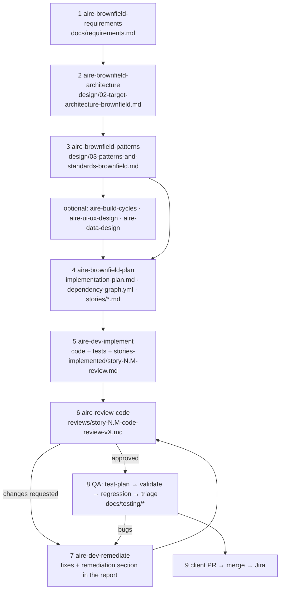

# AIRE Workflow Guide — implementing a story from start to end

**Audience:** engineers, QA and leads using the AIRE workflows on PacEHR work. Companion to [TEAM-WORKFLOW.md](TEAM-WORKFLOW.md) (process, folders, setup).
**Version:** 1.0 (2026-10-19).

> **How this was written and how far to trust it.** Built from the workflow files in `SPEC/workflows/`, the framework's own README (`~/Projects/AIRE-SDLC-Agentic-Framework/README.md`) and the artifacts the team already produced for Epic 02 (`docs/status.md`, `docs/plans/`, `docs/reviews/`, `docs/testing/`). Phases, gates, file names and prompts are quoted from those files. Where a workflow was read at heading level only (QA workflows, most of `aire-review-code`) this guide says what it saw, not how the AI behaves in the middle. Path B's story is **illustrative** — not a real ticket. The first time you run a workflow, note any difference from this guide and fix the guide.

---

## 1. How AIRE works in five lines

1. **Agents** are roles (Architect, Product Owner, Dev, Reviewer, QA…). **Workflows** are step-by-step scripts for one task. **Rulebooks** are the hard rules. You trigger a workflow by typing its name — `aire-dev-implement` — in a **fresh** Claude Code session started in `sai-systems-AIRE`.
2. Every workflow: checks `SPEC/references/` first, reads its agent and rulebook, tells you what it will do, and waits for you to type **`proceed`**. It stops and asks when something is unclear. It never assumes.
3. **Each workflow writes to a fixed place** under `docs/` and updates `docs/status.md`. That chain of files — requirements → architecture → patterns → plan → story → implementation record → review → remediation → QA report — *is* the traceability.
4. Each workflow ends by printing the next command. Follow it, in a **new** session.
5. **Whenever it touches a tracker (Jira) it asks first.** Nothing is pushed to Jira without your yes.

Code is written in the **product repos** (on branch `3p-dev/<JIRA-ID>-…`); everything AIRE writes lands in `sai-systems-AIRE/docs/`.

---

## 2. Which path for which piece of work

| Work | Path | Who runs it | Start with |
|---|---|---|---|
| A sprint's or epic's worth of stories | **A — planned stories** (§4) | Lead / architect runs steps 1–4 once; each engineer runs steps 5–7 for their own stories | `aire-brownfield-requirements` |
| One small change, no sprint planning | **B — enhancement** (§5) | The engineer | `aire-enhancement` |
| A defect reported by QA or a demo | **C — bug** (§6) | QA raises; engineer fixes | `aire-raise-defect` / `aire-qa-triage` |
| A single ticketed bug with no QA report | **C — bug**, no report ceremony | The engineer | TEAM-WORKFLOW §8 |
| Understand the code first | Baseline | Baseline owner | `aire-brownfield-inspect`, `aire-brownfield-deep-dive` (already done for all 13 modules; refresh per release) |
| Requirements changed mid-flight | Drift | Lead | `aire-drift` |

**Prerequisite for A and B:** the baseline exists (`docs/architecture/current/00-…` and the modules). It does — dated 2026-10-19. If the code has moved a lot since, refresh the affected modules first (TEAM-WORKFLOW §11).

---

## 3. Before you start — the same checklist for every path

- [ ] You are in a **fresh** Claude Code session started in `sai-systems-AIRE`, with the product repos added (`claude --add-dir ../PacEHR --add-dir ../pacEHR_API --add-dir ../PacEHR_AI`).
- [ ] `tools/check-workspace.sh` passes.
- [ ] You pulled the latest `sai-systems-AIRE` and your client repo's base branch.
- [ ] The Atlassian MCP is authorised (`/mcp`) if the workflow will read or write Jira.
- [ ] Your Jira stories have **Description, Acceptance Criteria, Out of Scope** — the workflow imports exactly these and will interrupt you with questions for whatever is missing. Template: `~/Projects/AIRE-SDLC-Agentic-Framework/SPEC_cli_node_package/templates/examples/STORY_FORMAT_TEMPLATE.md`.
- [ ] You are on a ticket branch in the shadow repo (`ticket/<JIRA-ID>-<slug>`) when a workflow will edit `docs/`.

---

## 4. Path A — a planned story, start to end

The stages and their outputs:

**Who does what.** Steps 1–4 produce shared planning documents — **one person runs them, once per sprint/epic**, and the result is reviewed and merged to `main` of the shadow repo before engineers start. Steps 5–7 are per story and per engineer: each story has its own story file, implementation record and review files, so people on different stories never touch the same file.

### Step 1 — Requirements: `aire-brownfield-requirements`
- **Reads:** `SPEC/references/`, the baseline docs.
- **It asks:** how to define requirements — **[J]** import from the Jira active sprint, or **[L]** describe locally. For **J** it asks for the Jira project key, fetches the sprint's technical stories, skips non-technical ones, and runs a **completeness check** per story (description, acceptance criteria, out of scope). For each incomplete story it asks only the missing questions, informed by what it saw in the code.
- **You decide:** answer the questions; confirm the roles-and-permissions matrix; approve the document (**A** approved / **B** edit needed).
- **Writes:** `docs/requirements.md` — project overview, current system context, roles & permissions matrix, imported Jira stories, functional requirements, success and failure criteria, scope (in / out / impact), affected modules, existing patterns to follow. Sets "Requirements" ✅ in `docs/status.md`.
- **Watch for:** `docs/requirements.md` is one shared file. Run this step once per planning round, by one person.

### Step 2 — Target architecture: `aire-brownfield-architecture`
- **Needs:** `docs/requirements.md` and the system overview — it stops and tells you to run the earlier workflow if either is missing.
- **Does:** a delta analysis (what changes vs today), then target-state design: components, data-model changes and migration plan, new and modified endpoints, security design, technical decisions.
- **Writes:** `docs/architecture/design/02-target-architecture-brownfield.md` and `docs/architecture-diagrams/02-target-architecture-diagrams-brownfield.md`.
- **You decide:** approve the design. Prefers additive changes over breaking ones.

### Step 3 — Patterns and standards: `aire-brownfield-patterns`
- **Needs:** requirements, overview, **all** deep-dives, and the target architecture.
- **Does:** extracts the patterns the code uses today (with file paths), loads the rulebook's recommended patterns, and shows them **side by side**. **You choose each one explicitly** — the agent never silently adopts a new pattern. Then project structure, coding patterns, test patterns, documentation standards, and the mandatory **file/module boundary map** (which concerns share files such as route registries, DI containers, migrations index).
- **Writes:** `docs/architecture/design/03-patterns-and-standards-brownfield.md` — every pattern marked *Current — kept* or *New adoption*, with DO / DON'T examples.
- **Why it matters:** this is the document the Dev and Reviewer agents measure code against. For PacEHR_AI the standard is the repo's own `CLAUDE.md` (the existing review reports cite it as "ADR-03").

### Optional between 3 and 4
`aire-build-cycles` (split into CYCLE-N, `docs/plans/builds/`), `aire-ui-ux-design` (`docs/ui-ux/ui-ux-spec.md`, used for design tokens in frontend stories), `aire-data-design` (data model, contracts, quality plan — switches to migration mode when `docs/data/current-state.md` exists).

### Step 4 — Plan the stories: `aire-brownfield-plan`
- **First it:** checks prerequisites, reads the existing plan and **asks you to confirm the epic/story numbering** it will use.
- **Jira-sourced requirements:** it creates **one story file per Jira story**, keeping the original title, description, acceptance criteria and out-of-scope unchanged, and adds derived fields (steps, files, patterns, tests, wave, requires/enables). The Jira key is carried in the story header.
- **The multi-developer step — Phase 1.5, mandatory for 2+ stories.** It asks `team_size`, then builds `docs/plans/dependency-graph.yml`:
  - stories are grouped into **waves of independent work** (`requires`: only where one story needs the other's *code* to exist, not just its API shape);
  - it lists every file touched by 2+ stories as **`shared_files`** and makes you confirm that list — files that don't exist yet are created by a single "seed" story in wave 1;
  - it distributes each wave across developers and writes `assignments:` (advisory — developers may swap), flagging any wave that leaves a developer idle. You confirm.
- **Then:** writes `docs/plans/implementation-plan.md` (a lean index only), and each story file **one at a time**, asking you to continue after each.
- **Tracker sync (always asks, even if the MCP isn't configured):** reads the `## Project Tracking` block in `docs/status.md`; if there is none (today there isn't) it asks `Push stories to: Jira / GitHub / Azure DevOps / Skip`. For **Jira** it asks for the project key, **does not duplicate** stories that already exist in Jira, and instead adds labels (`epic-N`, `story-N.M`, `wave-N`, and `dev:N` when a wave is split across 2+ developers), a fixVersion and a planning comment — so the Jira board itself shows who owns what. Local stories (`Jira: LOCAL`) are created in Jira. Whether the workflow also writes the Project Tracking block automatically was not confirmed; add it by hand if later workflows keep asking.
- **Outputs:** `docs/plans/implementation-plan.md`, `docs/plans/dependency-graph.yml`, `docs/plans/stories/epic-N-story-N.M-<slug>.md`.

### Step 5 — Implement: `aire-dev-implement`
This is the step each engineer runs, once per story.

1. **Routing gate (first thing, mandatory).** If the plan has `assignments:`, it asks **both** in one message: *which dev slot are you* and *one-by-one or in one go* (in one go spawns parallel subagents for your slot's independent stories; one-by-one does a single story and stops). Reply like `Dev 2, one-by-one`. If there is no graph it skips to the classic single-story run.
2. **Which story.** It detects the tracker from `docs/status.md` and offers: a local story (`story 1.1`, `next story`), or Jira (`pick from jira`, `jira story PROJ-123`). Choose the story from **your slot**.
3. **Reads** only what that story file names — not the whole `docs/architecture/` tree. The story file is self-contained: a **User Reference** (plain-English summary and acceptance criteria) and an **AI Agent Reference** (the contract: must-read files, technical AC, patterns, steps, tests, out of scope). It implements from the AI Agent Reference.
4. **Builds test-first.** Write failing tests, implement, run them, check coverage ≥85% on changed files, lint clean. A **requirement-coverage gate** blocks completion if an acceptance criterion has no proof.
5. **Tracker.** With Jira it can transition the issue and comment, using fixed status names. Hard rules in the workflow: **confirm first** (nothing runs without your yes in that turn), **verify after** (an update that didn't land is a failure), **stop on failure**, and completion comments carry tests passed/total, coverage %, lint status and the PR URL.
6. **Writes** `docs/stories-implemented/story-N.M-review.md`: what was implemented, files changed, patterns applied, testing summary **with pasted output**, DoD evidence, challenges, deviations from plan, lessons learned.

**Where the code goes:** the product repo, on `3p-dev/<JIRA-ID>-<slug>`, committed `<JIRA-ID> : …`. The AIRE docs go in the shadow repo on your ticket branch. **Never** the other way round (`tools/guard.sh` checks).

> If a story file says **🔴 DO NOT BUILD**, stop. Epic 02's story 2.5 carried exactly that: the spec contradicted itself, and the plan blocked the build until a decision (D11) was made. The workflow's "no assumptions" rule is why that was caught before shipping.

### Step 6 — Review: `aire-review-code`
- **Review-only.** The Reviewer may not edit source, tests or config — only `docs/reviews/` and `docs/status.md`.
- You say what to review (a story). It reads the plan and the pattern documents, checks correctness, pattern adherence, testing, documentation and security, and grades issues: 🔴 Blocker · 🟠 High · 🟡 Medium · 🟢 Low.
- **Writes** `docs/reviews/story-N.M-code-review-vX.md` — version increments on each re-review — with an approval status, and asks before updating the tracker. It has an **anti-loop protection** and ends with a fixed next-step message (it will not offer to edit code itself).
- **Honest note:** the Reviewer *and* the Dev can be the same AI model in the same session — the Epic 02 reports disclose this. Treat the review as a structured checklist, not an independent human opinion; the client PR review is the independent one.

### Step 7 — Remediate: `aire-dev-remediate`
- It **lists the available reports** (code reviews under `docs/reviews/`, QA triage under `docs/testing/`) and asks which one. It then reads the plan, architecture and the story's implementation record, and **confirms which issues will be fixed** (default scope: 🔴 + 🟠, or P0 + P1).
- For each issue: fix test-first, mark ✅ Resolved **inside the source report**, and add a status banner at the top. No separate remediation log is created.
- Deferred issues need your consent and a reason. It asks before touching tracker status.
- **After:** re-request review (`aire-review-code`) if any 🔴 was fixed; re-run QA if any P0/P1 was fixed. Repeat until approved.

### Step 8 — QA
| Workflow | Needs | Writes |
|---|---|---|
| `aire-qa-test-plan` | the plan and stories; you pick scope (`full`, `epic N`, `story N.M`) | `docs/testing/test-plan-<scope>.md` — requirement-to-scenario traceability |
| `aire-qa-validate` | a test plan | `docs/testing/validation-report-<scope>-<date>.md` — test execution, quality gates, functional testing, issues found |
| `aire-qa-regression` | a prior validation report as baseline | `docs/testing/regression-report-<date>.md` — new failures, fixed issues, flaky tests |
| `aire-qa-triage` | a validation or regression report | `docs/testing/bug-triage-<date>.md` — P0–P3 priority, release-blocking assessment, and (asking first) pushes bugs to the tracker |

Triage output feeds Step 7 again.

### Step 9 — The client PR
Follow [context/All/01-git-and-pr-conventions.md](context/All/01-git-and-pr-conventions.md): merge the base branch in, build, push `3p-dev/<JIRA-ID>-…`, PR title `<JIRA-ID> : <Jira title>`, the description with the four ticked checklist lines and no other checkboxes. Put the PR link in your ticket folder's `05-pr.md`. After merge, move Jira on and update context/baseline docs your change made wrong.

### A real run of this chain — Epic 02, story 2.5 (PEA-205)
Taken from `docs/status.md`, `docs/plans/stories/` and `docs/reviews/`. It shows the loop, including the parts that did not go smoothly.

| When | Step | Result |
|---|---|---|
| 2026-10-05 | requirements → architecture → patterns → plan | Epic 02 scoped (PEA-201…207); 7 story files; `dependency-graph.yml` with waves; story 2.5 was **blocked** — spec contradictory (decision D11) |
| 2026-10-06 | `aire-dev-implement` story 2.5 | D11 settled by the owner; built; two spec defects found and **recorded rather than silently fixed** (the spec had no `templetID` column; a stale file number); two extra CHECK constraints added; tests 130 pass |
| 2026-10-06 | `aire-review-code` v1 | **❌ CHANGES REQUESTED** — 0🔴 / 1🟠 / 3🟡 / 1🟢. The 🟠 was the same unchecked-type defect found twice before in stories 2.6 and 2.7 |
| 2026-10-06 | `aire-dev-remediate` | Fixed the 🟠 and the 🟢; **three 🟡 deferred** because each needed a person or a database, not engineering |
| 2026-10-06 | `aire-review-code` v2 | **✅ APPROVED** — and it noted the approval covers the *code*, not the migration, which stays gated |
| 2026-10-06 | `aire-qa-test-plan` → `aire-qa-validate` (epic 2) | 38 scenarios planned; **⚠️ CONDITIONAL PASS** — 13 of 38 executed because 25 integration tests need a database that had no credentials |
| after | `aire-dev-remediate` on the QA report | QA-001…003 fixed; QA-004 (coverage gate cannot be evidenced) raised |

What this teaches: the chain catches real defects (the same unchecked-type bug three times); a review can miss things a later QA pass finds (QA-001: a method with no test that six reviews overlooked); and "tests that never ran" is a finding, not a pass. It also shows where AIRE hands decisions back to a human (D11, D4, D7, B11) instead of guessing.

---

## 5. Path B — a small change with `aire-enhancement`

Use it when the change is small and self-contained, with no sprint planning. **Three halt gates** — nothing is built until you say yes at #2, and nothing is closed until you approve at #3. It uses four agents (Analyst, Architect, Product Owner, Dev) and **you** as the reviewer.

> **Illustrative example — not a real ticket.** Invented to show the shape.

| Phase | What happens | Example |
|---|---|---|
| 0 | Reads the enhancement template; computes the next number `N` from `docs/enhancements/enhancement-*.md` (never reuses one) | → `docs/enhancements/enhancement-1.md` |
| 1A | **Seven questions** at once: title; what must change; current behaviour; desired behaviour; why; 2–4 testable acceptance criteria; out of scope. Optional screenshots into `docs/enhancements/screenshots/` | Title: *Show verified date next to allergy list heading*. Current: heading only. Desired: "Verified 12 Oct 2026" when set. AC: shown when set; hidden when empty; no change to editing. Out of scope: how the date is entered |
| **Gate #1** | It shows the captured file; you type `yes` or ask for changes | `yes` |
| 1B | Reads inputs, screenshots and the baseline | |
| 2 | **Codebase impact scan** by the Architect: affected files, callers, risks | Finds the SPA allergy component, the DTO field, the stored procedure — and a second screen that reuses the component |
| 3–4 | Product Owner authors **sub-story `1.1a`** (self-contained, like a regular story). **Gate #2** — approve the story | `yes` |
| 5 | Asks before pushing the story to Jira | Your call |
| 6 | **Dev implements** test-first, coverage ≥85% on changed files, lint clean — the same process as any story, inside the product repo only | Branch `3p-dev/<JIRA-ID>-…` |
| 7 | **Gate #3** — you review the implementation | `yes` |
| 8 | Close-out: `docs/status.md` updated, tracker issue closed | |

Then do Step 9 (the client PR) as in Path A.

---

## 6. Path C — bugs

| Source | Do |
|---|---|
| Notes from a demo or exploratory test | `aire-raise-defect`. It asks whether the bugs are written down, interviews the tester for what is missing (summary, environment, steps, expected, actual, severity, reproducibility, affected story), consolidates the questions into **one** message, and creates **one Jira issue per bug** — only after the tester approves. It will not merge two failures into one ticket or split one into two. It needs the Atlassian MCP; with none it stops and says so. |
| A QA validation or regression report | `aire-qa-triage` → bug-triage report with P0–P3 → (asks) push to Jira → `aire-dev-remediate` on the triage report → re-validate |
| One Jira bug, no QA report | TEAM-WORKFLOW §8: reproduce first, root cause, failing test, minimal fix, evidence, PR |

For the fix itself: **reproduce on the base branch first**, write the failing test, fix minimally, and never rename or reformat SQL in a bug PR.

---

## 7. Several people, several stories — how AIRE supports it, and where it doesn't

**What AIRE already does for you**
- **Waves and slots.** `dependency-graph.yml` gives each developer a slot of independent stories per wave, so two people are not given stories that need each other's unfinished code.
- **Shared files are surfaced up front.** `shared_files` lists anything two stories touch (route registries, DI registration, migration indexes, `package.json`, lockfiles) so conflicts are planned, not discovered at merge.
- **Per-story files.** Each story has its own plan file, implementation record and review files — people on different stories never edit the same one.
- **Resume-friendly.** The next day, run `aire-dev-implement` again; check `docs/status.md` and `docs/stories-implemented/` for where you stopped.

**Where you have to add discipline** (full rules in TEAM-WORKFLOW §10)
- `docs/requirements.md`, `docs/plans/implementation-plan.md` and `dependency-graph.yml` are **single shared files**. One person runs steps 1–4 per planning round, merged before others start.
- `docs/status.md` is written by every workflow, by design — and is the file most likely to collide. It is `merge=union` (appends instead of conflicting), which can **duplicate** rows. Revert unintended edits to it before opening a shadow-repo PR; `aire-pr-generator` Phase 2 repairs duplication.
- Only the plan's author adds `assignments:`; developers may swap stories, but say so in the PR.
- If two stories end up needing the same file or stored procedure, agree the order in both ticket folders and merge the first before the second branches.

---

## 8. Working habits that make the workflows behave

- **One workflow per session.** Each reloads its own context; chaining several in one chat blurs them.
- **Type the exact trigger** (`aire-dev-implement`), then answer the gate questions precisely — `yes`, `proceed`, `A`, `Dev 2, one-by-one`.
- **Answer, don't wave through.** Gates exist so a human decides: numbering, shared files, pattern choices, scope of a remediation, tracker pushes.
- **Never skip the routing gate** in `aire-dev-implement`.
- **Don't ask the Reviewer to fix code** — it is review-only by design; use `aire-dev-remediate`.
- **Demand pasted output.** Implementation records and reports must contain real test output; "tests pass" alone is not evidence.
- **If a story says DO NOT BUILD or has an open decision, stop** and escalate.
- **Parallel mode costs tokens.** "In one go" spawns subagents; use it for a slot of truly independent stories, not by default.
- **Keep secrets and patient data out** of requirements, stories, tickets and prompts. AIRE writes what you tell it into files that are shared.

---

## 9. Prompts at a glance

| Goal | Type |
|---|---|
| Start planning a sprint | `aire-brownfield-requirements` → `J` → project key |
| Design the delta | `aire-brownfield-architecture` → `proceed` |
| Settle patterns | `aire-brownfield-patterns` → `proceed` |
| Cut stories and slots | `aire-brownfield-plan` |
| Build my story | `aire-dev-implement` → `Dev 1, one-by-one` → `jira story <KEY>` |
| Review it | `aire-review-code` → `story N.M` |
| Fix the findings | `aire-dev-remediate` → pick the report |
| Plan and run QA | `aire-qa-test-plan` → `aire-qa-validate` → `aire-qa-triage` |
| A small change | `aire-enhancement` |
| Log bugs | `aire-raise-defect` |
| Requirements moved | `aire-drift` |
| Refresh the baseline | `aire-brownfield-inspect`, `aire-brownfield-deep-dive` |

---

## 10. Not verified here

- The QA workflows and `aire-review-code` were read at heading and template level; the exact prompts mid-run were not exercised for this guide.
- `aire-build-cycles`, `aire-ui-ux-design` and `aire-data-design` are described from the framework README and their position in the chain; no PacEHR run was inspected.
- Jira pushes need the Atlassian MCP authorised by each user; the Jira site and project keys for this engagement are still to be recorded (TEAM-WORKFLOW §14).
- Where the framework refers to `docs/stories-implemented/`, that folder does not exist in this repo yet — Epic 02's implementation evidence is recorded in `docs/status.md` and the review reports. It will be created by the first `aire-dev-implement` run.
