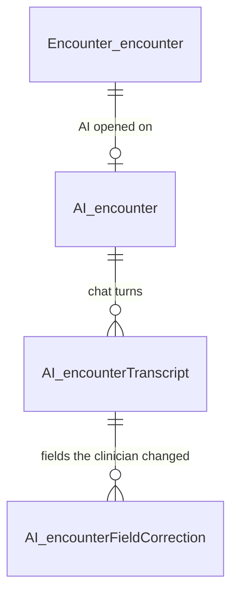

# AI Encounter Schema — Design

**Date:** 2026-10-07 · **Owner:** Akash Saxena · **Status:** draft for review
**Supersedes:** `2026-10-06-ai-data-schema-design.md` (11 objects reduced to 3 tables)

---

## 1. Summary

Three tables in the `AI` schema, one per step of the clinician's flow.

| Table | One row is | Serves |
|---|---|---|
| `AI.encounter` | one encounter where the clinician opened AI | the conversation (conversation id = `encounterID`); running token and cost totals |
| `AI.encounterTranscript` | one chat turn: the clinician's text and the AI's JSON reply | chat history for follow-ups; audit of every AI call, failures included; tokens, cost, model and latency per turn |
| `AI.encounterFieldCorrection` | one AI-filled field the clinician changed | strict accuracy: value wrong, unit wrong, or both |

Current field values are not stored here. They stay where they already live: the encounter form (`Encounter.encounterData`).

---

## 2. Clinician flow

| # | Clinician | System | Writes |
|---|---|---|---|
| 1 | Clicks **AI Encounter** | API opens the SSE/WebSocket connection | `AI.encounter`: insert, or reuse the row if AI was opened before |
| 2 | Sends text | Agent runs with the earlier turns as chat history | `AI.encounterTranscript`: one insert when the turn ends, with the reply or the reason it failed. Its tokens and cost are added to `AI.encounter` in the same transaction |
| 3 | Sees fields filled | Form shows each value with its unit | — |
| 4 | Changes a field the AI filled | Form sends the AI's value and the clinician's value | `AI.encounterFieldCorrection`: upsert; deleted if changed back |
| 5 | Sends more text | Same as step 2; fields the clinician typed or corrected are never replaced | `AI.encounterTranscript` |



---

## 3. Principles

- **Stored as presented.** The clinician's text and the AI's reply are stored exactly as sent and received. The correction stores the value the clinician saw next to the value they saved.
- **No junk rows.** A correct field has no row. A failed turn has no reply. A correction where nothing changed is refused by the database.
- **No copies of existing data.** Patient, account, provider, date of service and signed state come from `Encounter.encounter` through `encounterID`. There is one deliberate exception: the encounter's token and cost totals. They are the sum of its turns, written by the same procedure in the same transaction (rule 4).
- **Approved types** (CRUD doc §4.4): `INT`, `VARCHAR`, `DATETIME2`, and computed `BIT`. Money is `DECIMAL(12,6)` in USD, which needs approval (O8).
- **Cost is a snapshot.** Each turn stores what it cost at that day's price. Prices change, so cost is never recomputed from tokens later.
- **UTF-8 for free text.** `VARCHAR(MAX)` with `Latin1_General_100_CI_AS_SC_UTF8`, because the database default (`SQL_Latin1_General_CP1_CI_AS`) loses characters outside Western European text.

---

## 4. Tables

### 4.1 `AI.encounter`: the conversation

Ties the conversation to a real encounter and records the template the AI fills. Without it, turns have no owner. It also shows what the encounter's AI use cost, without summing every turn.

```sql
-- Need to remove and refer from Encounter.Encounter table -- addd new column in Encouter table for AI Engine reference

CREATE TABLE AI.encounter (                                                        -- the AI conversation of one encounter
  encounterID      INT           NOT NULL,                                         -- Encounter.encounter.encounterID = the conversation id
  templetID        INT           NOT NULL,                                         -- template the AI fills; updated if the clinician switches template (see O2)
  inputTokens      INT           NOT NULL DEFAULT 0,                               -- total tokens sent, all turns (failed ones included: they were billed)
  outputTokens     INT           NOT NULL DEFAULT 0,                               -- total tokens returned, all turns
  inputCostUsd     DECIMAL(12,6) NOT NULL DEFAULT 0,                               -- total input cost in USD = SUM of the turns' inputCostUsd
  outputCostUsd    DECIMAL(12,6) NOT NULL DEFAULT 0,                               -- total output cost in USD = SUM of the turns' outputCostUsd
  createdByUserID  INT           NOT NULL,                                         -- clinician who first opened AI on this encounter
  createdUtc       DATETIME2(3)  NOT NULL DEFAULT SYSUTCDATETIME(),                -- when AI was first opened
  CONSTRAINT PK_aiEncounter PRIMARY KEY (encounterID),                             -- one conversation per encounter, reused on reopen
  CONSTRAINT FK_aiEncounter_encounter FOREIGN KEY (encounterID) REFERENCES Encounter.encounter (encounterID)  -- no AI row without a real encounter
);
```

### 4.2 `AI.encounterTranscript`: the chat turns

Holds what the clinician asked and what the AI answered, in one row per turn. It does three jobs:

- It is the chat history sent on every follow-up.
- It is the audit of every AI call, including blocked and failed ones.
- It is the only place that records tokens, cost, model and latency, since the new agent no longer writes `Log.AILogs`.

```sql
CREATE TABLE AI.encounterTranscript (                                              -- one chat turn: what the clinician sent + what the AI returned
  transcriptID     INT IDENTITY  NOT NULL,                                         -- turn id; ascending = conversation order
  encounterID      INT           NOT NULL,                                         -- the conversation this turn belongs to
  clinicianQuery   VARCHAR(MAX)  COLLATE Latin1_General_100_CI_AS_SC_UTF8 NOT NULL,  -- text exactly as the clinician sent it
  aiResponse       VARCHAR(MAX)  COLLATE Latin1_General_100_CI_AS_SC_UTF8 NULL,  -- structured-output JSON exactly as returned (§5); NULL when the turn failed
  reasonCode       VARCHAR(40)   NULL,                                             -- why there is no reply; the agent's REASON_CODES, e.g. INJECTION_BLOCKED, PAYLOAD_TOO_LARGE, MODEL_CALL_FAILED, OUTPUT_SCHEMA_VIOLATION
  promptId         INT           NULL,                                             -- AI.prompt row used; NULL if blocked before the prompt loaded
  modelName        VARCHAR(50)   NULL,                                             -- model version the provider reports, e.g. gpt-4.1-2025-04-14; NULL if the model was never called
  inputTokens      INT           NULL,                                             -- tokens sent, summed over every model call in the turn (cached tokens included); NULL if never called
  outputTokens     INT           NULL,                                             -- tokens returned, summed over every model call in the turn; NULL if never called
  inputCostUsd     DECIMAL(12,6) NULL,                                             -- input cost at that day's price, cached tokens at the cached price; NULL if never called
  outputCostUsd    DECIMAL(12,6) NULL,                                             -- output cost at that day's price; NULL if never called
  latencyMs        INT           NOT NULL,                                         -- how long the clinician waited: request received → reply or refusal sent
  createdByUserID  INT           NOT NULL,                                         -- clinician who sent it
  createdUtc       DATETIME2(3)  NOT NULL DEFAULT SYSUTCDATETIME(),                -- when the turn finished
  CONSTRAINT PK_encounterTranscript PRIMARY KEY (transcriptID),                    -- clustered on time order
  CONSTRAINT FK_encounterTranscript_encounter FOREIGN KEY (encounterID) REFERENCES AI.encounter (encounterID),  -- every turn belongs to a conversation
  CONSTRAINT CK_encounterTranscript_result CHECK ((aiResponse IS NOT NULL AND reasonCode IS NULL) OR (aiResponse IS NULL AND reasonCode IS NOT NULL)),  -- a reply or a reason, never both or neither
  CONSTRAINT CK_encounterTranscript_json CHECK (ISJSON(aiResponse) = 1),           -- the reply is valid JSON
  CONSTRAINT CK_encounterTranscript_usage CHECK ((modelName IS NULL AND inputTokens IS NULL AND outputTokens IS NULL AND inputCostUsd IS NULL AND outputCostUsd IS NULL) OR (modelName IS NOT NULL AND inputTokens IS NOT NULL AND outputTokens IS NOT NULL AND inputCostUsd IS NOT NULL AND outputCostUsd IS NOT NULL)),  -- the model was called (all five set) or not (none set)
  CONSTRAINT CK_encounterTranscript_replyUsage CHECK (aiResponse IS NULL OR modelName IS NOT NULL)  -- a reply always carries its usage
);
CREATE INDEX IX_encounterTranscript_encounter ON AI.encounterTranscript (encounterID);  -- loads one conversation's history in order
EXEC sp_tableoption 'AI.encounterTranscript', 'large value types out of row', 1;  -- query and reply text off-row, so cost and history scans read narrow rows
```

### 4.3 `AI.encounterFieldCorrection`: what the clinician changed

Records each field the clinician changed after the AI filled it, with a strict verdict:

- **Value:** right or wrong.
- **Unit:** right or wrong.

This table is the AI's accuracy measure. A field with no row was accepted as the AI filled it.

```sql
CREATE TABLE AI.encounterFieldCorrection (                                         -- one AI-filled field the clinician changed
  transcriptID      INT          NOT NULL,                                         -- the turn whose value was on screen when it was changed
  sectionID         INT          NOT NULL,                                         -- Template.section.sectionID
  fieldID           INT          NOT NULL,                                         -- Template.fields.fieldID
  aiValue           VARCHAR(MAX) COLLATE Latin1_General_100_CI_AS_SC_UTF8 NOT NULL,-- value the AI filled, as the clinician saw it
  aiUnit            VARCHAR(20)  NULL,                                             -- unit the AI filled; NULL for unitless fields
  finalValue        VARCHAR(MAX) COLLATE Latin1_General_100_CI_AS_SC_UTF8 NULL,    -- value the clinician saved; NULL = cleared (the AI should not have filled it)
  finalUnit         VARCHAR(20)  NULL,                                             -- unit the clinician saved
  isValueCorrect    AS CAST(CASE WHEN finalValue = aiValue THEN 1 ELSE 0 END AS BIT),                      -- computed: 1 = value right
  isUnitCorrect     AS CAST(CASE WHEN ISNULL(finalUnit, '') = ISNULL(aiUnit, '') THEN 1 ELSE 0 END AS BIT), -- computed: 1 = unit right
  reference varchar(max),
  isReferenceDeleted bit default (false),
  correctedByUserID INT          NOT NULL,                                         -- clinician who changed it
  correctedUtc      DATETIME2(3) NOT NULL DEFAULT SYSUTCDATETIME(),                -- when it was last changed
  CONSTRAINT PK_encounterFieldCorrection PRIMARY KEY (transcriptID, sectionID, fieldID),  -- one verdict per field; a re-edit updates it
  CONSTRAINT FK_encounterFieldCorrection_transcript FOREIGN KEY (transcriptID) REFERENCES AI.encounterTranscript (transcriptID),  -- tied to the turn it corrects
  CONSTRAINT CK_encounterFieldCorrection_changed CHECK (finalValue IS NULL OR finalValue <> aiValue OR ISNULL(finalUnit, '') <> ISNULL(aiUnit, '')),  -- refused unless something changed
  CONSTRAINT CK_encounterFieldCorrection_cleared CHECK (finalValue IS NOT NULL OR finalUnit IS NULL)  -- a cleared field has no unit
);
```

**The verdict is strict:**

| AI filled | Clinician saved | `isValueCorrect` | `isUnitCorrect` |
|---|---|---|---|
| `820` kg | `82` kg | 0 | 1 |
| `82` lbs | `82` kg | 1 | 0 |
| `82` lbs | `180` kg | 0 | 0 |
| `Full Code` | *(cleared)* | 0 | 1 (unitless) |
| `82` kg | `82.0` kg | 0 | 1 |

- Comparison is exact, except that it ignores case and trailing spaces (the column collation). No partial credit.
- The flags are computed from the stored values, so they cannot disagree with them.
- `aiValue` is the one deliberate copy from `aiResponse`. It records what the clinician saw, and the flags are computed from it.

---

## 5. AI response contract

The reply is stored exactly as the structured output returns it. This design relies on only one part of it:

```json
{ "fields": [ { "sectionID": 2, "fieldID": 26, "value": "82", "unit": "kg" },
              { "sectionID": 2, "fieldID": 1, "value": "Full Code" } ] }
```

| Rule | Why |
|---|---|
| `fields[]` holds only the fields the AI filled | No junk; the edit-rate denominator counts filled fields |
| `value` and `unit` are separate; `unit` is omitted for unitless fields | The unit verdict needs them apart. Templates have no unit column: 2,839 of 3,105 fields are free `text`, such as "Weight" or "Length in cm" |
| The schema is built from the encounter's current template | The AI cannot return a field from another template, even after a template switch |

---

## 6. API rules

1. **Open.** Insert `AI.encounter`. If the row exists, reuse it, and update `templetID` if the template changed.
2. **Signed encounters.** Refuse a turn when `Encounter.encounter.encounterSignedDate` is set. No AI column is needed for this.
3. **History.** Send the earlier turns with a reply, oldest first, as user/assistant messages. Failed turns are not sent.
4. **One write per turn.** After the reply or the failure, `usp_addAIEncounterTranscript` inserts the turn and adds its tokens and cost to the `AI.encounter` totals, in one transaction. No other code changes the totals. Disable Send while a turn runs.
5. **Never overwrite the clinician.** A new turn fills a field only if it is empty or still holds the AI's own value. Values the clinician typed or corrected are skipped.
6. **Correction.** When the clinician changes an AI-filled field, upsert the row against the turn whose value was on screen. Changing it back to the AI's value deletes the row. This is the schema's only hard delete: a reverted edit is not a correction.
7. **Stored procedures** (CRUD doc §2):
   - `usp_addEditAIEncounter` writes the conversation.
   - `usp_addAIEncounterTranscript` writes a turn.
   - `usp_addEditAIEncounterFieldCorrection` writes a correction and deletes it when the field is reverted.
8. **Tokens and cost.**
   - They are recorded whenever the model was called, even when the turn then failed (a content filter or a schema violation), because Azure bills those calls.
   - A turn that calls the model more than once (tool calls) records the sum of all its calls.
   - `inputCostUsd` = (input − cached) × input price + cached × cached-input price, and `outputCostUsd` = output × output price. The cached count is LangChain's `usage_metadata.input_token_details.cache_read`.
   - Prices are per 1M tokens and come from configuration for each deployment, never from code. Today, gpt-4.1 Global is $2.00 input, $0.50 cached input and $8.00 output; Data Zone is 10% higher.
   - Each turn's cost is rounded to 6 decimals. The totals are sums of the rounded turns, so they match exactly. Pass cost to the driver as `sql.Decimal(12, 6)`.

Rule 5 means each field gets at most one correction per encounter.

---

## 7. Queries

```sql
-- Chat history for the next turn
SELECT clinicianQuery, aiResponse FROM AI.encounterTranscript
WHERE encounterID = @encounterID AND aiResponse IS NOT NULL ORDER BY transcriptID;

-- Edit rate per field: of the signed encounters where the AI filled the field, how often the clinician changed it (needs compatibility level >= 130)
-- Signed only: on an unsigned encounter "no correction" may mean "not reviewed yet", not "accepted"
WITH filled AS (
  SELECT DISTINCT t.encounterID, f.sectionID, f.fieldID
  FROM AI.encounterTranscript t
  JOIN Encounter.encounter e ON e.encounterID = t.encounterID AND e.encounterSignedDate IS NOT NULL
  CROSS APPLY OPENJSON(t.aiResponse, '$.fields') WITH (sectionID INT, fieldID INT) f)
SELECT f.fieldID,
       COUNT(*)                                                AS filled,
       COUNT(c.isValueCorrect)                                 AS corrected,
       SUM(CASE WHEN c.isValueCorrect = 0 THEN 1 ELSE 0 END)   AS valueWrong,
       SUM(CASE WHEN c.isUnitCorrect  = 0 THEN 1 ELSE 0 END)   AS unitWrong
FROM filled f
OUTER APPLY (SELECT c.isValueCorrect, c.isUnitCorrect
             FROM AI.encounterFieldCorrection c JOIN AI.encounterTranscript ct ON ct.transcriptID = c.transcriptID
             WHERE ct.encounterID = f.encounterID AND c.sectionID = f.sectionID AND c.fieldID = f.fieldID) c
GROUP BY f.fieldID;

-- AI spend per month and model
SELECT DATEFROMPARTS(YEAR(createdUtc), MONTH(createdUtc), 1) AS month, modelName, COUNT(*) AS turns,
       SUM(inputTokens) AS inputTokens, SUM(outputTokens) AS outputTokens, SUM(inputCostUsd + outputCostUsd) AS costUsd
FROM AI.encounterTranscript WHERE modelName IS NOT NULL
GROUP BY DATEFROMPARTS(YEAR(createdUtc), MONTH(createdUtc), 1), modelName;

-- Totals check: returns no rows when every encounter's totals equal the sum of its turns
SELECT e.encounterID
FROM AI.encounter e
OUTER APPLY (SELECT ISNULL(SUM(inputTokens), 0) AS i, ISNULL(SUM(outputTokens), 0) AS o,
                    ISNULL(SUM(inputCostUsd), 0) AS ic, ISNULL(SUM(outputCostUsd), 0) AS oc
             FROM AI.encounterTranscript t WHERE t.encounterID = e.encounterID) s
WHERE e.inputTokens <> s.i OR e.outputTokens <> s.o OR e.inputCostUsd <> s.ic OR e.outputCostUsd <> s.oc;
```

---

## 8. Storage

These are assumptions, not measurements: 365k AI encounters a year, 2.5 turns each, and 3 corrections per encounter.

| Table | Rows / year | Size / year |
|---|---|---|
| `AI.encounter` | 365k | ~15 MB |
| `AI.encounterTranscript` | ~0.9M at ~7 KB (3 KB query + 4 KB reply) | ~6.4 GB |
| `AI.encounterFieldCorrection` | ~1.1M at ~150 B | ~0.2 GB |

That comes to about 6.6 GB a year, or roughly $0.76/month at $0.115/GB-month (East US 2).

**Model spend dwarfs storage.** Assume ~4,000 input and ~600 output tokens a turn on gpt-4.1 Global, with no caching. That is ~$0.013 a turn, or ~$11.7k a year (~$970/month) for 0.9M turns. The cost columns replace this estimate with real numbers from the first day.

---

## 9. Removed from the previous design

| Removed | Why it can go | Add back when |
|---|---|---|
| `extractionSession` epoch, `closedUtc`, status | A template switch updates `templetID`, and old turns stay readable because `fieldID`s are global. Signed state lives on `Encounter.encounter` | Restart-from-scratch becomes a feature |
| Separate `transcript` and `agentRun` | One turn is one row | — |
| `fieldState`, protection, merge actions, trigger, `reviewStatus`, `openDecisions`, `reviewedJson` | The form holds current values. Rule 5 replaces protection, and corrections replace review | Conflicts must be shown as review cards instead of being skipped |
| `requestID`, prompt hashes, evidence offsets | Send is disabled during a turn. The reply JSON keeps whatever evidence the model returns | Duplicate turns are seen, or prompt versions are compared (O4) |
| `fieldConstraint` | Epic 6 | Epic 6 validators are built |
| `evalSet`, `evalExample`, `evalRun`, `evalResult`, `fieldOutcome` view | Corrections are the production accuracy signal | Prompt versions are compared on a gold set |

---

## 10. Open items

| # | Item | Owner |
|---|---|---|
| O1 | The Epic 3 output schema must return `value` and `unit` separately, and the form must edit them separately | AI + UI |
| O2 | `Encounter.encounter.templeteId` already holds the template, so `AI.encounter.templetID` copies it. Keep it, or read it from there? Either way, after a template switch the earlier turns don't record which template they filled | Owner |
| O3 | Who writes corrections: the AI service through a resolve call, or the .NET API on form save | API |
| O4 | `AI.prompt` is edited in place, so `promptId` alone can't tell which wording ran. Add a text hash before comparing prompts | AI |
| O5 | A field the AI left empty and the clinician typed is not recorded: "AI missed it" can't be told apart from "clinician added new information" | Owner |
| O6 | Retention period for transcripts (they contain PHI). The foreign keys mean that purging an encounter must delete its AI rows first | Compliance |
| O7 | Apply to the dev DB; the firewall currently blocks this machine | Infra |
| O8 | `DECIMAL(12,6)` for cost needs DBA approval (CRUD doc §4.4). The fallback is `INT` micro-dollars (1 = $0.000001; one gpt-4.1 input token = 2) | DBA |
| O9 | Where model prices are configured, per deployment, and who updates them when Azure changes prices | Infra + AI |