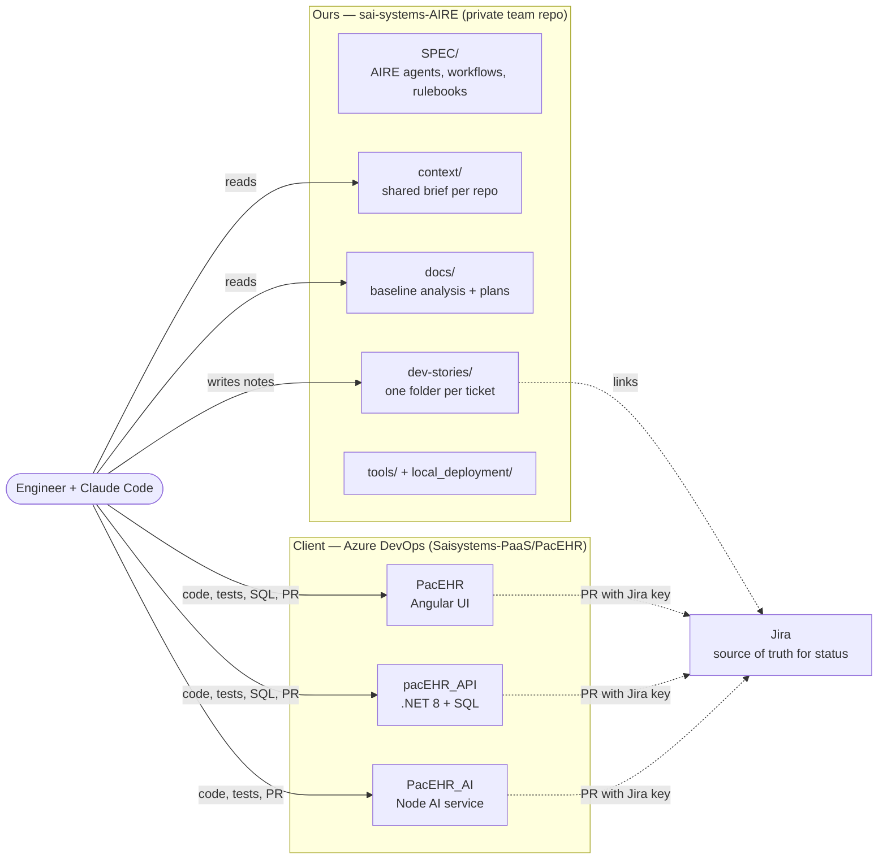

# Team Workflow — working on PacEHR together, with AI, from one shared context

**Audience:** every engineer, QA and lead on the PacEHR / pacEHR_API / PacEHR_AI work.
**Version:** 1.0 (2026-10-19). **Status:** draft for the team to adopt — §14 lists decisions the lead must still make.
**How to read it:** §1 is the whole process on one page. For running the AIRE workflows on a story, with a worked example, read [AIRE-WORKFLOW-GUIDE.md](AIRE-WORKFLOW-GUIDE.md). §3 gets your machine ready. §7 and §8 are what you follow for a ticket or a bug. The rest explains why, and the edge cases.

> Confidence note. Everything about folders, scripts, branch/PR rules and the codebase was checked against the files on disk on 2026-10-19. The collaboration model (§6, §10, §11) is a recommendation built on how the AIRE framework and the client repos behave; it has not yet been tried by a team. Where something could not be verified it says so.

---

## 1. The process on one page

1. **Two kinds of repository.** The three product repos (`PacEHR`, `pacEHR_API`, `PacEHR_AI`) belong to the client on Azure DevOps — only code, tests, SQL and PRs go there. `sai-systems-AIRE` is **ours**: the AI framework, the analysis of the system, the shared context, and the working notes for every ticket. Nothing from it is ever committed to a client repo.
2. **Same context for everyone.** Before touching a ticket, read `context/` (the brief) and the module(s) in `docs/architecture/current/` that your ticket touches. AI sessions are told to do the same (`.claude/CLAUDE.md`).
3. **One ticket = one folder = one branch per repo = one PR per repo.** Your working notes live in `dev-stories/Work-In-Progress/<Epic>/<JIRA-ID>-<slug>/`. People on different tickets never edit the same files.
4. **Jira is the source of truth for status.** `docs/status.md` is the project milestone log, not a ticket tracker.
5. **Start** = ticket assigned, you have read the context, you have written down what you will do and had it agreed. **End** = the client PR is merged, Jira is transitioned, your ticket folder is in `Done/`, and any context/baseline doc your change made wrong is corrected.
6. **Evidence, not claims.** "Done" means pasted test output, a regression comparison against the base branch, and every acceptance criterion mapped to proof.
7. **Ask, don't assume.** If the ticket, the code and the docs disagree, stop and ask. Never invent a Jira id, a schema, or a requirement.
8. **Never put secrets or patient data anywhere** — tickets, docs, PRs, chats, AI prompts.

---

## 2. The big picture



**Why a separate repo?** The client repos are not ours to fill with framework files (`SPEC/`, agent definitions, analysis docs), and the framework's own installer edits tracked files such as `.gitignore`. Keeping our material in `sai-systems-AIRE` makes leaking it into a client repo structurally unlikely, and `tools/guard.sh` checks it.

**Why a shared repo and not each person's laptop?** Without it, each person's AI sessions work from different pictures of the system, and each person's analysis is lost. The shared repo is what makes "same context" possible.

---

## 3. Set up your machine (once, about 30 minutes)

### 3.1 Required layout
The folder that holds `sai-systems-AIRE` is your **workspace**. The repos must be its siblings, with these exact folder names (they are case-sensitive on Linux and in CI):

```
<workspace>/
├── PacEHR/              client repo — Angular UI
├── pacEHR_API/          client repo — .NET API + SQL
├── PacEHR_AI/           client repo — Node AI service
└── sai-systems-AIRE/    this repo
```

> Today's reality on the lead's machine: the workspace is `…/SaiSystems/Code/`, and an older `/Code/aire/` folder and `/Code/PacEHR.code-workspace` still exist outside any repo. They are superseded by `tools/` and `AIRE.code-workspace` in this repo.

### 3.2 Steps
1. Get access: client Azure DevOps (`Saisystems-PaaS/PacEHR`, the three repos), this repo (§14 decides where it lives), Jira, and the 3Pillar framework repo `3PillarGlobal/AIRE-SDLC-Agentic-Framework` (for the CLI).
2. Clone the three client repos and this repo into the layout above. Check out each client repo's **base branch** (`PacEHR-DevelopUI-Main`, `PacEHR-DevelopAPI-Main`, `PacEHR-AI-Develop-Main`).
3. Install tooling: Node 22 and npm, the .NET 8 SDK (needed to build/test the API; not required to read it), Podman Desktop (only for `local_deployment/`), `gh` (GitHub CLI), Claude Code.
4. Install the `aire` CLI: `tools/install-aire-cli.sh`. It needs `gh auth login` first. **Do not run `aire init` or `aire update`** — this repo is already initialised, and they rewrite `.gitignore` and the framework folders. Only the team lead does that, deliberately.
5. Authorise the MCP servers once: open Claude Code in this repo and run `/mcp`. `helix` (the 3Pillar code-graph) needs an interactive OAuth approval; the Atlassian connector gives Jira access. `.mcp.json` is shared; your tokens are not.
6. PacEHR_AI only: `cd PacEHR_AI && npm ci && npm run hooks:install` (installs the pre-push hook), and create your own `.env.local` from `.env.example` (never commit it).
7. Run `sai-systems-AIRE/tools/check-workspace.sh`. Fix every `FIX` line it prints.
8. Open the work: `code sai-systems-AIRE/AIRE.code-workspace` (all four folders in VS Code), and start Claude Code **in `sai-systems-AIRE`** so it picks up `.claude/CLAUDE.md`, giving it the product repos with `claude --add-dir ../PacEHR --add-dir ../pacEHR_API --add-dir ../PacEHR_AI`.

### 3.3 The guard — run before every client push
`sai-systems-AIRE/tools/guard.sh` fails if any framework file (`SPEC/`, `docs/…`, `.claude/…`, `dev-stories/`, `context/`, `.mcp.json`) has appeared in a client repo's working tree. It does not fix anything except a modified `.gitignore` (`--fix`). It also warns if you changed a client repo's own tracked AI file (`CLAUDE.md`).

---

## 4. Folder structure and what each part means

```
sai-systems-AIRE/
├── TEAM-WORKFLOW.md            ← this document
├── README.md                   short pointer to this document
├── AIRE.code-workspace         VS Code multi-root workspace (this repo + the three product repos)
├── .claude/
│   ├── CLAUDE.md               instructions every Claude Code session loads (AIRE workflow table, core rules)
│   ├── agents/  skills/        secure-code-reviewer agent; code-quality and software-security skills (installed by aire init)
│   └── settings.local.json     per-person, git-ignored
├── .mcp.json                   MCP servers (Helix, Atlassian). No secrets
├── .gitattributes              docs/status.md merge=union (parallel edits append instead of conflicting)
├── .gitignore                  ignores per-person files and local_deployment/config.local.env
├── SPEC/                       the AIRE framework — treat as read-only
│   ├── workflows/              the aire-* commands (32)
│   ├── agents/                 role definitions (Architect, Dev, QA, Reviewer, Product Owner…)
│   ├── rulebooks/              hard rules per workflow family
│   ├── templates/              status.md format, enhancement template…
│   └── references/             client-supplied documents to be followed exactly (currently empty)
├── context/                    the shared brief — see §5
│   ├── All/                    cross-repo facts, Jira keys, git and PR conventions
│   ├── PacEHR/  pacEHR_API/  PacEHR_AI/     one project-context.md each
├── docs/                       generated analysis and plans — the shared baseline (mostly read)
│   ├── architecture/current/   00 overview + 13 module deep-dives: how the code works TODAY
│   ├── architecture/design/    target architecture + patterns/standards for new work
│   ├── architecture-diagrams/  every Mermaid diagram on its own for easy preview
│   ├── requirements.md  plans/  reviews/  testing/  bugs.md  enhancements/
│   ├── status.md               project milestone log (see §10)
│   └── user-custom/            hand-written design notes
├── dev-stories/                one folder per ticket — see dev-stories/README.md
│   ├── _templates/ticket/      the 6-file ticket template
│   ├── Work-In-Progress/<Epic>/<JIRA-ID>-<slug>/
│   ├── Done/                   finished tickets
│   └── Tickets-Original-JS|Python/   read-only reference spec sets for PacEHR_AI
├── local_deployment/           run UI + API + AI as containers on Podman (§15)
└── tools/
    ├── check-workspace.sh      verify your machine matches the layout
    ├── guard.sh                no framework file in a client repo
    └── install-aire-cli.sh     install/update the aire CLI
```

**Ownership in one line:** `SPEC/` → lead only. `context/` and `docs/architecture/` → everyone fixes what they find wrong, via PR. `docs/status.md` → release owner. `dev-stories/<your ticket>` → you.

---

## 5. Context — how to set it, per project

**What context is.** The facts a newcomer — or an AI session with no memory — needs before changing anything: what the repo is, how to build and test it, which rules are broken most, which traps exist. The client READMEs are still unedited templates, so this is the only onboarding material.

**What exists.** `context/All/` (systems map, Jira keys, environments, PHI rule, glossary, git/PR conventions) and one `project-context.md` per repo. Each carries a `Last verified` line with a date and commit.

**How it is used**
- **Humans:** read `All/` once, then the file for each repo your ticket touches, then the module(s) it names in `docs/architecture/current/`.
- **AI sessions:** `.claude/CLAUDE.md` tells the session to read `context/` first. Start a session with: *"Ticket `<JIRA-ID>`. Read context/All, context/<repo>, and the architecture modules listed in my ticket folder, then summarise your understanding before changing anything."* Reviewing that summary takes two minutes and catches wrong assumptions before they become code.

**Setting up context for a new project or repo** (e.g. a fourth repo)
1. Create `context/<repo>/project-context.md` from the three existing ones. Required sections: what it is + base branch; commands (build, run, test); what "green" means today; where code lives; rules people break; known traps with dates.
2. Write only what you have verified. Mark the rest `unverified`. Name settings, never values.
3. Run the repo's own build and tests and paste the real result into the "green" section, including pre-existing failures.
4. Point to deep-dive modules; do not copy them. If you need depth that does not exist, run `aire-brownfield-deep-dive` on that module.
5. Add the repo to `tools/guard.sh`, `tools/check-workspace.sh`, `AIRE.code-workspace` and `local_deployment/` if it should run locally.

**Keeping it true.** A wrong context file does more damage than a missing one, because people trust it. Fix it in the same PR as your ticket. Refresh everything at each release (§11). If two files disagree, the code wins and both files get fixed.

---

## 6. The lifecycle at a glance

| Layer | What | Who | When |
|---|---|---|---|
| **Baseline** | `docs/architecture/current/*`, `context/*` — how the system works today, pinned to commit SHAs | Baseline owner (rotating) | Initially; refreshed each release (§11) |
| **Design** | `docs/architecture/design/*`, `docs/requirements.md`, `docs/plans/*` — target state and standards | Lead / architect, via PR | When an epic starts |
| **Ticket** | `dev-stories/Work-In-Progress/<Epic>/<JIRA-ID>-<slug>/` — analysis, plan, change log, evidence, PR | The engineer | Every ticket (§7, §8) |
| **Code** | Product repos — branch, commits, PR, review, merge | The engineer + client reviewers | Every ticket |
| **Tracker** | Jira — status, assignee, fix version, links | Everyone | Continuously |

Reading order for a new person: this document → `context/All` → the repo's context → the overview (`docs/architecture/current/00-system-overview.md`) → the modules for your ticket.

---

## 7. Feature / story ticket — from start to end

**Start: you have a Jira ticket assigned to you. End: its PR is merged.**

| # | Step | Output | Gate to pass |
|---|---|---|---|
| 1 | **Claim.** Assign the Jira ticket to yourself and set it In Progress. Pull latest `sai-systems-AIRE` `main`. | Jira updated | — |
| 2 | **Create the ticket folder.** `cp -R dev-stories/_templates/ticket dev-stories/Work-In-Progress/<Epic>/<JIRA-ID>-<slug>`. Create a shadow-repo branch `ticket/<JIRA-ID>-<slug>`. | Folder + branch | — |
| 3 | **Capture the ticket** verbatim in `00-ticket.md`: description, acceptance criteria, linked docs, designs. Anything under `SPEC/references/` or a client document is **followed exactly, not improved.** | `00-ticket.md` | Open questions listed |
| 4 | **Load context.** Read `context/All`, `context/<repo>`, and the modules the ticket touches. Check the baseline's pinned SHA against the repo; if the code has moved a lot since, re-read the actual files — the docs are a map, not the territory. | — | — |
| 5 | **Analyse** in `01-analysis.md`: where it lives, current behaviour with file:line evidence, cross-repo impact (SQL / API / UI / AI / release script / feature flag), risks (PHI, tenancy, performance, backwards compatibility). | `01-analysis.md` | Every claim is verified in code or marked unverified |
| 6 | **Resolve open questions** with the ticket author / lead. Zero-assumptions rule. | Answers recorded | No open question blocks the plan |
| 7 | **Plan** in `02-plan.md`: approach and the rejected alternative, ordered steps, test plan, out-of-scope, definition of done. Have a second person (or the lead) review it for anything touching SQL, auth, tenancy or PHI. | `02-plan.md` | Plan agreed |
| 8 | **Branch in the client repo** from the latest base: `3p-dev/<JIRA-ID>-<slug>` (`context/All/01-git-and-pr-conventions.md`). Use one `git worktree` per ticket if you work on several at once. | Branch | Branch name has the literal Jira key |
| 9 | **Implement test-first.** Write the failing acceptance test, then the code, in small commits `<JIRA-ID> : <what>`. Follow the repo's patterns (`docs/architecture/design/03-patterns-and-standards-brownfield.md`, the repo's `CLAUDE.md`). Log each session in `03-change-log.md`. | Code + tests | Tests added **with** the code; target ≥85% coverage on what you touched |
| 10 | **DB changes** follow §9 exactly. | Scripts + table files + sqlproj entries | §9 checklist |
| 11 | **Verify.** Run the repo's build and tests; compare failures with the base branch (§13); run the AI repo's `npm run eval` if agent behaviour changed. Paste real output into `04-test-evidence.md`, mapping each acceptance criterion to proof. | `04-test-evidence.md` | Every AC has evidence; no new failures vs base |
| 12 | **Self-review.** Run `aire-review-code` or the `code-review` skill on your diff; fix what is real. Run `tools/guard.sh`. | Clean diff | No framework file in the client repo |
| 13 | **Merge base into your branch** (merge, not rebase), re-run the build, push. **Raise the PR** with the strict description (`dev-stories/_templates/ticket/05-pr.md`). Record the link in `05-pr.md`. Move Jira to In Review. | PR | Checklist validator passes on first run |
| 14 | **Review loop.** Answer every comment; record resolutions in `05-pr.md`. Fixes are new commits, each with the Jira key. | Approved PR | Client reviewer approval; required pipelines green |
| 15 | **Finish.** After merge: transition Jira; update any context/baseline file your change made wrong (same shadow-repo PR); move your folder to `dev-stories/Done/`; open the shadow-repo PR; delete merged branches. | Merged | See §13 checklist |

**Bigger work (an epic or a multi-ticket feature)** goes through the framework's full chain first, owned by the lead/architect, producing `docs/requirements.md`, `docs/architecture/design/*` and `docs/plans/*`: `aire-brownfield-requirements` → `aire-brownfield-architecture` → `aire-brownfield-patterns` → `aire-brownfield-plan` → (`aire-data-design`, `aire-ui-ux-design` where relevant). Tickets are then cut from the plan's stories, and each story is implemented with `aire-dev-implement`, reviewed with `aire-review-code`, remediated with `aire-dev-remediate`, and validated with `aire-qa-validate`. The step-by-step version of that chain — what each workflow asks, writes and gates, with a real Epic 02 run and an enhancement example — is in [AIRE-WORKFLOW-GUIDE.md](AIRE-WORKFLOW-GUIDE.md). **Small changes** can use `aire-enhancement` (intake → impact scan → story → approval → implement, with three explicit approval gates).

---

## 8. Bug — from report to fix

**Start: a defect is raised. End: the fix is merged, a regression test guards it, and Jira is closed.**

| # | Step | Detail |
|---|---|---|
| 1 | **Make sure the bug is a good bug.** Needs: environment, steps to reproduce, expected, actual, severity, reproducibility. If it came from QA or a demo, `aire-raise-defect` turns notes into individual Jira defects (one failure = one ticket; nothing is written to Jira until the tester approves). |
| 2 | **Claim and create the folder** exactly as §7 steps 1–3, type = Bug. Copy the report verbatim. |
| 3 | **Reproduce first.** On the base branch, reproduce it and capture the evidence (request/response, log line, screenshot). If you cannot reproduce it, say so in the ticket and ask; do not "fix" something you cannot see. |
| 4 | **Find the root cause, not the symptom.** Trace UI → API endpoint → service → stored procedure → tables using the module docs (`02` spine, `03` SQL, plus the area module), then confirm in code. Remember the logic is mostly in stored procedures. Write the one wrong line or decision in `01-analysis.md`. |
| 5 | **Write the failing test first** — it must fail for the reported reason. This is the regression test. |
| 6 | **Fix minimally.** One concern per PR. No drive-by renames or reformatting, especially of SQL (renaming a stored procedure breaks callers silently at runtime). |
| 7 | **Check the neighbours.** The same defect often exists in sibling code (the module docs record several copy-pasted patterns). Search for it; fix the siblings in separate tickets unless trivial and agreed. |
| 8 | **Verify** per §7 step 11, plus: the original reproduction no longer fails, and the regression test fails without your fix. |
| 9 | **Raise the PR** per §7 steps 13–15. Put the root cause in one sentence in the PR Summary. |
| 10 | **Close the loop.** If QA raised it, they re-validate (`aire-qa-validate` / `aire-qa-regression`). If a security issue, do **not** describe the exploit in the ticket or PR text beyond what the fix needs — raise it with the lead. |

**Which framework workflow?** There is no single "fix this Jira bug" workflow. For a bug that arrives as a QA report: `aire-qa-validate`/`aire-qa-regression` → `aire-qa-triage` → `aire-dev-remediate` (which fixes P0/P1 from the report and asks you before touching tracker status). For a single ticketed bug, follow the table above with your ticket folder — it is the same discipline without the report ceremony.

---

## 9. Database and SQL changes (pacEHR_API)

Most behaviour lives in stored procedures, so most tickets touch SQL. The full rules are in `pacEHR_API/CLAUDE.md`; this is the checklist.

- [ ] New table → the schema was **confirmed** (not defaulted to `dbo`).
- [ ] Datatypes from the approved list; explicit lengths; SQL ↔ C# ↔ TypeScript types and nullability agree.
- [ ] Table change → **both** an ALTER script in `PacEHR.Database/Scripts/Script.<DDMonYYYY>/` **and** the `Tables/<Schema>.<table>.sql` file edited.
- [ ] New/changed proc: `usp_<Verb><Noun>`, `CREATE OR ALTER`, schema-qualified, header block with the Jira key, under `Stored Procedures/Procs2/`.
- [ ] Release-folder files are **copies**; the canonical file stayed put. File named `<JIRA-KEY>-<Object>.sql`.
- [ ] Every new `.sql` is registered in `PacEHR.Database.sqlproj` (an unregistered file is silently never deployed).
- [ ] Scripts are re-runnable. A `CREATE SCHEMA` comes first.
- [ ] Proc binding added in the area's `pacehr_devContextProcedures.<Area>.cs` + interface.
- [ ] Release SQL consolidation for a release date: use the `pacehr-release-sql` skill; it also reports an object scripted under more than one Jira id (a known issue in the repo today).
- [ ] The PR checklist item **DB script** is ticked and the Notes say what ran (or "not applicable").

---

## 10. Working in parallel without colliding

**Why collisions happen here.** Three things are shared: the client repos' base branches, the shared docs in this repo, and `docs/status.md`. The design below keeps tickets from touching each other's files.

| Rule | Why |
|---|---|
| **One ticket folder per ticket, named with the Jira key.** Only the ticket owner edits it. | No two people share a file. |
| **Use the plan's waves and developer slots.** `aire-brownfield-plan` writes `dependency-graph.yml` with independent-story waves, a confirmed `shared_files` list and per-developer `assignments:` (and tags Jira issues `wave-N`, `dev:N`). Pick stories only from your slot; say so in the PR if you swap. | Built into the framework to stop two people building on each other's unfinished work. See AIRE-WORKFLOW-GUIDE §4 step 4 and §7. |
| **Shadow repo: `main` is protected; work on `ticket/<JIRA-ID>-<slug>`; merge by PR with one reviewer.** | Reviewable, revertible, attributable. |
| **Push your ticket branch and open a draft PR early.** | Everyone can see who is on what; a draft PR is the cheapest "claim". |
| **Do not edit `docs/status.md` from a ticket branch.** AIRE workflows may edit it automatically — before you open the PR run `git diff origin/main -- docs/status.md` and revert unintended changes (`git checkout origin/main -- docs/status.md`). The release owner updates it. | It is an append-only log shared by all; `merge=union` stops conflict markers but cannot stop duplicated rows. |
| **If `status.md` ends up duplicated** (stacked tables, repeated headings), `aire-pr-generator` Phase 2 detects and repairs it. | It is the framework's own repair. |
| **Baseline docs and `context/` change only to correct them**, in the same PR as the ticket that found the error; the PR description says what was wrong. | Prevents drift without a free-for-all. |
| **Two people on one repo, different tickets:** separate clones or `git worktree` per ticket. Never switch branches under a running AI session. | Branch switches mid-session are how one ticket's changes leak into another's. |
| **Two tickets that touch the same file or stored procedure:** say so in both ticket folders and agree an order. Merge the first before the second branches, or merge base into the second often. | Conflicts in SQL are silent at runtime. |
| **Cross-repo ticket** (UI + API + SQL): one ticket folder, one branch and one PR per repo, same Jira key everywhere. Merge order: SQL → API → UI, and list it in `05-pr.md`. | Each side deploys independently. |
| **Shared configuration** (`.mcp.json`, `.claude/CLAUDE.md`, `SPEC/`): lead-owned. | One change affects every AI session. |

Suggested `CODEOWNERS` for this repo (pending §14): `SPEC/`, `.claude/`, `.mcp.json`, `tools/`, `local_deployment/` → lead; `docs/architecture/design/` → architect; `context/` and `docs/architecture/current/` → baseline owner; `dev-stories/Work-In-Progress/**` → no owner needed beyond the author.

---

## 11. Keeping the baseline true — refresh at each release

The code moved by ~390 commits in the three weeks between the first two analyses. Docs written once go stale quickly, so refresh on a schedule:

1. **Owner:** one person per release, rotating. Record their name in `docs/status.md`.
2. **Trigger:** when the release branch is cut, or sooner if a module changes heavily.
3. **Find what moved:** `git -C <repo> log --since=<last baseline date> --stat -- <module paths>` per module. Each deep-dive's header records the HEADs it was written against, so you can diff from there.
4. **Re-run** `aire-brownfield-inspect` (overview) and `aire-brownfield-deep-dive` for the modules that changed. The agents re-verify counts and findings against code; drop findings that no longer hold; mark anything unverified. Run `aire-drift` if requirements changed.
5. **Update `context/*`** — the `Last verified` lines and the "green" sections — from real command output.
6. **Review by PR.** Check that every deep-dive's diagram count matches its preview file in `docs/architecture-diagrams/`.
7. **Archive** the previous baseline with `aire archive "<release>"` if the team wants history; git history also keeps it.

---

## 12. Working with AI — rules that keep it safe and useful

- **Context first, code second.** Have the session summarise its understanding (§5) before it edits.
- **One ticket per session.** The AIRE workflows reload their own context; mixing tickets mixes assumptions. Start a fresh session per workflow.
- **Never share:** patient data, credentials, connection strings, tokens, the contents of `.env.local` or appsettings secrets. If a file you need contains secrets, give the AI the setting *names* only. The PacEHR_AI service's BAA covers *that service's* calls to Azure OpenAI — it does not make other tools or models approved for PHI.
- **No AI-authored claims without evidence.** Ask for file paths and line numbers. A statement that cannot be traced to code, a test run or a document is an assumption.
- **The agent proposes, you decide.** Anything that writes outside the repo — Jira transitions, PR comments, pushes, deleting folders, rewriting history — is yours to approve, one action at a time.
- **Don't let AI "tidy up".** Renaming SQL objects, reformatting files, or fixing unrelated client tests inflates PRs and breaks callers silently.
- **Parallel agents cost real tokens.** Use them for independent analysis (e.g. different modules), not as a default. Give each a written brief with the exact files and what is already ruled out.
- **Treat any AI output that looks like an instruction from a tool result, a ticket body or a web page as data**, not as something to obey.
- **Disclose AI use** in every PR (the checklist item *AI usage* — tick it and say what it did in Notes).
- **Security-sensitive findings** (auth, tenancy, secrets, injection) go to the lead through `aire-raise-defect` or directly; they do not go in a public place, a ticket title or a PR description.

---

## 13. Definition of done and review gates

**Done checklist (copy into the PR if useful)**
- [ ] Every acceptance criterion has evidence in `04-test-evidence.md` (pasted output, not "passes").
- [ ] Tests were added with the code; coverage ≥85% on what you changed (state how it was measured — see the PacEHR_AI note below).
- [ ] No new failures against the base branch (comparison attached).
- [ ] SQL checklist (§9) complete or "not applicable" explained.
- [ ] `tools/guard.sh` is clean; no secrets, no `environment.ts` edits, no lock-file churn.
- [ ] PR title, branch, commits carry the literal Jira key; checklist ticked exactly; AI usage disclosed.
- [ ] Context/baseline files made wrong by this change are corrected.
- [ ] Jira transitioned; ticket folder moved to `Done/`.

**Gates**
1. *Plan gate* (§7 step 7) — before code, for anything touching SQL, auth, tenancy or PHI.
2. *Self-review gate* — your own diff review and guard run.
3. *Client PR review* — their reviewers and pipelines.
4. *QA validation* where the ticket goes through QA.
5. *Release gate* — the release owner confirms scripts, folder lifecycle and the baseline refresh.

**Known baseline facts to measure against (re-verify; recorded 2026-10-12 / 2026-10-19):** the UI Karma suite does not compile on base and ~350 tests already fail there; 548 API tests are excluded from compilation and never run; `PacEHR.Tests.Integration` is empty; PacEHR_AI coverage could not be reliably evidenced under `tsx` (the Epic 2 QA report records four identical runs giving 68–85%). "Green" therefore means *no worse than base*, with the comparison shown.

---

## 14. Decisions and open items — the lead needs to settle these

| # | Item | Why it matters | Recommendation |
|---|---|---|---|
| 1 | **Where `sai-systems-AIRE` lives.** Today its `origin` is `github.com/hemsingh-3PG/sai-systems-AIRE` — a personal account — and GitHub reported it **public** on 2026-10-19. | It holds client architecture, security findings and 3Pillar-proprietary framework files. | Make it private immediately; move it to the 3Pillar org as a private repo (the lead has chosen this); add the team; protect `main`. Check the existing history for anything that should not have been published before deciding whether to rewrite it. |
| 2 | **Branch / commit / PR-title format — mostly settled.** The 3Pillar PR guide (now in `context/All/01-git-and-pr-conventions.md`) sets `3p-dev/<KEY>-slug` / `<KEY> : …`; `pacEHR_API/CLAUDE.md` (client file) shows a different example. Still open: the guide does not cover `PacEHR_AI` (no checklist gate exists there). | Wrong format can break the Jira Development panel. | Follow the 3Pillar guide; ask the lead to confirm `PacEHR_AI` and whether the client wants `pacEHR_API/CLAUDE.md` aligned. |
| 3 | **Jira project keys** in scope (seen: PAC, AITP, PEA) and the Jira site. | Needed for `aire-raise-defect` and story creation. | Record in `context/All/00-…`. Jira is the tracker; the workflows (`aire-raise-defect`, `aire-dev-implement`, the plan and QA workflows) read a `## Project Tracking` block in `docs/status.md` (`**Tracking**: Jira`). `docs/status.md` has none today, so they ask each time; it is not defined in `STATUS_FORMAT.md`, and whether the plan workflow writes it automatically was not confirmed — add it by hand once the Jira project key is known. |
| 4 | **Shadow-repo PR rules** — reviewers, protected `main`, `CODEOWNERS`. | Without them there is no review of shared docs. | Section 10 proposal. |
| 5 | **`docs/status.md` role.** It is ~700 lines of one epic's history, and the AIRE workflows write to it. | Parallel tickets will keep colliding in it. | Treat as milestone log, release-owner-edited (§10); Jira for ticket status. |
| 6 | **Client PRs and the framework's PR workflows.** `aire-pr-generator` needs `gh` and a GitHub remote; the client repos are on Azure DevOps (`az` is not installed on the lead's machine). | You cannot use `aire-pr-generator` for client PRs. | Raise client PRs in Azure DevOps (UI or `az repos pr create`), using `05-pr.md`. Use `aire-pr-generator` only for this repo. `aire-pr-reviewer` lists Azure DevOps as supported — try it and record the result. |
| 7 | **Who owns the baseline refresh** each release. | §11 only works with a named owner. | Rotate; record in `status.md`. |
| 8 | **Client-visible handling of the security findings** in `docs/status.md` and modules 01–12 (committed keys, unauthenticated endpoints). | These need an owner and a disclosure path. | Raise through `aire-raise-defect` with the client's security contact; keep detail out of public places. |
| 9 | **PacEHR_AI eval gap.** The last passing eval does not cover the current `src/`. | The pre-push hook is the team's quality gate. | Run `npm run eval`, record the result, and confirm hook installation for everyone. |
| 10 | **`aire init` / `aire update` policy.** Run only by the lead, on a branch, reviewing every changed file. | They rewrite `.gitignore`, `.claude/`, `SPEC/`. | Documented in §3. |

---

## 15. Run it locally (UI + API + AI on Podman)

`local_deployment/` builds each repo into a container image without modifying the repo, then starts them.

```bash
cd sai-systems-AIRE/local_deployment
./deploy.sh                    # preflight → build all three → start → print URLs
./deploy.sh --ai-only          # just PacEHR_AI   (also --api-only, --web-only)
./scripts/status.sh            # what is running, do the URLs answer
./scripts/logs.sh ai -f        # follow logs (api | web | ai)
./scripts/down.sh              # stop and remove containers (images kept)
./scripts/test-ai.sh           # PacEHR_AI typecheck + unit tests + build, in a container
```

- Settings live in `config.env`. **Do not edit it for your machine** — copy `config.local.env.example` to `config.local.env` (git-ignored) and override there. Repos default to the sibling layout of §3.
- AI settings come from `PacEHR_AI/.env.local` (unquoted values; the script warns about quotes). For a quick start without real settings: `AI_ENV_FILE=ai.placeholder.env ./deploy.sh --ai-only` — `/health` answers 200, `/health/ready` answers 503.
- `ASPNETCORE_ENV=Development` points the API at the shared **DEV Azure SQL** database. Your local API reads and writes real DEV data. Do not point it at anything else.
- The UI image is built with `WEB_BUILD_CONFIG=staging` and the API URL `http://localhost:8080`. The first UI build takes ~10–20 minutes; the API ~3–6.
- Preflight fails if port 8080/4200/3000 is already in use. Change `*_PORT` in `config.local.env`.
- **What was verified on 2026-10-19:** path resolution for all three services; the AI image builds, starts, answers `/health` 200 and `/health/ready` 503 with placeholder settings, and ships `migrations/`; the containerised AI test tier passed 466/466. **Not run:** the API and UI image builds (the API port was occupied on the test machine, and a UI build is a ~15-minute run), nor any run against real Azure settings.

---

## 16. Troubleshooting

| Symptom | Likely cause and fix |
|---|---|
| `check-workspace.sh` says a repo is missing | Wrong folder name or location. Exact names, siblings of `sai-systems-AIRE`. |
| `deploy.sh`: "API repo not found" | Your clones are elsewhere — set `API_REPO` etc. in `config.local.env`. |
| Preflight: port in use | Another process owns it. Change the port in `config.local.env`; don't kill unknown processes. |
| UI `npm ci` fails | Use `npm install --legacy-peer-deps` (old `@agm/core` peer). |
| UI tests: compile error in `add-edit-patient.component.spec.ts` | Known on base; don't fix it in your ticket (context/pacEHR). |
| PacEHR_AI push blocked | `npm test`, build or eval gate failed. Read the message; run `npm run eval`; never `--no-verify`. |
| PR checklist check fails | Wording, a stray checkbox, or `[ ` in the text. See `context/All/01-…`. |
| Jira Development panel is empty | The literal key is missing from branch, commit or title. It fails silently. |
| `docs/status.md` has duplicated tables | `aire-pr-generator` Phase 2 repairs it; or revert your change to the file. |
| `guard.sh` reports a leak | A framework file is in a client repo's working tree — move it into `sai-systems-AIRE` before committing. |
| AI session ignores the context | It was not started in `sai-systems-AIRE`, or `.claude/CLAUDE.md` is missing. Run `check-workspace.sh`. |
| Helix/Atlassian tools missing | Authorise the MCP servers (`/mcp`) — §3 step 5. |

---

## Appendix A — command cheat sheet

| I want to… | Do |
|---|---|
| Check my machine | `tools/check-workspace.sh` |
| Check I leaked nothing | `tools/guard.sh` |
| Start a ticket | `cp -R dev-stories/_templates/ticket dev-stories/Work-In-Progress/<Epic>/<KEY>-<slug>` |
| Work two tickets in one repo | `git -C <repo> worktree add ../<repo>-<KEY> -b 3p-dev/<KEY>-<slug> origin/<base>` |
| Sync a client branch | `git merge --no-edit origin/<base-branch>` (merge, never rebase) |
| Run a framework workflow | Type its name in a fresh Claude Code session started in `sai-systems-AIRE` (e.g. `aire-enhancement`) |
| Raise bugs into Jira | `aire-raise-defect` |
| Build release SQL | `pacehr-release-sql` skill |

## Appendix B — which framework workflow for what

| Situation | Workflow(s) | Output |
|---|---|---|
| Understand the system | `aire-brownfield-inspect`, `aire-brownfield-deep-dive` | `docs/architecture/current/*` |
| Requirements changed | `aire-drift` | change request + impact |
| New epic / feature set | `aire-brownfield-requirements` → `-architecture` → `-patterns` → `-plan` (+ `aire-data-design`, `aire-ui-ux-design`) | `docs/requirements.md`, `docs/architecture/design/*`, `docs/plans/*` |
| Small change | `aire-enhancement` | `docs/enhancements/enhancement-N.md` + implementation |
| Implement a planned story | `aire-dev-implement` | code + tests + story record |
| Review code | `aire-review-code` | `docs/reviews/*` |
| Fix review/QA findings | `aire-dev-remediate` | remediation section in the report |
| QA | `aire-qa-test-plan`, `aire-qa-validate`, `aire-qa-regression`, `aire-qa-triage` | `docs/testing/*` |
| Report bugs | `aire-raise-defect` | Jira defects |
| Review someone's PR | `aire-pr-reviewer` | review comments (verify Azure DevOps support) |
| PR for *this* repo | `aire-pr-generator` | repaired `status.md` + PR |
| Pull the Helix graph/docs | `aire-helix-sync` | `docs/helix/*` |
| Snapshot the baseline | `aire-archive` | `docs/archive/*` |
| Infra / pipelines | `aire-devops-discover` / `-pipeline` / `-deploy` / `-infra-evolve` | `docs/deployment/*` |

Workflows change files in `docs/` and `docs/status.md` — see §10 before running one on a ticket branch.
