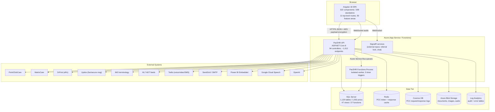
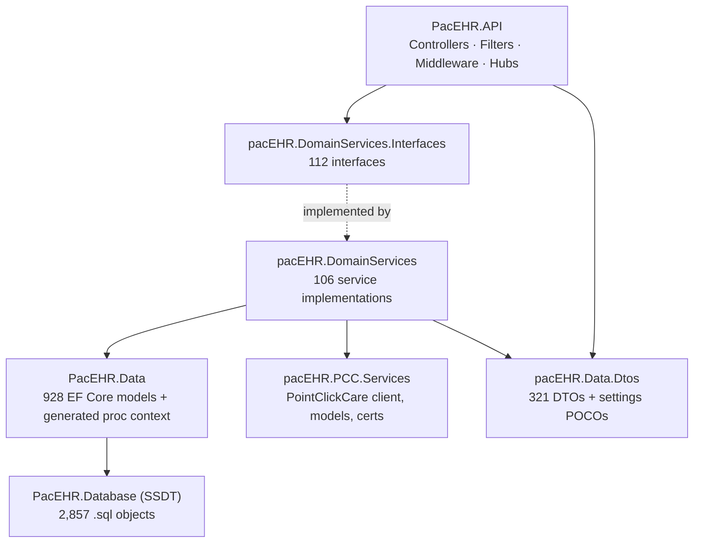

# PacEHR — System Overview Diagrams

**Date**: 2026-09-30
**Source**: `docs/architecture/current/00-system-overview.md`
**Produced by**: ARCHITECT (`aire-brownfield-inspect`, Phase 5)
**Audience**: BA / Product / anyone who wants the pictures without the prose

> These are the Mermaid diagrams extracted verbatim from the system overview. Preview them in any Markdown viewer with Mermaid support (VS Code "Markdown Preview Mermaid Support", GitHub, Azure DevOps wiki).

---

## 1. System Context & Containers

What talks to what: the browser SPA, the single .NET 8 API, the scheduled worker, the data tier, and every external clinical or platform service.

---

## 2. Backend Layer Structure

How the nine .NET projects depend on each other, from controllers down to the SSDT database project.

---

**Full analysis**: `docs/architecture/current/00-system-overview.md`
