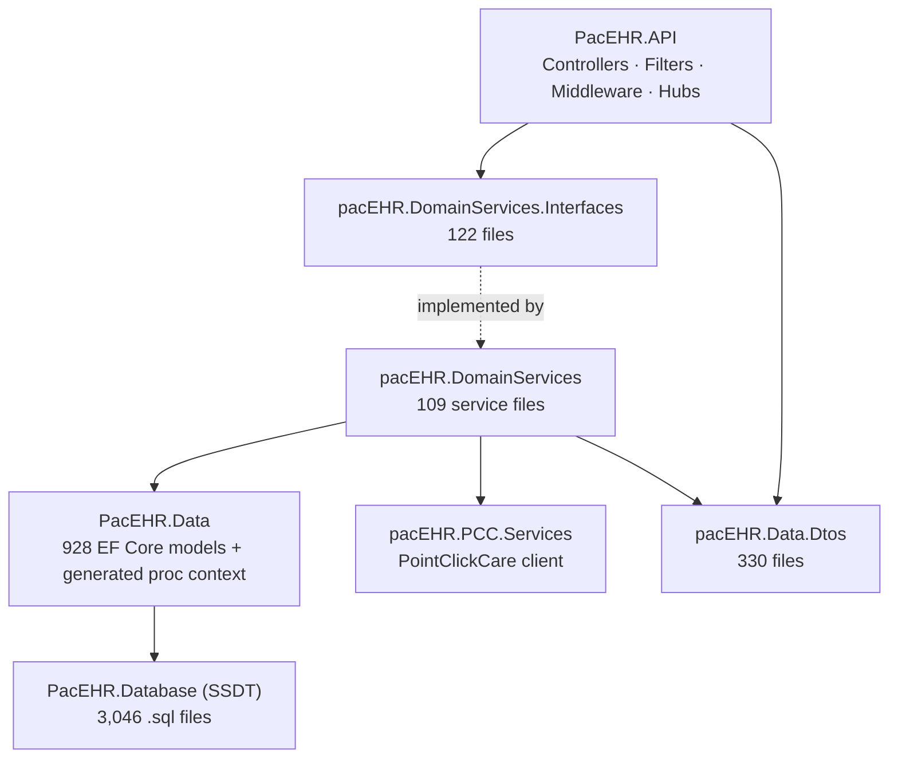
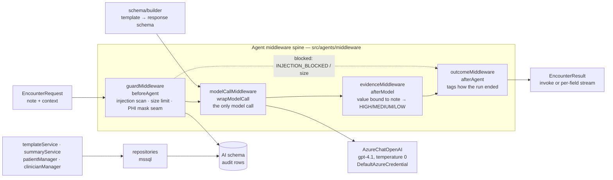

# System Overview — Diagrams

**Source**: `docs/architecture/current/00-system-overview.md` (2026-10-19)
**Purpose**: human-readable preview of every Mermaid diagram in the overview.

---

## System Context & Containers

```mermaid
flowchart TB
  subgraph Client["Browser"]
    SPA["Angular 18 SPA<br/>340 components / 304 standalone<br/>54 feature folders"]
  end

  subgraph Azure["Azure"]
    API["PacEHR.API<br/>ASP.NET Core 8<br/>100 controllers, ~1,039 endpoints"]
    FUNC["PacEHR.Functions.Process<br/>Isolated worker, 5 timer triggers"]
    AISVC["pacEHR_AI<br/>Node 22 / TypeScript<br/>LangChain agent, /health only"]
    SIGR["SignalR services<br/>(external repos)"]
  end

  subgraph Data["Data Tier"]
    SQL[("SQL Server<br/>PacEHR schema: 1,132 table scripts<br/>1,602 procedure scripts")]
    AISQL[("AI schema<br/>same Azure SQL database<br/>10 migrations")]
    REDIS[("Redis<br/>PCC token + response cache")]
    COSMOS[("Cosmos DB<br/>PCC request/response logs")]
    BLOB[("Azure Blob Storage")]
    LAW[("Log Analytics")]
  end

  subgraph Ext["External Systems"]
    PCC["PointClickCare"]
    MC["MatrixCare"]
    DRF["DrFirst (eRx)"]
    UPD["Updox"]
    IMO["IMO terminology"]
    HL7["HL7 ADT feeds"]
    TW["Twilio"]
    SG["SendGrid / SMTP"]
    PBI["Power BI Embedded"]
    GSP["Google Cloud Speech"]
    OAI["OpenAI (legacy prompt path)"]
    DRG["Dragon Copilot<br/>dictation SDK"]
    AOAI["Azure OpenAI<br/>gpt-4.1"]
    ENTRA["Microsoft Entra ID<br/>JWKS"]
  end

  SPA -->|"HTTPS JSON + AES payload encryption"| API
  SPA -->|WebSocket| SIGR
  SPA -->|"WebSocket audio"| API
  SPA -->|"SDK, token from API"| DRG

  API --> SQL
  API --> REDIS
  API --> COSMOS
  API --> BLOB
  API --> LAW
  API -->|"Service Bus queues"| FUNC
  FUNC --> SQL

  API --> PCC
  API --> MC
  API --> DRF
  API --> UPD
  API --> IMO
  API --> HL7
  API --> TW
  API --> SG
  API --> PBI
  API --> GSP
  API --> OAI

  AISVC --> AISQL
  AISVC -->|"managed identity"| AOAI
  AISVC -.->|"verifies bearer JWT"| ENTRA
  AISQL -.- SQL
  SPA -. "no caller yet" .-> AISVC
```

## Backend Layer Structure

## PacEHR_AI Agent Middleware Spine

