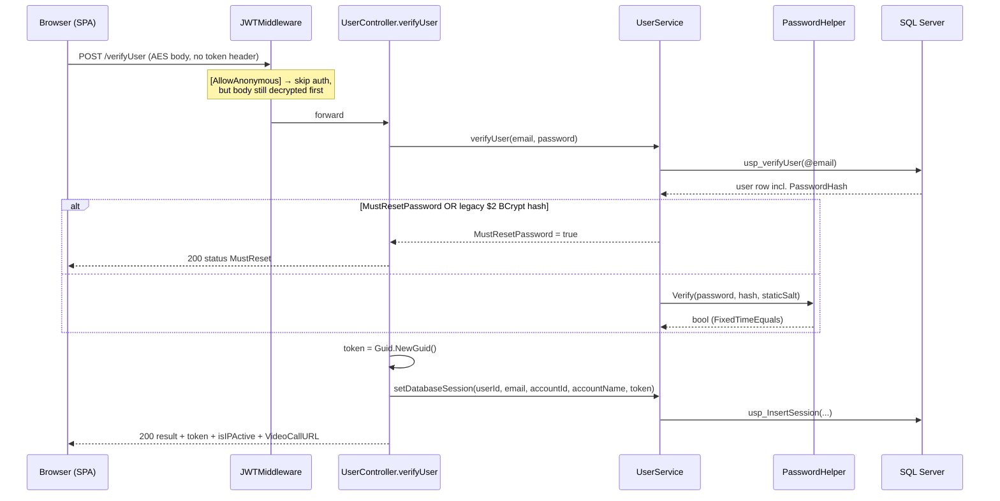
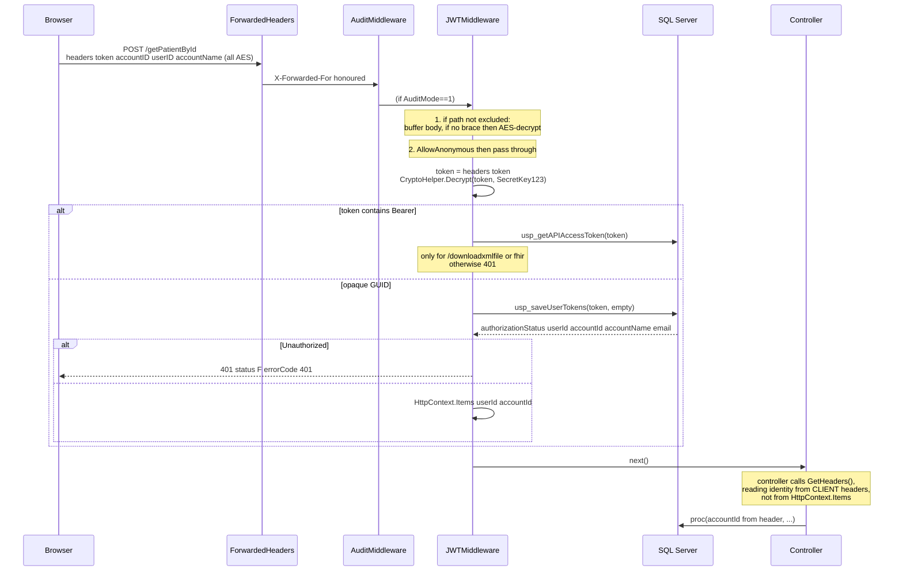
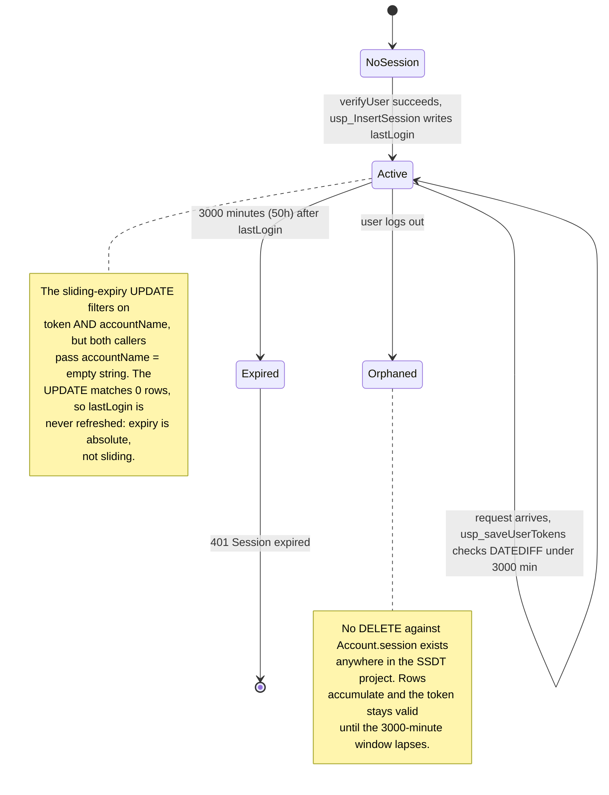
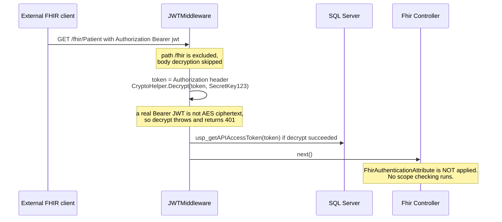

# PacEHR — Auth, Identity & Tenancy Diagrams

**Date**: 2026-09-30
**Source**: `docs/architecture/current/01-auth-identity-tenancy-deep-dive.md`
**Produced by**: ARCHITECT (`aire-brownfield-deep-dive`, Phase 6)
**Audience**: BA / Product / anyone who wants the pictures without the prose

---

## 1. Login — password to opaque session token

How a user signs in, how the password is checked, and where the session token comes from.

---

## 2. Every authenticated request

The middleware pipeline each call passes through — and the point where controllers stop using the identity the middleware derived.

---

## 3. Session lifetime

Why sessions last 50 hours from login rather than sliding with activity, and why logout leaves the token usable.

---

## 4. FHIR / external client

The path an external FHIR caller takes — and the scope-checking filter that is never invoked.

---

**Full analysis**: `docs/architecture/current/01-auth-identity-tenancy-deep-dive.md`
