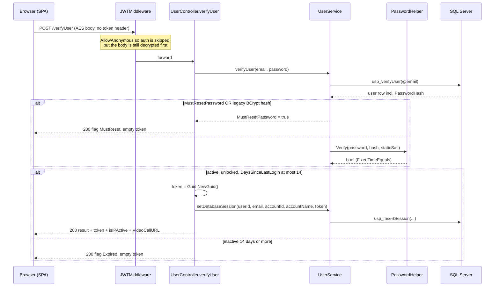
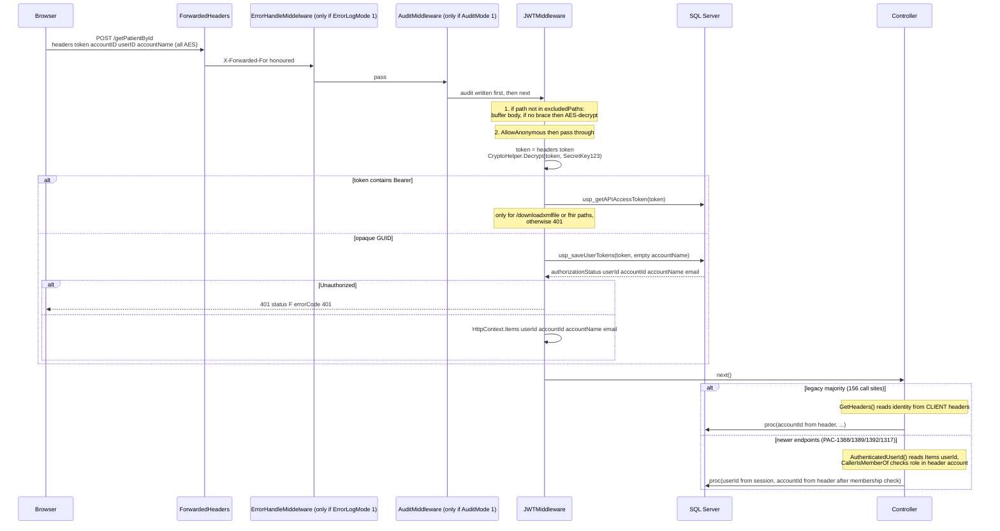
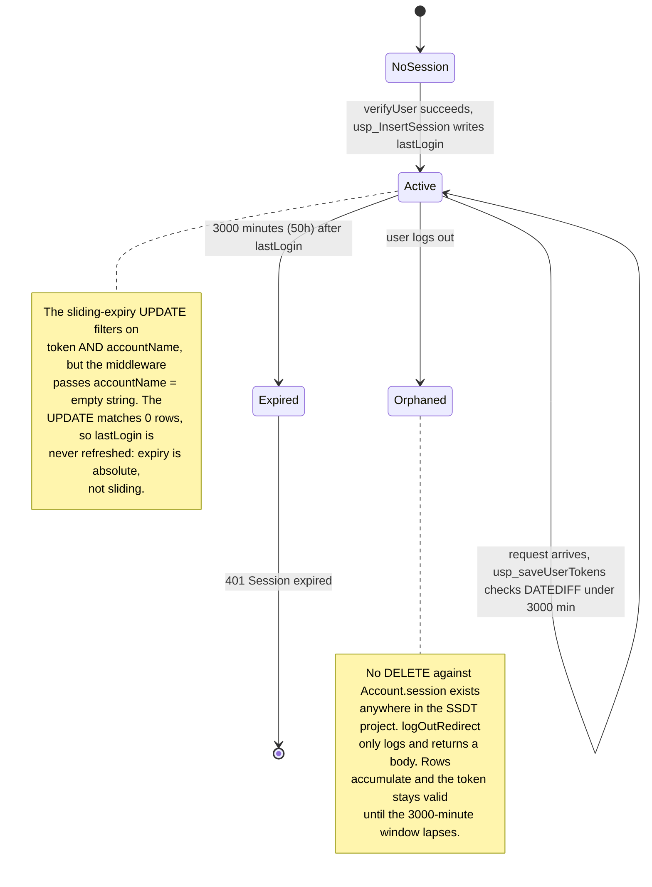
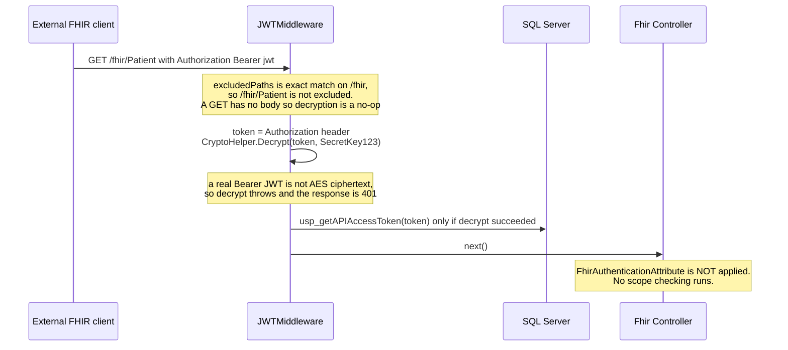
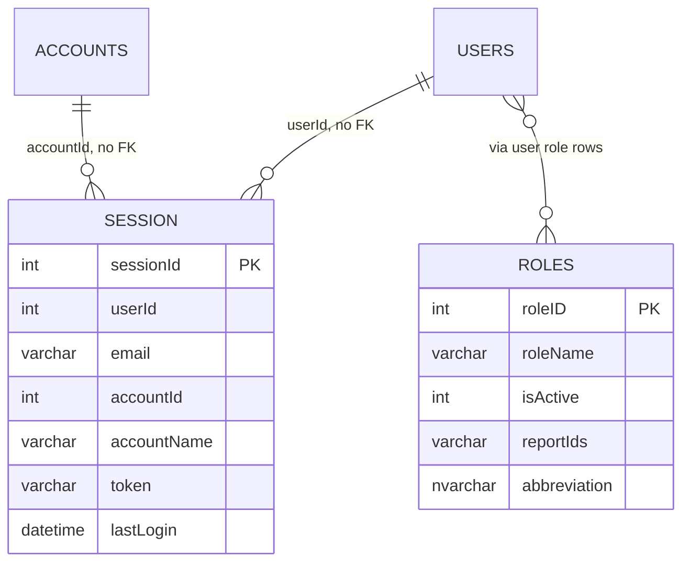

# PacEHR - Auth, Identity & Tenancy Diagrams

**Date**: 2026-10-19
**Source**: `docs/architecture/current/01-auth-identity-tenancy-deep-dive.md`
**Status**: Draft (awaiting user confirmation)

---

## 1. Workflow 1: Login (password to opaque session token)

## 2. Workflow 2: Every authenticated request

## 3. Workflow 3: Session lifetime

## 4. Workflow 4: FHIR / external client

## 5. Data Models

