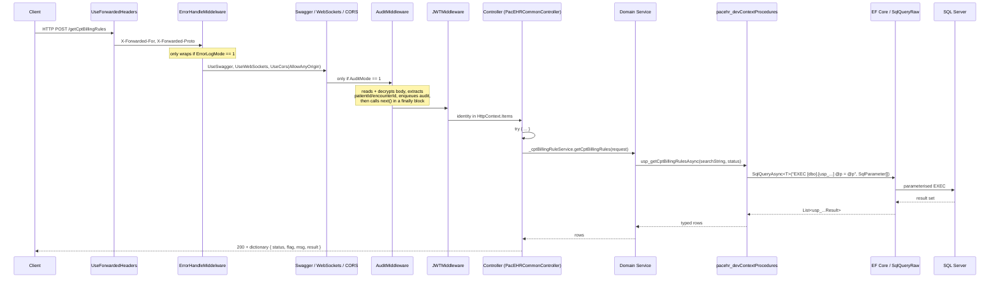
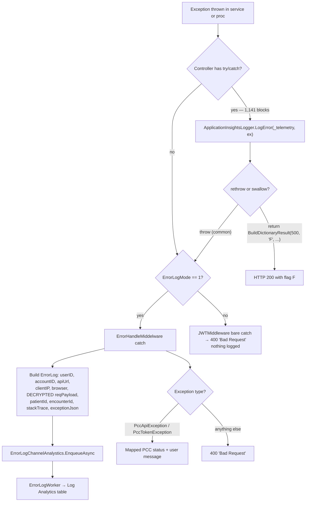
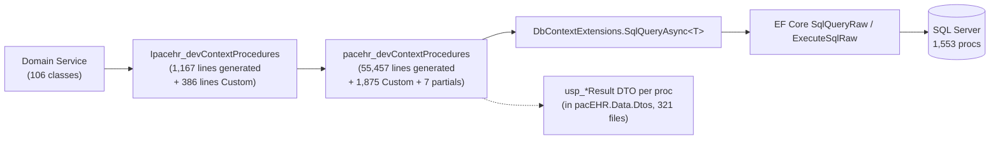

# PacEHR — API Request & Data Spine Diagrams

**Date**: 2026-09-30
**Source**: `docs/architecture/current/02-api-request-data-spine-deep-dive.md`
**Produced by**: ARCHITECT (`aire-brownfield-deep-dive`, Phase 6)
**Audience**: BA / Product / anyone who wants the pictures without the prose

---

## 1. The canonical request

Every one of the ~1,012 endpoints follows this path from HTTP to SQL and back.



---

## 2. Error path

Three competing error strategies in one pipeline, and which one runs depends on configuration.



---

## 3. Audit and error logging to Log Analytics

How request bodies reach the ops log store.

```mermaid
sequenceDiagram
  participant MW as Audit / Error middleware
  participant CH as ChannelAnalystics (in-memory Channel)
  participant W as AuditWorker / ErrorLogWorker (IHostedService)
  participant LAW as Azure Log Analytics

  MW->>MW: decrypt body, ExtractIds(patientId, encounterId)
  MW->>CH: EnqueueAsync(JsonConvert.SerializeObject(log))
  Note over CH: unbounded in-process channel;<br/>lost on process recycle
  W->>CH: dequeue
  W->>LAW: POST custom table (LogTableName / ErrorLogTableName)
```

---

## 4. The stored-procedure access layer

There is no repository pattern — every read and write goes through generated proc wrappers.



---

**Full analysis**: `docs/architecture/current/02-api-request-data-spine-deep-dive.md`
