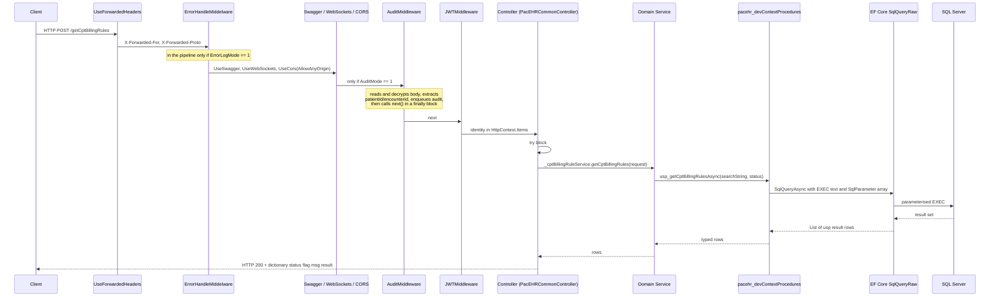
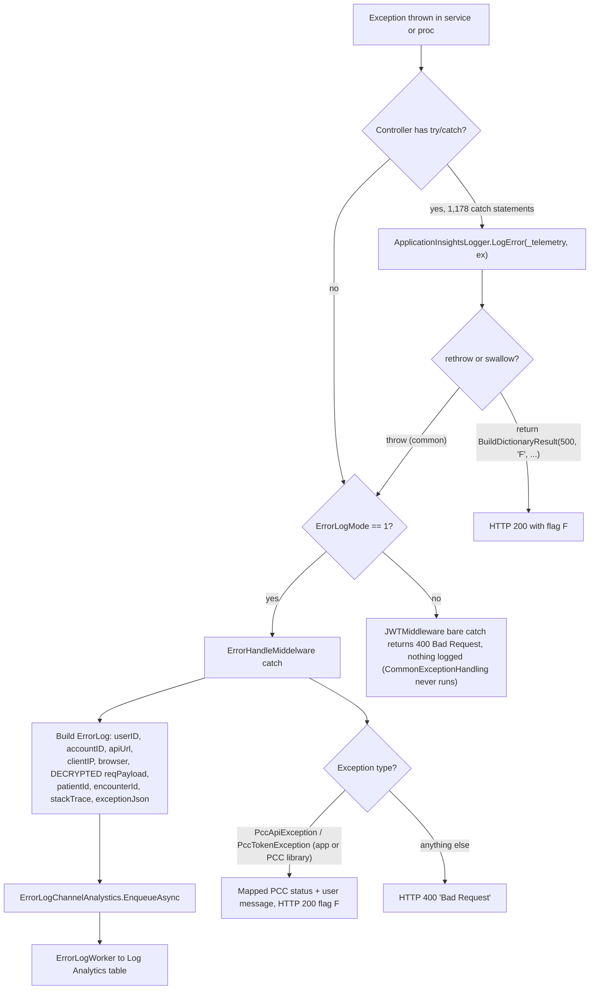
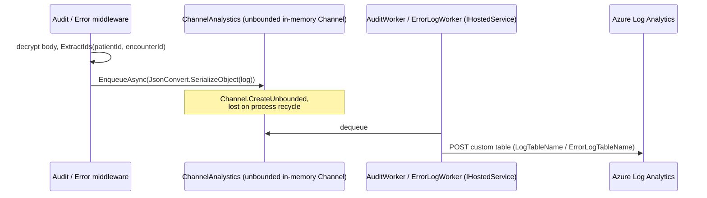
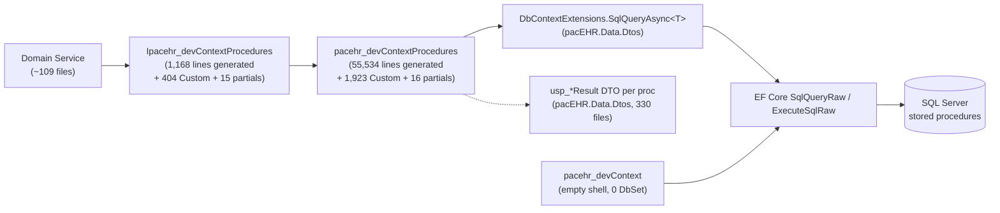

# PacEHR - API Request & Data Spine Diagrams

**Date**: 2026-10-19
**Source**: `docs/architecture/current/02-api-request-data-spine-deep-dive.md`
**Status**: Draft (awaiting user confirmation)

---

## 1. Workflow 1: The canonical request

## 2. Workflow 2: Error path

## 3. Workflow 3: Audit and error logging to Log Analytics

## 4. The stored-procedure access layer

