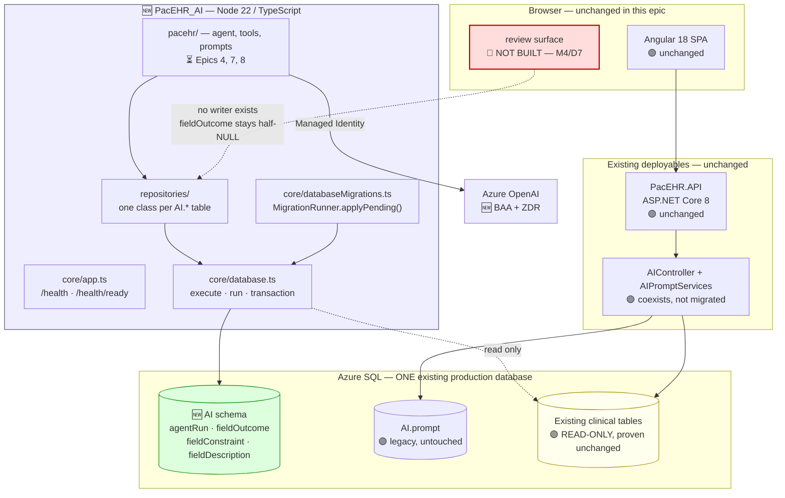
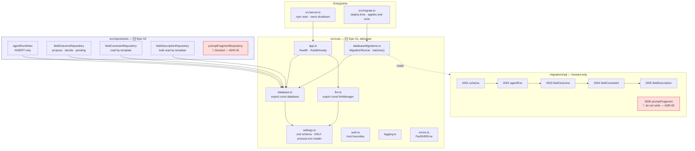
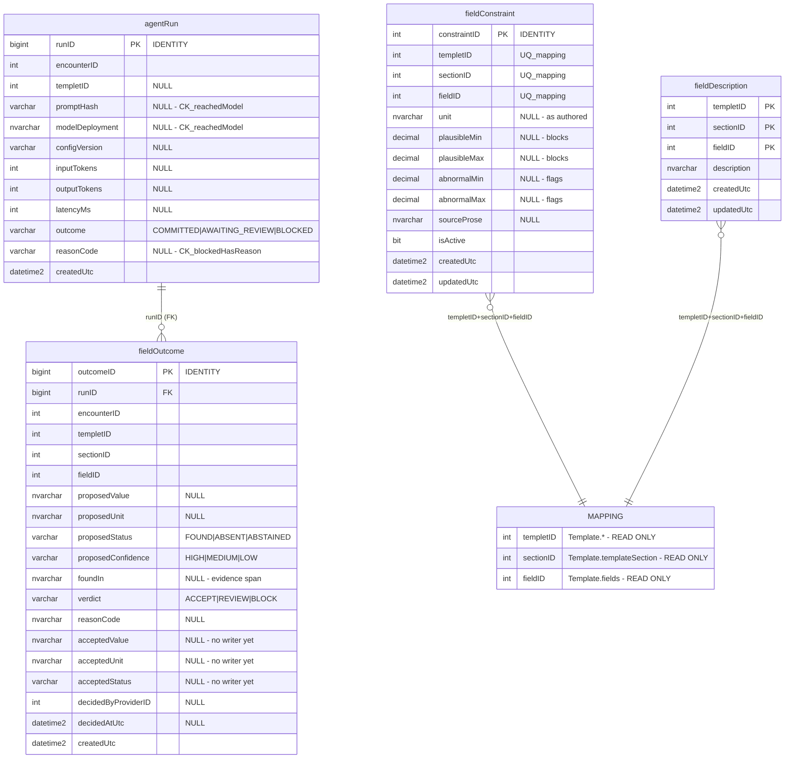

# Target Architecture Diagrams — PacEHR Encounter Agent, Data Layer (Epic 02)

**Source**: `docs/architecture/design/02-target-architecture-brownfield.md`
**Generated**: 2026-10-05

> Mermaid diagrams extracted from the target architecture document for easy preview.
> Annotations: 🆕 new · 🟡 modified · 🟢 unchanged · 🔴 not built / blocked

---

## Target System Context

---

## Component Architecture (Target)

---

## Data Model Changes

> `MAPPING` is **not a table**. It is the `(templetID, sectionID, fieldID)` triple identifying a
> field's use within a template, living in existing read-only clinical tables. The two
> configuration tables key on it and hold **no foreign key to it** — a foreign key would be a
> write dependency on tables this service may only read.
