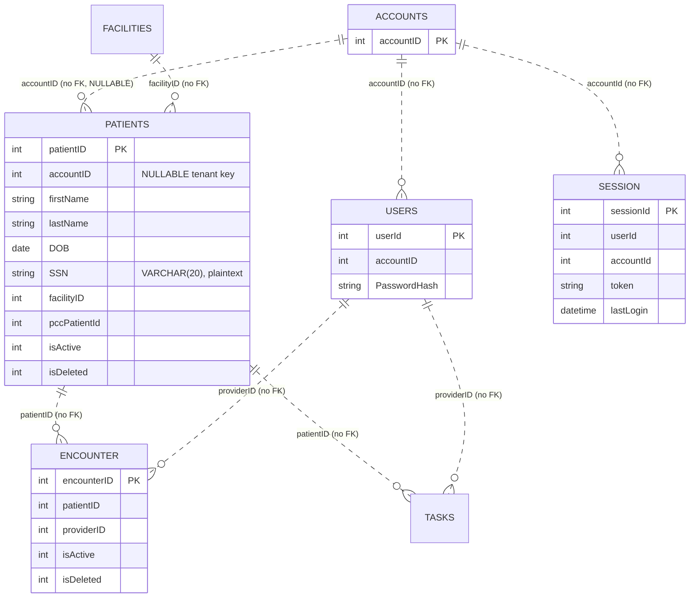
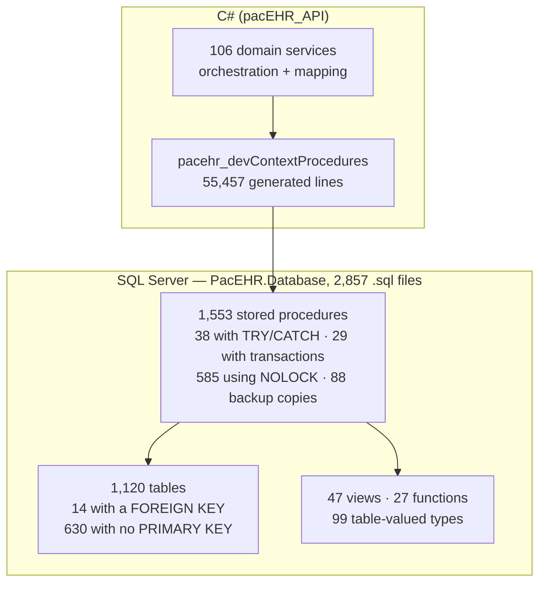
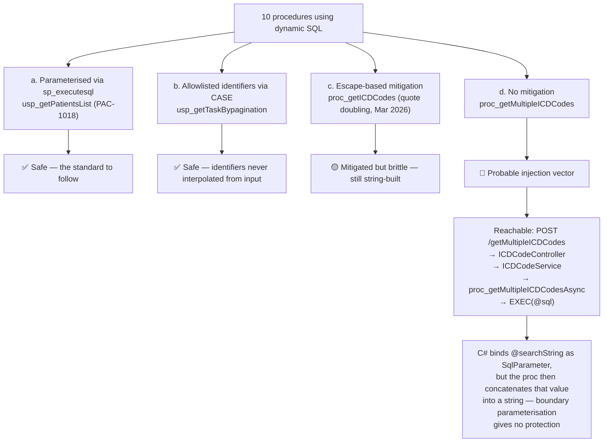

# PacEHR — Data & SQL Tier Diagrams

**Date**: 2026-09-30
**Source**: `docs/architecture/current/03-data-sql-tier-deep-dive.md`
**Produced by**: ARCHITECT (`aire-brownfield-deep-dive`, Phase 6)
**Audience**: BA / Product / anyone who wants the pictures without the prose

---

## 1. Core clinical ER — relationships by convention

Dotted lines are deliberate: these relationships exist in application code and naming, **not** as declared foreign keys. Only 14 of 1,120 tables declare a FK.

---

## 2. Where the logic lives

The SQL tier is not a persistence layer — 1,553 stored procedures against 106 C# service classes means it is the application.

---

## 3. Dynamic SQL — four qualities in ten procedures

Only 10 of 1,553 procedures build SQL dynamically, but they are not equally safe.

---

**Full analysis**: `docs/architecture/current/03-data-sql-tier-deep-dive.md`
