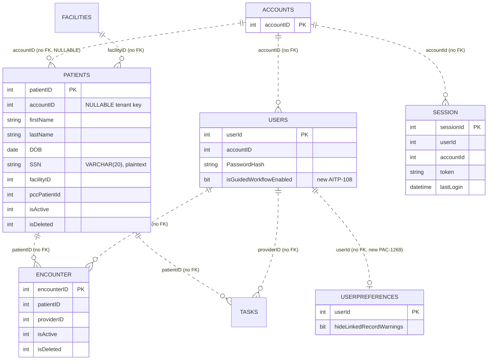
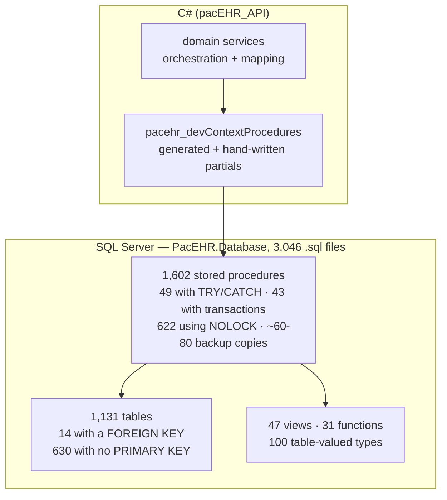
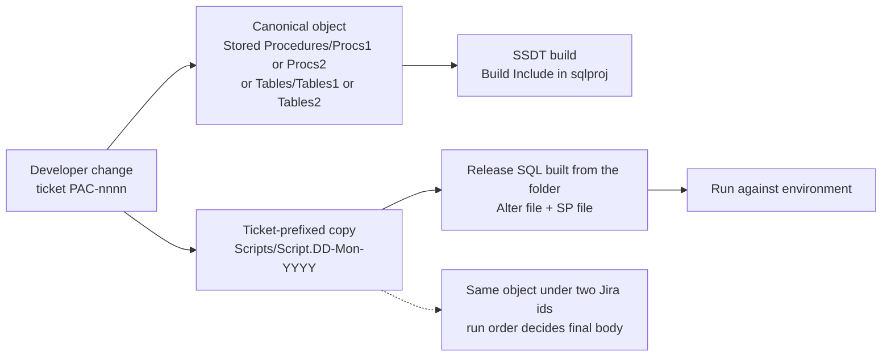
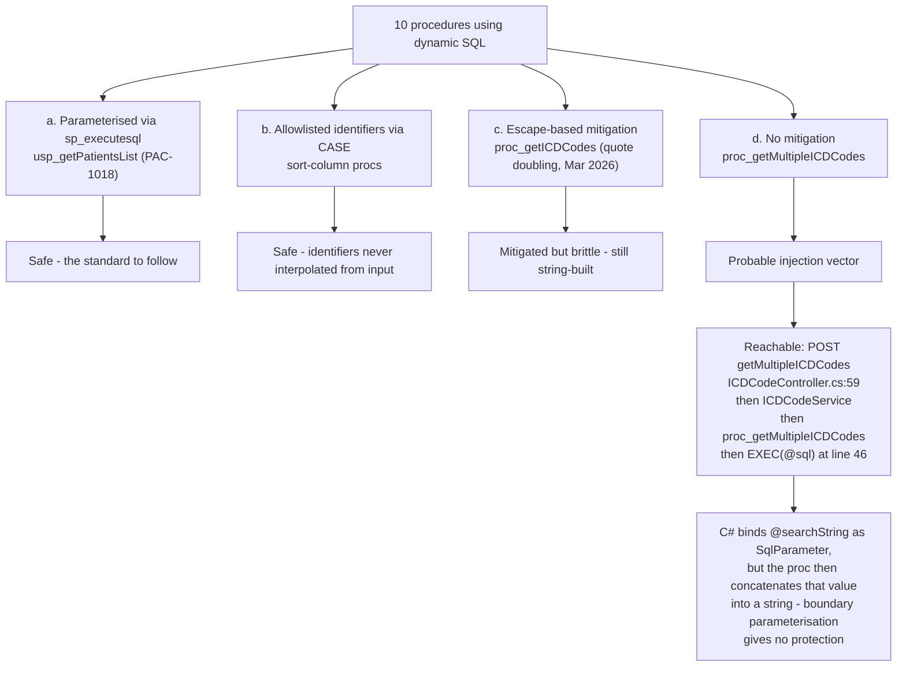

# PacEHR — Data & SQL Tier Diagrams

**Date**: 2026-10-19
**Source**: `docs/architecture/current/03-data-sql-tier-deep-dive.md`
**Produced by**: ARCHITECT (`aire-brownfield-deep-dive`, refresh)
**Status**: Draft (awaiting user confirmation)
**HEADs analysed**: PacEHR `401caa134`, pacEHR_API `0f611f65c`, pacEHR_AI `ef172ea`

---

## 1. Core clinical ER - relationships by convention

## 2. Where the logic lives

## 3. Release path for a schema or proc change

## 4. Dynamic SQL - four qualities and the reachable gap

