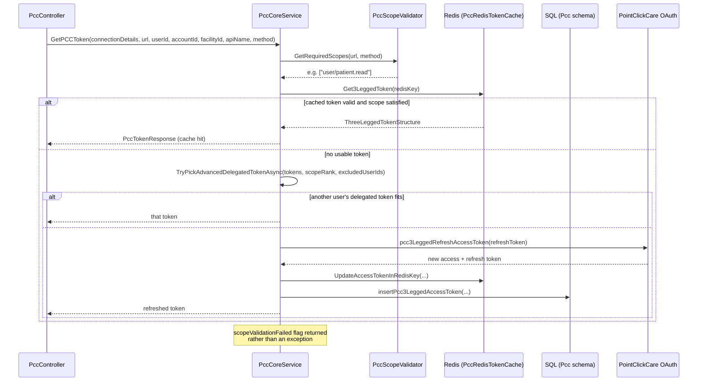
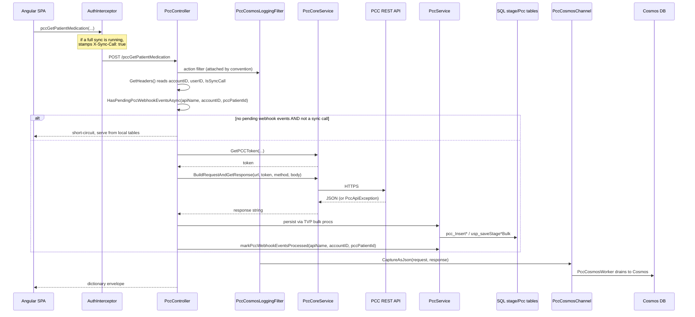
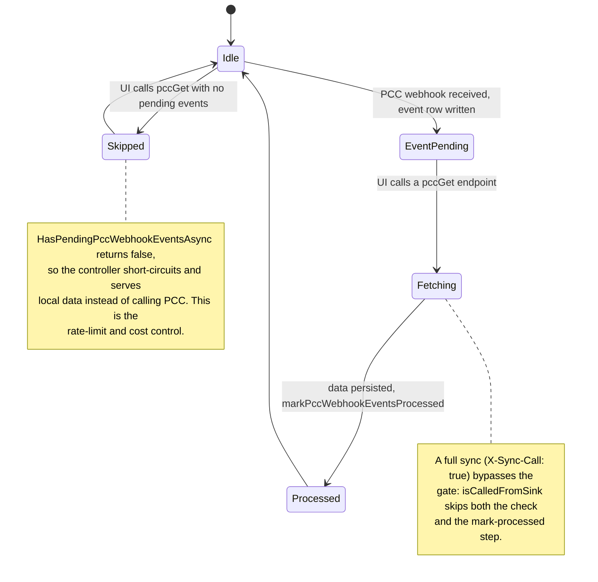
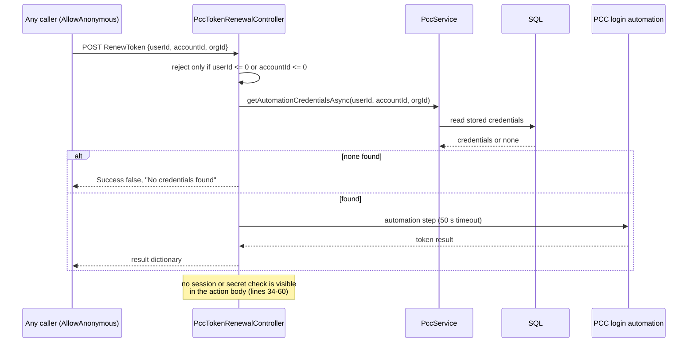
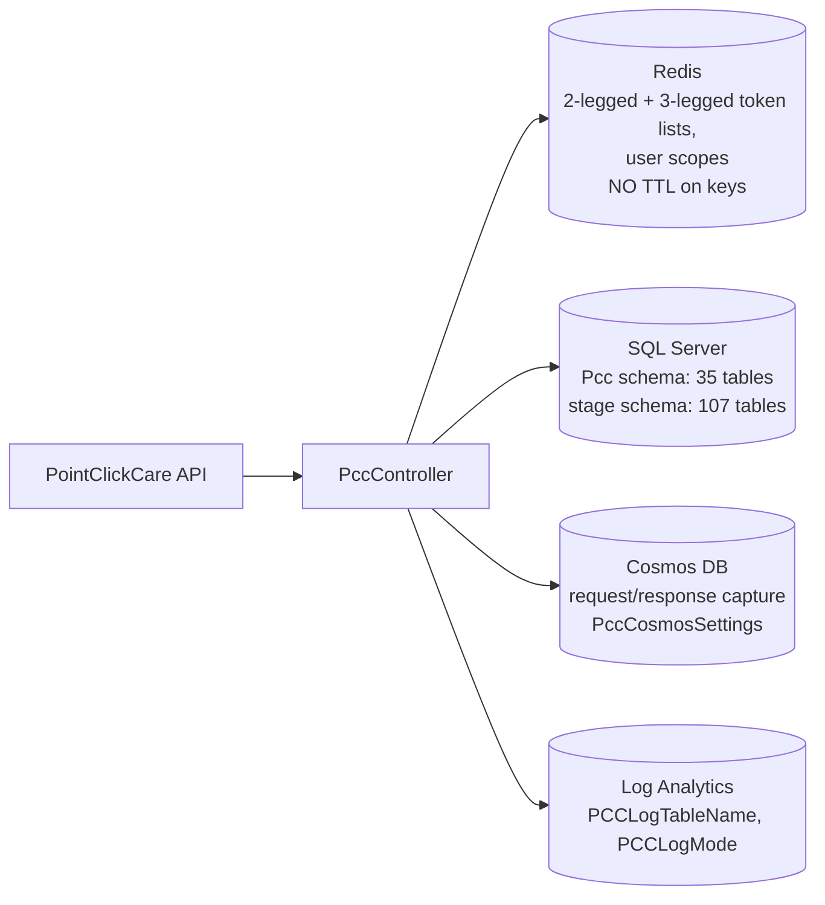

# PacEHR — PointClickCare Integration Diagrams

**Date**: 2026-10-19
**Source**: `docs/architecture/current/04-pointclickcare-integration-deep-dive.md`
**Produced by**: ARCHITECT (`aire-brownfield-deep-dive`, Phase 6)
**Status**: Draft (awaiting user confirmation)
**Audience**: BA / Product / anyone who wants the pictures without the prose

---

## 1. Token acquisition and caching

## 2. A PCC data fetch, end to end

## 3. Webhook-gated refresh

## 4. Anonymous token renewal

## 5. Where PCC data lands

