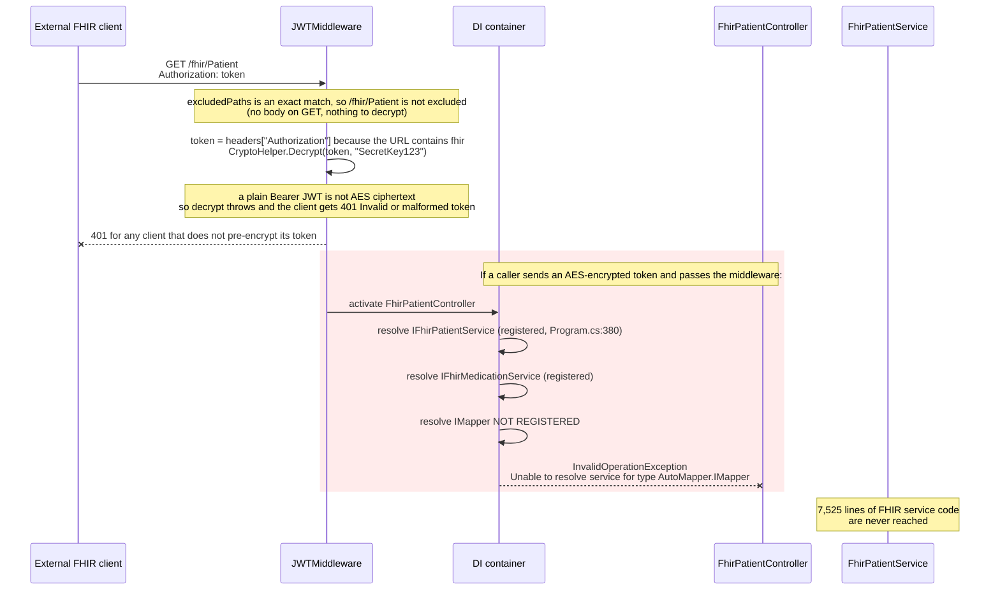
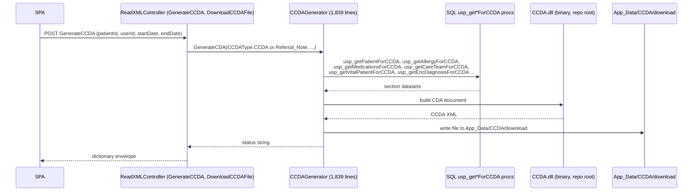
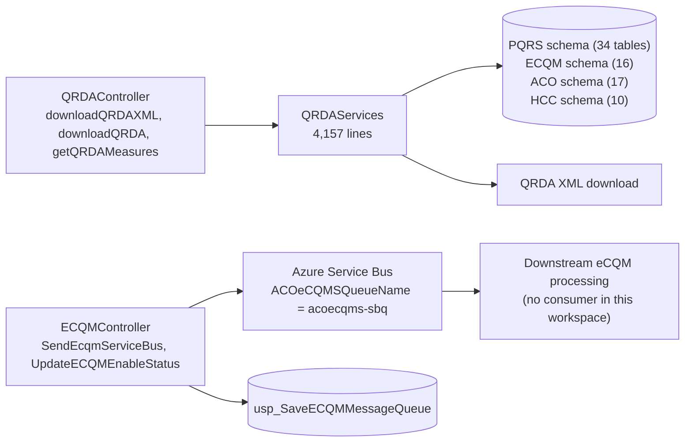
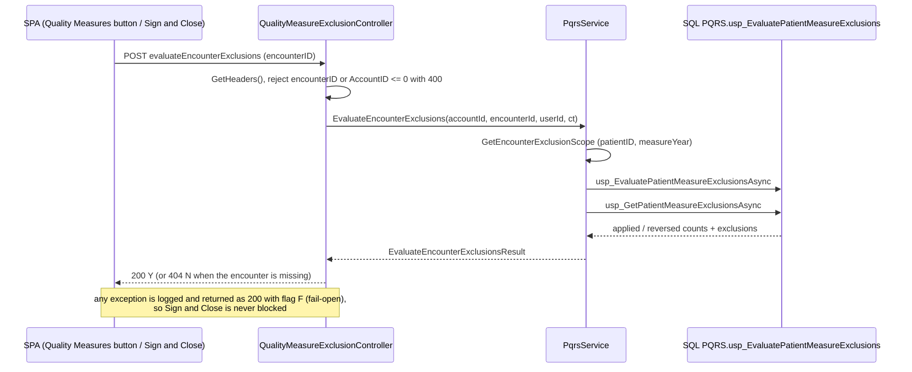
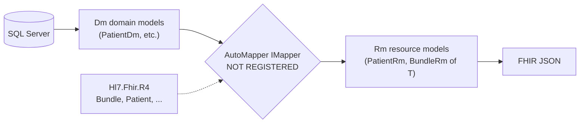

# PacEHR — Interoperability Diagrams (FHIR / CCDA / QRDA / eCQM)

**Date**: 2026-10-19
**Source**: `docs/architecture/current/05-interoperability-fhir-ccda-qrda-deep-dive.md`
**Produced by**: ARCHITECT (`aire-brownfield-deep-dive`, refresh)
**Status**: Draft (awaiting user confirmation)
**Audience**: BA / Product / anyone who wants the pictures without the prose

---

## 1. A FHIR request: what actually happens

---

## 2. CCDA document generation

---

## 3. QRDA / eCQM quality reporting

---

## 4. Automated quality-measure exclusions (new)

---

## 5. FHIR model layering

---

**Full analysis**: `docs/architecture/current/05-interoperability-fhir-ccda-qrda-deep-dive.md`
