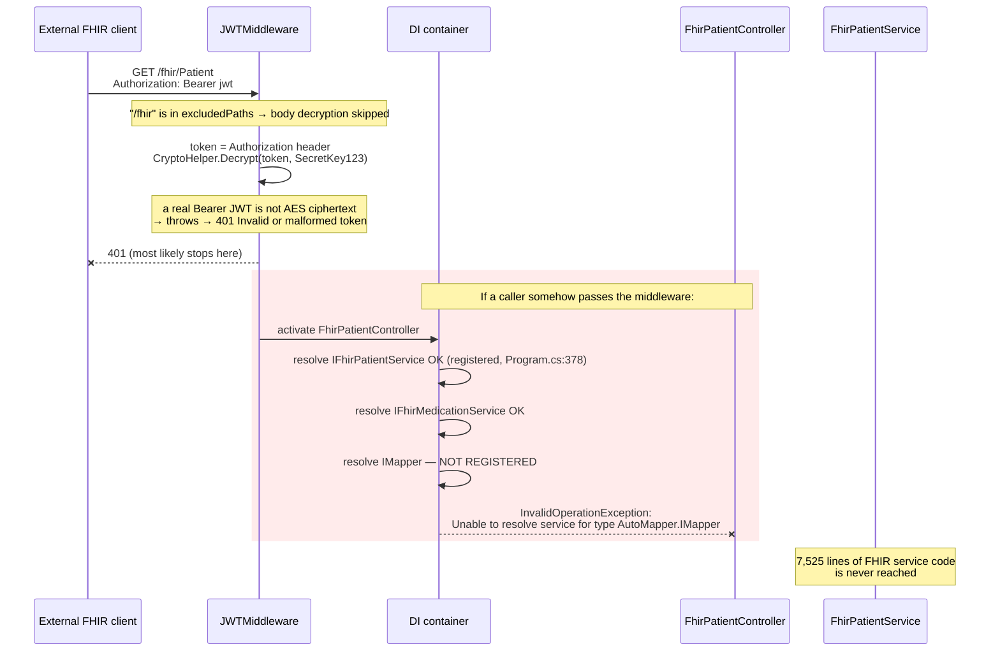
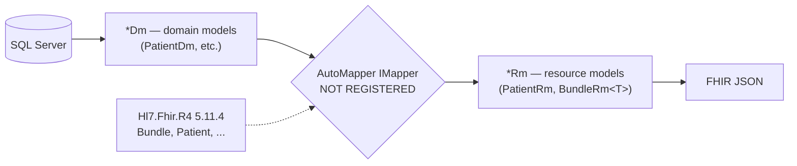
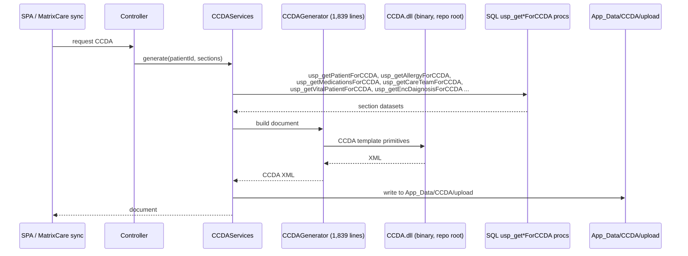
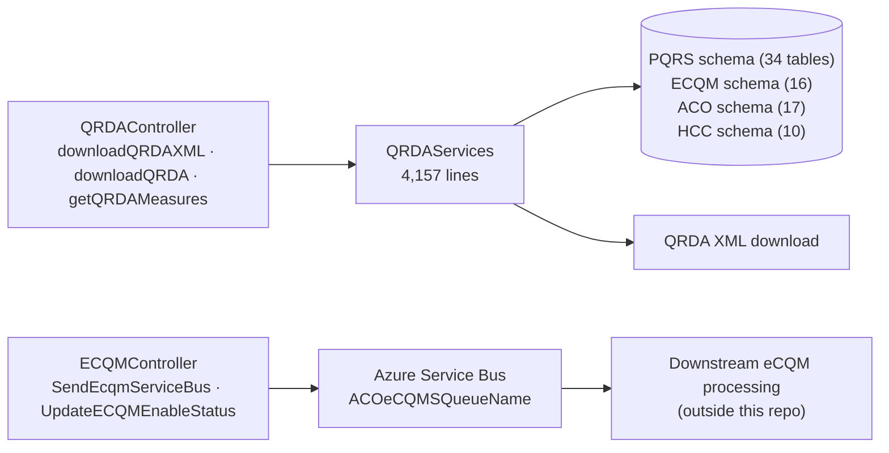

# PacEHR — Interoperability Diagrams (FHIR / CCDA / QRDA / eCQM)

**Date**: 2026-09-30
**Source**: `docs/architecture/current/05-interoperability-fhir-ccda-qrda-deep-dive.md`
**Produced by**: ARCHITECT (`aire-brownfield-deep-dive`, Phase 6)
**Audience**: BA / Product / anyone who wants the pictures without the prose

---

## 1. A FHIR request — what actually happens

The FHIR surface cannot serve a request: `IMapper` is injected by all 20 controllers and never registered in DI.

---

## 2. FHIR model layering — where it breaks

The `Dm` → `Rm` split is sound design. The break is exactly at the mapper.

---

## 3. CCDA document generation (active)

One stored procedure per document section, assembled by a committed binary.

---

## 4. QRDA / eCQM quality reporting (active)

---

**Full analysis**: `docs/architecture/current/05-interoperability-fhir-ccda-qrda-deep-dive.md`
