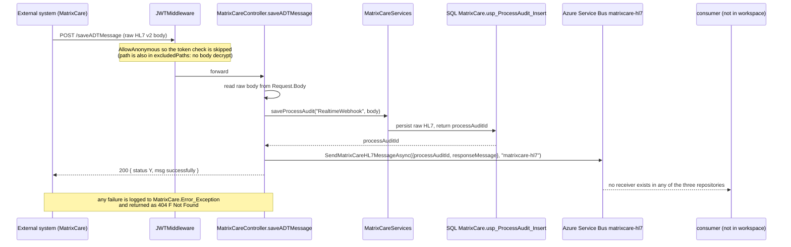
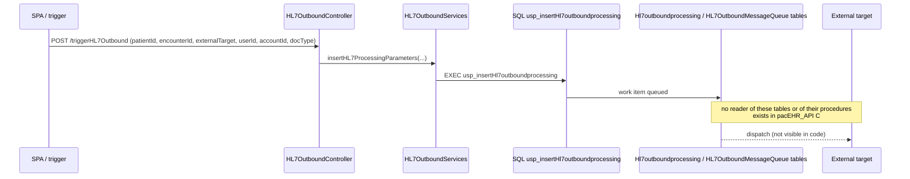
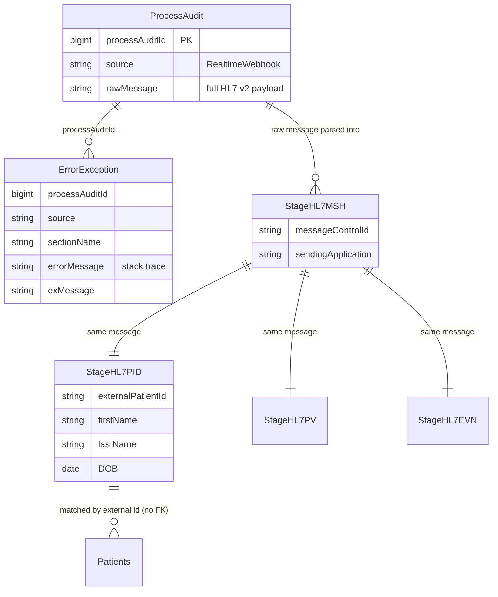

# PacEHR — HL7 v2, ADT Ingestion & Messaging Diagrams

**Date**: 2026-10-19
**Source**: `docs/architecture/current/06-hl7-adt-ingestion-deep-dive.md`
**Produced by**: ARCHITECT (`aire-brownfield-deep-dive`, refresh)
**Status**: Draft (awaiting user confirmation)
**Audience**: BA / Product / anyone who wants the pictures without the prose

---

## 1. Inbound ADT: audit-first ingestion

---

## 2. Outbound HL7

---

## 3. The messaging transport: 22 producers, 0 in-workspace consumers

```mermaid
flowchart TB
  subgraph Producers["Producers: ServiceBusQueueHelper, 22 send methods"]
    P1["SendMatrixCareHL7MessageAsync to matrixcare-hl7 (literal)"]
    P2["SendMatrixCareProgressNoteMessageAsync to matrixcare-progress-note (literal)"]
    P3["SendMessageUpdoxAsync, SendUpdoxFaxAsync"]
    P4["SendCCMEncounterMessageAsync"]
    P5["SendACOeCQMSMessageAsync, SendPQRSEncounterQMMessageAsync"]
    P6["SendPccDocumentMessageAsync, SendLinkExternalPatinetMessage"]
    P7["SendMessageAsyncForPccProgressNote, SendMessageForPccProgressNoteProcess"]
    P8["SendMessageAsyncForFacilityConfiguration"]
    P9["SendDiagnosisMessageAsync (DrFirst)"]
    P10["SendMessageAsyncForHIE, SendMessageAsyncForHIEPatientData (Kno2)"]
    P11["SendAuditLogMessageAsync, SendAuditLogMessagesAsync"]
    P12["SendMessageAsync, SendMessageChartAuditAsync, SendMessageToQuanticianAsync,<br/>SendMessagePatientEventSeriveBus, SendMessageEncounterEventSeriveBus"]
  end

  subgraph Bus["Azure Service Bus"]
    Q["named queues across several namespaces"]
  end

  subgraph Consumers["Receivers in pacEHR_API, PacEHR, pacEHR_AI"]
    C["NONE<br/>0 ServiceBusProcessor, 0 CreateReceiver, 0 ServiceBusTrigger, 0 QueueTrigger"]
  end

  EXT2["Named out-of-workspace consumer:<br/>HIEPatientDataFunction (kno2-patient-sbq), per code comment only"]

  P1 & P2 & P3 & P4 & P5 & P6 & P7 & P8 & P9 & P10 & P11 & P12 --> Q
  Q -.-> C
  Q -.-> EXT2
```

---

## 4. Inbound audit chain

---

**Full analysis**: `docs/architecture/current/06-hl7-adt-ingestion-deep-dive.md`
