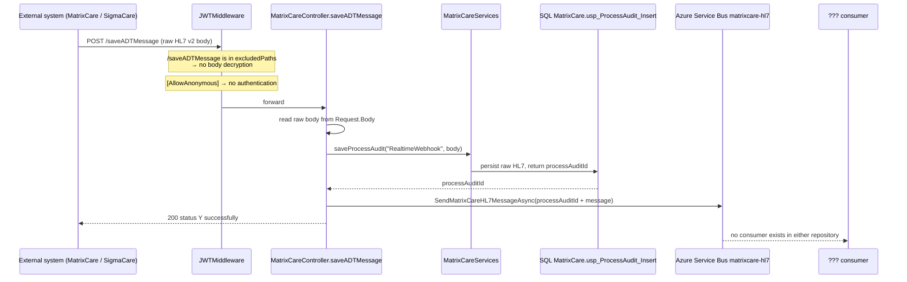
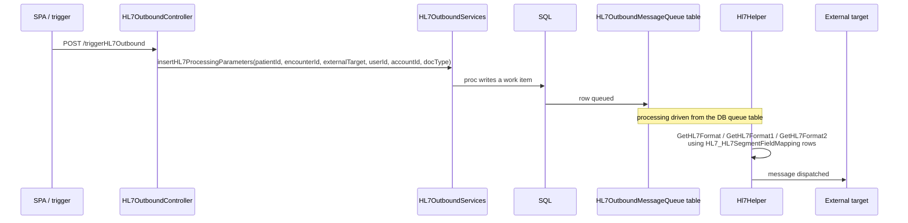
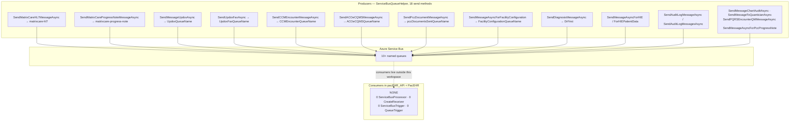
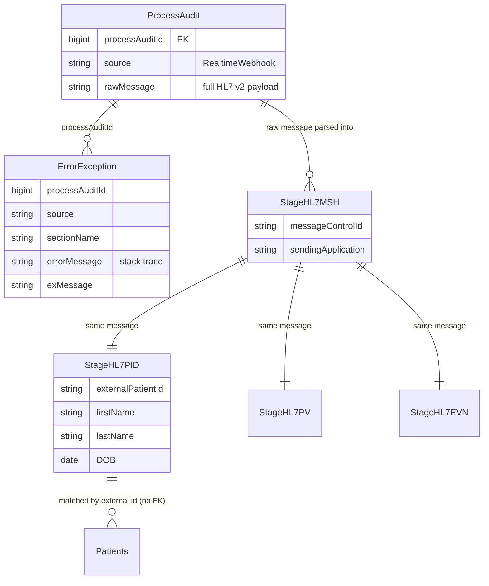

# PacEHR — HL7 v2, ADT Ingestion & Messaging Diagrams

**Date**: 2026-09-30
**Source**: `docs/architecture/current/06-hl7-adt-ingestion-deep-dive.md`
**Produced by**: ARCHITECT (`aire-brownfield-deep-dive`, Phase 6)
**Audience**: BA / Product / anyone who wants the pictures without the prose

---

## 1. Inbound ADT — audit-first ingestion

The raw HL7 message is persisted before anything that can fail. Note the endpoint is unauthenticated, and the queue has no consumer in either repository.

---

## 2. Outbound HL7

Outbound queueing is table-based, not Service Bus — a different mechanism from the inbound path.

---

## 3. The messaging transport — 18 producers, 0 consumers

Every asynchronous flow in PacEHR dispatches to a queue that nothing in either repository reads.

---

## 4. Inbound audit chain

How a raw HL7 message is correlated to staging rows and to any error.

---

**Full analysis**: `docs/architecture/current/06-hl7-adt-ingestion-deep-dive.md`
