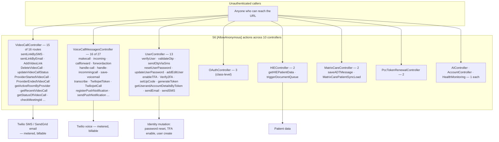
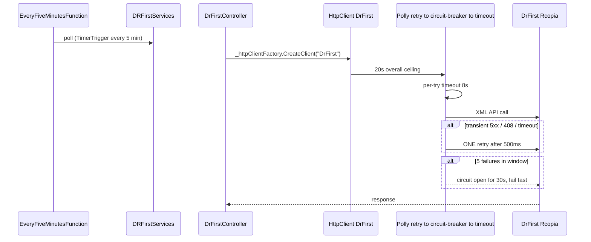

# PacEHR — External Integrations Diagrams

**Date**: 2026-09-30
**Source**: `docs/architecture/current/07-external-integrations-deep-dive.md`
**Produced by**: ARCHITECT (`aire-brownfield-deep-dive`, Phase 6)
**Audience**: BA / Product / anyone who wants the pictures without the prose

---

## 1. The anonymous-endpoint surface

56 `[AllowAnonymous]` actions across 10 controllers. Some are legitimately pre-authentication; many are not.

---

## 2. Twilio voice — webhook callbacks

Webhooks must be anonymous; the control that makes that safe — signature validation — is missing.

---

## 3. DrFirst — the one well-protected outbound path

The policy pattern the other integrations should adopt.

---

**Full analysis**: `docs/architecture/current/07-external-integrations-deep-dive.md`
