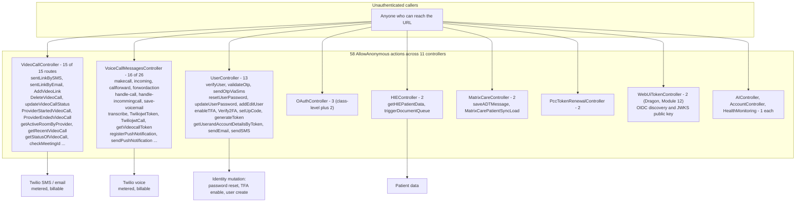
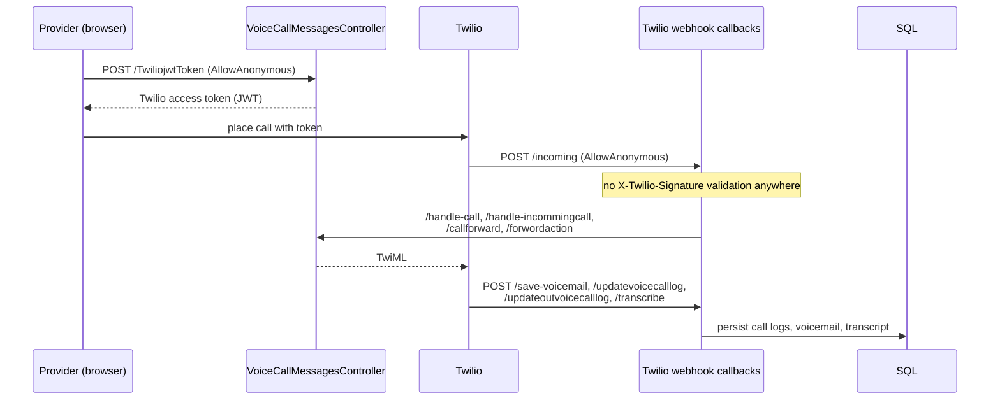
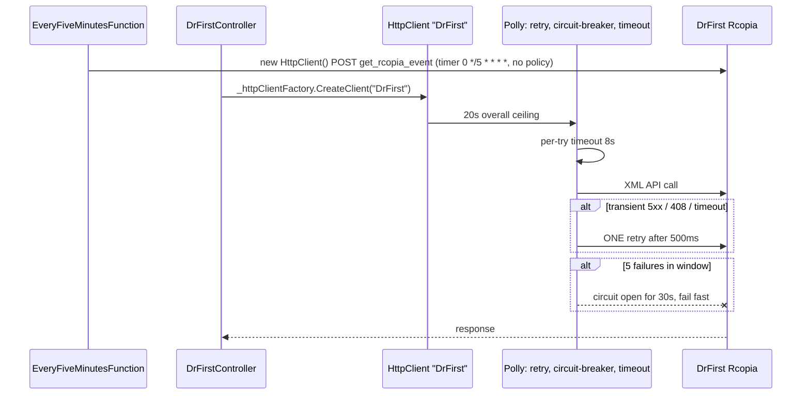
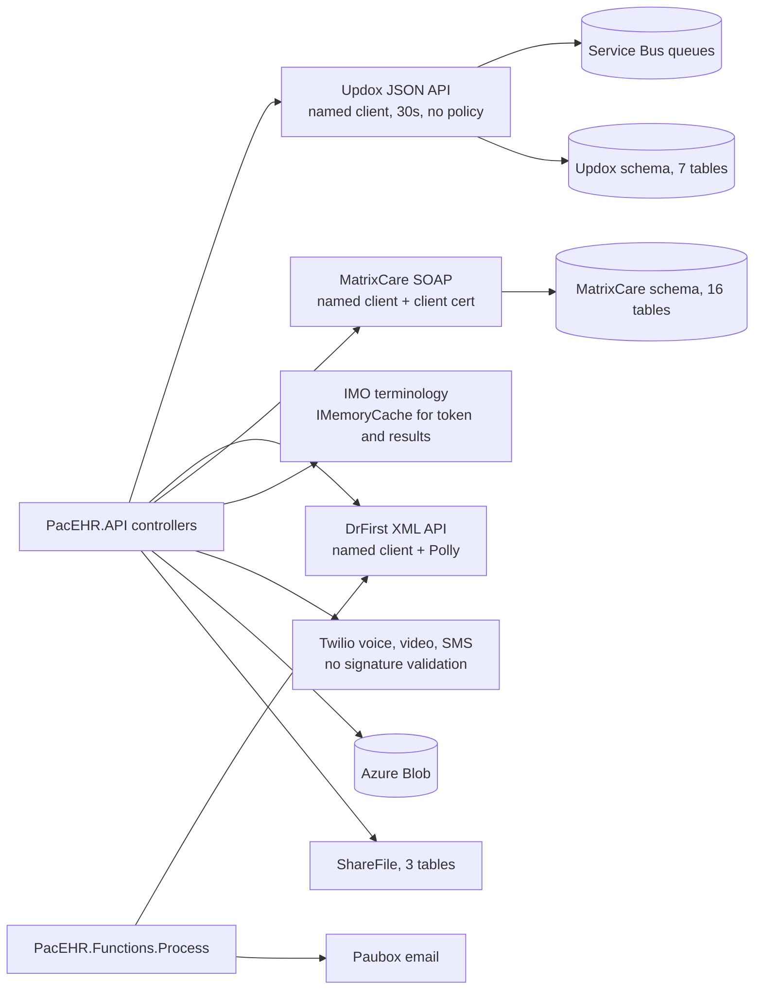

# PacEHR — External Integrations Diagrams

**Date**: 2026-10-19
**Source**: `docs/architecture/current/07-external-integrations-deep-dive.md`
**Produced by**: ARCHITECT (`aire-brownfield-deep-dive`, Phase 6)
**Status**: Draft (awaiting user confirmation)
**Audience**: BA / Product / anyone who wants the pictures without the prose

---

## 1. The anonymous-endpoint surface

## 2. Twilio voice - webhook callbacks

## 3. DrFirst - resilient controller path versus unprotected poll

## 4. Where integration data lands

