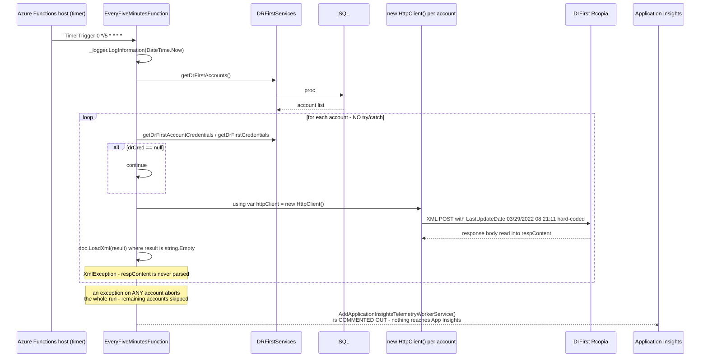
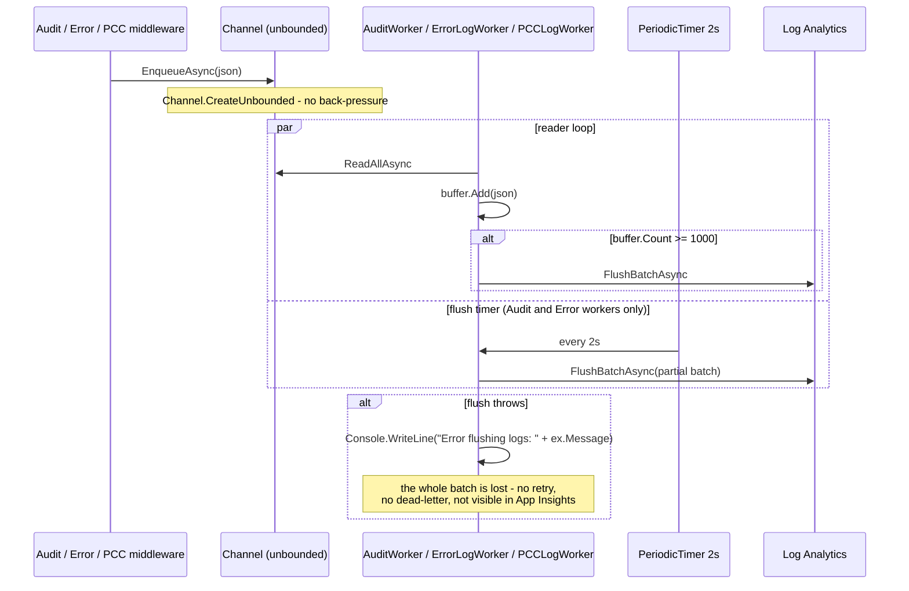
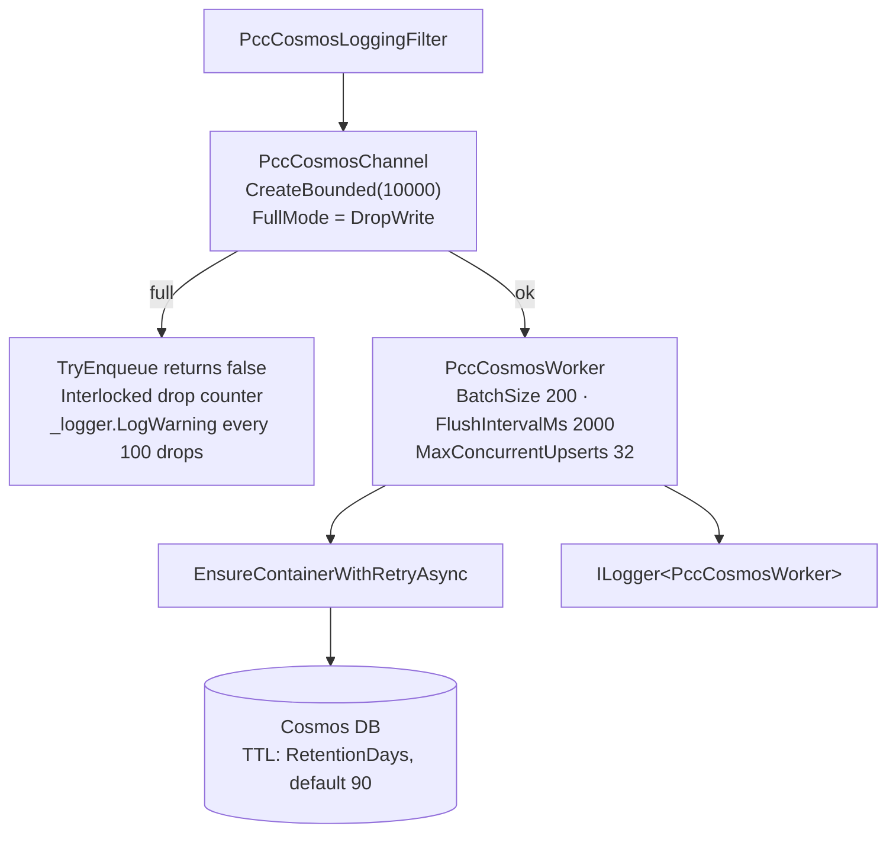
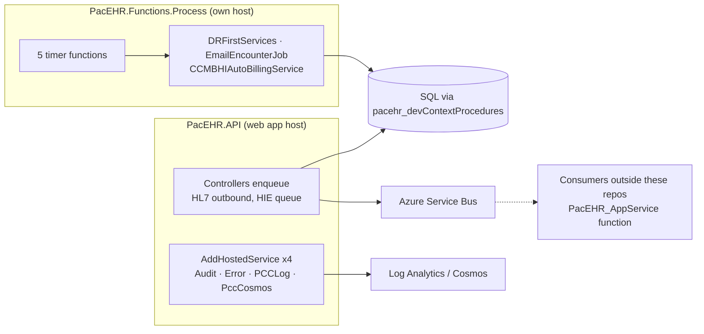
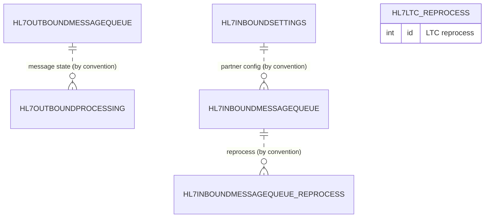

# PacEHR — Background Processing Diagrams

**Date**: 2026-10-19
**Source**: `docs/architecture/current/08-background-processing-deep-dive.md`
**Produced by**: ARCHITECT (`aire-brownfield-deep-dive`, refresh)
**Status**: Draft (awaiting user confirmation)
**HEADs analysed**: PacEHR `401caa134`, pacEHR_API `0f611f65c`, pacEHR_AI `ef172ea`

---

## 1. Functions timer worker - DrFirst poll

## 2. In-process log workers

## 3. PccCosmosWorker - the bounded-channel reference

## 4. Where background work is started

## 5. Job queue tables - relationships by convention

