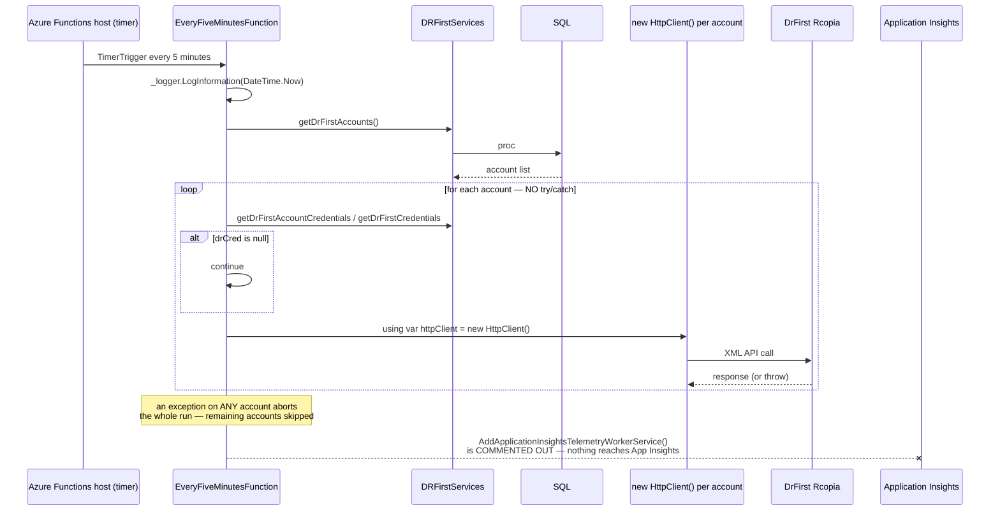
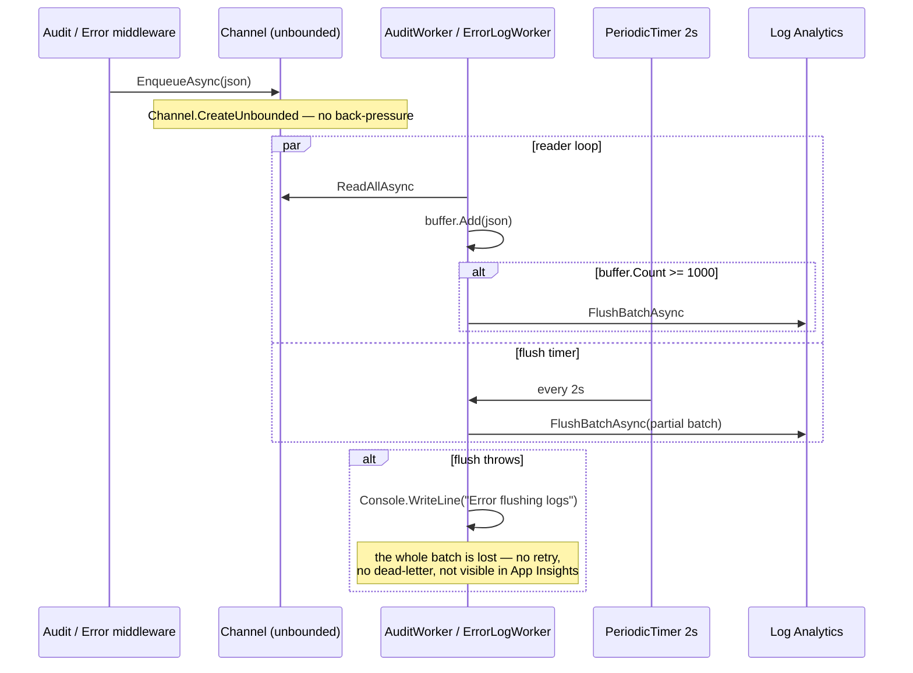
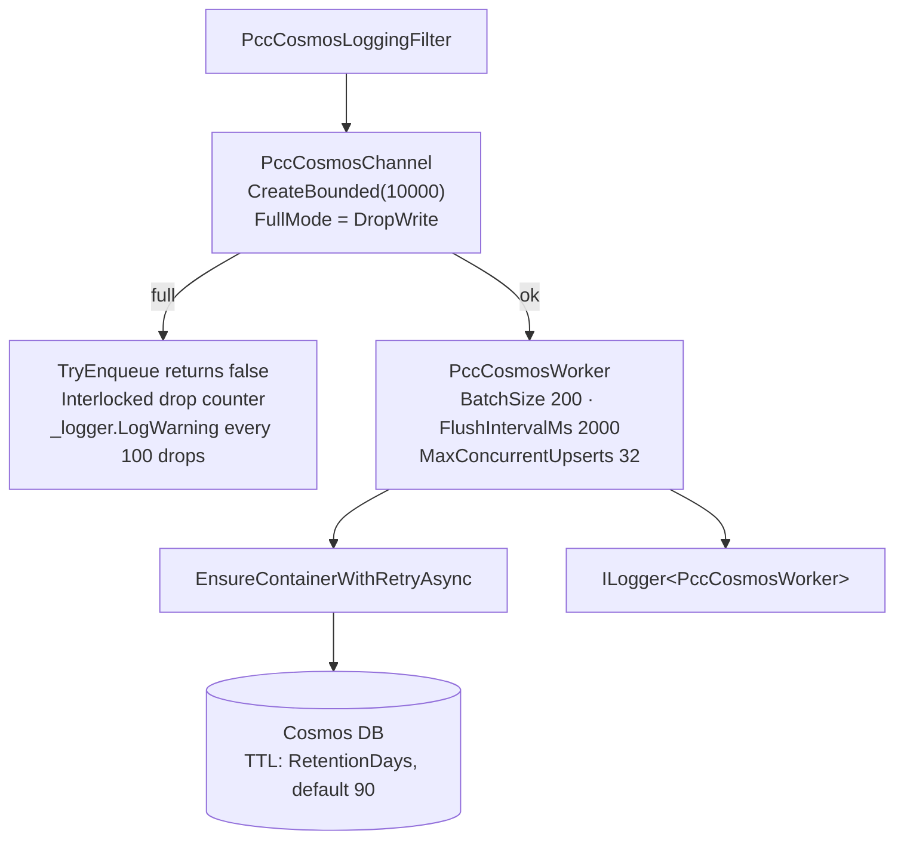

# PacEHR — Background Processing Diagrams

**Date**: 2026-09-30
**Source**: `docs/architecture/current/08-background-processing-deep-dive.md`
**Produced by**: ARCHITECT (`aire-brownfield-deep-dive`, Phase 6)
**Audience**: BA / Product / anyone who wants the pictures without the prose

---

## 1. The Functions timer worker

The DrFirst poller: no error isolation, its own HttpClient per account, and no telemetry.

---

## 2. In-process log workers

Unbounded channels, and a failed flush silently discards up to 1,000 audit records.

---

## 3. PccCosmosWorker — the same pattern done right

Bounded capacity, a named overload policy, a drop counter, structured logging and a TTL.

---

**Full analysis**: `docs/architecture/current/08-background-processing-deep-dive.md`
