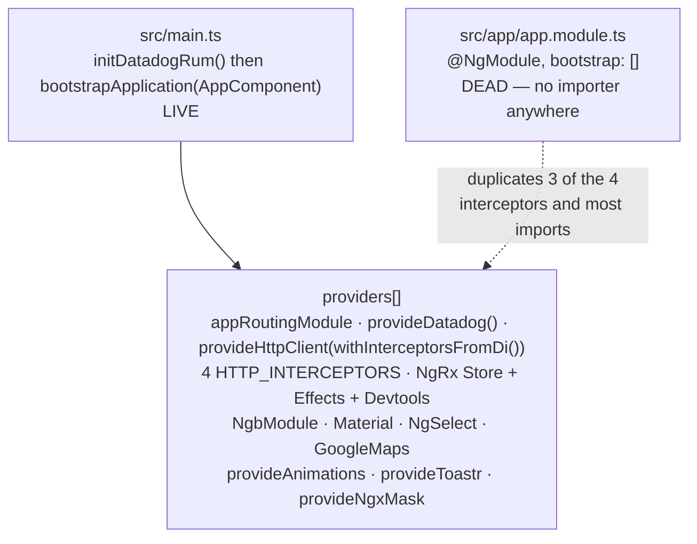
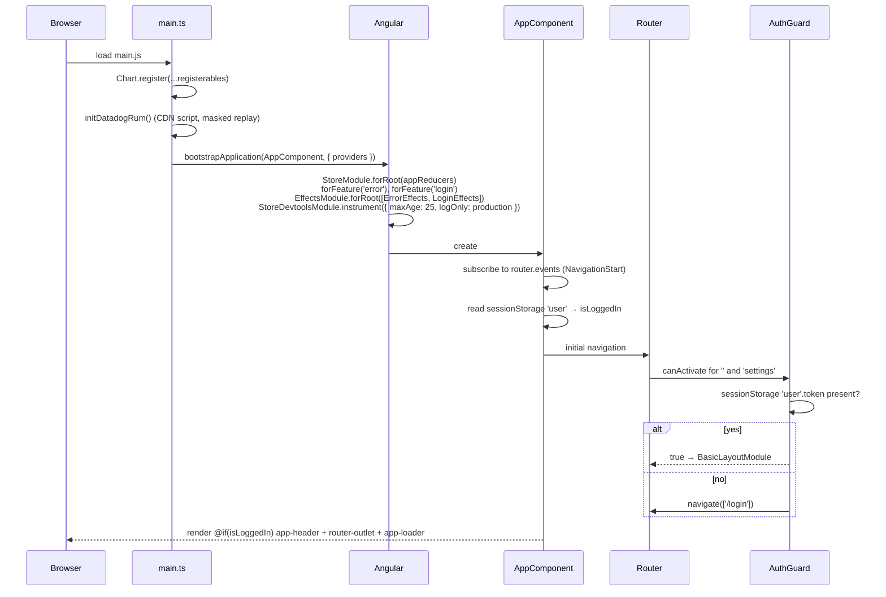
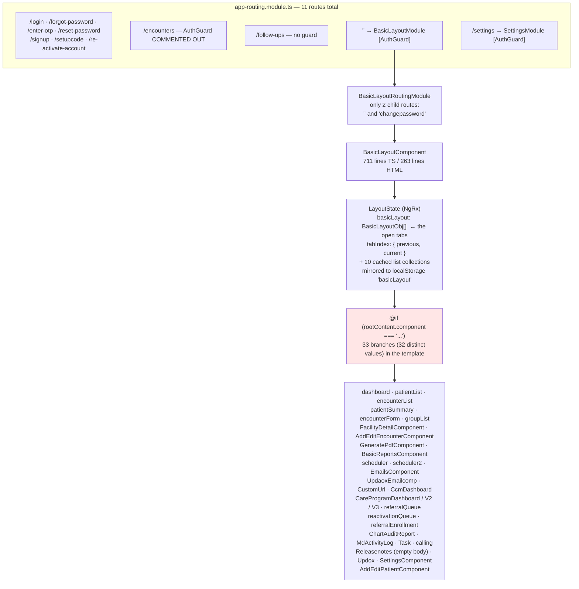
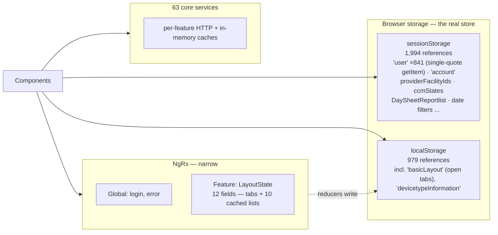
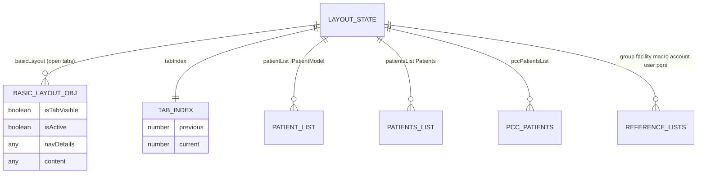

# PacEHR — SPA Shell & Navigation Diagrams

**Date**: 2026-10-19
**Source**: `docs/architecture/current/09-spa-shell-navigation-deep-dive.md`
**Produced by**: ARCHITECT (`aire-brownfield-deep-dive`, refresh)
**Audience**: BA / Product / anyone who wants the pictures without the prose

---

## 1. Two composition roots, one live

---

## 2. Application bootstrap

---

## 3. Navigation — tabs, not routes

---

## 4. State — three stores, unevenly used

---

## 5. `LayoutState` (`features/basic-layout/_store/layout.state.ts`, 463 lines)

---
