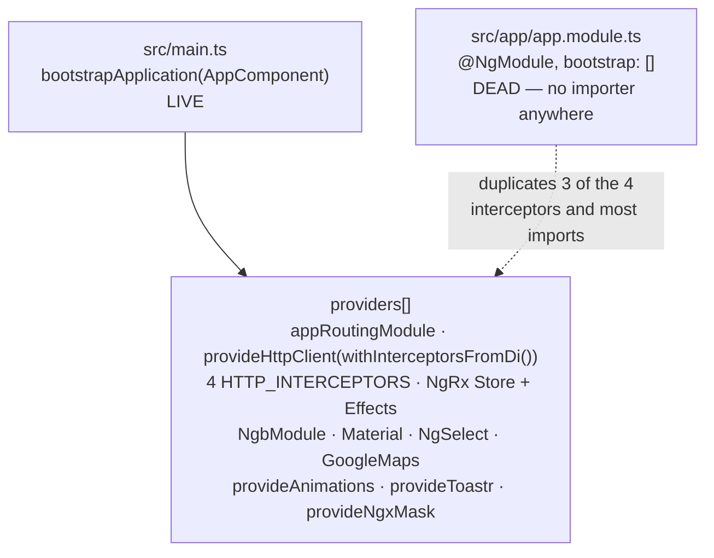
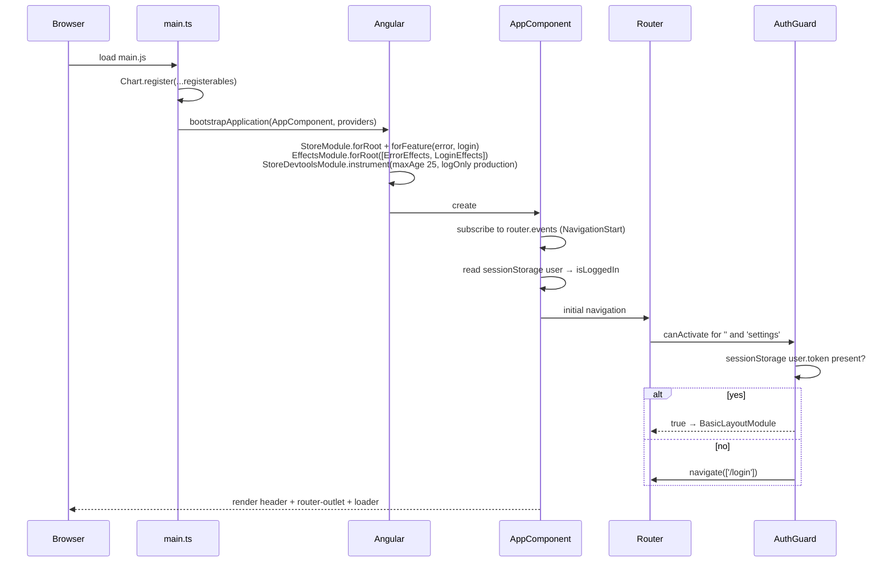
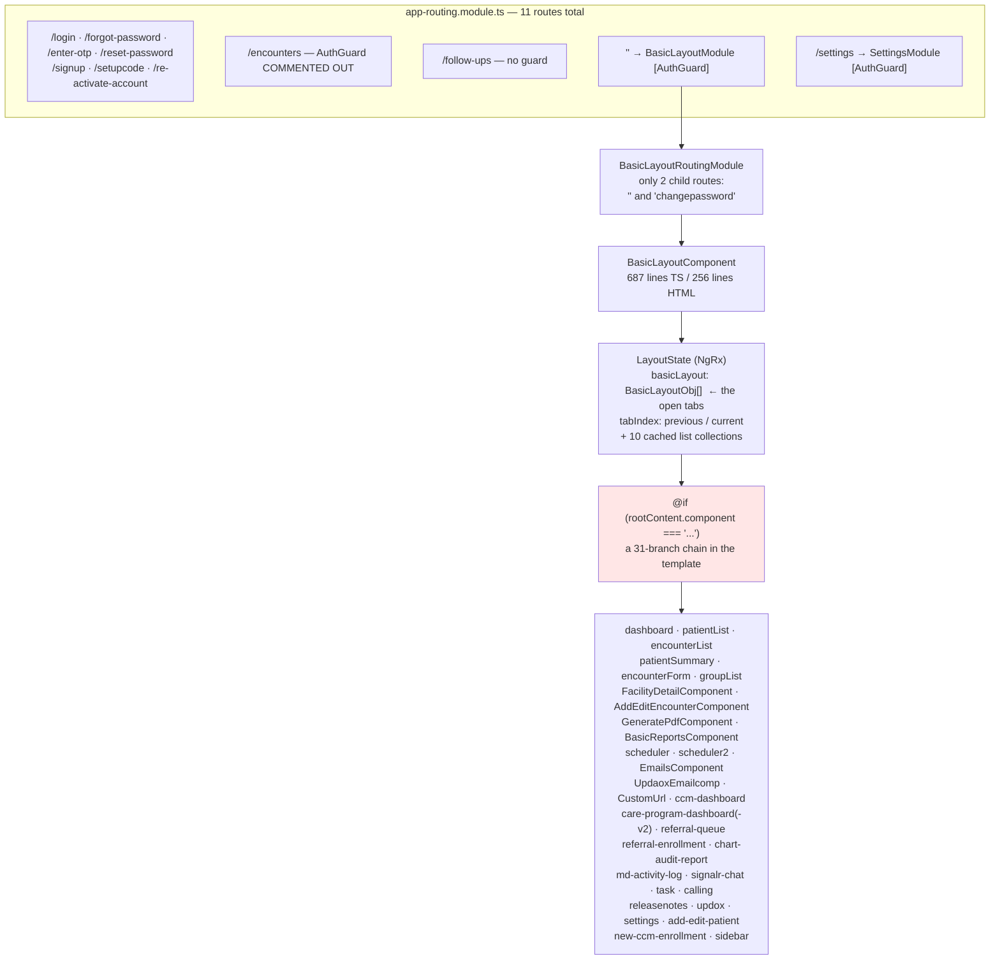
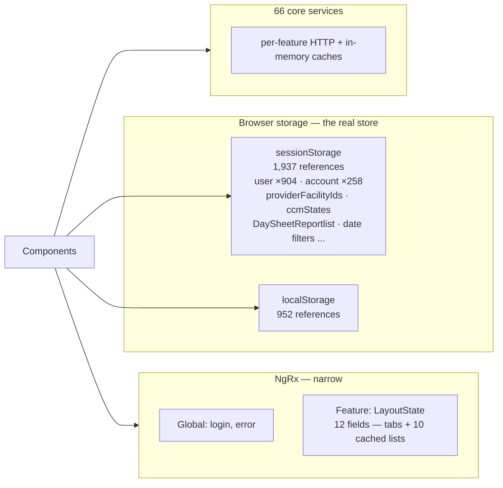

# PacEHR — SPA Shell & Navigation Diagrams

**Date**: 2026-09-30
**Source**: `docs/architecture/current/09-spa-shell-navigation-deep-dive.md`
**Produced by**: ARCHITECT (`aire-brownfield-deep-dive`, Phase 6)
**Audience**: BA / Product / anyone who wants the pictures without the prose

---

## 1. Two composition roots, one live

`main.ts` bootstraps the app. `app.module.ts` still exists, registers a different interceptor list, and is imported by nothing.

---

## 2. Application bootstrap

---

## 3. Navigation — tabs, not routes

The URL stays at `/` for every authenticated screen. A 31-branch string comparison decides what renders.

---

## 4. State — three stores, unevenly used

NgRx holds tabs and a few lists; browser storage holds everything else.

---

**Full analysis**: `docs/architecture/current/09-spa-shell-navigation-deep-dive.md`
