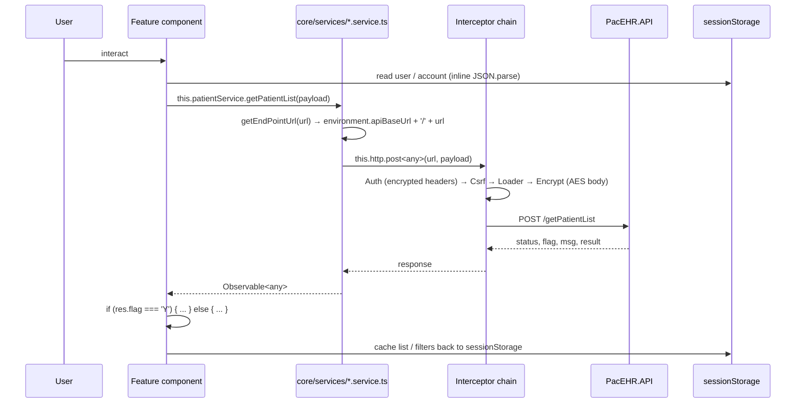
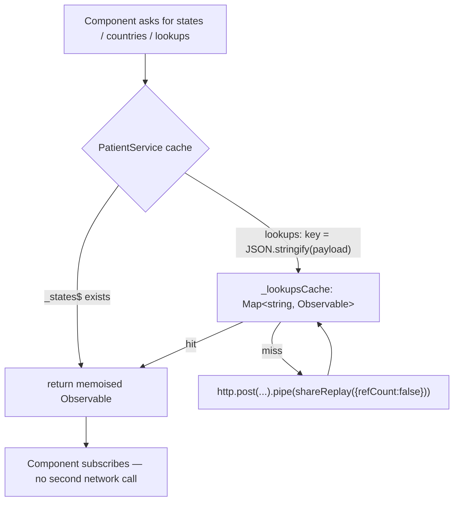
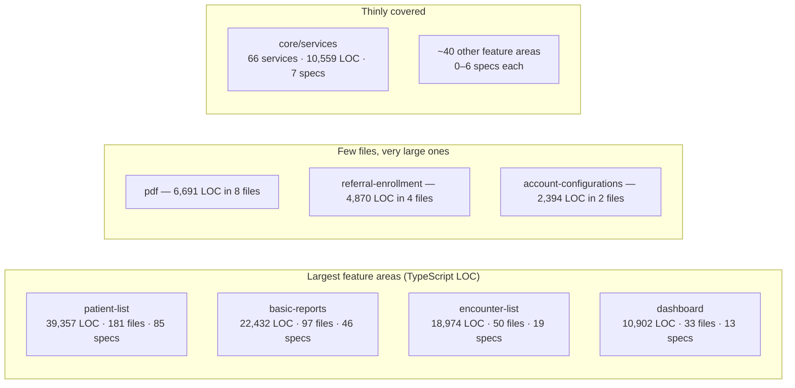

# PacEHR — SPA Feature Areas Diagrams

**Date**: 2026-09-30
**Source**: `docs/architecture/current/10-spa-feature-areas-deep-dive.md`
**Produced by**: ARCHITECT (`aire-brownfield-deep-dive`, Phase 6)
**Audience**: BA / Product / anyone who wants the pictures without the prose

---

## 1. A feature area's data path

Every screen follows this route from click to API and back — including the inline `sessionStorage` reads and the `flag`-based branching.

---

## 2. Caching — the pattern that exists in one service

`PatientService` memoises reference data correctly. The other 65 services do not.

---

## 3. Where the SPA's mass sits

Two feature areas hold half the code — and 41% of all the tests.

---

**Full analysis**: `docs/architecture/current/10-spa-feature-areas-deep-dive.md`
