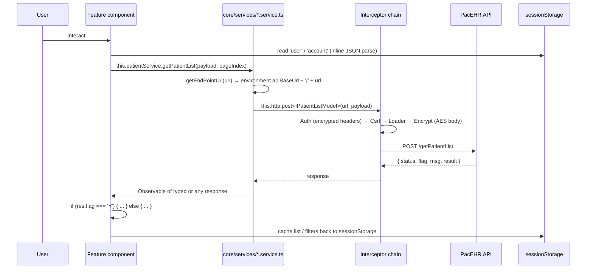
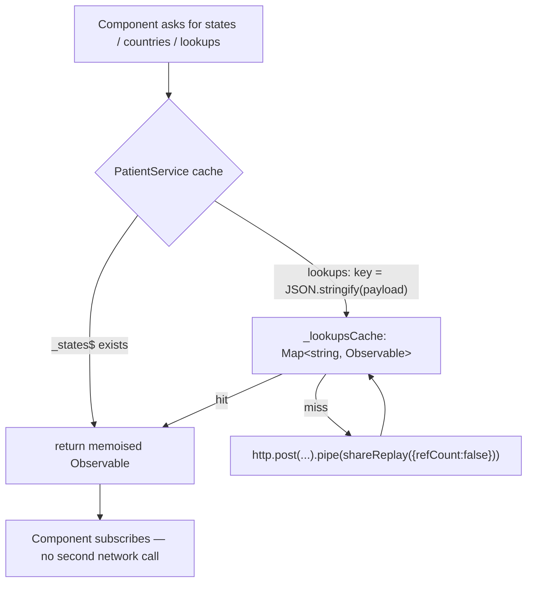
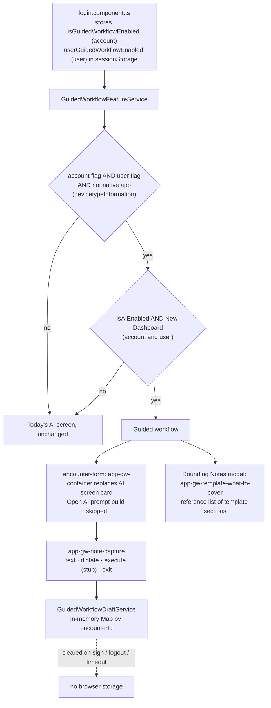
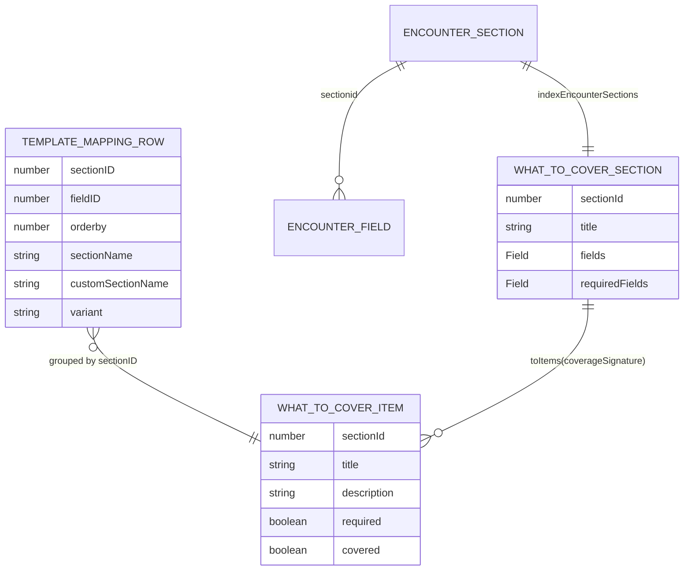
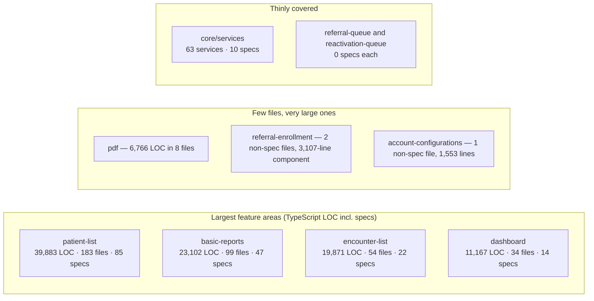

# PacEHR — SPA Feature Areas Diagrams

**Date**: 2026-10-19
**Source**: `docs/architecture/current/10-spa-feature-areas-deep-dive.md`
**Produced by**: ARCHITECT (`aire-brownfield-deep-dive`, refresh)
**Audience**: BA / Product / anyone who wants the pictures without the prose

---

## 1. A feature area's data path



---

## 2. Caching — now in several services



---

## 3. Guided workflow — gating and use



---

## 4. What-to-Cover read in the Rounding Notes modal

```mermaid
sequenceDiagram
  participant M as AddRoundingNotes modal
  participant T as app-gw-template-what-to-cover
  participant W as GuidedWorkflowWhatToCoverService
  participant TE as TemplateEditorService
  participant API as PacEHR.API

  M->>T: templateId (form control value)
  T->>T: ngOnChanges → toTemplateId (positive integer or null)
  T->>W: itemsForTemplate(id)
  alt cached for this id
    W-->>T: shared Observable (shareReplay)
  else not cached
    W->>TE: getTemplateMapping({ templateId })
    TE->>API: POST getTemplateMapping
    API-->>W: { flag, result: rows }
    W->>W: flag Y → fromTemplateMapping(rows) ordered by orderby, required if any Hard field
    W->>W: flag F or error → []; error evicts cache entry
    W-->>T: WhatToCoverItem[]
  end
  T-->>M: renders app-gw-what-to-cover in reference mode
```

---

## 5. Guided workflow models (`features/guided-workflow/models/what-to-cover.ts`)



---

## 6. Where the SPA's mass sits



---
