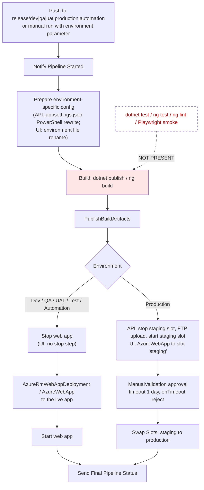
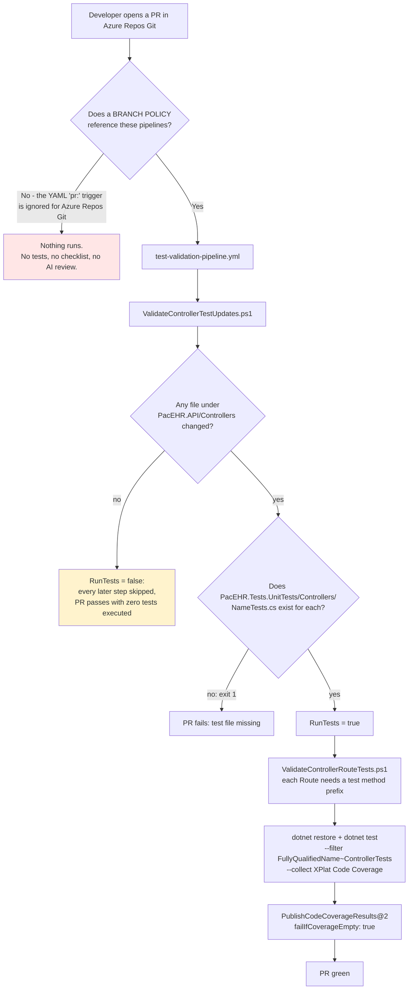
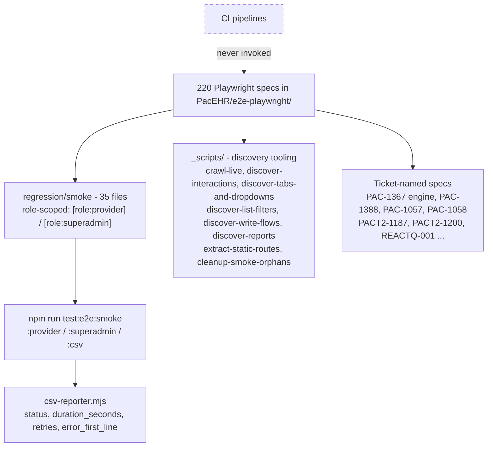
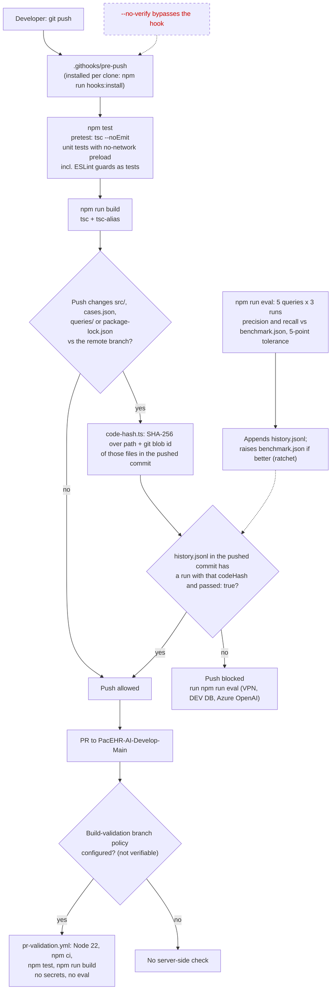

# PacEHR — Test Infrastructure & CI/CD Diagrams

**Date**: 2026-10-19
**Source**: `docs/architecture/current/11-test-infrastructure-cicd-deep-dive.md`
**Produced by**: ARCHITECT (`aire-brownfield-deep-dive`, Phase 6)
**Audience**: BA / Product / anyone who wants the pictures without the prose

---

## 1. The deploy path - no test gate; production has a slot swap

Neither deploy pipeline runs a test, lint or smoke step. Non-production stops, deploys and starts the app; production deploys to a staging slot, waits for a manual approval, then swaps.

---

## 2. The PR path (pacEHR_API) - may never run, and runs only controller tests

Needs a branch policy on Azure Repos; skips everything when no controller changed; runs only tests whose name contains ControllerTests.

---

## 3. The E2E suite (manual)

220 Playwright specs, 35 in the role-scoped smoke suite, plus discovery tooling. No pipeline invokes it.

---

## 4. pacEHR_AI quality gate - pre-push hook, PR build, eval ledger

Hook runs tests and build, then requires a passing eval run recorded for the exact code hash; the PR pipeline repeats tests and build but not the eval.

