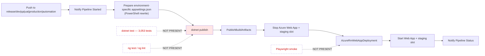
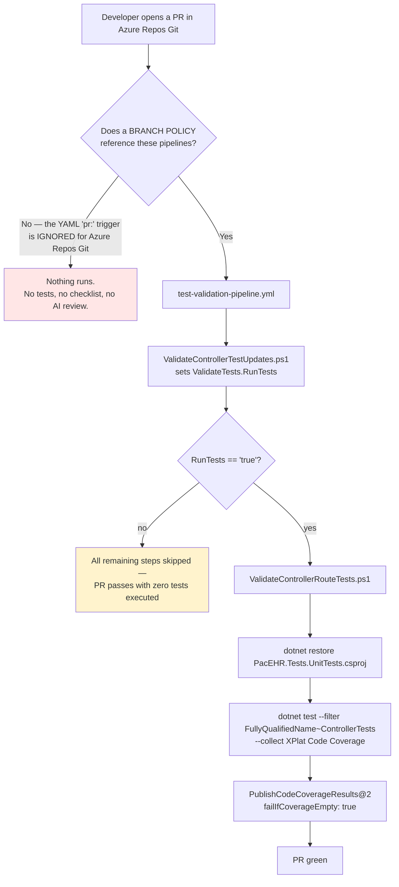
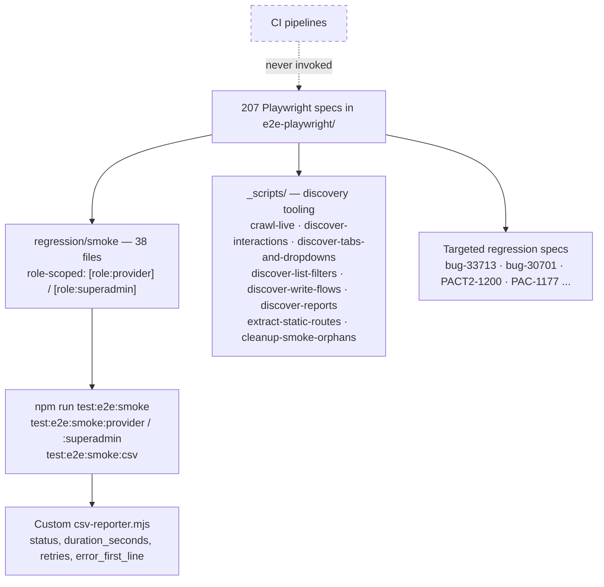

# PacEHR — Test Infrastructure & CI/CD Diagrams

**Date**: 2026-09-30
**Source**: `docs/architecture/current/11-test-infrastructure-cicd-deep-dive.md`
**Produced by**: ARCHITECT (`aire-brownfield-deep-dive`, Phase 6)
**Audience**: BA / Product / anyone who wants the pictures without the prose

---

## 1. The deploy path — no quality gate

Both deploy pipelines go from build to production with no test, lint or smoke step.

---

## 2. The PR path — may never run

YAML `pr:` triggers are ignored for Azure Repos Git. Two further conditions can skip the tests even when the pipeline does run.

---

## 3. The E2E suite — built, capable, never run by CI

---

**Full analysis**: `docs/architecture/current/11-test-infrastructure-cicd-deep-dive.md`
