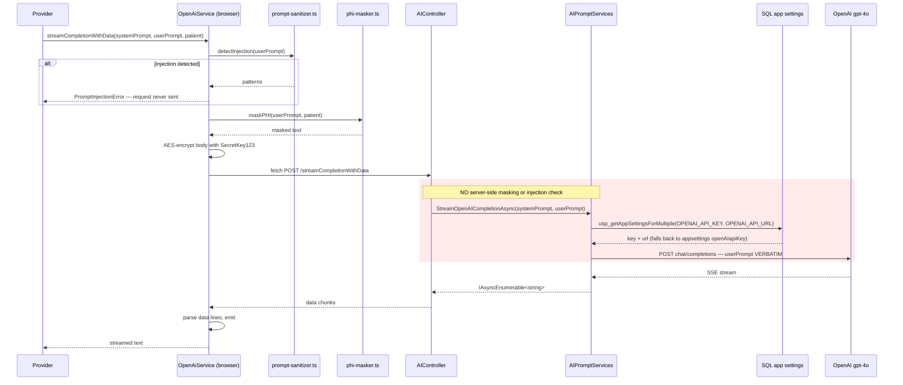
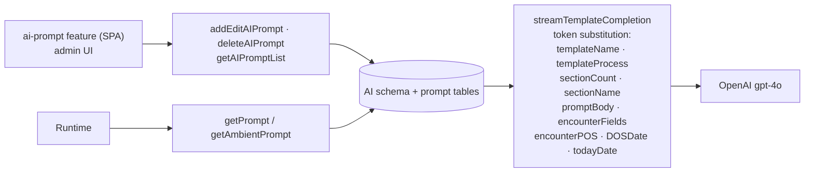

# PacEHR — AI Assistance & Dictation Diagrams

**Date**: 2026-09-30
**Source**: `docs/architecture/current/12-ai-assistance-deep-dive.md`
**Produced by**: ARCHITECT (`aire-brownfield-deep-dive`, Phase 6)
**Audience**: BA / Product / anyone who wants the pictures without the prose

---

## 1. Ambient dictation over an unauthenticated WebSocket

`/speechToText` is exempt from authentication twice, and takes patient and account identity from the query string.

```mermaid
sequenceDiagram
  participant B as Browser (or any WebSocket client)
  participant MW as JWTMiddleware
  participant CT as AIController.Get — /speechToText
  participant G as Google Cloud Speech V1
  participant DB as SQL

  B->>MW: GET wss://.../speechToText?notesId=&userId=&accountId=&patientId=
  Note over MW: /speechToText is in excludedPaths → no body decryption
  Note over MW: [AllowAnonymous] → no authentication
  MW->>CT: forward
  CT->>CT: int.TryParse(query userId)    → 0 on failure
  CT->>CT: int.TryParse(query accountId) → 0 on failure
  CT->>CT: int.TryParse(query patientId) → 0 on failure
  Note over CT: no ownership check — the caller names<br/>the patient and account it writes to
  CT->>CT: AcceptWebSocketAsync()
  loop audio frames, 48kHz mono 16-bit
    B->>CT: binary PCM
    CT->>G: StreamingRecognize (Google-Credentials.json)
    G-->>CT: interim + final transcripts
    CT-->>B: transcript JSON (deduped via sentTranscripts)
  end
  CT->>DB: persist transcript against notesId / patientId
  Note over CT: audio itself is buffered in memory;<br/>the blob upload is commented out
```

---

## 2. A chat completion — where the safety controls run

PHI masking and injection detection happen in the browser. The API forwards the prompt verbatim.



---

## 3. Prompt management

System prompts live in the database and are edited through an admin screen; nine tokens are substituted at runtime.



---

**Full analysis**: `docs/architecture/current/12-ai-assistance-deep-dive.md`
