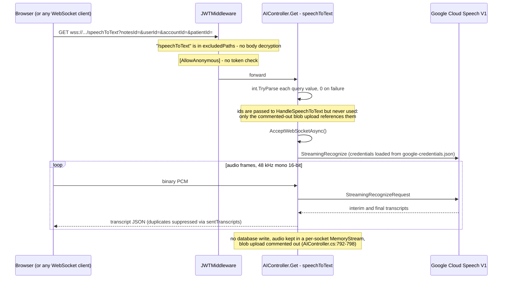
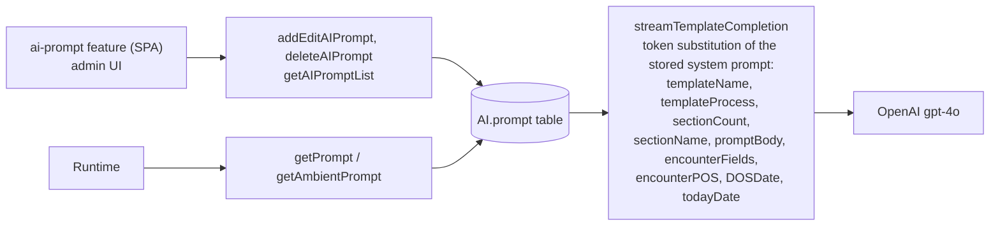
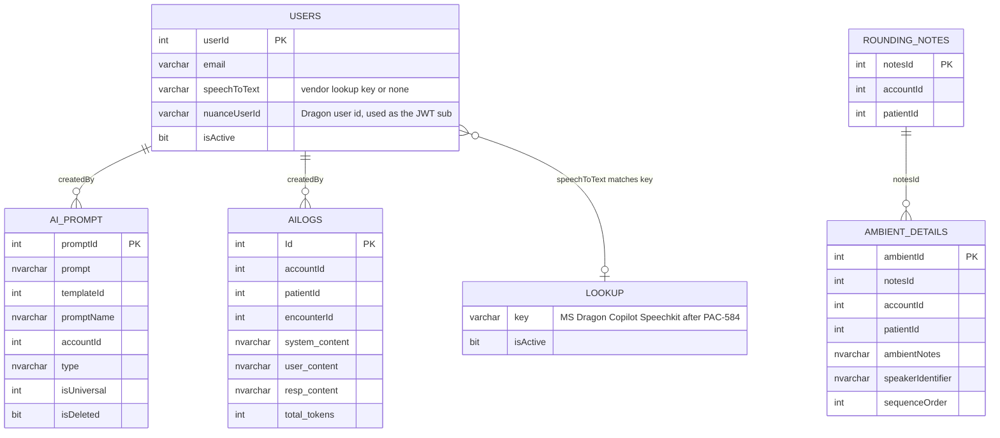

# PacEHR — AI Assistance & Dictation Diagrams

**Date**: 2026-10-19
**Source**: `docs/architecture/current/12-ai-assistance-deep-dive.md`
**Produced by**: ARCHITECT (`aire-brownfield-deep-dive`, Phase 6)
**Audience**: BA / Product / anyone who wants the pictures without the prose

---

## 1. Dragon Copilot dictation - partner JWT, token exchange, start (new)

The API signs a per-user partner JWT and publishes its public key; the browser SDK exchanges it for a Dragon token and starts dictation.

```mermaid
sequenceDiagram
  participant U as Clinician
  participant BTN as DragonRecordButton
  participant SVC as DragonCopilotService (SPA)
  participant API as WebUiTokenController
  participant US as UserService
  participant DB as SQL Account.users
  participant SDK as Dragon Copilot SDK (browser)
  participant DX as Dragon Copilot cloud

  U->>BTN: focus a text field, click Start Dictation
  BTN->>SVC: toggleDictation()
  SVC->>SVC: ensureMicAccess() - toast and stop if the microphone is blocked
  SVC->>SDK: dragon.initialize(services, partnerGuid, daxProductId, acquireAccessToken)
  SDK->>SVC: acquireAccessToken(scope)
  SVC->>API: GET /webUiToken (session token header; cached until ~2 min before expiry)
  API->>API: read userId from HttpContext.Items - 401 if absent
  API->>US: getDragonSub(userId)
  US->>DB: usp_GetDragonSubByUserId(userId)
  DB-->>US: userId, dragonSub (nuanceUserId), email - no row if inactive
  alt dragonSub empty
    API-->>SVC: 403 "not set up for this user", missing nuanceUserId
  else config incomplete
    API-->>SVC: 500 with the list of missing DragonCopilot keys
  else ok
    API->>API: sign RS256 JWT with DragonCopilot:PrivateKey, kid, aud streaming.daxcopilot.com, sub = dragonSub
    API-->>SVC: accessToken, expiresIn 3600, Bearer
  end
  SVC->>SDK: EhrAuthenticationClient.acquireToken(accessToken: partner JWT)
  SDK->>DX: POST token/generate
  DX->>API: GET issuer/.well-known/openid-configuration then jwks_uri (anonymous)
  API-->>DX: discovery document and public key
  DX-->>SDK: Dragon token
  SDK-->>SVC: Dragon token
  loop up to 3 attempts, 2.5 s each
    SVC->>SDK: recording.startRecording(dictation)
    SDK-->>SVC: recordingStarted event
  end
  SDK-->>U: dictated text typed into the focused field
  SVC->>SVC: dispatch input event so ngModel / reactive forms update
```

---

## 2. Ambient dictation over an unauthenticated WebSocket (legacy)

The endpoint is anonymous, streams audio to Google Cloud Speech and persists nothing.



---

## 3. A chat completion - where the safety controls run (legacy)

PHI masking and injection detection run in the browser only; the API forwards the prompt verbatim.


---

## 4. Prompt management (legacy)

Stored system prompts edited through an admin screen and filled with placeholder tokens at runtime.



---

## 5. Data model

Users, prompts, AI logs and ambient notes tables touched by this module.


