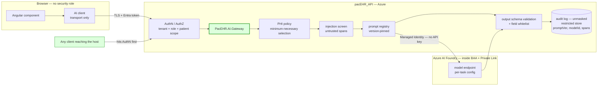
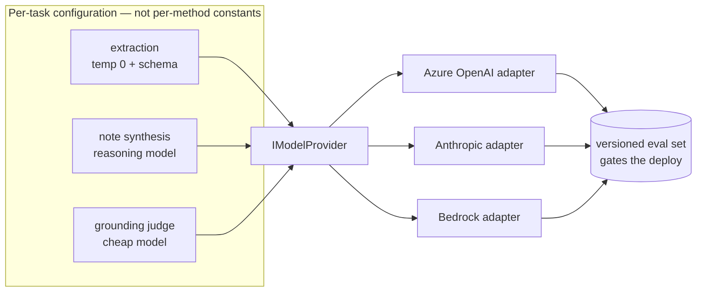
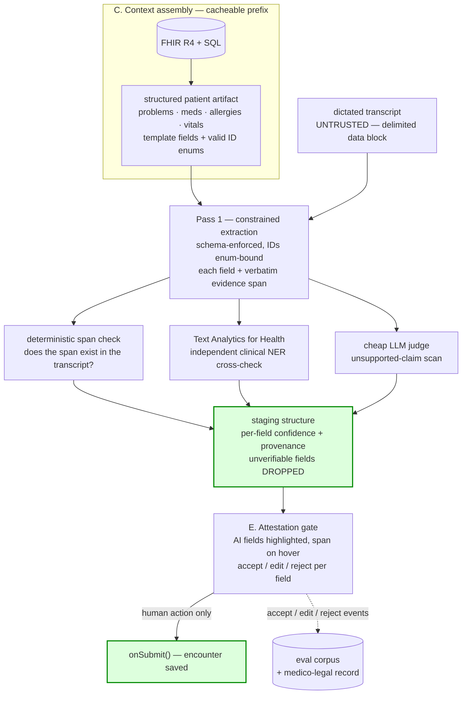
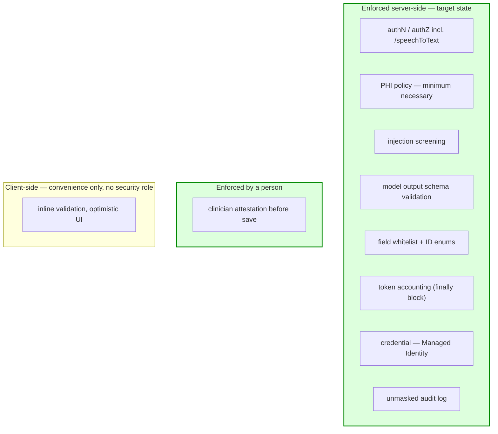

# PacEHR — AI Assistance & Dictation: Target Architecture Diagrams

**Date**: 2026-09-08
**Source**: `docs/architecture/design/12-ai-assistance-target-architecture.md`
**Produced by**: ARCHITECT
**Module 12 (target state)** — counterpart to `12-ai-assistance-deep-dive-diagrams.md`

> Mermaid diagrams extracted verbatim from the target-architecture design note.
> Each is paired with the current-state diagram it replaces.

---

## 1. Target trust boundaries — the guards move server-side

Replaces current-state diagram 2. Today `maskPHI`, `detectInjection` and body encryption all sit in the browser, so anything that can reach the host bypasses them, and the credential is resolved from SQL app settings. Here every guard is enforced inside the host, authorisation runs before anything else, and Managed Identity removes the credential entirely.

---

## 2. Provider abstraction and per-task routing

Model (`gpt-4o`) and `temperature = 0` are currently hardcoded in four `AIPromptServices` methods. Lifting them to per-task configuration behind one `IModelProvider` is what turns a model change into a config change — and what makes an A/B against the eval set possible without a deploy.

---

## 3. Two-pass generation, verification, and the attestation gate

Replaces current-state diagram 4 — the one where model output reaches a saved encounter unvalidated. `timer(1000)` is gone. Extraction is schema-constrained with ID enums, every field carries the transcript span it came from, three independent checks run against it, unverifiable fields are dropped rather than guessed, and a clinician acts before anything is written.

---

## 4. Where each control layer sits in the target state

Replaces current-state diagram 5. In the current state the "Neither" box holds prompt validation and model output schema validation. Here it is empty: nothing that matters is left to the browser, and the one control that belongs with a person is explicitly assigned to one.

---

## Reading order

| Current state | Target state | What changes |
|---|---|---|
| `12-...-deep-dive-diagrams.md` #2 — trust boundaries | #1 above | Guards move browser → host; credential removed |
| `12-...-deep-dive-diagrams.md` #1 — streaming completion | #1 and #2 above | Gateway interposed; provider becomes swappable |
| `12-...-deep-dive-diagrams.md` #4 — extraction auto-commit | #3 above | Validation, evidence spans and human attestation added |
| `12-...-deep-dive-diagrams.md` #5 — control layers | #4 above | "Neither" box emptied |
| `12-...-deep-dive-diagrams.md` #3 — ambient dictation | *(no diagram — see design note §G)* | Speech consolidated into one BAA boundary; socket authenticated; audio-retention posture decided |
