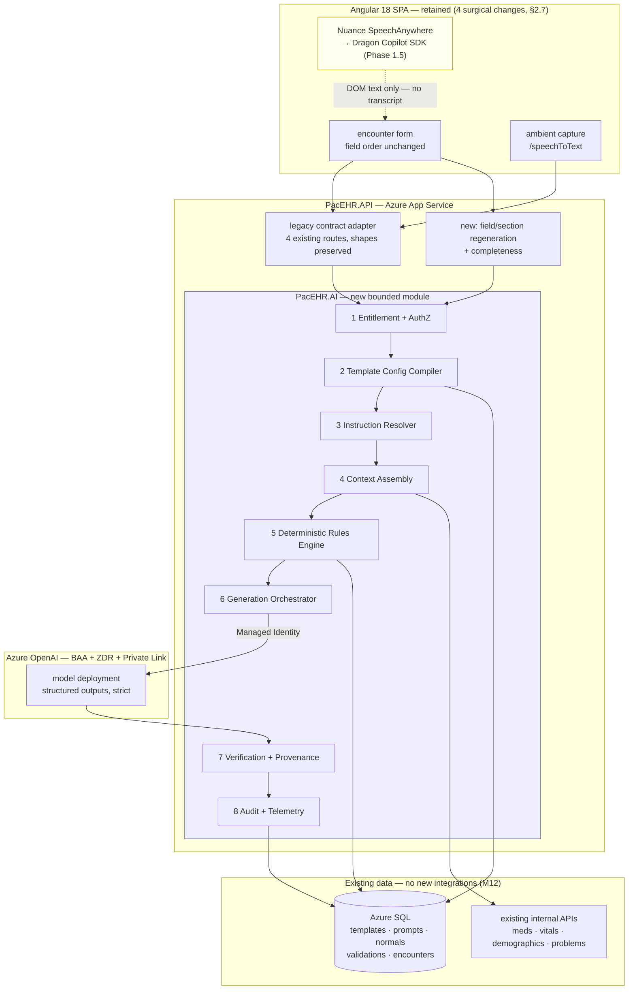
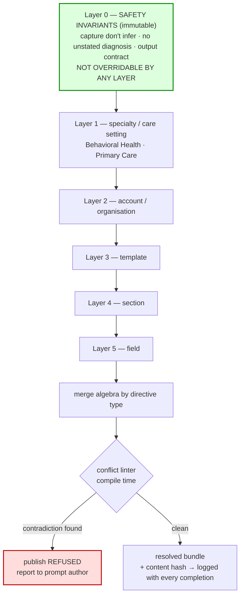

# PacEHR — AI Phase 1 Implementation Architecture Diagrams

**Date**: 2026-09-09
**Source**: `docs/architecture/design/12-ai-phase1-implementation-architecture.md`
**Produced by**: ARCHITECT
**Module 12 (Phase 1)** — see also `12-ai-assistance-deep-dive-diagrams.md` (current state)

> Mermaid diagrams extracted verbatim from the Phase 1 design note.

---

## 1. End-to-end Phase 1 architecture

The Angular SPA is retained with four surgical changes (design note §2.7). The new `PacEHR.AI`
module sits behind an adapter that preserves the four existing route contracts, so a feature flag
can route traffic per tenant or template and both engines can run in shadow mode. No new external
integrations — patient data comes from existing internal APIs (M12).

Note the yellow node: **Dragon writes recognised text straight into the DOM, so the backend never
sees a transcript** — only the final field value. That constraint drives the input-modality
abstraction and the input-time provenance tagging.

---

## 2. Instruction Resolver — composition replacing selection

The fix for the conflict problem. Today `usp_getPrompt` is winner-takes-all with an early
`RETURN`, so a template-level prompt **replaces** the universal prompt and silently drops the
safety rules it contained — including "do not create a diagnosis the provider did not provide."

Here Layer 0 is immutable and cannot be overridden by any narrower layer, `prohibition` and
`required` directives merge by union, and contradictions are caught by a linter at publish time
rather than surfacing as inconsistent model behaviour in production. The resolved bundle is
content-hashed and the hash is logged with every completion, which is what makes generations
reproducible and A/B comparison meaningful.

---

## Current state → Phase 1 mapping

| Current-state diagram | Phase 1 counterpart | What changes |
|---|---|---|
| `12-...-deep-dive-diagrams.md` #1 — streaming completion | #1 above | Engine interposed behind the same contract; Managed Identity replaces the API key |
| `12-...-deep-dive-diagrams.md` #2 — trust boundaries | #1 above | Guards move browser → host; entitlement enforced server-side |
| `12-...-deep-dive-diagrams.md` #3 — ambient dictation | #1 above (yellow node) | Two input modalities made explicit; Dragon's missing transcript named as a constraint |
| `12-...-deep-dive-diagrams.md` #4 — extraction auto-commit | #1 above | `timer(1000)` removed; schema-constrained decode makes invalid JSON unreachable |
| `12-...-deep-dive-diagrams.md` #5 — control layers | #2 above | Instruction composition replaces prompt selection |
