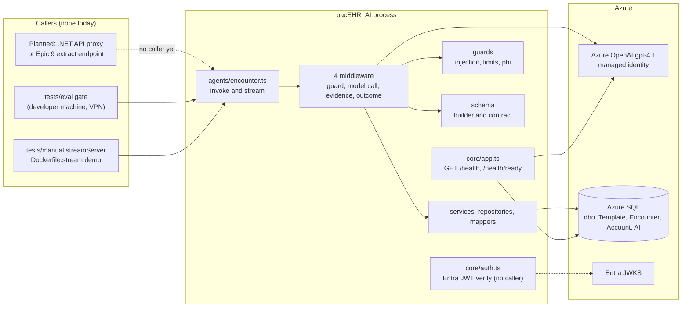
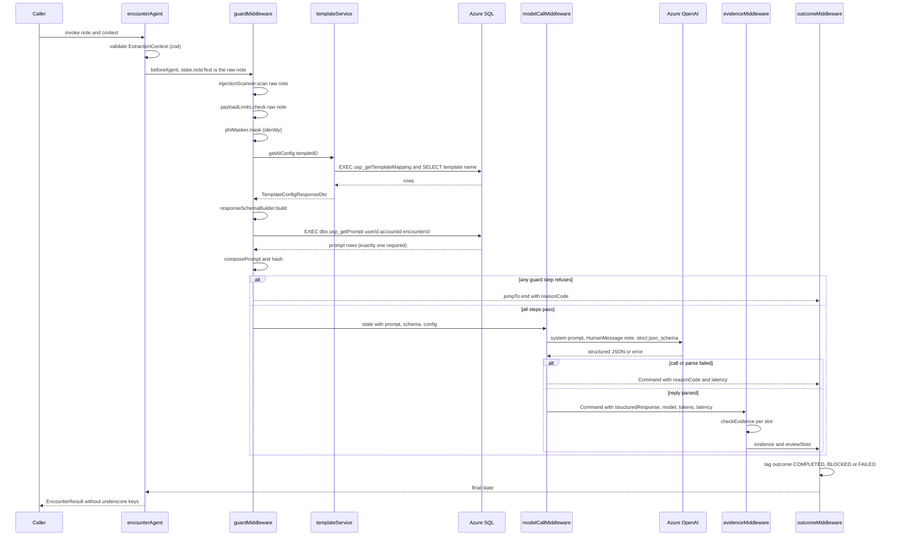
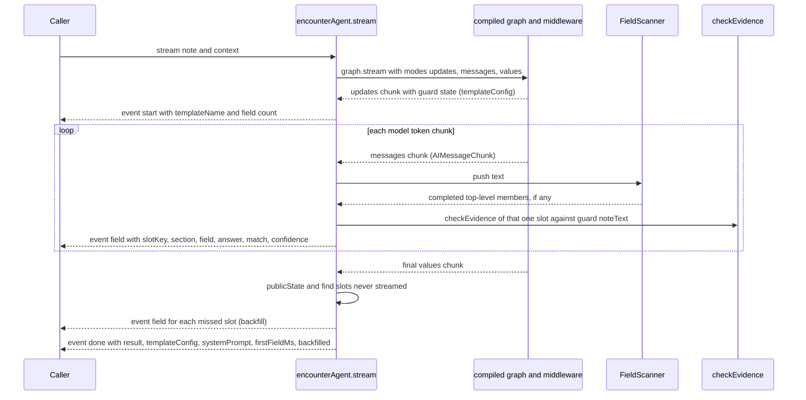
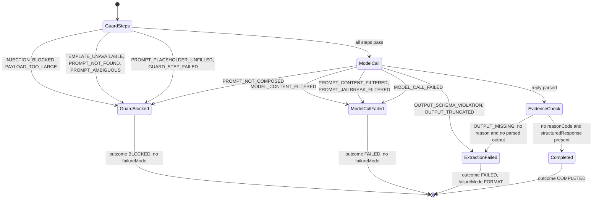
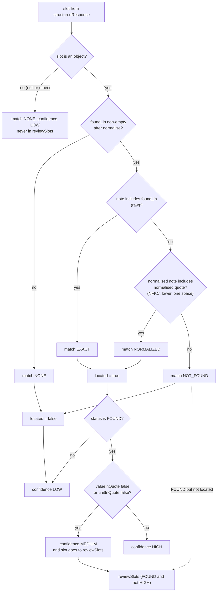
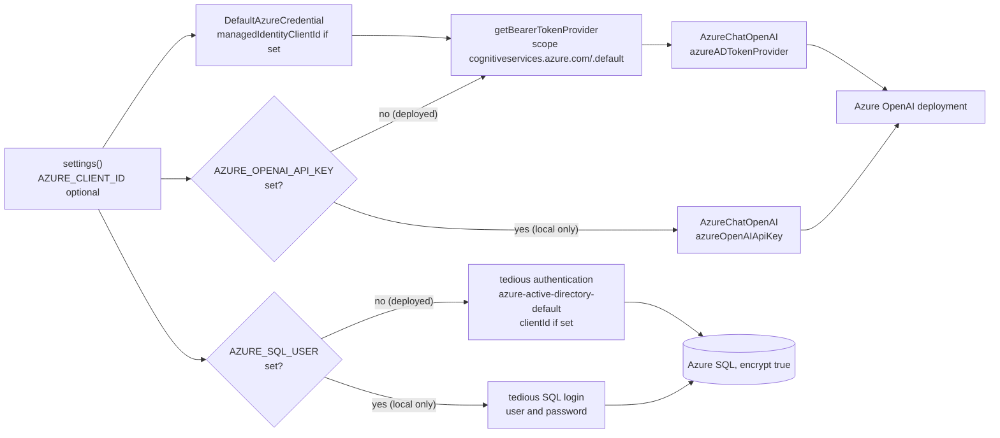
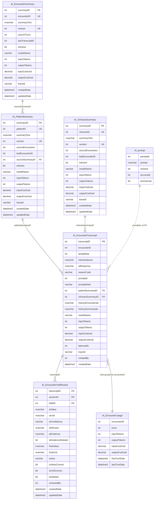
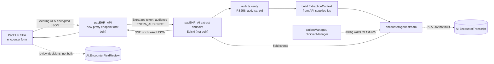

# PacEHR - pacEHR_AI Service Diagrams

**Date**: 2026-10-19
**Source**: `docs/architecture/current/13-pacehr-ai-service-deep-dive.md`
**Produced by**: ARCHITECT (`aire-brownfield-deep-dive`, Phase 6)
**Audience**: BA / Product / anyone who wants the pictures without the prose

---

## 1. Where the service sits

The service in context: callers (none in production), the in-process layers and the Azure dependencies.

## 2. One extraction request (invoke)

Guard, model call, evidence and outcome for a single run, including both exits.

## 3. Streaming (stream)

How per-field events are produced from the model's token stream.

## 4. Failure modes and outcome tagging

Every reason code, which stage raises it, and how it becomes BLOCKED, FAILED or COMPLETED.

## 5. Evidence and confidence derivation

How the HIGH / MEDIUM / LOW band is computed in code, never from the model.

## 6. Managed-identity access (Azure OpenAI and SQL)

Deployed path versus local-development fallback for both resources.

## 7. AI SQL schema (ER)

Tables, view and references in the AI schema, from the actual DDL in migrations/sql.

## 8. How it would be called (not built)

The implied call path from the SPA through the .NET API; dotted edges are unbuilt.

