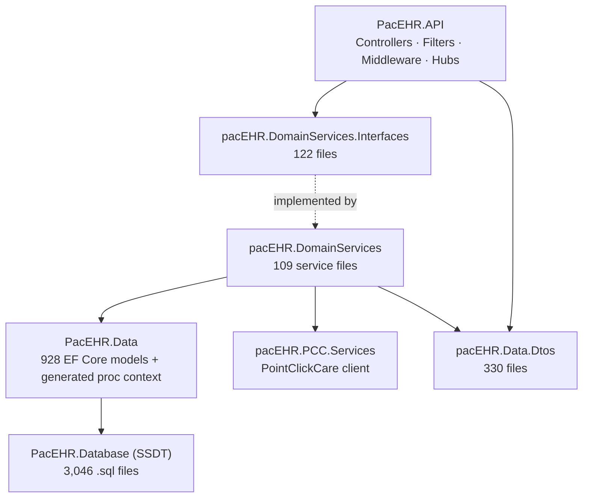
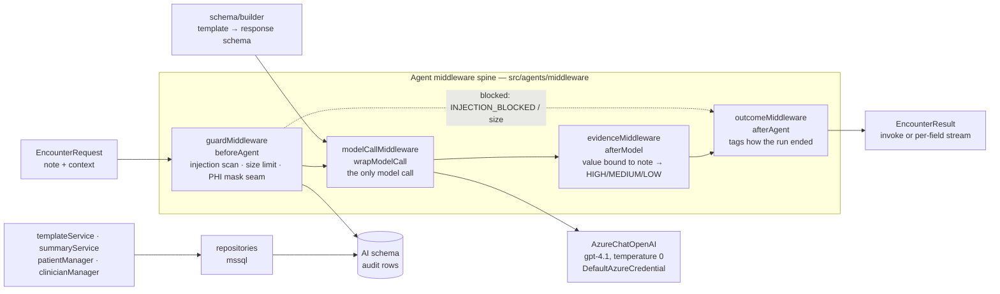

# System Overview - PacEHR

**Date**: 2026-10-19
**Analyzed By**: ARCHITECT
**Status**: Draft (awaiting user confirmation)
**Method**: AIRE `aire-brownfield-inspect` — Phases 0–5 (refresh of the 2026-09-30 overview)
**Scope**: three repositories — `PacEHR` (SPA), `pacEHR_API` (.NET API + SQL), `pacEHR_AI` (Node AI service)
**Evidence base**: direct filesystem analysis of the working copies. No README, wiki, or `CLAUDE.md` claim was accepted without checking it against code, except where a row is marked *carried* (taken from the 2026-09-30 deep-dives and not re-measured in this pass).

---

## Executive Summary

PacEHR is a multi-tenant, cloud-hosted Electronic Health Record (EHR) platform for post-acute / skilled-nursing and behavioural-health care, operated by Saisystems. It is an Angular 18 single-page application talking to a single ASP.NET Core 8 Web API over ~1,039 RPC-style HTTP endpoints, with most business logic implemented as T-SQL stored procedures in one large SQL Server database (1,602 procedure scripts, 1,132 table scripts).

Around that core sit an ONC-style FHIR R4 / CCDA / QRDA interoperability surface, integrations with external clinical systems (PointClickCare, MatrixCare, DrFirst, Updox, IMO, HL7 feeds), Azure platform services, and a timer-driven Azure Functions worker.

**New since 2026-09-30:** `pacEHR_AI` is no longer a stub. It is now a real Node.js 22 / TypeScript service (~1,950 lines in `src/`) that extracts structured values from a clinician's free-text note using a LangChain agent on Azure OpenAI (gpt-4.1). It has a guarded agent core, an accuracy-evaluation gate, and its own `AI` SQL schema, but **it is not yet connected to the rest of the system** — see [PacEHR_AI](#pacehr_ai-node-service).

**Scope note**: the standalone SignalR services and the Saisystems identity/token-handler services are not in this workspace. `PacEHR.API/Hubs/` does contain `ChatNotificationHub` and `EmailNotificationHub`, but `Program.cs` has no `MapHub` call.

---

## Repository Layout

| Repo | Remote (Azure DevOps, `Saisystems-PaaS/PacEHR/…`) | Checked-out ref | HEAD | Contents |
|---|---|---|---|---|
| `PacEHR/` | `PacEHR` | detached at `origin/3p-dev/AITP-117-Guided-screen-What-to-Cover-panel` | `401caa134` (2026-10-15) | Angular 18 SPA, Playwright suite, pipelines |
| `pacEHR_API/` | `pacEHR_API` | `PacEHR-DevelopAPI-Main` | `0f611f65c` (2026-10-16) | .NET 8 solution, SSDT database project, Functions worker, tests, pipelines |
| `pacEHR_AI/` | `PacEHR_AI` | `3p-dev/epic-05-Guardrails` | `ef172ea` (2026-10-16) | Node 22 / TypeScript AI extraction service, migrations, eval harness |

All three working trees are clean. `PacEHR` and `pacEHR_AI` are on feature branches, not their develop branches, so the numbers below describe those branches.

**Change since the 2026-09-30 overview** (commits since 2026-09-30): `PacEHR` 212, `pacEHR_API` 179, `pacEHR_AI` 41.

---

## System Architecture

### Architecture Diagram — System Context & Containers

```mermaid
flowchart TB
  subgraph Client["Browser"]
    SPA["Angular 18 SPA<br/>340 components / 304 standalone<br/>54 feature folders"]
  end

  subgraph Azure["Azure"]
    API["PacEHR.API<br/>ASP.NET Core 8<br/>100 controllers, ~1,039 endpoints"]
    FUNC["PacEHR.Functions.Process<br/>Isolated worker, 5 timer triggers"]
    AISVC["pacEHR_AI<br/>Node 22 / TypeScript<br/>LangChain agent, /health only"]
    SIGR["SignalR services<br/>(external repos)"]
  end

  subgraph Data["Data Tier"]
    SQL[("SQL Server<br/>PacEHR schema: 1,132 table scripts<br/>1,602 procedure scripts")]
    AISQL[("AI schema<br/>same Azure SQL database<br/>10 migrations")]
    REDIS[("Redis<br/>PCC token + response cache")]
    COSMOS[("Cosmos DB<br/>PCC request/response logs")]
    BLOB[("Azure Blob Storage")]
    LAW[("Log Analytics")]
  end

  subgraph Ext["External Systems"]
    PCC["PointClickCare"]
    MC["MatrixCare"]
    DRF["DrFirst (eRx)"]
    UPD["Updox"]
    IMO["IMO terminology"]
    HL7["HL7 ADT feeds"]
    TW["Twilio"]
    SG["SendGrid / SMTP"]
    PBI["Power BI Embedded"]
    GSP["Google Cloud Speech"]
    OAI["OpenAI (legacy prompt path)"]
    DRG["Dragon Copilot<br/>dictation SDK"]
    AOAI["Azure OpenAI<br/>gpt-4.1"]
    ENTRA["Microsoft Entra ID<br/>JWKS"]
  end

  SPA -->|"HTTPS JSON + AES payload encryption"| API
  SPA -->|WebSocket| SIGR
  SPA -->|"WebSocket audio"| API
  SPA -->|"SDK, token from API"| DRG

  API --> SQL
  API --> REDIS
  API --> COSMOS
  API --> BLOB
  API --> LAW
  API -->|"Service Bus queues"| FUNC
  FUNC --> SQL

  API --> PCC
  API --> MC
  API --> DRF
  API --> UPD
  API --> IMO
  API --> HL7
  API --> TW
  API --> SG
  API --> PBI
  API --> GSP
  API --> OAI

  AISVC --> AISQL
  AISVC -->|"managed identity"| AOAI
  AISVC -.->|"verifies bearer JWT"| ENTRA
  AISQL -.- SQL
  SPA -. "no caller yet" .-> AISVC
```

The dotted `no caller yet` edge is the key fact about the AI service: nothing in `PacEHR` or `pacEHR_API` references it (searched for `pacehr-ai`, `aiBaseUrl`, `aiServiceUrl`, `encounter-agent` in both). The `AI` schema is described by `pacEHR_AI/CLAUDE.md` as living in the same Azure SQL database as the PacEHR schema — **inferred from its own settings (`AZURE_SQL_SERVER`/`AZURE_SQL_DATABASE`), not confirmed against a deployed server.**

### Architecture Style

**Layered modular monolith** (single deployable API) with a **database-centric** core, a satellite serverless worker, and — new — a **separate Node microservice** for AI extraction.

- The API is one ASP.NET Core 8 process; separation is by project reference, not by process.
- Business logic sits predominantly in SQL Server stored procedures, invoked through a generated `Ipacehr_devContextProcedures` surface; C# domain services largely orchestrate and map.
- Endpoints are RPC-shaped (`[Route("addEditAIPrompt")]`, `[Route("getPatientById")]`), not REST — except the FHIR controllers.
- Asynchronous work is offloaded via Azure Service Bus queues to `PacEHR.Functions.Process` and in-process `IHostedService` workers.
- `pacEHR_AI` is the opposite style: a small, strictly layered TypeScript service (agents → guards → schema → services → repositories) whose checks run in ordinary code the model cannot skip.

### Layer Structure (backend)

### PacEHR_AI (Node service)

`patientManager` and `clinicianManager` exist but have no caller — the service's own `CLAUDE.md` says wiring waits for gold-standard fixtures.

---

## Technology Stack

Rows marked *carried* come from the 2026-09-30 analysis and were not re-measured.

| Category | Technology | Version | Notes |
|---|---|---|---|
| Frontend framework | Angular | 18.2.14 | 304 of 340 components standalone |
| Frontend language | TypeScript | 5.5.x | |
| Frontend UI kit | Angular Material 17 + Bootstrap 5 + ng-bootstrap | mixed | Material 17 on Angular 18 — version skew (Material `^17.0.0` verified) |
| Frontend state | NgRx Store + Effects | 18.0.0 | *carried* — `login` and `error` slices only |
| Dictation | Dragon Copilot SDK | — | **New.** `core/services/dragon-copilot.service.ts`; replaces the retired Nuance SpeechAnywhere integration |
| Backend framework | ASP.NET Core | .NET 8.0 | |
| ORM / data access | EF Core 8 + Dapper 2.1.66 | — | EF for models and generated proc calls |
| Database | SQL Server | — | `pacehr_devContext`; SSDT project `PacEHR.Database` |
| Cache / docs / messaging | Redis 2.12, Cosmos 3.59, Service Bus | — | Redis: PCC tokens; Cosmos: PCC logs; Service Bus: 10 `*QueueName` settings in `appsettings.json` |
| Serverless | Azure Functions isolated worker | — | 5 active timer triggers |
| Resilience | Polly 8.6.6 | — | `ResiliencePipeline` built in `Program.cs:81` and registered as a singleton (`:99`); *carried*: never injected anywhere |
| Interop | Hl7.Fhir.R4, CCDA.dll, QRDA | — | 20 `Fhir*` controllers |
| PDF | QuestPDF 2024.6, Syncfusion.Pdf 32.2.7 | — | Two PDF engines |
| Observability | Application Insights 2.23 + Log Analytics | — | `AuditWorker`, `ErrorLogWorker` hosted services |
| API docs | Swashbuckle 6.5 | — | Swagger UI enabled unconditionally |
| Backend tests | xUnit + Moq + AutoFixture + FluentAssertions | — | 3,408 `[Fact]`/`[Theory]` across 78 test files |
| Frontend unit tests | Karma + Jasmine | karma ^6.4.4 | 341 `.spec.ts` |
| E2E | Playwright | ^1.59.1 | 220 specs (legacy Protractor suite still present) |
| **AI service runtime** | Node.js, TypeScript (ESM) | Node ≥22.13, TS 5.8 | **New** |
| **AI agent framework** | LangChain JS + LangGraph | langchain 1.5, @langchain/langgraph 1.5, @langchain/openai 1.6 | `createAgent` with four custom middleware |
| **AI model** | Azure OpenAI gpt-4.1 | temperature 0 | Via `AzureChatOpenAI` + `DefaultAzureCredential` (managed identity); Azure lists gpt-4.1 retirement 2027-04-14 |
| **AI validation** | zod 4 | 4.6 | Settings and per-template response schema |
| **AI auth** | `jose` 6 | 6.2 | Entra ID JWT verification against the tenant JWKS (`src/core/auth.ts`) |
| **AI data** | `mssql` 12 | 12.7 | Own `AI` schema; forward-only SQL migrations |
| **AI logging** | pino 10 | 10.3 | |
| **AI tests** | `node --test` + tsx | — | 34 unit + 5 integration test files, plus eval harness |
| **AI CI** | Azure DevOps `pr-validation.yml`, `pacehr-ai-docker-images.yml`; `.githooks/pre-push` | — | PR pipeline runs `npm test` + build; pre-push also demands a passing `npm run eval` |
| Container | Docker, `node:22-alpine` | — | Multi-stage, runs as `node` user |

---

## Module Overview

### Frontend (`PacEHR/src/app`)

| Module | Path | Responsibility | Notes |
|---|---|---|---|
| Features | `features/` | 54 feature folders — patient list, encounters, scheduling, dashboards, billing rules, referrals, reports, Updox, calling, AI prompt, guided workflow, settings | Largest: `patient-list`, `basic-reports`, `encounter-list` |
| Core | `core/` | Services (63 non-spec), interceptors, models, enums, pipes | All HTTP access funnels through `core/services`. Interceptors live in the misspelled `core/ineterceptors/` |
| Shared | `_shared/` | Reusable components, directives, validators | Mixed standalone/NgModule |
| Store | `_store/` | NgRx | Only `login` and `error` (*carried*) |
| Configs | `configs/` | Constants, `phi-masker.ts`, `prompt-sanitizer.ts` | PHI masking before AI calls lives here |

New feature folders since 09-30 include `guided-workflow` (AITP-117 "What to Cover" panel is the latest work on the checked-out branch).

### Backend (`pacEHR_API`)

| Project | Responsibility | Size |
|---|---|---|
| `PacEHR.API` | Controllers, middleware, filters, hubs, workers | 100 controller files, ~1,039 HTTP-verb attributes, `Program.cs` 529 lines |
| `pacEHR.DomainServices` | Business orchestration | 109 top-level `.cs` files |
| `pacEHR.DomainServices.Interfaces` | Service contracts | 122 files |
| `pacEHR.PCC.Services` | PointClickCare client | Own DI extension |
| `pacEHR.Data.Dtos` | DTOs and settings POCOs | 330 files |
| `PacEHR.Data` | EF Core entities + generated proc context | 928 model files |
| `PacEHR.Database` | SSDT database project | 3,046 `.sql` files (1,132 under `Tables`, 1,602 under `Stored Procedures`) |
| `PacEHR.Functions.Process` | Scheduled jobs | 5 timer functions |
| `PacEHR.Tests.UnitTests` | xUnit | 3,408 test methods / 78 files |
| `PacEHR.Tests.Integration` | xUnit | **1 file** (`GlobalUsings.cs` only, 0 tests) |

Counts of `Tables` and `Stored Procedures` are file counts under the SSDT project paths. They are comparable to, but not identical with, the 09-30 figures (1,120 tables / 1,553 procedures), which were object counts — the apparent growth (+12 / +49) is directionally right but not exact.

### AI service (`pacEHR_AI/src`)

| Folder | Responsibility | Files |
|---|---|---|
| `agents/` | `encounter.ts` (invoke + stream), `prompt.ts`, `state.ts`, `failure-modes.ts`, `field-stream.ts`; `middleware/` guard · model-call · evidence · outcome | 10 |
| `guards/` | `injection.ts` (5 attack classes), `limits.ts` (20,000-char note cap), `phi.ts` (**identity mask** — Azure OpenAI is BAA-covered, so masking is closed by decision) | 3 |
| `schema/` | `builder.ts` (template → response schema), `contract.ts` (per-field value contract) | 2 |
| `services/` | `templateService`, `summaryService`, `patientManager`, `clinicianManager` (last two unwired) | 4 |
| `repositories/`, `mappers/`, `dtos/`, `types/` | `mssql` access, row-to-type mapping | 9 |
| `core/` | `settings.ts` (zod-validated env, the only reader of `process.env`), `app.ts` (HTTP), `auth.ts`, `database.ts`, `databaseMigrations.ts`, `llm.ts`, `logging.ts`, `errors.ts` | 8 |
| `chat/`, `conversations/` | **Scaffold only** — a README each | 2 |

### Controller Groupings (`PacEHR.API/Controllers`)

| Group | Controllers |
|---|---|
| Clinical | Patient, Encounter, ClinicalNotes, Diagnosis, Vital, Allergy/Immunization, Lab, Goal, TreatmentPlan, HealthConcern, and others |
| FHIR R4 | 20 `Fhir*` controllers |
| Interop / quality | HIE, HL7Outbound, QRDA, ECQM, QualityData, Pqrs |
| Billing | CPT*, FeeSchedule, Insurance |
| Integrations | Pcc, MatrixCare, DrFirst, Updox, Imo |
| Identity / admin | Authorization, Token, OAuth, `WebUiToken` (Dragon Copilot token), User, Roles, Account, Facility |
| Platform | `AIController` (legacy prompt/rounding-note/speech-to-text endpoints), FileUpload, Macro, Tag, Error, health monitoring |

---

## Entry Points

| Type | Path / Command | Description |
|---|---|---|
| Web (dev) | `PacEHR` → `npm start` | Angular dev server |
| API | `pacEHR_API/PacEHR.API/Program.cs` | Single `Main` — Key Vault, DbContext, Polly, CORS, ~250 DI registrations, middleware pipeline |
| Functions | `PacEHR.Functions.Process/Program.cs` | Isolated worker host |
| **AI service (dev)** | `pacEHR_AI` → `npm start` (`tsx src/server.ts`) | Node HTTP server, port from `PORT` |
| **AI service (prod)** | `node dist/server.js` (Dockerfile `CMD`) | Compiled image, port 3000 |
| **AI migrations** | `npm run migrate` / `node dist/migrate.js` | Applies `migrations/sql/` forward-only, then exits |
| **AI accuracy gate** | `npm run eval` | Runs 5 reference queries through the real agent against Azure OpenAI and the DEV database |
| E2E | `npx playwright test` | 220 specs |

### HTTP surface of `pacEHR_AI` (from `src/core/app.ts`)

| Method | Path | Behaviour |
|---|---|---|
| GET | `/health` | `200 {status:"ok"}` |
| GET | `/health/ready` | Probes the database (`AI` schema exists) and the model (a live `pong` call, **billed per hit**); `200` or `503` |
| any other | — | `405` for non-GET, `404` otherwise |

There is **no extract, review or conversation endpoint yet** — the service's `CLAUDE.md` lists the extract/review API (Epic 9) and moving the HTTP surface onto Azure Functions (Epic 11) as not built. `auth.ts` implements Entra JWT verification, but no route in `app.ts` calls it.

### Scheduled Jobs (`PacEHR.Functions.Process`)

| CRON | Purpose |
|---|---|
| `0 0 14 * * *` | CCM/BHI auto-billing |
| `0 0 13 * * *` | Daily encounter email |
| `0 0 */12 * * *` | Twice-daily encounter email |
| `0 0 */1 * * *` | Hourly encounter email |
| `0 */5 * * * *` | DrFirst polling |

`DailyForTFAFunction` remains fully commented out (*carried*).

---

## External Dependencies

| Service | Purpose | Integration | Status in this pass |
|---|---|---|---|
| PointClickCare, HL7 ADT, FHIR R4, CCDA, QRDA, Updox, DrFirst, MatrixCare, IMO, Twilio, SendGrid, Power BI, ShareFile, Google Cloud Speech | See 2026-09-30 overview and deep-dives 04–07 | REST / SDK / queues | *carried* — not re-measured |
| OpenAI (legacy) | Prompt-based assistance via `AIController` | Key in `appsettings.json` | *carried* |
| **Dragon Copilot** | Voice dictation in the SPA | Browser SDK; API issues a token via `WebUiTokenController` (`GET /webUiToken`, audience `streaming.daxcopilot.com`); per-user `nuanceUserId` looked up by new proc `usp_GetDragonSubByUserId` (PAC-584) | **New**, verified in code |
| **Azure OpenAI** | gpt-4.1 extraction in `pacEHR_AI` | `AzureChatOpenAI`, managed identity, optional named content-filter header | **New**, verified in code |
| **Microsoft Entra ID** | Bearer-token verification in `pacEHR_AI` | JWKS at `login.microsoftonline.com/<tenant>/discovery/v2.0/keys` | **New**, verified in code (unused by a route today) |
| Azure SQL (`AI` schema) | AI audit, summaries, transcripts, field review | `mssql`, Entra or SQL login (`authentication: azureSqlUser`) | **New** |

### `pacEHR_AI` database objects (from `migrations/sql/`)

Ten forward-only migrations: `encounter_summary`, `patient_summary`, `clinician_summary`, `encounter_transcript`, `encounter_field_review`, `encounter_usage_view`, and four stored procedures (`usp_get_active_*`, `usp_upsert_*` for encounter and patient summaries). Post-apply checks are in `migrations/verification/post-apply-checks.sql`.

> The 2026-10-06 status entries refer to further AI-schema tables (`agentRun`, `fieldOutcome`, `fieldConstraint`, `promptFragment`) from Epic 02. Only ten numbered scripts exist on the branch inspected here, none with those names. Either that work is on another branch or has been renumbered — **not resolved in this pass; needs confirmation.**

---

## Design References (Legacy Documentation)

**Location**: `SPEC/references/` (in `saiystems-AIRE`)

| File | Type | Description | Relevance |
|---|---|---|---|
| — | — | Only two empty folders (`builds/`, `devops/`) | No reference documents to honour |

`docs/helix/INDEX.md` is absent and the `helix` MCP server requires authorization, so no Helix solution context was used.

---

## Test Infrastructure

| Type | Location | Framework | Volume |
|---|---|---|---|
| Backend unit | `PacEHR.Tests.UnitTests/` | xUnit + Moq | 3,408 methods / 78 files |
| Backend integration | `PacEHR.Tests.Integration/` | xUnit | **0 tests** |
| Frontend unit | `PacEHR/src/**/*.spec.ts` | Karma + Jasmine | 341 specs for 340 components |
| Frontend E2E | `PacEHR/e2e-playwright/` | Playwright | 220 specs |
| **AI unit** | `pacEHR_AI/tests/unit/` | `node:test` + tsx, network and process-spawn blocked (`no-network.ts`, `no-spawn.ts`) | 34 files |
| **AI integration** | `pacEHR_AI/tests/integration/` | `node:test` | 5 files; need Azure credentials (the 2026-10-06 status records most as skipped) |
| **AI accuracy eval** | `pacEHR_AI/tests/eval/` | Custom: 5 reference notes vs `cases.json`, benchmark in `benchmark.json`, history in `history.jsonl` | Self-reported 2026-10-15: recall 82.9%, precision 94.5% (benchmark 94.9%, 5-point tolerance) |
| AI manual | `pacEHR_AI/tests/manual/` | Postman + scripts | Not automated |

---

## Configuration

| File | Purpose |
|---|---|
| `PacEHR.API/appsettings*.json` | 6 environment overlays; Key Vault when `KeyVault:Uri` is set |
| `PacEHR/src/environments/*.ts` | SPA endpoints per environment |
| `pacEHR_AI/src/core/settings.ts` | The only reader of `process.env`; zod schema. Required: `AZURE_OPENAI_ENDPOINT`, `AZURE_OPENAI_API_VERSION`, `AZURE_OPENAI_GPT_4_1_DEPLOYMENT`, `AZURE_SQL_SERVER`, `AZURE_SQL_DATABASE`, `ENTRA_TENANT_ID`, `ENTRA_AUDIENCE`. Optional: `AZURE_OPENAI_API_KEY`, `AZURE_CLIENT_ID`, `AZURE_SQL_USER`/`PASSWORD`, `LOG_LEVEL`, `PORT`, `AZURE_OPENAI_CONTENT_FILTER_POLICY` |
| `pacEHR_AI/.env.example` | Committed template; real values in git-ignored `.env.local` |
| `pacEHR_AI/Dockerfile`, `Dockerfile.stream` | Production image; demo streaming image |

---

## Key Observations

### Strengths

- **Clean backend layering** — interfaces separated from implementations; PCC isolated in its own project.
- **Large backend unit suite** — 3,408 xUnit tests (up from 3,053).
- **`pacEHR_AI` is built to a stricter standard than the rest of the estate.** Verified in code: configuration only through one zod schema; no top-level `await`; the only model call is in one middleware; prompt-injection and size checks run in code before any model call; confidence is derived by checking each value against the note, never read from the model; unit tests cannot reach the network; a pre-push hook blocks changes to agent code without a passing accuracy eval.
- **Managed-identity access to Azure OpenAI** in the AI service — no key is required when `AZURE_CLIENT_ID`/default credential resolves (an API key setting exists as optional).
- **Mature E2E suite** — 220 Playwright specs.
- **Modernising Angular** — 304 of 340 components standalone.

### Areas of Concern

Verified again in this pass against `Program.cs` (529 lines):

- **Authentication is not wired into the ASP.NET Core pipeline.** `//TODO - Authentication Pipeline Here` at `Program.cs:101`; `UseAuthentication()`/`UseAuthorization()` are called (`:510`, `:512`) but authentication is done by the custom `JWTMiddleware` (`:508`).
- **CORS is fully open.** `app.UseCors(o => o.AllowAnyOrigin().AllowAnyHeader().AllowAnyMethod())` (`:490`); the named policy is commented out under a `TODO uncomment below 2 lines when Auth and Cors are established`.
- **Swagger UI is enabled unconditionally** (`:482-483`).
- **A local-dev override is committed**: `// LOCAL DEV OVERRIDE — do NOT commit` above a disabled `UseHttpsRedirection()` (`:486-487`).
- **`IDRFirstServices` is registered three times** (`:285`, `:291`, `:353`; the earlier overview said twice).
- **Logic lives in the database** — 1,602 procedure scripts vs 109 service files.
- **Zero backend integration tests.**
- **The AI service is not integrated.** Nothing in the SPA or API calls it, its HTTP surface is health-only, and its authenticator has no route. Meanwhile AI features users can reach today (`AIController`, `ai-prompt`, `prompt-sanitizer.ts`) run on the *legacy* path.
- **Two AI architectures coexist**: the legacy browser-masks-then-API-forwards-to-OpenAI path, and the new guarded Azure OpenAI service. Their guardrail models differ (the new service scans on the server; the legacy path was recorded on 09-30 as client-side only).
- **`/health/ready` makes a billable model call on every request**; the code comment itself says it is too costly for a platform probe.
- **gpt-4.1 retirement (2027-04-14)** is a dated dependency risk for the AI service.
- **Branch hygiene**: `PacEHR` is checked out detached on a ticket branch; `pacEHR_AI` on an epic branch. Findings may differ on the develop branches.

Findings 1–12 recorded in `docs/status.md` on 2026-09-30 (unauthenticated `/speechToText` WebSocket, probable SQL injection in `proc_getMultipleICDCodes`, FHIR `IMapper` never registered, client-asserted tenancy, committed credentials, and so on) are **carried, not re-verified in this pass**. Re-verify before acting on them.

### Technical Debt

| Item | Evidence |
|---|---|
| Dead Protractor suite beside Playwright | `PacEHR/e2e/` |
| TSLint still configured | `tslint.json` |
| Angular Material 17 on Angular 18 | `package.json` |
| Three charting libraries; two PDF engines | *carried* |
| Misspelled paths | `core/ineterceptors/`, `pacEHR_API/temppp/` |
| Dead code | `DailyForTFAFunction.cs` |
| Committed binary and credentials file | `CCDA.dll`, `Google-Credentials.json` (*carried*; values not inspected) |
| `chat/` and `conversations/` scaffolds in `pacEHR_AI` | READMEs only, by design |
| `pacEHR_AI` lock file names three AWS packages as optional-peer metadata | Stated in its `CLAUDE.md`; accepted pending confirmation |

---

## Delta vs. 2026-09-30

| Metric | 2026-09-30 | 2026-10-19 | Change |
|---|---|---|---|
| `pacEHR_AI` | stub, no source | ~1,950 lines TS, 39 test files, 10 migrations | **new service** |
| API controllers | 94 | 100 | +6 |
| API HTTP-verb endpoints | ~1,012 | ~1,039 | +27 |
| SPA components | 322 (309 standalone) | 340 (304 standalone) | +18 / −5 standalone¹ |
| SPA feature folders | 50 | 54 | +4 |
| SPA unit specs | 317 | 341 | +24 |
| Backend unit tests | 3,053 | 3,408 | +355 |
| Playwright specs | 207 | 220 | +13 |
| Dragon Copilot dictation | — | SPA service + `webUiToken` endpoint + proc | **new** |

¹ The 09-30 count of 309 and today's 304 used different greps (today: files named `*.component.ts` containing `standalone: true`); treat the standalone figure as not directly comparable.

---

**Next step**: user confirmation of this document, then `aire-brownfield-deep-dive` — the 12 deep-dives pre-date the last ~390 commits and none of them covers `pacEHR_AI` or Dragon Copilot.
