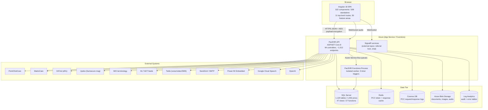
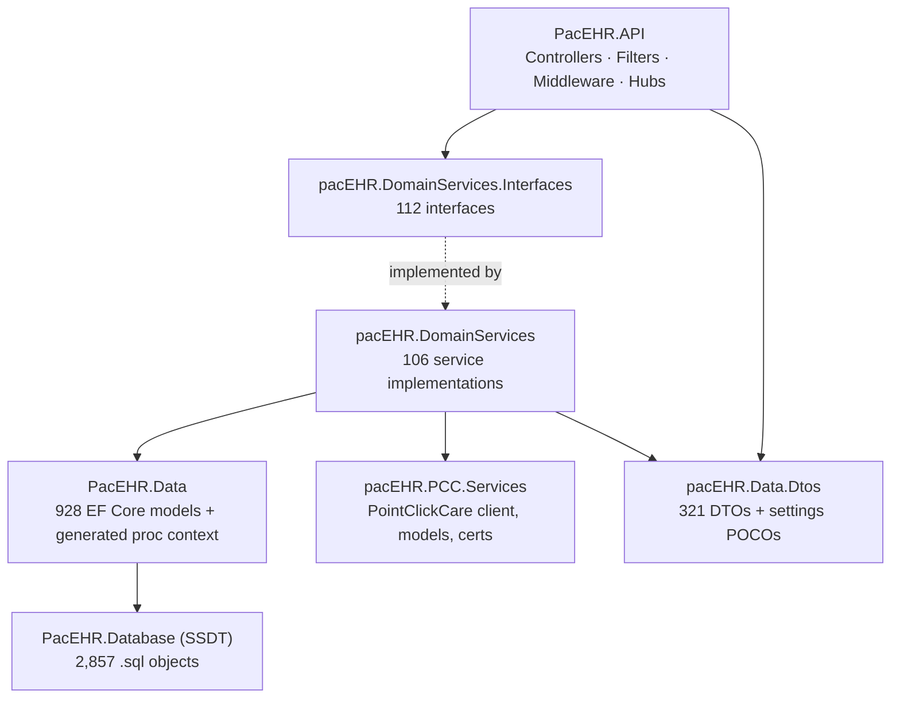

# System Overview - PacEHR

**Date**: 2026-09-30
**Analyzed By**: ARCHITECT
**Status**: Draft (awaiting user confirmation)
**Method**: AIRE `aire-brownfield-inspect` — Phases 0–5 (refresh of the 2026-09-08 baseline)
**Evidence base**: direct filesystem analysis of the working copies in this workspace. No README, wiki, or `CLAUDE.md` claim was accepted without verification in code.

---

## Executive Summary

PacEHR is a multi-tenant, cloud-hosted Electronic Health Record (EHR) platform for post-acute / skilled-nursing and behavioural-health care, operated by Saisystems. It is delivered as an Angular 18 single-page application talking to a single ASP.NET Core 8 Web API over ~1,012 RPC-style HTTP endpoints, with the bulk of business logic implemented as T-SQL stored procedures inside one large SQL Server database (1,553 procedures, 1,120 tables).

Around that core sit an ONC-style FHIR R4 / CCDA / QRDA interoperability surface, bidirectional integrations with external clinical systems (PointClickCare, MatrixCare, DrFirst, Updox, IMO, HL7 feeds), Azure platform services (Service Bus, Blob, Cosmos DB, Redis, Key Vault, Application Insights) and a timer-driven Azure Functions worker for scheduled jobs.

**Scope note**: two components this system depends on are *not* present in this workspace — the standalone SignalR services (referenced only by URL in `src/environments/*` and by comments in `PacEHR.API/Program.cs`) and the Saisystems identity/token-handler services. A third repo, `PacEHR_AI/`, is now cloned here but contains only a stub README — no code.

---

## Repository Layout

| Repo / folder | Git remote | Current branch | HEAD | Contents |
|---|---|---|---|---|
| `PacEHR/` | `Saisystems-PaaS/PacEHR/PacEHR` (Azure DevOps) | `PacEHR-DevelopUI-Main` | `3034de845` (2026-09-30) | Angular 18 SPA, Playwright suite, Azure DevOps pipelines |
| `pacEHR_API/` | `Saisystems-PaaS/PacEHR/pacEHR_API` (Azure DevOps) | `PacEHR-DevelopAPI-Main` | `9f2a6ee19` (2026-09-29) | .NET 8 solution (API, domain services, DTOs, EF models, Functions), SSDT database project, test projects, pipelines |
| `PacEHR_AI/` | `Saisystems-PaaS/PacEHR/PacEHR_AI` (Azure DevOps) | `PacEHR-AI-Develop-Main` | `cfc59aa` (2026-09-30) | **Stub only** — template README, no source |
| `local_deployment/` | not a git repo — workspace-only | — | — | Podman-based local runner for API + web |
| `SPEC/`, `docs/`, `aire/` | not a git repo — workspace-only | — | — | AIRE SDLC framework (workflows, agents, rulebooks) and its outputs |

**Change since the 2026-09-08 baseline**: 158 commits on `PacEHR`, 143 on `pacEHR_API` (301 total).

---

## System Architecture

### Architecture Diagram — System Context & Containers

### Architecture Style

**Layered modular monolith** (single deployable API) with a **database-centric** core and a satellite serverless worker.

- The API is one ASP.NET Core 8 process. There is no service decomposition inside it — separation is by project reference, not by process.
- Business logic sits predominantly in SQL Server stored procedures, invoked through a generated `Ipacehr_devContextProcedures` surface; C# domain services largely orchestrate and map.
- Endpoints are RPC-shaped (`[Route("addEditAIPrompt")]`, `[Route("getPatientById")]`), not REST resources — except the FHIR controllers, which are resource-oriented by mandate.
- Asynchronous work is offloaded via Azure Service Bus queues to `PacEHR.Functions.Process` and to in-process `IHostedService` workers.

### Layer Structure (backend)

---

## Technology Stack

| Category | Technology | Version | Notes |
|---|---|---|---|
| Frontend framework | Angular | 18.2.14 | 309 of 322 components are standalone; only 14 NgModules remain |
| Frontend language | TypeScript | 5.5.4 | 928 `.ts` files under `src/` |
| Frontend state | NgRx Store + Effects | 18.0.0 | Narrow use — only `login` and `error` slices |
| UI kit | Angular Material 17 + Bootstrap 5.3.3 + ng-bootstrap 16 | mixed | Material 17 on Angular 18 — version skew |
| Charts | Highcharts 12.3, Chart.js 4.4, ng2-charts 5 | — | Three charting stacks in one app |
| Realtime (FE) | `@microsoft/signalr` | 8.0.7 | Points at external SignalR App Services |
| Telephony / video | Twilio Voice SDK 2.12, twilio-video 2.31 | — | In-browser calling |
| Backend framework | ASP.NET Core | .NET 8.0 | All 9 solution projects target `net8.0` |
| ORM / data access | EF Core 8.0.14 + Dapper 2.1.66 | — | EF for models & generated proc calls; Dapper alongside |
| Database | SQL Server | — | `pacehr_devContext`; SSDT project `PacEHR.Database` |
| Cache | Redis (StackExchange 2.12) | — | PCC tokens and PCC response caching |
| Document store | Azure Cosmos DB 3.59 | — | PCC request/response logging |
| Messaging | Azure Service Bus 7.19 | — | 6+ named queues (Updox, CCM encounter, ACO eCQM, PCC docs, facility config) |
| Serverless | Azure Functions isolated worker 2.0 | — | 5 timer triggers |
| Resilience | Polly 8.6.6 | — | Pipeline built in `Program.cs` but **never injected**; EF Core's `EnableRetryOnFailure` is what actually protects SQL |
| Interop | Hl7.Fhir.R4 5.11.4 | — | 20 FHIR controllers; CCDA via `CCDA.dll`; QRDA |
| PDF | QuestPDF 2024.6, Syncfusion.Pdf 32.2.7 | — | Two PDF engines |
| Auth (backend) | Custom `JWTMiddleware` + BCrypt 4.1 + GoogleAuthenticator 3.2 | — | No `AddAuthentication` scheme registered — see Concerns |
| Observability | Application Insights 2.23 + Log Analytics | — | Plus custom `AuditWorker` / `ErrorLogWorker` hosted services |
| Secrets | Azure Key Vault 4.7 | — | Loaded at startup when `KeyVault:Uri` is set |
| API docs | Swashbuckle 6.5 | — | Swagger UI enabled in all environments |
| Backend tests | xUnit 2.4.2, Moq 4.20, AutoFixture 4.18, FluentAssertions 8.2 | — | 3,053 `[Fact]`/`[Theory]` across 61 files |
| Frontend unit tests | Karma + Jasmine 3.6 | — | 317 `.spec.ts` |
| E2E | Playwright 1.59 (+ legacy Protractor 7) | — | 207 Playwright specs; Protractor suite is dead weight |
| CI/CD | Azure DevOps YAML pipelines | — | Per-repo deploy, PR checklist, AI PR review, KB refresh |
| Local dev | Podman + Containerfiles | — | `local_deployment/` |

---

## Module Overview

### Frontend (`PacEHR/src/app`)

| Module | Path | Responsibility | Notes |
|---|---|---|---|
| Features | `features/` | 50 feature areas — patient list, encounters, scheduling, dashboards, CPT/billing, referrals, reports, Updox, calling, AI prompt, settings | Largest: `patient-list`, `basic-reports`, `encounter-list` |
| Core | `core/` | Services (66), interceptors (4), models, enums, pipes, directives, utils | All HTTP access funnels through `core/services` |
| Shared | `_shared/` | Reusable components, directives, validators, `shared.module.ts` | Mixed standalone/NgModule |
| Store | `_store/` | NgRx actions/effects/reducers/state | Only `login` and `error` |
| Configs | `configs/` | Constants, account/user configuration, `phi-masker.ts`, `prompt-sanitizer.ts` | PHI masking before AI calls lives here |

**HTTP interceptors** (`core/ineterceptors/` — note the misspelled folder): `auth`, `csrf`, `encrypt`, `loader`. The `encrypt` interceptor implements client-side AES payload encryption, with an `EncryptIgnoredAPI` allowlist configured server-side.

### Backend (`pacEHR_API`)

| Project | Path | Responsibility | Size |
|---|---|---|---|
| `PacEHR.API` | `PacEHR.API/` | Controllers, middleware, filters, SignalR hubs, PDF/fax helpers, background workers | 94 controllers, ~1,012 endpoints |
| `pacEHR.DomainServices` | `pacEHR.DomainServices/` | Business orchestration | 106 service classes |
| `pacEHR.DomainServices.Interfaces` | `pacEHR.DomainServices.Interfaces/` | Service contracts | 112 interfaces |
| `pacEHR.PCC.Services` | `pacEHR.PCC.Services/` | PointClickCare client, models, certificates, DI extension | Own DI module (`AddPCCServices`, `AddPccCoreServices`) |
| `pacEHR.Data.Dtos` | `pacEHR.Data.Dtos/` | Request/response DTOs and settings POCOs | 321 files |
| `PacEHR.Data` | `PacEHR.Data/Models` | EF Core entities + generated stored-procedure context | 928 files |
| `PacEHR.Database` | `PacEHR.Database/` | SSDT database project | 2,857 `.sql` files |
| `PacEHR.Functions.Process` | `PacEHR.Functions.Process/` | Scheduled jobs | 5 timer functions |
| `PacEHR.Tests.UnitTests` | — | xUnit suite | 3,053 test methods / 61 files |
| `PacEHR.Tests.Integration` | — | **Empty** — only `GlobalUsings.cs` | 0 tests |

### Controller Groupings (94 total)

| Group | Controllers |
|---|---|
| Clinical | Patient, Encounter, ClinicalNotes, Diagnosis, Vital, Allergy/Immunization, Lab, Goal, TreatmentPlan, HealthConcern, Prognosis, PatientSymptom, Assessment, Normals, Implantable, BloodGlucose, FastScore |
| FHIR R4 | 20 `Fhir*` controllers + `FhirCapabilityStatement` |
| Interop / quality | HIE, HL7Outbound, QRDA, ECQM, QualityData, Pqrs, ReadXML |
| Billing | CPTCode, CptBillingRule, CptCodeFamily, CptCalculatorEntry, FeeSchedule, FinancialResponsiblity, Insurance |
| Integrations | Pcc, PccTokenRenewal, MatrixCare, DrFirst, Updox, Imo, PatientSyncRequestForUpdox |
| Identity / admin | Authorization, Token, OAuth, User, Roles, Account, AccountGroup, Group, Facility, CareProvider |
| Comms | Message, MessageGroup, EmailContent, VideoCall, VoiceCallMessages, Task, Event |
| Reporting | CaseLoadReport, DaySheetReport, PsychotropicMedicationReport, ChartAudit, ActivityLog |
| Platform | AI, FileUpload, Logo, Macro, Tag, Error, PacEHRHealthMonitoring, DecodeBase64 |

---

## Entry Points

| Type | Path / Command | Description |
|---|---|---|
| Web (dev) | `PacEHR` → `npm start` (`ng serve`) | Angular dev server, proxy via `src/proxy.conf.json` |
| Web (build) | `npm run build-prod-patch` | Bumps version, runs `replace.build.js`, production build |
| API | `pacEHR_API/PacEHR.API/Program.cs` (526 lines) | Single `Main` — Key Vault, DbContext, Polly, CORS, SignalR, ~250 DI registrations, middleware pipeline |
| Functions | `pacEHR_API/PacEHR.Functions.Process/Program.cs` | Isolated worker host |
| SPA bootstrap | `PacEHR/src/main.ts` → `app-routing.module.ts` | 11 top-level routes |
| Local containers | `local_deployment/deploy.sh`, `scripts/up.sh` | Podman API + web |
| E2E | `npx playwright test` | 207 specs, incl. smoke suites by role |

### Scheduled Jobs (`PacEHR.Functions.Process`)

| Function | CRON | Purpose |
|---|---|---|
| `DailyCCMBHFunction` | `0 0 14 * * *` | CCM/BHI auto-billing |
| `DailyEmailFunction` | `0 0 13 * * *` | Daily encounter email |
| `TwiceDailyEmailFunction` | `0 0 */12 * * *` | Twice-daily encounter email |
| `HourlyEmailFunction` | `0 0 */1 * * *` | Hourly encounter email |
| `EveryFiveMinutesFunction` | `0 */5 * * * *` | DrFirst polling |
| `DailyForTFAFunction` | — | **Fully commented out** — dead code |

### In-Process Background Workers

`AuditWorker`, `ErrorLogWorker` (registered via `AddHostedService` in `Program.cs`), plus `PccCosmosWorker` for PCC logging.

---

## External Dependencies

### External Services (verified by code references)

| Service | Purpose | Integration | Code footprint |
|---|---|---|---|
| PointClickCare | Bidirectional EHR sync, webhooks | REST + certs + Redis cache + Cosmos logging | Dedicated project `pacEHR.PCC.Services` |
| HL7 ADT feeds | Inbound admissions/discharges | HL7 parsing | 26 files |
| FHIR R4 | ONC interoperability surface | Hl7.Fhir.R4 | 55 files, 20 controllers |
| CCDA | Document exchange | `CCDA.dll` (binary, repo root) | 19 files |
| QRDA | Quality reporting | — | 9 files |
| Updox | Fax + secure messaging | REST + Service Bus queues | 14 files |
| DrFirst | ePrescribing | REST, 5-min poll | 10 files |
| MatrixCare | EHR integration | REST | 9 files |
| IMO | Clinical terminology | REST | 4 files |
| Twilio | Voice, video, SMS, push | Twilio SDK 5.49 | 10 files |
| SendGrid + SMTP | Transactional email | SendGrid 9.21 / EAGetMail | 4 files |
| Power BI Embedded | Embedded analytics | `powerbi-client-angular` 3.0 | 2 files |
| Google Cloud Speech | Encounter audio transcription | `Google.Cloud.Speech.V1` over WebSocket | `AIController` |
| OpenAI | AI assistance on encounters | `openAIapiKey` in appsettings | 3 files |
| ShareFile | File exchange | `ShareFile.Api.Client` 4.0 | 4 files |
| Azure Key Vault / Blob / Service Bus / Cosmos / Redis / App Insights / Log Analytics | Platform | Azure SDKs | throughout |

### Service Bus Queues (from `appsettings.json`)

`UpdoxQueueName`, `UpdoxFaxQueueName`, `CCMEncounterQueueName`, `ACOeCQMSQueueName`, `EncounterEventQueueName`, `FacilityConfigurationQueueName`, `pccDocumentsSentQueueName` — several with their own connection strings.

---

## Design References (Legacy Documentation)

**Location**: `SPEC/references/`

| File | Type | Description | Relevance |
|---|---|---|---|
| — | — | Directory contains only two empty folders (`builds/`, `devops/`) | No legacy reference documents available |

**Note**: Phase 0 found no PRDs, architecture documents, or designs to honor. All findings in this document derive from code. `docs/helix/INDEX.md` is absent, so no prior Helix solution context was available either.

---

## Test Infrastructure

| Type | Location | Framework | Volume |
|---|---|---|---|
| Backend unit | `PacEHR.Tests.UnitTests/` (Controllers, DomainServices, Services, Pcc, Library) | xUnit + Moq + AutoFixture + FluentAssertions | 3,053 test methods / 61 files |
| Backend integration | `PacEHR.Tests.Integration/` | xUnit | **0 tests** — only `GlobalUsings.cs` |
| Frontend unit | `PacEHR/src/**/*.spec.ts` | Karma + Jasmine | 317 specs |
| Frontend E2E | `PacEHR/e2e-playwright/` | Playwright | 207 specs + discovery/crawl scripts |
| Frontend E2E (legacy) | `PacEHR/e2e/` | Protractor 7 | Deprecated framework, still in repo |

Frontend unit-test coverage is heavily skewed: 85 of 317 specs sit in `features/patient-list` and 46 in `features/basic-reports`; most of the other 48 feature areas have none. Only 7 of the 66 `core/services` have a spec.

---

## Configuration

| File | Purpose |
|---|---|
| `PacEHR.API/appsettings.json` + `.Development/.QA/.Uat/.Test/.Automation/.Production.json` | 6 environment overlays |
| Azure Key Vault (`KeyVault:Uri`) | Secret source at startup when configured |
| `PacEHR/src/environments/environment{,.test,.uat,.demo,.prod,.automation}.ts` | SPA API/blob/SignalR endpoints per environment |
| `PacEHR/src/proxy.conf.json` | Dev-server API proxy |
| `PacEHR/angular.json`, `replace.build.js` | Build config and version stamping |
| `local_deployment/config.env` | Local container settings |
| `pacEHR_API/PacEHR.Functions.Process/host.json` | Functions host config |

---

## Key Observations

### Strengths

- **Clean project layering on the backend** — interfaces (`pacEHR.DomainServices.Interfaces`) are separated from implementations, and the PCC integration is isolated in its own project with its own DI extension method.
- **Substantial backend test investment** — 3,053 xUnit test methods, using a modern stack (Moq, AutoFixture, FluentAssertions, MockQueryable).
- **Deliberate resilience engineering** — EF Core's `EnableRetryOnFailure` is tuned with a specific transient-error list (deadlock 1205, lock timeout 1222, timeouts), and `Microsoft.Extensions.Http.Polly` covers outbound HTTP. (The separate Polly `ResiliencePipeline` in `Program.cs` is registered but unused — see module 02.)
- **Mature E2E suite** — 207 Playwright specs with role-scoped smoke runs and reusable discovery scripts.
- **Angular is current and modernising** — on 18.x with 309 of 322 components already standalone.
- **Serious observability** — App Insights, Log Analytics, and purpose-built audit/error/PCC-logging workers with configurable modes.
- **Secrets handled properly in principle** — Key Vault integration exists at startup.

### Areas of Concern

- **Authentication is not wired into the ASP.NET Core pipeline.** `Program.cs` contains `//TODO - Authentication Pipeline Here` and `//TODO - AUTHORIZATION Pipeline Here`; no authentication scheme is registered, yet `app.UseAuthentication()` / `app.UseAuthorization()` are called. Authentication is instead performed by a custom `JWTMiddleware` running before them. Any `[Authorize]` attribute therefore has no configured scheme to act on. **Requires verification with the team.**
- **CORS is fully open in the effective pipeline.** A named `AllowOrigin` policy is defined but commented out; the active call is `app.UseCors(o => o.AllowAnyOrigin().AllowAnyHeader().AllowAnyMethod())`.
- **Swagger UI is enabled unconditionally**, including production builds, exposing the full ~1,012-endpoint surface.
- **Logic lives in the database.** 1,553 stored procedures against 106 C# service classes means the true business rules are largely untestable by the C# unit suite and invisible to static analysis.
- **Zero integration tests.** The project exists but contains no tests — the API/DB seam is entirely unverified.
- **Frontend unit coverage is thin and lopsided** — 317 specs across 322 components, concentrated in two feature areas.
- **`Program.cs` is a 526-line single method** with ~250 hand-written DI registrations, duplicates (`IDRFirstServices` registered twice), and a commented-out `AddDbContext`.
- **Committed credentials risk.** `Google-Credentials.json` sits in `PacEHR.API/`, `CCDA.dll` is a binary at repo root, and `appsettings.json` carries keys named `openAIapiKey`, `TWILIO_AUTH_TOKEN`, `MailPassword`, `pbiPassword`, `StaticSalt`, `ClientSecret_*`. **Values need auditing — flagged, not inspected.**
- **A local-dev override was committed**: `// LOCAL DEV OVERRIDE — do NOT commit` above a disabled `app.UseHttpsRedirection()`.
- **`PacEHR_AI` is an empty repo** carrying an unedited template README, while AI features (OpenAI, Google Speech, `ai-prompt`, `AIController`) actually live inside the main repos.

### Technical Debt

| Item | Evidence |
|---|---|
| Dead Protractor E2E suite alongside Playwright | `PacEHR/e2e/`, `protractor` + `codelyzer` in devDependencies |
| TSLint (deprecated) still configured | `tslint.json`, `tslint` 6.1 |
| Angular Material 17 on Angular 18 | `package.json` version skew |
| Three charting libraries | Highcharts + Chart.js + ng2-charts |
| Two PDF engines | QuestPDF + Syncfusion |
| Legacy `EntityFramework` 6.5.1 next to EF Core 8 | `.csproj` references |
| ASP.NET Web API (`Microsoft.AspNet.WebApi.Core` 5.3) in a .NET 8 app | `.csproj` references |
| Misspelled directories shipped in paths | `core/ineterceptors/`, `pacEHR_API/temppp/` |
| Dead code | `DailyForTFAFunction.cs` fully commented out |
| RPC-style endpoints named inconsistently | `addEditAIPrompt`, `getPatientById` — camelCase routes, no REST semantics |
| `pacEHR/pacEHR.csproj` has no `TargetFramework` | Orphan project, not in `pacEHR.sln` |
| Typo'd config key in production use | `SericeBusConnection` (sic) bound in `Program.cs` |

---

## Delta vs. 2026-09-08 Baseline

| Metric | 2026-09-08 | 2026-09-30 | Change |
|---|---|---|---|
| SQL tables | 1,048 | 1,120 | +72 |
| Stored procedures | 1,489 | 1,553 | +64 |
| API endpoints (HTTP verb attributes) | ~1,025 | ~1,012 | −13 |
| SPA components | 315 | 322 | +7 |
| Repos in workspace | 2 tracked | 3 tracked | `PacEHR_AI` added (stub) |
| Referral-lock SignalR hub | hosted in API | moved to external service | Feature 32556 / S15/S4 |

---

**Next step**: `aire-brownfield-deep-dive` — after user confirmation of this document.
