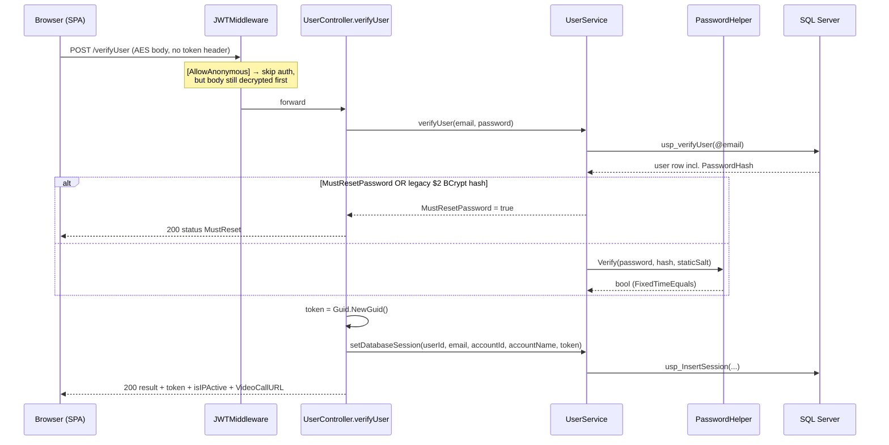
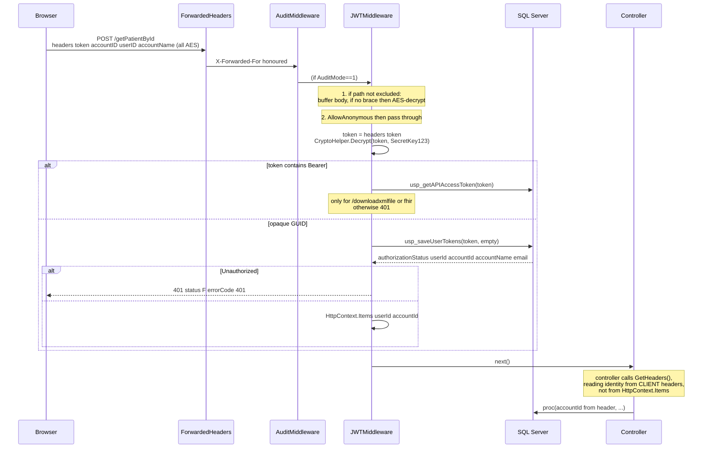
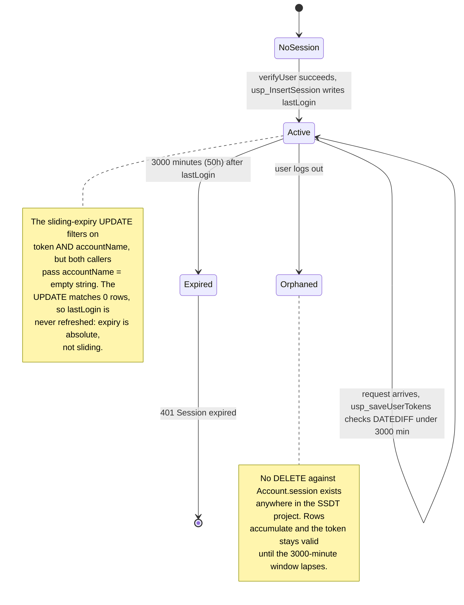
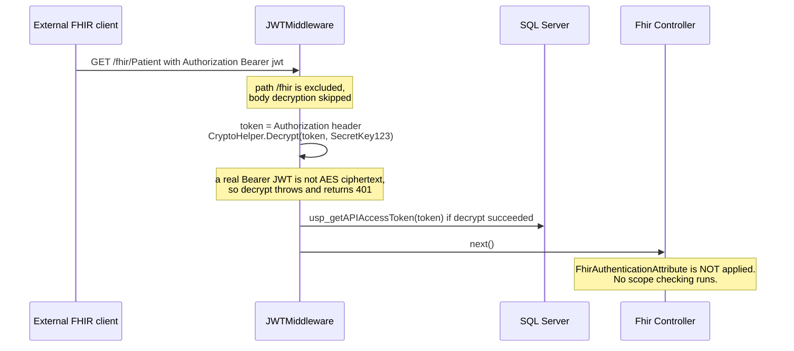

# Deep-Dive - Auth, Identity & Tenancy

**Date**: 2026-09-30
**Analyzed By**: ARCHITECT
**Status**: Draft (awaiting user confirmation)
**Scope**: authentication, session management, tenant/user scoping, transport confidentiality, route protection
**Evidence base**: `pacEHR_API` @ `9f2a6ee19`, `PacEHR` @ `3034de845`. Every claim below cites a file path verified in this working copy.

---

## Module Overview

**Purpose**: establish who is calling the API, which tenant (account) they belong to, and whether the request is allowed to proceed.

**Paths**:
- `pacEHR_API/PacEHR.API/Library/Authentication/` — `JWTMiddleware.cs`, `FhirAuthenticationAttribute.cs`
- `pacEHR_API/PacEHR.API/Library/PacEHRCommonController.cs` — header-derived identity
- `pacEHR_API/PacEHR.API/Filters/AuthorizeFilterAttribute.cs` — **unreferenced**
- `pacEHR_API/pacEHR.DomainServices/Static/` — `CryptoHelper.cs`, `PasswordHelper.cs`
- `pacEHR_API/PacEHR.Database/Tables/Tables1/session.sql`, `Stored Procedures/.../usp_saveUserTokens.sql`
- `PacEHR/src/app/core/ineterceptors/` — `auth`, `csrf`, `encrypt`, `loader`
- `PacEHR/src/app/auth.guard.ts`, `src/app/app-routing.module.ts`

**Headline**: authentication is **not** ASP.NET Core authentication. No authentication scheme is registered; a bespoke middleware validates an opaque GUID session against SQL, and tenancy is taken from **client-supplied headers**.

---

## Component Breakdown

| Component | File | Responsibility | Status |
|---|---|---|---|
| `JWTMiddleware` | `PacEHR.API/Library/Authentication/JWTMiddleware.cs` | The real auth gate: body decryption, token extraction, session validation, identity into `HttpContext.Items` | **Active** |
| `PacEHRCommonController.GetHeaders()` | `PacEHR.API/Library/PacEHRCommonController.cs` | Decrypts `accountID` / `userID` / `accountName` request headers into `CommonHeaders` | **Active** — 126 call sites |
| `CryptoHelper.Decrypt` | `pacEHR.DomainServices/Static/CryptoHelper.cs` | AES-CBC decrypt, key = SHA-256 of a passphrase | Active |
| `SecurityConstants.EncryptionKey` | `PacEHR.API/Constants/SecurityConstants.cs` | `"SecretKey123"` | Active |
| `PasswordHelper` | `pacEHR.DomainServices/Static/PasswordHelper.cs` | SHA-256(staticSalt + password), constant-time verify, legacy-BCrypt detection | Active |
| `UserService.verifyUser` | `pacEHR.DomainServices/UserService.cs:64` | Login: fetch by email, compare hash in app layer | Active |
| `usp_saveUserTokens` | `PacEHR.Database/Stored Procedures/.../usp_saveUserTokens.sql` | Session lookup + sliding-expiry update | Active |
| `usp_InsertSession` | `PacEHR.Database/Stored Procedures/Procs2/usp_InsertSession.sql` | Session row creation at login | Active |
| `AuthorizeFilterAttribute` | `PacEHR.API/Filters/AuthorizeFilterAttribute.cs` | Near-duplicate of `JWTMiddleware` as an MVC filter | 🔴 **Dead** — never registered |
| `FhirAuthenticationAttribute` | `PacEHR.API/Library/Authentication/FhirAuthenticationAttribute.cs` | Bearer/JWT validation for FHIR | 🔴 **Dead** — not applied to any `PacEHR.API` controller |
| `AuthGuard` | `PacEHR/src/app/auth.guard.ts` | SPA route protection | Active (partial) |
| `AuthInterceptor` | `PacEHR/src/app/core/ineterceptors/auth.interceptor.ts` | Stamps encrypted `token`/`accountID`/`userID`/`accountName` headers | Active |
| `CsrfInterceptor` | `PacEHR/src/app/core/ineterceptors/csrf.interceptor.ts` | Sends `X-XSRF-TOKEN` when cookie present | Active, but see below |

### Dead-code verification

`AuthorizeFilterAttribute` and `FhirAuthenticationAttribute` are referenced **only** from the legacy `pacEHR/` project (`pacEHR/App_Start/WebApiConfig.cs:53-54`, `pacEHR/Controllers/*`), which has no `<TargetFramework>` and is **not a member of `pacEHR.sln`**. Neither type is registered in `Program.cs`, applied via `[ServiceFilter]`/`[TypeFilter]`, or added to `MvcOptions.Filters`. They do not execute in the deployed API.

---

## Key Workflows

### Workflow 1: Login (password → opaque session token)



**Stories**:
1. Password comparison moved out of SQL into the application layer — `usp_verifyUser` now takes email only (`UserService.cs:66`, comment confirms the change).
2. Accounts still holding a BCrypt hash (`$2a$`/`$2b$`) are blocked and forced through password reset — an in-flight migration.
3. The session token is a bare `Guid.NewGuid()` — no signature, no claims, no expiry encoded in the token itself.
4. Inactivity policy is enforced in C#: `DaysSinceLastLogin > 14` returns `"Expired"` (`UserController.cs:306`).
5. Role-based field stripping happens inline with magic numbers — `roleID == 6`, `== 5`, `== 1` each null out different response fields (`UserController.cs:320-339`).

### Workflow 2: Every authenticated request



**Stories**:
1. The middleware derives authoritative identity from the session row, then stores it in `HttpContext.Items`.
2. Controllers overwhelmingly ignore it: **126 `GetHeaders()` call sites across 23 controllers** read identity from client headers, versus **2** reads of `HttpContext.Items["userId"]/["accountId"]`.
3. `Bearer` tokens are rejected outright unless the path is `/downloadxmlfile` or contains `fhir` (`JWTMiddleware.cs:110-126`).
4. On any unhandled exception the middleware returns a flat `400 Bad Request` when `ErrorLogMode != 1`, masking the cause (`JWTMiddleware.cs:148-167`).

### Workflow 3: Session lifetime



**Evidence for the sliding-expiry defect**:
- `usp_saveUserTokens.sql`: `Update [Account].[session] Set lastLogin = getdate() Where token = @token AND accountName=@accountName`
- `JWTMiddleware.cs:130`: `ProcedureHelper.CallSaveUserTokensAsync(_serviceProvider, token, string.Empty)`
- `AuthorizeFilterAttribute.cs`: `string accountName = string.Empty; ... usp_saveUserTokensAsync(token, accountName)`

Both call sites pass an empty `accountName`, which cannot match the stored value. **Needs runtime confirmation**, but the code path is unambiguous.

Also note the timeout constant: `< 3000` minutes with a trailing comment `--720`. The effective window is **50 hours**, not the 12 hours the comment implies.

### Workflow 4: FHIR / external client



This is the single largest open question in the module. `FhirAuthenticationAttribute` (which does real JWT validation and FHIR scope checks) exists but is attached to nothing in `PacEHR.API`. Meanwhile `JWTMiddleware` AES-decrypts the `Authorization` header with `"SecretKey123"` before doing anything else. **Whether the FHIR surface is reachable at all in a deployed environment needs verification** — see Open Questions.

---

## Data Models

### `Account.session` — `PacEHR.Database/Tables/Tables1/session.sql`

| Field | Type | Constraints | Description |
|---|---|---|---|
| `sessionId` | INT | PK, IDENTITY | Surrogate key |
| `userId` | INT | NOT NULL | No FK declared |
| `email` | VARCHAR(100) | NOT NULL | Denormalised from `Account.users` |
| `accountId` | INT | NOT NULL | Tenant; no FK declared |
| `accountName` | VARCHAR(100) | NOT NULL | Denormalised |
| `token` | VARCHAR(100) | NOT NULL | The GUID; `idx_Session_token` non-clustered index |
| `lastLogin` | DATETIME | NOT NULL | Expiry anchor |

Observations: no foreign keys, no uniqueness constraint on `token`, no `expiresAt` column, no `revokedAt`. Expiry is computed at read time from `lastLogin`.

### `Account.roles` — `PacEHR.Database/Tables/.../roles.sql`

| Field | Type | Constraints |
|---|---|---|
| `roleID` | INT | PK, IDENTITY |
| `roleName` | VARCHAR(255) | NOT NULL |
| `isActive` | INT | NULL |
| `reportIds` | VARCHAR(100) | NULL — comma-delimited report ids in a scalar column |
| `abbreviation` | NVARCHAR(50) | NULL |

`reportIds` holds a delimited list rather than a join table — authorisation data in a denormalised string.

### Credential fields (from `usp_verifyUser` result shape)

| Field | Used for |
|---|---|
| `PasswordHash` | SHA-256 hex, or legacy `$2*` BCrypt |
| `MustResetPassword` | Forces the reset flow |
| `DaysSinceLastLogin` | 14-day inactivity lockout |
| `isActive`, `locked` | Account state gates |
| `roleID` | Drives inline response-field stripping |

---

## Pattern Catalog

### Pattern: transport confidentiality — shared-secret AES with a hardcoded key

**Where**: `pacEHR.DomainServices/Static/CryptoHelper.cs`, `PacEHR.API/Constants/SecurityConstants.cs:5`, `PacEHR/src/app/configs/account-configuration.ts`

```csharp
// ACTUAL (PacEHR.API/Constants/SecurityConstants.cs)
public static class SecurityConstants
{
    public const string EncryptionKey = "SecretKey123";
}

// ACTUAL (JWTMiddleware.cs:100) — the literal appears inline too
token = CryptoHelper.Decrypt(token, "SecretKey123").Replace("\"", "");
```

```csharp
// DON'T: a compile-time constant shared by client and server, committed to two repos
CryptoHelper.Decrypt(token, "SecretKey123");

// DO: if a shared secret is genuinely required, resolve it from Key Vault at runtime
CryptoHelper.Decrypt(token, _securityOptions.Value.PayloadKey);
```

The same literal is present in the SPA (`auth.interceptor.ts`: `utilityFunctions.encrypt(..., 'SecretKey123')`), so it ships to every browser. The encryption provides obfuscation, not confidentiality — TLS is doing the real work. Key derivation is `SHA256(passphrase)` with no KDF iterations (`CryptoHelper.cs:15-16`).

### Pattern: "is it encrypted?" detection by string sniffing

**Where**: `JWTMiddleware.cs:60`

```csharp
// ACTUAL
if (!string.IsNullOrWhiteSpace(body) && !body.Contains("{"))
{
    var decryptedJson = CryptoHelper.Decrypt(body, SecurityConstants.EncryptionKey);
    ...
}
```

```csharp
// DON'T: infer content encoding from whether a brace appears anywhere in the body
if (!body.Contains("{")) { Decrypt(body); }

// DO: signal it explicitly
if (request.Headers.ContainsKey("X-Payload-Encrypted")) { Decrypt(body); }
```

Any base64 ciphertext that happens to contain `{` is passed through as plaintext JSON; any plaintext body without `{` is fed to the decryptor. The server-side allowlist `EncryptIgnoredAPI` in `appsettings.json` exists to patch around this.

### Pattern: authentication — opaque GUID session validated in SQL

**Where**: `UserController.cs:319`, `usp_saveUserTokens.sql`

```csharp
// ACTUAL
string token = Guid.NewGuid().ToString();
await _userService.setDatabaseSession(result.userID, result.email, result.accountID, result.accountName, token);
```

This is a legitimate, defensible design (server-side sessions beat self-contained JWTs for revocability). The problems are in the details: no revocation on logout, a 50-hour window, and the broken sliding-expiry UPDATE.

### Pattern: 🔴 tenancy from client-asserted headers

**Where**: `PacEHR.API/Library/PacEHRCommonController.cs:29-60`

```csharp
// ACTUAL — the tenant id comes off the wire from the caller
public CommonHeaders GetHeaders()
{
    var ret = new CommonHeaders();
    if (HttpContext.Request.Headers.TryGetValue("accountID", out StringValues accountIDSV))
    {
        int.TryParse(CryptoHelper.Decrypt(accountIDSV[0], "SecretKey123").Replace("\"", ""), out int accountId);
        ret.AccountID = accountId;
    }
    ...
}
```

```csharp
// DON'T: trust the caller for the tenant boundary
var headers = GetHeaders();
var data = await _svc.GetPatients(headers.AccountID);

// DO: use the identity the session lookup produced
var accountId = (int)HttpContext.Items["accountId"]!;
var data = await _svc.GetPatients(accountId);
```

The middleware already computed the authoritative `accountId` from the session row and placed it in `HttpContext.Items`. The header value is encrypted with a key the client possesses, so a caller holding a valid session for account A can present `accountID` for account B. **Counts: 126 header-derived call sites vs. 2 `HttpContext.Items` reads.** This is the module's most consequential finding and should be confirmed against a running environment before being treated as exploitable — a stored procedure may re-derive scope internally.

### Pattern: password storage — SHA-256 with one global salt

**Where**: `pacEHR.DomainServices/Static/PasswordHelper.cs`

```csharp
// ACTUAL
public static string Hash(string plainText, string staticSalt)
{
    byte[] inputBytes = Encoding.UTF8.GetBytes(staticSalt + plainText);
    byte[] hashBytes = SHA256.HashData(inputBytes);
    return Convert.ToHexString(hashBytes).ToLowerInvariant();
}
```

```csharp
// DON'T: a fast general-purpose hash with one process-wide salt
SHA256.HashData(Encoding.UTF8.GetBytes(staticSalt + password));

// DO: a memory-hard KDF with a per-user salt and a tunable work factor
// (the codebase already depends on BCrypt.Net-Next 4.1.0)
BCrypt.Net.BCrypt.EnhancedHashPassword(password, workFactor: 12);
```

Note the direction of travel: `IsLegacyBcryptHash()` treats BCrypt as the *old* format being migrated away from. BCrypt is the stronger primitive; the migration reduces password-storage strength. A single global salt (`StaticSalt` in `appsettings.json`) means identical passwords produce identical hashes across all users, enabling bulk cracking from one rainbow table. `Verify` correctly uses `CryptographicOperations.FixedTimeEquals`, and `IsStrongPassword` enforces 8+ chars with upper/lower/digit — both good.

### Pattern: CSRF — client sends a header the server never validates

**Where**: `PacEHR/src/app/core/ineterceptors/csrf.interceptor.ts`

```typescript
// ACTUAL — the interceptor's own comment asserts a server-side filter
// "Anonymous endpoints (e.g. login) are skipped server-side by ValidateCsrfFilter,
//  so passing through is safe. For authenticated requests the server returns 403
//  if the header is missing"
const cloned = req.clone({ headers: req.headers.set('X-XSRF-TOKEN', csrfToken) });
```

**No `ValidateCsrfFilter` exists in the API.** All 12 matches for `Antiforgery`/`XSRF` in `pacEHR_API` are inside test files (`CCMControllerTests.cs`, `AssessmentControllerTests.cs` — `FakeAntiforgeryValidationFeature`). There is no `AddAntiforgery()` in `Program.cs`, no filter registration, and nothing issues the `XSRF-TOKEN` cookie the interceptor reads. The client-side half of a CSRF defence is deployed against a server that ignores it.

**Mitigating context, stated fairly**: the API authenticates via a custom `token` *header*, not a cookie. Browsers do not attach custom headers to cross-site requests automatically, so classic CSRF is largely inapplicable here. The finding is that the code documents a control that does not exist — a maintenance and audit hazard more than an immediate exposure.

### Pattern: API response envelope — untyped dictionary

**Where**: every controller, e.g. `AIController.cs:47`, `UserController.cs:287`

```csharp
// ACTUAL
public async Task<IDictionary<String, Object>> verifyUser(verifyUser objUser)
{
    var dictionary = new Dictionary<string, object>();
    dictionary = AddToDictionaryResult(dictionary, 200, "Y", "successfully", result);
    dictionary.Add("token", token);
    return dictionary;
}
```

```csharp
// DON'T: an untyped bag, HTTP 200 regardless of outcome, status in the body
return AddToDictionaryResult(dict, 500, "F", "Invalid account configuration", null); // still HTTP 200

// DO: typed results with real status codes
return Problem(statusCode: 500, detail: "Invalid account configuration");
```

Consequences: Swagger documents every endpoint as returning an opaque object; clients must branch on a body field (`"Y"`/`"F"`/`"MustReset"`/`"Expired"`); HTTP semantics carry no information. The SPA's `AuthInterceptor` has to compensate with body-shape sniffing.

### Pattern: error handling — swallow and generalise

**Where**: `JWTMiddleware.cs:148`, `AuthorizeFilterAttribute.cs:176`

```csharp
// ACTUAL
catch
{
    if (_errorLogMode == 1) { throw; }
    else { await ReturnBadRequest(context, "Bad Request"); }
}
```

```csharp
// DON'T: a bare catch that turns every failure into 400 with no log
catch { await ReturnBadRequest(context, "Bad Request"); }

// DO: log with context, then map deliberately
catch (Exception ex)
{
    _logger.LogError(ex, "Auth pipeline failure for {Path}", context.Request.Path);
    await ReturnBadRequest(context, "Bad Request");
}
```

Whether failures are observable at all depends on the `ErrorLogSettings:ErrorLogMode` config flag. In the `else` branch nothing is logged.

### Pattern: logging — static helper over `TelemetryClient`

**Where**: `PacEHR.API/Library/ApplicationInsightsLogger.cs`, used throughout

```csharp
// ACTUAL
ApplicationInsightsLogger.LogInfo(_telemetry, "Start Verifying User Data from DB");
ApplicationInsightsLogger.LogInfo(_telemetry, "AccountID is NULL for user: " + result.userID);
```

```csharp
// DON'T: string concatenation, no structured fields
LogInfo(_telemetry, "AccountID is NULL for user: " + result.userID);

// DO: structured, queryable
_logger.LogWarning("AccountID null for {UserId}", result.userID);
```

Messages are free-text and unstructured, so they cannot be aggregated in App Insights without parsing. `ILogger<T>` is available via DI but bypassed in this path.

### Pattern: client-side route protection only

**Where**: `PacEHR/src/app/auth.guard.ts`, `app-routing.module.ts`

```typescript
// ACTUAL
canActivate(): boolean {
  const user = sessionStorage.getItem('user');
  const userCan = user ? !!JSON.parse(user).token : false;
  if (userCan) { return true; }
  this.router.navigate(['/login']);
  return false;
}
```

The guard checks only for the *presence* of a token string — no expiry check, no server validation. Two routes bypass it entirely:

```typescript
{ path: 'encounters',  component: EncounterListComponent, /* canActivate: [AuthGuard], */ },  // commented out
{ path: 'follow-ups',  component: FollowUpsComponent },                                       // never had one
```

This is a UX control, not a security boundary — correct in principle, since the API is the real gate. Worth noting only because the API's gate has the weaknesses above.

### Pattern: blanket `[AllowAnonymous]` at class level

**Where**: `PacEHR.API/Controllers/OAuthController.cs:10`

```csharp
[AllowAnonymous]            // ← class level
public class OAuthController : ControllerBase
{
    [AllowAnonymous] public async Task<IActionResult> GetAuthorizeUrlAsync(...)
    public async Task<IActionResult> ExchangeCode([FromBody] OAuthTokenRequest request)
    public async Task<IActionResult> RefreshToken([FromBody] OAuthRefreshRequest request)
    public async Task<IActionResult> RevokeToken([FromBody] string token, ...)
    [AllowAnonymous] public async Task<IActionResult> OAuthCallback(...)
}
```

The OAuth callback and authorize-url endpoints legitimately need anonymous access. `ExchangeCode`, `RefreshToken` and `RevokeToken` inherit it from the class. Across the API there are **56 active `[AllowAnonymous]` attributes in 10 controllers** (60 textual occurrences, 4 of them commented out in `ImoController`). The distribution is concentrated: `VoiceCallMessagesController` 16, `VideoCallController` 15, `UserController` 13, `OAuthController` 3, `HIEController`/`MatrixCareController`/`PccTokenRenewalController` 2 each, `AIController`/`AccountController`/`PacEHRHealthMonitoringController` 1 each. Module 07 enumerates them.

### Test patterns (auth)

**Location**: `pacEHR_API/PacEHR.Tests.UnitTests/`
**Naming**: `{Type}Tests.cs` / `{Type}Test.cs` (inconsistent), `[Collection("DomainServiceTests")]`

| Suite | Tests |
|---|---|
| `Controllers/UserControllerTests.cs` | 88 |
| `DomainServices/UserServiceTest.cs` | 34 |
| `DomainServices/PasswordHelperTests.cs` | 9 |
| `DomainServices/TokenServiceTest.cs` | 2 |
| **`JWTMiddleware`** | **0** |
| **`PacEHRCommonController.GetHeaders`** | **0** |
| **`CryptoHelper`** | **0** |

```csharp
// ACTUAL — clear, FluentAssertions-based (PasswordHelperTests.cs)
[Fact]
public void Hash_ReturnsNonEmptyHexString()
{
    var hash = PasswordHelper.Hash("Password1", "");
    hash.Should().NotBeNullOrEmpty();
    hash.Should().HaveLength(64);
    hash.Should().MatchRegex("^[0-9a-f]+$");
}
```

The test style is good. The gap is what is tested: every `PasswordHelper` test passes `""` as the salt, and the component that actually enforces authentication on all ~1,012 endpoints has no tests at all.

---

## Entry Points

| Entry | Route | Anonymous | Description |
|---|---|---|---|
| Login | `POST /verifyUser` | ✅ | Password → session GUID |
| OTP validate | `POST /validateOtp` | ✅ | Two-factor step |
| OTP send | `POST /sendOtpViaSms` | ✅ | Twilio SMS |
| Password verify | `POST /verifyUserPassword` | — | Re-auth for sensitive actions |
| Certificate verify | `POST /verifyUserCertificate` | — | Signing credential check |
| Logout redirect | `POST /logOutRedirect` | — | No session row deletion |
| OAuth authorize | `GET /oauth/authorize-url` | ✅ | PCC OAuth start |
| OAuth callback | `GET /oauth/callback` | ✅ | PCC OAuth return |
| OAuth exchange | `POST /oauth/token` | ✅ (inherited) | Code → token |
| OAuth refresh | `POST /oauth/refresh` | ✅ (inherited) | Refresh token |
| OAuth revoke | `POST /oauth/revoke` | ✅ (inherited) | Revoke token |
| FHIR (all) | `/fhir/*` | middleware-excluded | See Workflow 4 |

---

## Open Questions for the Team

These cannot be resolved from source alone and gate the requirements step:

1. ~~**Is the FHIR surface reachable in any deployed environment?**~~ **Resolved in Module 05**: no. Beyond the `Authorization`-header AES-decrypt problem described here, all 20 FHIR controllers inject `IMapper`, which is never registered in DI — controller activation fails regardless of auth. See `05-interoperability-fhir-ccda-qrda-deep-dive.md`. Running `GET /fhir/metadata` against a deployed environment is still worth doing as confirmation.
2. **Do stored procedures re-derive `accountId` internally?** If they scope by the passed `accountId` alone, the header-asserted tenancy is a cross-tenant exposure. One proc (`usp_getPatientById` or similar) inspected end to end would settle it.
3. **Has anyone observed session expiry behaving as sliding?** If users are logged out exactly 50 hours after login regardless of activity, the `accountName=''` defect is confirmed.
4. **Was the BCrypt → SHA-256 migration a deliberate decision?** If so, what drove it, and what proportion of `Account.users` rows still hold `$2*` hashes?
5. **Is `StaticSalt` environment-specific and Key-Vault-sourced in production**, or the `appsettings.json` value?
6. **Should `AuthorizeFilterAttribute`, `FhirAuthenticationAttribute` and the whole `pacEHR/` legacy project be deleted?** They are the only readers of several code paths and make the auth story ambiguous for anyone reading the repo.

---

## Recommendations

| # | Recommendation | Rationale | Effort |
|---|---|---|---|
| 1 | Switch controllers from `GetHeaders()` to `HttpContext.Items` for `accountId`/`userId` | Closes the client-asserted tenancy gap; the correct values are already computed | High — 126 call sites, but mechanical |
| 2 | Fix `usp_saveUserTokens`: drop `AND accountName=@accountName` from the UPDATE | Restores intended sliding expiry | Trivial |
| 3 | Reduce the session window from 3000 minutes and align the code with the `--720` comment | 50 hours is long for an EHR | Trivial |
| 4 | Delete the session row on logout | Tokens currently survive logout | Low |
| 5 | Move `EncryptionKey` and `StaticSalt` to Key Vault; remove the literals from both repos | A committed shared secret is not a secret | Medium — coordinated FE/BE release |
| 6 | Reconsider SHA-256 for passwords; BCrypt is already a dependency | Per-user salt + work factor | Medium |
| 7 | Either implement `ValidateCsrfFilter` or delete the `CsrfInterceptor` and its comment | Documented control that does not exist | Low |
| 8 | Add unit tests for `JWTMiddleware` | Zero coverage on the sole auth gate | Medium |
| 9 | Delete the orphan `pacEHR/` project and the two dead filters | Removes a misleading second auth implementation | Low |
| 10 | Replace `[AllowAnonymous]` at class level on `OAuthController` with per-action attributes | Three token endpoints are anonymous by inheritance | Trivial |
| 11 | Replace the body-sniffing `!body.Contains("{")` check with an explicit header | Deterministic instead of heuristic | Low |
| 12 | Register a real authentication scheme, or remove `UseAuthentication()`/`UseAuthorization()` | Today they are no-ops that imply protection which `[Authorize]` cannot deliver | Medium |

---

**Next**: Module 02 — API request & data spine.
