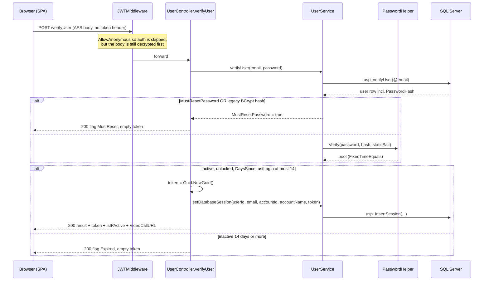
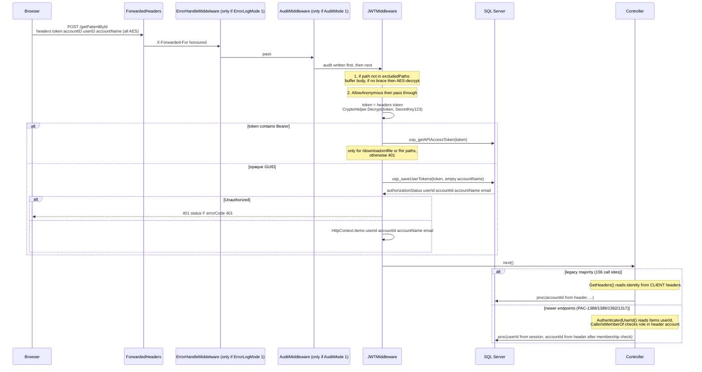
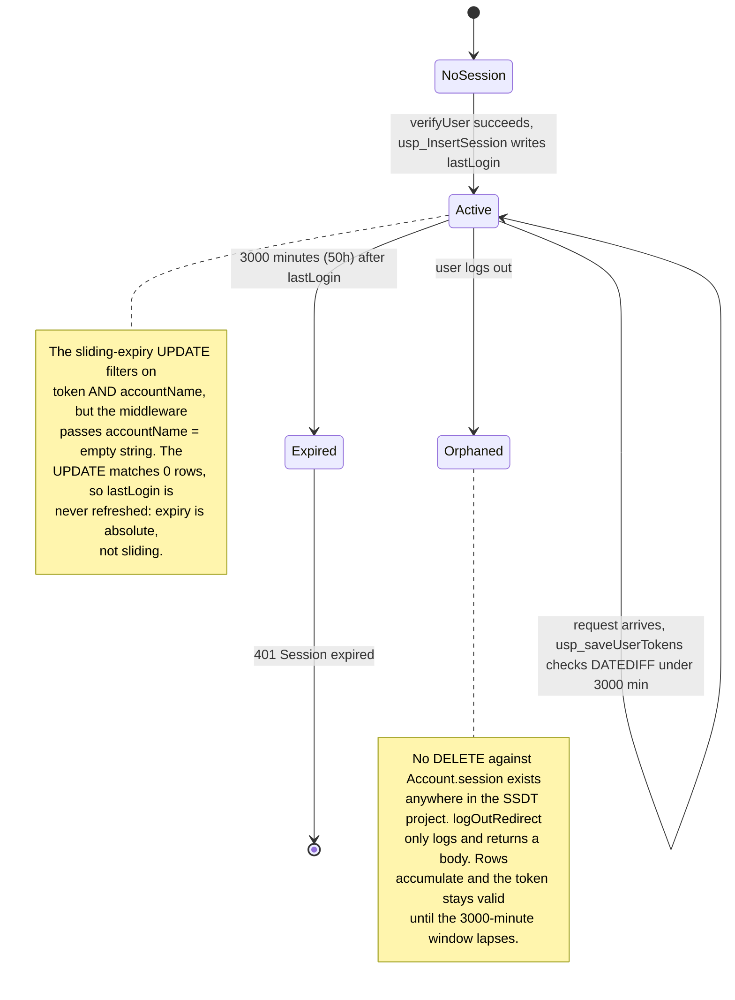
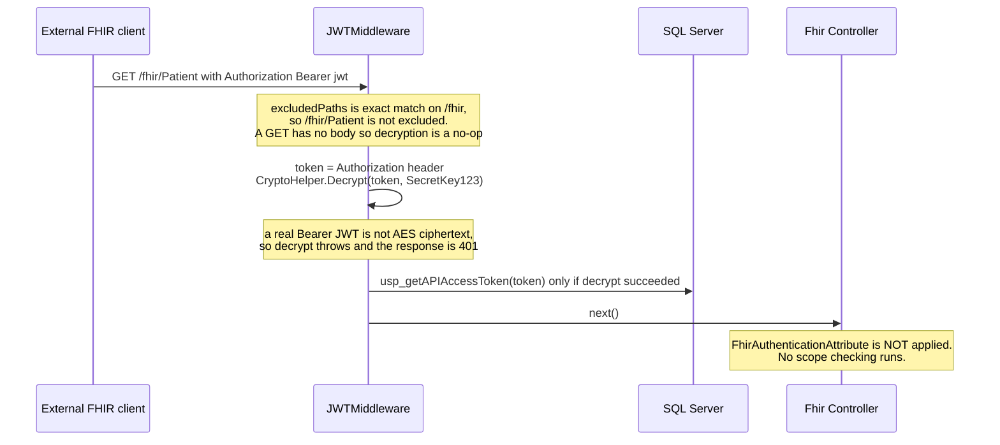
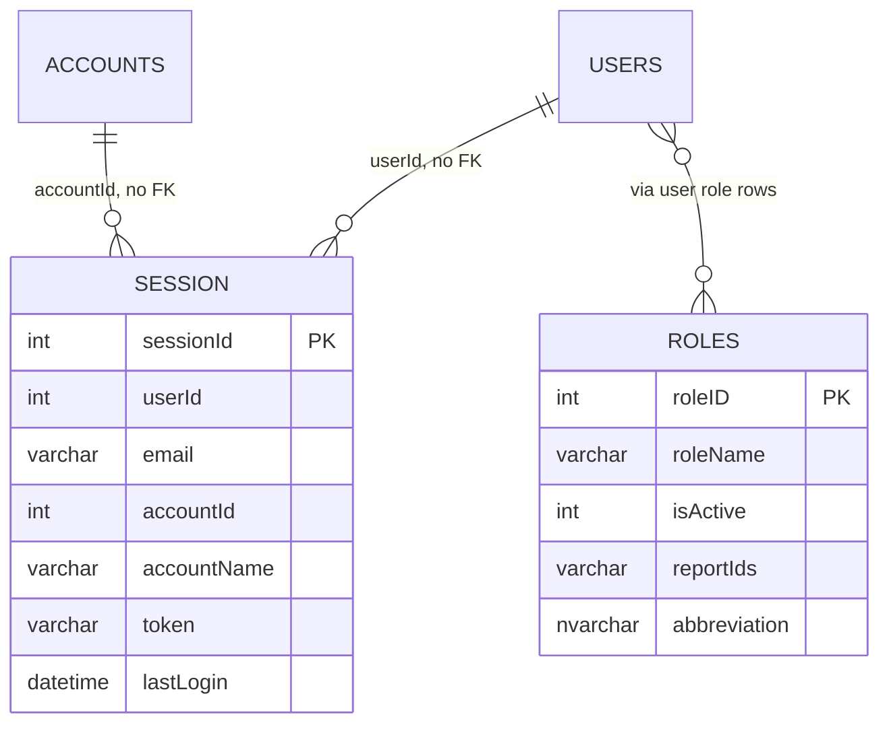

# Deep-Dive - Auth, Identity & Tenancy

**Date**: 2026-10-19
**Analyzed By**: ARCHITECT
**Status**: Draft (awaiting user confirmation)
**Type**: Refresh of the 2026-09-30 deep-dive (old doc used as a checklist, every claim re-verified against current code)
**Scope**: authentication, session management, tenant/user scoping, transport confidentiality, route protection
**HEADs analysed**: `pacEHR_API` @ `0f611f65c` (210 commits after the old evidence base `9f2a6ee19`), `PacEHR` @ `401caa134` (old base `3034de845`). `pacEHR_AI` @ `ef172ea` is out of scope for this module. Every claim cites a file path read in this working copy.

---

## Changes since 2026-09-30

| Area | Old doc | Now (verified) |
|---|---|---|
| Auth gate code | `JWTMiddleware`, `usp_saveUserTokens`, `session.sql`, `CryptoHelper`, `PasswordHelper`, `SecurityConstants`, `AuthorizeFilterAttribute`, `FhirAuthenticationAttribute` | **Unchanged**: git diff `9f2a6ee19..HEAD` shows no change to any of them. All core findings (sliding-expiry defect, 50 h window, no logout delete, hardcoded key, SHA-256 + global salt, dead filters) still hold. |
| Header-derived identity | 126 `GetHeaders()` call sites in 23 controllers | **156 call sites in 28 controllers** (`git grep -c 'GetHeaders()' HEAD -- PacEHR.API/Controllers`). The reliance grew. |
| Session-derived identity | 2 reads of `HttpContext.Items` | **A real counter-pattern now exists** (new): `AuthenticatedUserId()` reads `Items["userId"]` in `ReferralController` (`:1017`, 13 uses incl. `ReferralController.ReferralAttachments.cs` and `.ReassignSpeciality.cs`), `UserController` (`:290`), plus `PatientController.GetTokenItem` (`:850`), `WebUiTokenController` (`:50`, `:68`). About 20 call sites in 5 controllers. These come from PAC-1388/1389/1392, PAC-1317 and Dragon work. |
| Account membership check | none | New `UserController.CallerIsMemberOf(accountId)` (`:295`) verifies the *session* user holds a role in the *header* account (PAC-1388). `PatientController.checkPatientMergeDuplicates` (`:816-823`) rejects a UI account that disagrees with the token account. |
| `[AllowAnonymous]` | 56 active in 10 controllers | **58 active in 11 controllers**. New: `WebUiTokenController` (2, on `:167` and `:201`; the token-minting `GET webUiToken` at `:44` is not anonymous). |
| Unit tests | `UserControllerTests` 88, `UserServiceTest` 34 | 115 and 37 (`[Fact]`/`[Theory]` attribute count). `JWTMiddleware`, `CryptoHelper`, `GetHeaders` still have **0** direct tests. |
| FHIR reachability | "single largest open question" | Resolved in Module 05 and not re-opened here. |
| Corrections to the old doc | | (a) The `excludedPaths` check is exact string equality (`JWTMiddleware.cs:49-52`), so only the literal path `/fhir` is excluded, not `/fhir/Patient`. For GET requests there is no body so the effect is nil, but the old diagram note overstated it. (b) All `SecretKey123` literal sites are now enumerated (see Pattern Catalog). |

Not changed on the SPA side except `078b2a317` (loader import cycle, unrelated to auth): `auth.guard.ts`, `auth.interceptor.ts`, `csrf.interceptor.ts` are byte-identical in behaviour to the old description.

---

## Module Overview

**Purpose**: establish who is calling the API, which tenant (account) they belong to, and whether the request is allowed to proceed.

**Paths**:
- `pacEHR_API/PacEHR.API/Library/Authentication/` - `JWTMiddleware.cs`, `FhirAuthenticationAttribute.cs`
- `pacEHR_API/PacEHR.API/Library/PacEHRCommonController.cs` - header-derived identity
- `pacEHR_API/PacEHR.API/Filters/AuthorizeFilterAttribute.cs` - unreferenced by the API
- `pacEHR_API/pacEHR.DomainServices/Static/` - `CryptoHelper.cs`, `PasswordHelper.cs`
- `pacEHR_API/PacEHR.Database/Tables/Tables1/session.sql`, `Stored Procedures/Procs2/usp_saveUserTokens.sql`, `usp_InsertSession.sql`
- `PacEHR/src/app/core/ineterceptors/` - `auth`, `csrf`, `encrypt`, `loader`
- `PacEHR/src/app/auth.guard.ts`, `src/app/app-routing.module.ts`

**Headline**: authentication is **not** ASP.NET Core authentication. `UseAuthentication()`/`UseAuthorization()` are called (`Program.cs:510,512`) but no authentication scheme is registered; a bespoke middleware validates an opaque GUID session against SQL. Tenancy is still **predominantly taken from client-supplied (AES-encrypted) headers**, with a small but growing set of newer endpoints that use the session-derived identity instead.

---

## Component Breakdown

| Component | File | Responsibility | Status |
|---|---|---|---|
| `JWTMiddleware` | `PacEHR.API/Library/Authentication/JWTMiddleware.cs` | The real auth gate: body decryption, token extraction, session validation, identity into `HttpContext.Items` (`:142-145`) | **Active** |
| `PacEHRCommonController.GetHeaders()` | `PacEHR.API/Library/PacEHRCommonController.cs:29` | Decrypts `accountID` / `userID` / `accountName` request headers into `CommonHeaders` | **Active** - 156 call sites / 28 controllers |
| Session-identity helpers | `ReferralController.cs:1017`, `UserController.cs:290`, `PatientController.cs:850` | Read `Items["userId"]`/`["accountId"]` set by the middleware | **Active, new** (PAC-1388/1389/1392/1317) |
| `UserController.CallerIsMemberOf` | `PacEHR.API/Controllers/UserController.cs:295` | Session user must hold an active role in the header account | **Active, new** |
| `CryptoHelper.Decrypt` | `pacEHR.DomainServices/Static/CryptoHelper.cs` | AES-CBC decrypt, key = SHA-256 of a passphrase (`:14`) | Active |
| `SecurityConstants.EncryptionKey` | `PacEHR.API/Constants/SecurityConstants.cs:5` | `"SecretKey123"` | Active |
| `PasswordHelper` | `pacEHR.DomainServices/Static/PasswordHelper.cs` | SHA-256(staticSalt + password), constant-time verify, legacy-BCrypt detection | Active |
| `UserService.verifyUser` | `pacEHR.DomainServices/UserService.cs:64` | Login: fetch by email, compare hash in app layer | Active |
| `usp_saveUserTokens` | `PacEHR.Database/Stored Procedures/Procs2/usp_saveUserTokens.sql` | Session lookup + (intended) sliding-expiry update | Active |
| `usp_InsertSession` | `PacEHR.Database/Stored Procedures/Procs2/usp_InsertSession.sql` | Session row creation at login | Active |
| `AuthorizeFilterAttribute` | `PacEHR.API/Filters/AuthorizeFilterAttribute.cs` | Near-duplicate of `JWTMiddleware` as an MVC filter | Dead in the API (see below) |
| `FhirAuthenticationAttribute` | `PacEHR.API/Library/Authentication/FhirAuthenticationAttribute.cs:23` | Bearer/JWT validation + FHIR scope claims | Dead in the API (see below) |
| `AuthGuard` | `PacEHR/src/app/auth.guard.ts` | SPA route protection | Active (partial) |
| `AuthInterceptor` | `PacEHR/src/app/core/ineterceptors/auth.interceptor.ts:78-89` | Stamps encrypted `token`/`accountID`/`userID`/`accountName` headers | Active |
| `CsrfInterceptor` | `PacEHR/src/app/core/ineterceptors/csrf.interceptor.ts` | Sends `X-XSRF-TOKEN` when a cookie is present | Active but see CSRF pattern |

### Dead-code verification (re-run)

Re-grepped `PacEHR.API/**/*.cs` outside `Filters/` and `Library/Authentication/Fhir*`: no `[ServiceFilter]`, `[TypeFilter]`, `[FhirAuthentication]`, `AuthorizeFilterAttribute` or `MvcOptions.Filters` reference. The legacy `pacEHR/` project (has `pacEHR/pacEHR.csproj`) is not listed in `pacEHR.sln` (grep count 0). Neither type executes in the deployed API.

---

## Key Workflows

### Workflow 1: Login (password to opaque session token)



**Stories** (all re-verified, line numbers current):
1. Password comparison is in the application layer; `usp_verifyUser` takes email only (`UserService.cs:66`, comment confirms).
2. Accounts still holding a BCrypt hash (`$2a$`/`$2b$`) are blocked and forced through password reset (`UserService.cs:75-77`) - an in-flight migration.
3. The session token is a bare `Guid.NewGuid()` (`UserController.cs:486`) - no signature, claims or expiry in the token.
4. Inactivity policy in C#: `DaysSinceLastLogin > 14` returns `"Expired"` (`UserController.cs:473-477`).
5. Role-based response-field stripping inline with magic numbers: `roleID == 6`, `== 5`, `== 1` (`UserController.cs:488-509`).
6. All login outcomes (`Y`, `Expired`, `MustReset`, `InActive`, `N`) are HTTP 200 with the outcome in the body flag.

### Workflow 2: Every authenticated request



**Stories**:
1. The middleware derives authoritative identity from the session row and stores it in `HttpContext.Items` (`JWTMiddleware.cs:139-145`).
2. Controllers still overwhelmingly ignore it: **156 `GetHeaders()` call sites across 28 controllers** (was 126/23) versus about 20 session-identity reads across 5 controllers (was 2).
3. The newer pattern is only partial: in `UserController.getUserReassignPermission` (`:314-319`) the account still comes from the header, but the caller must hold a role in it. `PatientController.checkPatientMergeDuplicates` (`:816-823`) accepts the token account when present but silently falls back to the UI-sent account when `tokenAccountId` is 0.
4. `Bearer` tokens are rejected unless path is `/downloadxmlfile` or contains `fhir` (`JWTMiddleware.cs:109-126`).
5. On any unhandled exception the middleware returns flat `400 Bad Request` when `ErrorLogMode != 1` (`:149-166`); nothing is logged in that branch. `ErrorLogMode` is 0 in `appsettings.json:138`, QA, Test, Uat, Automation, and 1 only in `appsettings.Development.json:144` (no `appsettings.Production.json` override; Key Vault/env overrides not verifiable here).

### Workflow 3: Session lifetime



**Evidence (re-verified, files unchanged)**:
- `usp_saveUserTokens.sql`: `Update [Account].[session] Set lastLogin = getdate() Where token = @token AND accountName=@accountName`, and the validity test `DATEDIFF(MINUTE, lastLogin, getdate()) < 3000)--720`.
- `JWTMiddleware.cs:130`: `ProcedureHelper.CallSaveUserTokensAsync(_serviceProvider, token, string.Empty)`.
- `AuthorizeFilterAttribute.cs` passes an empty `accountName` too, but that filter is dead.
- `UserController.cs:1705-1720` `logOutRedirect` only logs and returns `BuildDictionaryResult(200, "F", "User logged out successfully")`; grep for `DELETE ... session` across `PacEHR.Database` returns nothing.

The sliding-expiry conclusion still **needs runtime confirmation**, but the code path is unambiguous. The effective window is **50 hours**, not the 12 hours the `--720` comment implies.

### Workflow 4: FHIR / external client



`FhirAuthenticationAttribute` exists (`Library/Authentication/FhirAuthenticationAttribute.cs:23`) but is attached to nothing in `PacEHR.API`. The earlier open question is closed in Module 05: the FHIR surface is not reachable (controller activation fails regardless of auth). Re-check done here: `AddAutoMapper` still not found anywhere in the solution sources; the rest of that finding is carried from Module 05, not re-verified here.

---

## Data Models



### `Account.session` - `PacEHR.Database/Tables/Tables1/session.sql` (unchanged)

| Field | Type | Constraints | Description |
|---|---|---|---|
| `sessionId` | INT | PK, IDENTITY | Surrogate key |
| `userId` | INT | NOT NULL | No FK declared |
| `email` | VARCHAR(100) | NOT NULL | Denormalised from `Account.users` |
| `accountId` | INT | NOT NULL | Tenant; no FK declared |
| `accountName` | VARCHAR(100) | NOT NULL | Denormalised |
| `token` | VARCHAR(100) | NOT NULL | The GUID; `idx_Session_token` non-clustered index |
| `lastLogin` | DATETIME | NOT NULL | Expiry anchor |

Observations: no foreign keys, no uniqueness constraint on `token`, no `expiresAt`, no `revokedAt`. Expiry is computed at read time from `lastLogin`. The user-to-role link table shown in the ER diagram is carried from the old doc (`Account.roles` shape not re-opened; the join table name was not verified).

### `Account.roles` (carried, not re-verified this pass)

`roleID` PK, `roleName`, `isActive`, `reportIds VARCHAR(100)` (comma-delimited report ids in a scalar column), `abbreviation`. Authorisation data in a denormalised string.

### Credential fields (from `usp_verifyUser` result shape, as consumed in `UserController.cs:469-530`)

| Field | Used for |
|---|---|
| `PasswordHash` | SHA-256 hex, or legacy `$2*` BCrypt |
| `MustResetPassword` | Forces the reset flow |
| `DaysSinceLastLogin` | 14-day inactivity lockout |
| `isActive`, `locked` | Account state gates |
| `roleID` | Drives inline response-field stripping |

---

## Pattern Catalog

### Pattern: transport confidentiality - shared-secret AES with a hardcoded key

**Where**: `pacEHR.DomainServices/Static/CryptoHelper.cs`, `PacEHR.API/Constants/SecurityConstants.cs:5`, SPA `auth.interceptor.ts:78-89`, `encrypt.interceptor.ts:32`, `open-ai.service.ts:247-253`

```csharp
// ACTUAL (PacEHR.API/Constants/SecurityConstants.cs:5)
public const string EncryptionKey = "SecretKey123";

// ACTUAL (JWTMiddleware.cs:101) - the literal is also inline
token = CryptoHelper.Decrypt(token, "SecretKey123").Replace("\"", "");
```

```csharp
// DON'T: a compile-time constant shared by client and server, committed to two repos
CryptoHelper.Decrypt(token, "SecretKey123");

// DO: if a shared secret is genuinely required, resolve it from Key Vault at runtime
CryptoHelper.Decrypt(token, _securityOptions.Value.PayloadKey);
```

Server-side the literal (rather than the constant) is repeated in `JWTMiddleware.cs:101`, `PacEHRCommonController.cs:37,46,54`, `AuditMiddleware.cs:59,60,82`, `ErrorHandleMiddelware.cs:45,46,66`, `PccCosmosLoggingFilter.cs:207`, `VideoCallController.cs:48,103,151`, `AuthorizeFilterAttribute.cs:59,106,215`. The same literal ships in the SPA bundle, so the encryption is obfuscation, not confidentiality; TLS does the real work. Key derivation is `SHA256(passphrase)` with no KDF iterations (`CryptoHelper.cs:14`).

### Pattern: "is it encrypted?" detection by string sniffing

**Where**: `JWTMiddleware.cs:60`

```csharp
// ACTUAL
if (!string.IsNullOrWhiteSpace(body) && !body.Contains("{"))
{
    var decryptedJson = CryptoHelper.Decrypt(body, SecurityConstants.EncryptionKey);
```

```csharp
// DON'T: infer content encoding from whether a brace appears anywhere in the body
if (!body.Contains("{")) { Decrypt(body); }

// DO: signal it explicitly
if (request.Headers.ContainsKey("X-Payload-Encrypted")) { Decrypt(body); }
```

Any plaintext non-JSON body (without `{`) is fed to the decryptor and rejected with 400 "Failed to decrypt request body." (`:72-76`). The 15-entry `excludedPaths` list (`:49`) exists to patch around this for webhooks and voice endpoints.

### Pattern: authentication - opaque GUID session validated in SQL

**Where**: `UserController.cs:486-487`, `usp_saveUserTokens.sql`

```csharp
// ACTUAL
string token = Guid.NewGuid().ToString();
await _userService.setDatabaseSession(result.userID, result.email, result.accountID, result.accountName, token);
```

A defensible design (server-side sessions are revocable). The problems are in the details: no revocation on logout, a 50-hour window, a broken sliding-expiry UPDATE.

### Pattern: tenancy from client-asserted headers (still dominant) vs session-derived identity (new, spreading)

**Where**: `PacEHR.API/Library/PacEHRCommonController.cs:29-60` (header path); `ReferralController.cs:1013-1018`, `UserController.cs:289-300`, `PatientController.cs:849-858` (session path)

```csharp
// DON'T (156 call sites): trust the caller for the tenant boundary
var headers = GetHeaders();
var data = await _svc.GetPatients(headers.AccountID);

// DO (existing house example, ReferralController.cs:1017): use the identity the session lookup produced
[NonAction]
private int AuthenticatedUserId() =>
    int.TryParse(HttpContext?.Items["userId"]?.ToString(), out var userId) ? userId : 0;
```

```csharp
// DO, stronger (UserController.cs:295-300): header account is accepted only if the SESSION user holds a role in it
var caller = AuthenticatedUserId();
if (caller <= 0 || accountId <= 0) return false;
var roles = await _userService.GetRolesByUser(accountId, caller);
return roles != null && roles.Count > 0;
```

The header value is encrypted with a key the client possesses, so a caller holding a valid session for account A can present `accountID` for account B on any endpoint that still uses `GetHeaders()` alone. **Counts: 156 header-derived call sites (28 controllers) vs about 20 session-identity reads (5 controllers).** The team has clearly recognised the gap (comments reference "S-2" and PDQ-01) and is closing it endpoint by endpoint, but there is no central enforcement: nothing compares the header account to `Items["accountId"]`. Still to be confirmed against a running environment, since a stored procedure may re-derive scope internally (not checked this pass).

### Pattern: password storage - SHA-256 with one global salt

**Where**: `pacEHR.DomainServices/Static/PasswordHelper.cs:12-16`

```csharp
// ACTUAL
public static string Hash(string plainText, string staticSalt)
{
    byte[] inputBytes = Encoding.UTF8.GetBytes(staticSalt + plainText);
    byte[] hashBytes = SHA256.HashData(inputBytes);
    return Convert.ToHexString(hashBytes).ToLowerInvariant();
}
```

```csharp
// DON'T: a fast general-purpose hash with one process-wide salt
SHA256.HashData(Encoding.UTF8.GetBytes(staticSalt + password));

// DO: a memory-hard KDF with a per-user salt and a tunable work factor
BCrypt.Net.BCrypt.EnhancedHashPassword(password, workFactor: 12);
```

`IsLegacyBcryptHash()` (`:35`) treats BCrypt as the old format being migrated away from, so the migration reduces password-storage strength. `StaticSalt` is `"PacEHR@Sec#Salt2024"` in `appsettings.json:170` and identically in Development, QA, Test, Uat and Automation files; there is no `StaticSalt` in `appsettings.Production.json` (grep), so production presumably supplies it via Key Vault/env (**not verifiable from source**). `Verify` uses `CryptographicOperations.FixedTimeEquals` (`:26`); `IsStrongPassword` enforces 8+ chars with upper/lower/digit.

### Pattern: CSRF - client sends a header the server never validates

**Where**: `PacEHR/src/app/core/ineterceptors/csrf.interceptor.ts`

```typescript
// ACTUAL - the interceptor's own comment asserts a server-side filter
// "Anonymous endpoints (e.g. login) are skipped server-side by ValidateCsrfFilter..."
const cloned = req.clone({ headers: req.headers.set('X-XSRF-TOKEN', csrfToken) });
```

```typescript
// DON'T: document a control that does not exist
// "...skipped server-side by ValidateCsrfFilter, so passing through is safe"

// DO: either implement the server filter + XSRF cookie issuance, or delete the interceptor
```

Re-verified: no `ValidateCsrfFilter`, no `AddAntiforgery()` in `Program.cs`, and the only `Antiforgery`/`XSRF` hits in `pacEHR_API` are in 2 unit-test files (`FakeAntiforgeryValidationFeature`). Nothing issues the `XSRF-TOKEN` cookie. Mitigating context: authentication uses a custom `token` header, not a cookie, so classic CSRF is largely inapplicable; the finding is a documented control that does not exist (audit/maintenance hazard).

### Pattern: API response envelope - untyped dictionary, HTTP 200

**Where**: every controller, e.g. `UserController.cs:454`, `AIController.cs:46`

```csharp
// ACTUAL
public async Task<IDictionary<string, object>> verifyUser(verifyUser objUser)
...
return AddToDictionaryResult(dictionary, 500, "F", "Invalid account configuration", null); // HTTP 200
```

```csharp
// DON'T: untyped bag, HTTP 200 regardless of outcome, status in the body
return AddToDictionaryResult(dict, 500, "F", "Invalid account configuration", null);

// DO: typed results with real status codes
return Problem(statusCode: 500, detail: "Invalid account configuration");
```

Note a new, partial exception: `UserController.getUserReassignPermission` puts `403` in the body status (`:316`) but still returns HTTP 200; `WebUiTokenController.GetWebUiToken` returns real `StatusCode(401/403, ...)` (`:52`, `:60`) and is the only auth-adjacent endpoint found using real HTTP status codes. Details of the envelope helpers are in Module 02.

### Pattern: error handling - swallow and generalise

**Where**: `JWTMiddleware.cs:149-166`

```csharp
// ACTUAL
catch
{
    if (_errorLogMode == 1) { throw; }
    else { await ReturnBadRequest(context, "Bad Request"); }
}
```

```csharp
// DON'T: a bare catch that turns every failure into 400 with no log
catch { await ReturnBadRequest(context, "Bad Request"); }

// DO: log with context, then map deliberately
catch (Exception ex)
{
    _logger.LogError(ex, "Auth pipeline failure for {Path}", context.Request.Path);
    await ReturnBadRequest(context, "Bad Request");
}
```

Whether failures are observable depends on `ErrorLogSettings:ErrorLogMode` (see Workflow 2 story 5). Also note the decrypt failures at `:72` and `:103` return specific 400/401 messages without logging.

### Pattern: logging - static helper over `TelemetryClient`

**Where**: `PacEHR.API/Library/ApplicationInsightsLogger.cs:12-45`, used throughout, e.g. `UserController.cs:480`

```csharp
// ACTUAL
ApplicationInsightsLogger.LogInfo(_telemetry, "AccountID is NULL for user: " + result.userID);
```

```csharp
// DON'T: string concatenation, no structured fields
LogInfo(_telemetry, "AccountID is NULL for user: " + result.userID);

// DO: structured, queryable
_logger.LogWarning("AccountID null for {UserId}", result.userID);
```

Also note `LogError(ex, message)` formats with `string.Format($"...{0}...{1}")` (`:26`), where the interpolation consumes the placeholders first, so the trace message is malformed. Minor, but it is in the one shared error logger.

### Pattern: client-side route protection only

**Where**: `PacEHR/src/app/auth.guard.ts:11-19`, `app-routing.module.ts:32-34,37,46,54`

```typescript
// ACTUAL
canActivate(): boolean {
  const user = sessionStorage.getItem('user');
  const userCan = user ? !!JSON.parse(user).token : false;
  if (userCan) { return true; }
  this.router.navigate(['/login']);
  return false;
}
```

```typescript
// DON'T: leave a route unguarded
{ path: 'encounters', component: EncounterListComponent, // canActivate: [AuthGuard],
{ path: 'follow-ups', component: FollowUpsComponent },

// DO
{ path: 'follow-ups', component: FollowUpsComponent, canActivate: [AuthGuard] },
```

The guard checks only the *presence* of a token string, with no expiry or server validation. Re-verified: `encounters` still has `canActivate` commented out (`:34`), and `follow-ups` (`:37`) has none. This is a UX control; the API is the real gate.

### Pattern: class-level `[AllowAnonymous]` over sensitive actions

**Where**: `PacEHR.API/Controllers/OAuthController.cs:10`

```csharp
// ACTUAL
[AllowAnonymous]            // class level, line 10
public class OAuthController : ControllerBase
{
    [AllowAnonymous] public async Task<IActionResult> GetAuthorizeUrlAsync(...)  // :26-28
    ... ExchangeCode / RefreshToken / RevokeToken inherit anonymity ...
    [AllowAnonymous] public async Task<IActionResult> OAuthCallback(...)         // :59-61
}
```

```csharp
// DON'T: blanket anonymity so that every future action is open by default
[AllowAnonymous] public class OAuthController : ControllerBase

// DO: per-action attributes for the two redirect endpoints only
[HttpGet("authorize-url"), AllowAnonymous] public Task<IActionResult> GetAuthorizeUrlAsync(...)
```

Across the API: **58 active `[AllowAnonymous]` in 11 controllers** (counted excluding commented lines): `VoiceCallMessagesController` 16, `VideoCallController` 15, `UserController` 13, `OAuthController` 3, `HIEController` 2, `MatrixCareController` 2, `PccTokenRenewalController` 2, `WebUiTokenController` 2 (new), `AIController` 1, `AccountController` 1, `PacEHRHealthMonitoringController` 1. Module 07 enumerates them.

### Test patterns (auth)

**Location**: `pacEHR_API/PacEHR.Tests.UnitTests/`. **Naming**: `{Type}Tests.cs` / `{Type}Test.cs` (inconsistent), `[Collection("DomainServiceTests")]`.

| Suite | Tests ([Fact]/[Theory]) |
|---|---|
| `Controllers/UserControllerTests.cs` | 115 (was 88) |
| `DomainServices/UserServiceTest.cs` | 37 (was 34) |
| `DomainServices/PasswordHelperTests.cs` | 9 |
| `DomainServices/TokenServiceTest.cs` | 2 |
| `Controllers/WebUiTokenControllerTests.cs` | present (new, count not taken) |
| **`JWTMiddleware`** | **0** (only comments in `PatientControllerTests.cs:69,778,915` refer to it) |
| **`PacEHRCommonController.GetHeaders`** | **0 direct** (controller tests build encrypted headers by hand, e.g. `PatientControllerTests.cs:63-70`) |
| **`CryptoHelper`** | **0** (tests re-implement the encryptor: `PccControllerTests.cs:222`) |

```csharp
// ACTUAL - controller tests now seed both identity sources (PatientControllerTests.cs:63-70)
httpContext.Request.Headers["accountID"] = Encrypt(accountId.ToString(), "SecretKey123");
httpContext.Items["accountId"] = accountId;   // what JWTMiddleware stores
```

```csharp
// DON'T: hand-roll the production cipher in each test file
private static string Encrypt(string plainText, string password) { /* copy */ }

// DO: test the real middleware once, expose a shared test helper
await new JWTMiddleware(next, scopeFactory, config).InvokeAsync(ctx);
```

The test style is good. The gap is the component that enforces authentication on every endpoint has no tests. `PacEHR.Tests.Integration` still contains only `GlobalUsings.cs` and a csproj.

---

## Entry Points

| Entry | Route | Anonymous | Description |
|---|---|---|---|
| Login | `POST /verifyUser` | yes | Password to session GUID (`UserController.cs:452`) |
| OTP validate / send | `POST /validateOtp`, `/sendOtpViaSms` | yes (carried from old doc) | Two-factor step, Twilio SMS |
| Password verify | `POST /verifyUserPassword` | no | Re-auth for sensitive actions (`:1420`); mints another GUID (`:1459`) |
| Certificate verify | `POST /verifyUserCertificate` | no | Signing credential check (`:1528`) |
| Logout redirect | `POST /logOutRedirect` | no | No session row deletion (`:1705`) |
| Web UI token | `GET /webUiToken` | no | Mints a Dragon Copilot JWT for the session user; uses `Items["userId"]`, real 401/403 (`WebUiTokenController.cs:44-60`). New. |
| OAuth authorize / callback | `GET /oauth/authorize-url`, `/oauth/callback` | yes | PCC OAuth start / return |
| OAuth exchange / refresh / revoke | `POST /oauth/token`, `/refresh`, `/revoke` | yes (inherited) | Code/refresh/revoke |
| FHIR (all) | `/fhir/*` | middleware-excluded only for the exact path `/fhir` | See Workflow 4 and Module 05 |

(OTP routes carried, not re-verified individually this pass.)

---

## Open Questions for the Team

1. **Do stored procedures re-derive `accountId` internally?** If they scope by the passed `accountId` alone, header-asserted tenancy is a cross-tenant exposure on 156 call sites. Inspect one proc end to end (not done this pass).
2. **Has anyone observed session expiry behaving as sliding?** Logout at exactly 50 hours regardless of activity would confirm the `accountName=''` defect.
3. **Was the BCrypt to SHA-256 migration deliberate?** What proportion of `Account.users` rows still hold `$2*` hashes?
4. **Is `StaticSalt` environment-specific and Key-Vault-sourced in production**, or the `appsettings.json` value?
5. **Is the S-2 / PDQ-01 session-identity approach intended to become the rule?** If yes, a central check (header account must equal `Items["accountId"]`) would close the gap for all 156 sites at once instead of endpoint by endpoint.
6. **Should `AuthorizeFilterAttribute`, `FhirAuthenticationAttribute` and the whole legacy `pacEHR/` project be deleted?**
7. Which environments run with `AuditMode=1` (which logs decrypted payloads, Module 02)? Not an auth question but it affects how header and token values are exposed in logs.

---

## Recommendations

| # | Recommendation | Rationale | Effort |
|---|---|---|---|
| 1 | Add a central guard: compare header `accountID`/`userID` with `Items["accountId"]/["userId"]` (reject on mismatch), then migrate `GetHeaders()` consumers gradually | Closes client-asserted tenancy for 156 sites with one change; builds on the PAC-1388/1389 pattern | Low for the guard, High for full migration |
| 2 | Fix `usp_saveUserTokens`: drop `AND accountName=@accountName` from the UPDATE | Restores intended sliding expiry | Trivial |
| 3 | Reduce the session window from 3000 minutes and align the code with the `--720` comment | 50 hours is long for an EHR | Trivial |
| 4 | Delete the session row on logout | Tokens currently survive logout | Low |
| 5 | Move `EncryptionKey` and `StaticSalt` to Key Vault; remove the literals from both repos | A committed shared secret is not a secret | Medium - coordinated FE/BE release |
| 6 | Reconsider SHA-256 for passwords; BCrypt is already a dependency | Per-user salt + work factor | Medium |
| 7 | Either implement `ValidateCsrfFilter` or delete `CsrfInterceptor` and its comment | Documented control that does not exist | Low |
| 8 | Add unit tests for `JWTMiddleware`, `GetHeaders`, `CryptoHelper` | Zero direct coverage on the sole auth gate | Medium |
| 9 | Delete the orphan `pacEHR/` project and the two dead filters | Removes a misleading second auth implementation | Low |
| 10 | Replace class-level `[AllowAnonymous]` on `OAuthController` with per-action attributes | Three token endpoints anonymous by inheritance | Trivial |
| 11 | Replace the `!body.Contains("{")` check with an explicit header | Deterministic instead of heuristic | Low |
| 12 | Register a real authentication scheme, or remove `UseAuthentication()`/`UseAuthorization()` | Today they imply protection that `[Authorize]` cannot deliver | Medium |
| 13 | Return real HTTP status codes from new endpoints as `WebUiTokenController` does | Stops spreading the 200-for-everything contract | Low |

---

**Next**: Module 02 - API request & data spine.
