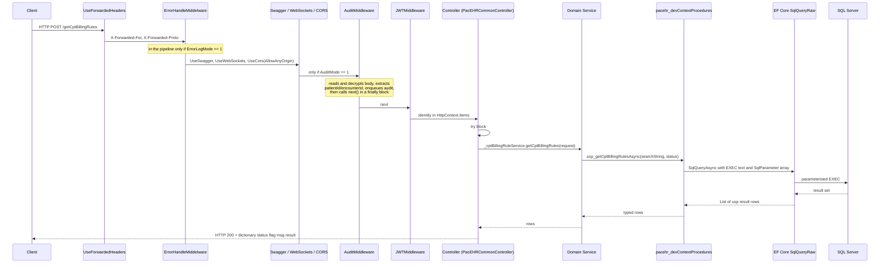
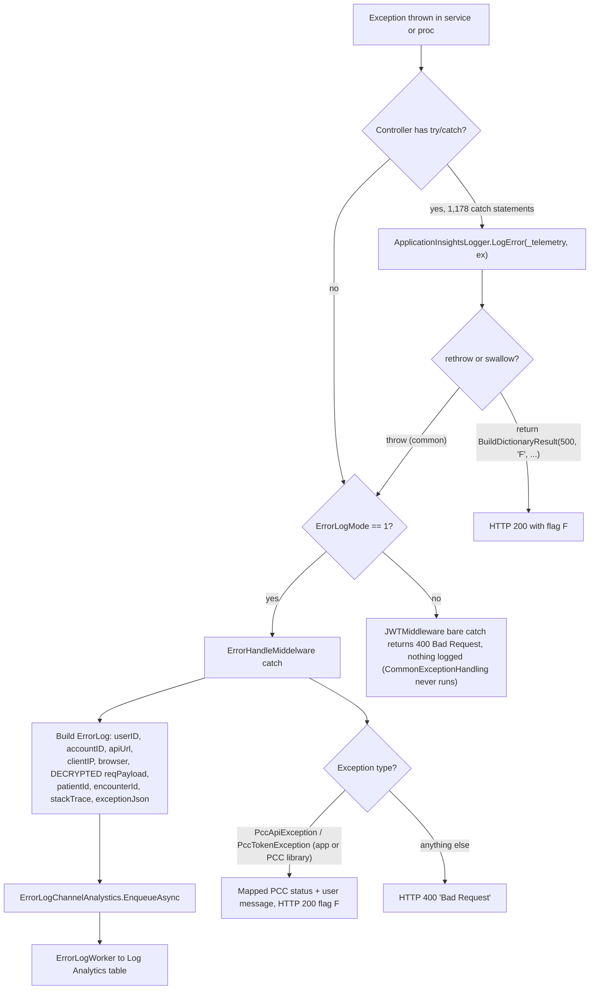
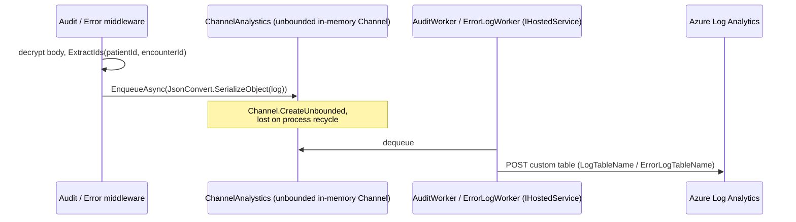
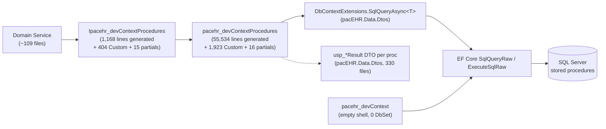

# Deep-Dive - API Request & Data Spine

**Date**: 2026-10-19
**Analyzed By**: ARCHITECT
**Status**: Draft (awaiting user confirmation)
**Type**: Refresh of the 2026-09-30 deep-dive (old doc used as a checklist, every claim re-verified against current code)
**Scope**: the path every request takes from HTTP to SQL and back - middleware pipeline, controller conventions, domain-service layer, the generated stored-procedure context, response envelopes, error handling, audit/error logging
**HEADs analysed**: `pacEHR_API` @ `0f611f65c` (210 commits after the old evidence base `9f2a6ee19`). `PacEHR` @ `401caa134` and `pacEHR_AI` @ `ef172ea` are not part of this module.

---

## Changes since 2026-09-30

| Area | Old doc | Now (verified) |
|---|---|---|
| Middleware files | `Program.cs` pipeline, `AuditMiddleware`, `ErrorHandleMiddelware`, `PacEHRCommonController`, `ApplicationInsightsLogger` | **No change to any file under `PacEHR.API/Library/`** (`git diff 9f2a6ee19 HEAD -- PacEHR.API/Library` empty). `Program.cs` changed by 3 lines only (3 new DI registrations: `IHexploraService`, `IAutomatedWorkflowService`, `IPauboxEmailService`). The pipeline analysis stands. |
| Size of the spine | 94 controllers, ~1,012 endpoints | **100 controller files**, **1,049 HTTP-verb attributes**, 1,080 `[Route("...")]` attributes in `PacEHR.API/Controllers`. 1,178 `catch` statements (old 1,141) in 95 controller files (old 89). |
| Generated proc context | 55,457 lines | **55,534 lines** `pacEHR.DomainServices/pacehr_devContextProcedures.cs` plus **17 hand-written partials** (old 8 incl. Custom): new `AutomatedWorkflow`, `PatientMerge`, `ProviderReferralQueue`, `ProviderSpecialty`, `QualityMeasureExclusion`, `Reactivation`, `ReferralAccountSettings`, `ReferralAttachments`, `UserPreferences` (all since 2026-09-30). `Custom.cs` 1,923 lines (was 1,875). Interface 1,168 lines + 16 partials. |
| **Correction: EF entities** | "928 EF entity classes mapped in `pacehr_devContext`" | **Not true, and was not true at the old HEAD either.** `PacEHR.Data/PacEHR.Data.csproj:10-12` has `<Compile Remove="Models\**" />`, so the 928 files in `PacEHR.Data/Models/` (including a second, older 45,502-line `pacehr_devContextProcedures.cs` and a second `DbContextExtensions.cs`) are **not compiled**. The live `pacehr_devContext` (`pacEHR.DomainServices/pacehr_devContext.cs`) is a 17-line shell with **0 `DbSet<>`**. The compiled `SqlQueryAsync<T>` lives in `pacEHR.Data.Dtos/DbContextExtensions.cs:35`, not `PacEHR.Data/Models/`. |
| **Correction: caching** | "There is no caching layer" | `builder.Services.AddMemoryCache()` exists (`Program.cs:214`, PERF-001); the only consumer found is `pacEHR.DomainServices/ImoService.cs` (IMO tokens, app settings, search results). Request path for ordinary controllers is still uncached. |
| New finding | | `CommonExceptionHandling : IExceptionHandler` is registered (`Program.cs:395`) but `UseExceptionHandler` is commented out (`Program.cs:507`), so it never runs. |
| New finding | | `ErrorHandleMiddelware` is added to the pipeline **only when `ErrorLogMode == 1`** (`Program.cs:475-478`); its `else` branch (PCC-only exception mapping, `ErrorHandleMiddelware.cs:129-151`) is therefore unreachable. |
| Environment config | "which environments run Audit/ErrorLog needs confirmation" | Narrowed from files: `AuditMode`=1 in `appsettings.json:129`, Development, QA, Test, Uat; 0 only in Automation. `ErrorLogMode`=1 only in Development (`appsettings.Development.json:144`); 0 everywhere else. `appsettings.Production.json` sets neither, so production inherits base values (Audit on, ErrorLog off) unless Key Vault/env overrides, which cannot be verified from source. |
| DTO validation | 74 of 321 DTOs annotated | **75 of 330** DTO files carry `[Required]/[MaxLength]/[StringLength]/[Range]` (23%). `ModelState` checks in controllers: still 0. |
| Test counts | 3,053 unit tests | **3,408** `[Fact]`/`[Theory]` attributes in `PacEHR.Tests.UnitTests` (counting method may differ from the old figure). `PacEHR.Tests.Integration` still has only `GlobalUsings.cs` + csproj. |
| Dropped / not re-verified | | "~250 DI registrations" not supported: 149 lines in `Program.cs` match `AddScoped/AddSingleton/AddTransient/AddHttpClient`. "106 service classes / 112 interfaces": re-counted as ~109 `.cs` files directly under `pacEHR.DomainServices/` and 122 `I*.cs` under `pacEHR.DomainServices.Interfaces/` (file counts, not class counts). "1,553 stored procedures": **carried, not re-verified** (1,427 `usp_*.sql` files exist in `PacEHR.Database`, plus non-`usp_` procs). |

Findings that **still hold unchanged**: three response-envelope helpers with different `result`-key semantics, HTTP 200 for failures, SQL parameterisation throughout the proc layer, `RefExec`-style interpolated statement text (now 7 partials instead of 4), dead Polly `ResiliencePipeline`, PHI in audit/error logs, `ExtractIds` three-casing duplication, free-text logging, near-absent validation.

---

## Module Overview

**Purpose**: the shared machinery all 100 controllers and ~1,049 endpoints ride on. Nothing here is domain-specific; everything here affects every feature.

**Key sizes (re-measured)**:

| Component | Size |
|---|---|
| `PacEHR.API/Program.cs` | 529 lines, one `Main`, 149 DI registration lines |
| `pacehr_devContextProcedures.cs` (generated) | **55,534 lines** |
| `pacehr_devContextProcedures.Custom.cs` (hand-written) | 1,923 lines |
| Other hand-written proc partials | 16 files (Referral 826, TreatmentPlan 605, Symptoms 162, ProviderSpecialty 123, Reactivation 124, AutomatedWorkflow 100, others under 60) |
| `Ipacehr_devContextProcedures.cs` (generated interface) | 1,168 lines, plus 404 lines `Custom` and 15 other partials |
| Wrapper methods in generated context | 877 `public virtual async Task` (+ those in partials) |
| Domain service files | ~109 under `pacEHR.DomainServices/`, 122 `I*.cs` interfaces |
| DTO files (`pacEHR.Data.Dtos`) | 330 |
| Compiled EF entity classes | **0** (the 928 files in `PacEHR.Data/Models` are `Compile Remove`d) |
| Controller `catch` statements | **1,178** in 95 of 100 controller files |
| Unit tests | 3,408 attributes |

---

## Component Breakdown

| Layer | Component | File | Responsibility |
|---|---|---|---|
| Host | `Program.cs` | `PacEHR.API/Program.cs` | Config, Key Vault, DbContext, DI, middleware order |
| Middleware | `ForwardedHeaders` | `Program.cs:471` | Real client IP behind the gateway; `KnownNetworks`/`KnownProxies` cleared |
| Middleware | `ErrorHandleMiddelware` | `Library/ErrorHandleMiddelware.cs` | Catch-all, error log, response mapping. **Added only if `ErrorLogMode == 1`** (`Program.cs:475-478`) |
| Middleware | `AuditMiddleware` | `Library/AuditMiddleware.cs` | Pre-request audit record, added only if `AuditMode == 1` (`Program.cs:499-502`) |
| Middleware | `JWTMiddleware` | `Library/Authentication/JWTMiddleware.cs` | Body decryption + session auth (Module 01) |
| Dead handler | `CommonExceptionHandling` | `Library/CommonExceptionHandling.cs` | `IExceptionHandler`, registered, never wired (`UseExceptionHandler` commented out) |
| Filter | `PccCosmosLoggingFilter` | `Library/PccCosmosLoggingFilter.cs` | PCC request/response capture; attached by `PccCosmosLoggingConvention` (`Program.cs:424`) only when Cosmos is configured |
| Base | `PacEHRCommonController` | `Library/PacEHRCommonController.cs` | `[ApiController]` (`:12`), header identity, response-envelope builders |
| Service | ~109 `*Service`/`*Services` | `pacEHR.DomainServices/` | Orchestration + mapping |
| Data | `pacehr_devContextProcedures` | `pacEHR.DomainServices/` | Typed wrappers over stored procedures |
| Data | `DbContextExtensions.SqlQueryAsync<T>` | `pacEHR.Data.Dtos/DbContextExtensions.cs:35` | The single call site into `SqlQueryRaw`/`ExecuteSqlRaw` |
| Data | `pacehr_devContext` | `pacEHR.DomainServices/pacehr_devContext.cs` | Empty `DbContext` shell used only to reach `Database` |
| Workers | `AuditWorker`, `ErrorLogWorker` | `Library/` (`Program.cs:444-445`) | Drain unbounded channels to Log Analytics; `PccCosmosWorker` only when Cosmos active (`:440`) |

---

## Key Workflows

### Workflow 1: The canonical request



**Stories**:
1. Two of three middlewares are **config-gated at registration time** (`Program.cs:475-478`, `:499-502`). With `ErrorLogMode != 1` there is no global exception handler; with `AuditMode != 1` no audit. Config files show Audit on and ErrorLog off for every environment except Development (ErrorLog on) and Automation (Audit off).
2. `AuditMiddleware` calls `await _next(context)` from a `finally` block (`AuditMiddleware.cs:138-141`). Early `return`s still reach it, so requests are never dropped; but the audit is written **before** the action runs, so no status code, duration or outcome is captured. A failure inside the audit logic is swallowed to `Console.WriteLine` (`:134-137`).
3. Order matters: `UseRouting` -> ErrorHandle -> Swagger -> WebSockets -> CORS -> Audit -> JWT -> `UseAuthentication` -> `UseAuthorization` -> `MapControllers` (`Program.cs:471-516`). Audit runs before authentication, so the audit record's `userID`/`accountID` come from the client-asserted headers, not the session.
4. Swagger is registered unconditionally (`Program.cs:482-483`), and CORS is `AllowAnyOrigin/AnyHeader/AnyMethod` (`:490-492`) with a `//TODO` above it.
5. Below the controller everything is synchronous request to proc to rows: no unit of work, no repository abstraction, and (outside `ImoService`) no cache.

### Workflow 2: Error path



**Stories**:
1. Three competing error strategies in one pipeline: per-action `try/catch`, the gated `ErrorHandleMiddelware`, and `JWTMiddleware`'s catch (Module 01, which converts to 400 itself when `ErrorLogMode != 1` and so never lets the exception reach anything else).
2. Why node H is the JWTMiddleware catch: `await _next(context)` runs inside `JWTMiddleware`'s `try` (`JWTMiddleware.cs:83` for anonymous routes, `:147` for authenticated ones), so every downstream controller exception reaches its catch. With `ErrorLogMode != 1` that catch returns a flat 400 and logs nothing (`:165`); with `ErrorLogMode == 1` it rethrows to `ErrorHandleMiddelware` (`:149-163`). New in this refresh: `CommonExceptionHandling` and the else-branch of `ErrorHandleMiddelware` are dead code.
3. Only PCC exceptions get meaningful status mapping, and then as HTTP 200 (`ReturnPccTokenError` sets `StatusCode = OK`, `:155`). Everything else is `400 Bad Request` regardless of cause.
4. `app.UseExceptionHandler` is commented out (`Program.cs:507`).

### Workflow 3: Audit and error logging to Log Analytics



Verified: both channels are `Channel.CreateUnbounded<string>` (`AuditLogChannelAnalystics.cs:7`, `ErrorLogChannelAnalystics.cs:7`). By contrast `PccCosmosChannel` is bounded at 10,000 with `DropWrite` (`PccCosmosChannel.cs:17-22`) - the safer design already exists in the same folder.

---

## Data Models

### The stored-procedure access layer

There is **no repository pattern and no entity-based querying in the request path**, and now verified more strongly than before: there are no compiled entities at all. Every read and write goes through a generated wrapper:



`PacEHR.Data/Models/` holds 928 `.cs` files and a stale copy of the proc context, but the project excludes them from compilation (`PacEHR.Data.csproj:10-12`); they are reference output from EF Core Power Tools. `efpt.config.json` in `PacEHR.Data` is the generator config.

### `ErrorLog` record (written to Log Analytics) - unchanged

| Field | Source | PHI risk |
|---|---|---|
| `userID`, `accountID` | decrypted request headers (client-asserted) | identifiers |
| `apiUrl`, `clientIP`, `browserBrand`, `browserVersion` | request | - |
| **`reqPayload`** | **full decrypted request body** (`ErrorHandleMiddelware.cs:101`) | **high** |
| `patientId`, `encounterId` | extracted from payload | identifiers |
| `errorMessage`, `stackTrace`, `exceptionJson` | exception (`JsonConvert.SerializeObject(ex)`, `:109`) | may embed data |

### `AuditLog` record

Same shape minus the exception fields; includes `token` (the raw `Token` header, still AES-encrypted, `AuditMiddleware.cs:58,115`), the full decrypted `reqPayload`, `patientId`, `encounterId`.

---

## Pattern Catalog

### Pattern: stored-procedure wrappers - parameterised and safe

**Where**: `pacEHR.DomainServices/pacehr_devContextProcedures.cs` (generated by EF Core Power Tools, config `PacEHR.Data/efpt.config.json`), e.g. `:204`

```csharp
// DO - the house standard (pacehr_devContextProcedures.cs:204)
var _ = await _context.SqlQueryAsync<depression_ACOReportResult>(
    "EXEC @returnValue = [dbo].[depression_ACOReport] @accountId = @accountId, @fromDate = @fromDate, @toDate = @toDate, @userId = @userId, @isSuperAdmin = @isSuperAdmin",
    sqlParameters, cancellationToken);
```

```csharp
// DON'T - concatenating values into the statement text
await _context.SqlQueryAsync<T>("EXEC [dbo].[usp_x] @id = " + id, null, ct);
```

Every value is bound as a `SqlParameter`. **No SQL injection vector was found in the generated layer** (re-checked on the sampled proc plus the interpolation grep below). The hand-written partials add ticket-referenced comments (`// PAC-1107 ...`), a genuine strength.

### Pattern: SQL text assembled by string interpolation (proc name + parameter names)

**Where** (now 7 partials plus one Custom method, was 4): `pacehr_devContextProcedures.Referral.cs:33-34,38-39`, `.Symptoms.cs:15`, `.TreatmentPlan.cs:29`, `.AutomatedWorkflow.cs:16`, `.ProviderSpecialty.cs:16`, `.QualityMeasureExclusion.cs:13`, and `.Custom.cs:1514` (`$"EXEC {procName} @processAuditId, @myTable"`)

```csharp
// ACTUAL (Referral.cs:33-34)
private static string RefExec(string proc, SqlParameter[] ps) =>
    $"EXEC [dbo].[{proc}] " + string.Join(", ", ps.Select(p => $"@{p.ParameterName}=@{p.ParameterName}"));
```

```csharp
// DON'T: build the statement text from runtime values
ExecuteSqlRawAsync(RefExec(procNameFromRequest, ps), ps);

// DO: keep the statement a literal, bind only values
ExecuteSqlRawAsync("EXEC [Referral].[usp_saveStagePayerInformationBulk] @myTable = @myTable", ps);
```

**Assessed as not currently exploitable**: spot-checked call sites pass hardcoded proc-name literals (e.g. `RefExec("usp_saveStagePatientEnrollment", ps)`, `Referral.cs:80`), and the `Custom.cs:1510-1511` comment states `procName`/`tvpTypeName` are fixed constants supplied by the caller. Not every call site of all 8 helpers was enumerated. The risk is structural and the helper pattern is being copied into each new partial.

### Pattern: response envelope - three near-identical builders with different semantics

**Where**: `PacEHR.API/Library/PacEHRCommonController.cs:96-140` (`BuildDictionaryResult` `:96`, `AddToDictionaryResults` `:114`, `AddToDictionaryResult` `:130`)

```csharp
// BuildDictionaryResult (:96) - omits "result" when null OR empty
if (!IsNullOrEmpty(result)) { dictionary.Add("result", result); }
// AddToDictionaryResults (:114) - bool? flag, omits "result" when null OR empty
// AddToDictionaryResult  (:130) - string flag, omits "result" ONLY when null
if (result != null) { dictionary.Add("result", result); }
```

```csharp
// DON'T: three helpers whose contract differs in whether a key appears at all
return BuildDictionaryResult(200, "F", "No data found", rules);   // empty list: no "result" key
return AddToDictionaryResult(dict, 200, "Y", "ok", rules);        // empty list: "result": []

// DO: one typed envelope with a stable shape
return new ApiResponse<List<Rule>>(status: 200, flag: "Y", msg: "ok", result: rules ?? []);
```

Usage count: 2,285 lines in controllers call `BuildDictionaryResult` or `AddToDictionaryResult`. `flag` is `string` in two overloads and `bool?` in the third. Unchanged since the old doc.

### Pattern: HTTP 200 for everything

**Where**: every controller signature `Task<IDictionary<string, object>>`; e.g. `UserController.cs:316`

```csharp
// ACTUAL - a failure, returned as HTTP 200
return BuildDictionaryResult(403, "F", "You do not have access to this account");
```

```csharp
// DON'T
return BuildDictionaryResult(500, "F", "Invalid account configuration", null);

// DO
return StatusCode(403, new { error = "You do not have access to this account" });   // as WebUiTokenController.cs:52 does
```

The numeric `status` is inside the JSON; the HTTP status is 200. Load balancers, App Insights failure metrics and retry policies see success. The SPA compensates by branching on `flag === 'F'` (`auth.interceptor.ts` normalises non-JSON errors into `{flag:'F', ...}`, `:152-169`). Only `WebUiTokenController` (new) and `JWTMiddleware`'s 401/400 use real HTTP codes among the endpoints reviewed.

### Pattern: the canonical controller action

**Where**: `PacEHR.API/Controllers/CptBillingRuleController.cs:22-45`

```csharp
// ACTUAL - this shape repeats ~1,049 times
[Route("getCptBillingRules")]
[HttpPost]
public async Task<IDictionary<string, object>> getCptBillingRules(getCptBillingRulesRequest request)
{
    try
    {
        ApplicationInsightsLogger.LogInfo(_telemetry, "Start Getting CPT Billing Rules from DB");
        var rules = await _cptBillingRuleService.getCptBillingRules(request);
        if (rules != null && rules.Count > 0)
            return BuildDictionaryResult(200, "Y", "Successfully", rules);
        return BuildDictionaryResult(200, "F", "No data found", rules);
    }
    catch (Exception ex)
    {
        ApplicationInsightsLogger.LogError(_telemetry, ex);
        throw;
    }
}
```

Conventions: camelCase verb-noun routes with no resource paths (`[HttpPost]` even for reads); C# method names mirror the route in camelCase; "No data found" is `flag: "F"`; two free-text info logs per action; catch logs and rethrows, correct but it only reaches a handler if `ErrorLogMode == 1` (otherwise `JWTMiddleware` turns it into a 400).

```csharp
// DON'T: HTTP verb semantics lost, reads as POST with no resource path
[Route("getCptBillingRules")] [HttpPost]

// DO: resource route and a verb that matches
[HttpGet("cpt-billing-rules")]
```

### Pattern: input validation - largely absent

**Where**: `pacEHR.Data.Dtos/` and all controllers

| Signal | Count |
|---|---|
| DTO files carrying `[Required]/[MaxLength]/[StringLength]/[Range]` | **75 of 330** (old 74 of 321) |
| Explicit `ModelState` references in controllers | **0** |
| `[ApiController]` on the base class | yes (`PacEHRCommonController.cs:12`) and re-applied on e.g. `WebUiTokenController.cs:14` |

```csharp
// ACTUAL - no annotations, no guard clause; the DTO goes straight to the proc
public async Task<IDictionary<string, object>> getCptBillingRules(getCptBillingRulesRequest request)
{
    var rules = await _cptBillingRuleService.getCptBillingRules(request);
```

```csharp
// DON'T: pass the request straight to the proc with no constraints
// DO
public sealed class getCptBillingRulesRequest
{
    [StringLength(200)] public string? SearchString { get; init; }
    [RegularExpression("^(Active|Inactive)$")] public string? Status { get; init; }
}
```

`[ApiController]` gives automatic 400 `ProblemDetails` on model-binding failure, only for constraints that exist, a shape that contradicts the dictionary envelope. Some new endpoints do ad-hoc guards in the action body (e.g. `if (request == null || request.userId <= 0)` at `UserController.cs:269,310,337`) returning the dictionary shape.

### Pattern: database resilience - one real, one dead

**Where**: `Program.cs:59-99`

```csharp
// ACTIVE (Program.cs:64-71) - EF Core execution strategy
sqlOptions.EnableRetryOnFailure(
    maxRetryCount: 3,
    maxRetryDelay: TimeSpan.FromSeconds(10),
    errorNumbersToAdd: new List<int> { 4060, 1205, -2, ... });

// REGISTERED BUT NEVER CONSUMED (Program.cs:81, :99)
var sqlResiliencePipeline = new ResiliencePipelineBuilder().AddRetry(...).AddCircuitBreaker(...).Build();
builder.Services.AddSingleton(sqlResiliencePipeline);
```

```csharp
// DON'T: register a safety net nothing resolves
builder.Services.AddSingleton(sqlResiliencePipeline);

// DO: inject and use it on the raw-ADO paths, or delete it
public MyRawSqlService(ResiliencePipeline pipeline) { ... pipeline.ExecuteAsync(...) }
```

`ResiliencePipeline` appears only at `Program.cs:81` and `:99` in non-test code (grep). The EF retry policy is real. Caveat: `EnableRetryOnFailure` makes EF's execution strategy reject user-initiated transactions unless wrapped via `CreateExecutionStrategy` - not checked this pass.

> **Correction to `00-system-overview.md`** (carried from the old doc, re-confirmed): the claim that a Polly retry + circuit-breaker pipeline wraps SQL access is not accurate; EF's `EnableRetryOnFailure` does.

### Pattern: PHI written to operational logs

**Where**: `Library/AuditMiddleware.cs:81-102,120`, `Library/ErrorHandleMiddelware.cs:66-86,101`

```csharp
// ACTUAL (AuditMiddleware.cs:82, :102, :120)
bool wasEncrypted = IsBase64String(reqPayload); string jsonPayload = wasEncrypted ? CryptoHelper.Decrypt(reqPayload, "SecretKey123") : reqPayload;
...
reqPayload = reqPayload,   // :120 - holds jsonPayload (assigned :102), the full clinical payload
```

```csharp
// DON'T: persist the whole request body to an ops log store
reqPayload = jsonPayload;

// DO: log a redacted projection, or a correlation id
reqPayload = PhiRedactor.Redact(jsonPayload);
```

The resulting record is serialised and sent to Azure Log Analytics (`LogTableName`, `ErrorLogTableName`). Mitigations present: `LogAllowedControllers` (only honoured when `IsLogEnabledForAllController == 1`, which is **0** in all config files) and `EncryptIgnoredAPI` (a skip list by action name). So by configuration in every checked file, `LogAllowedControllers` is not applied and the audit captures all controllers except the skip list. With `AuditMode = 1` in base, Development, QA, Test and Uat configs, **decrypted payloads are being queued for Log Analytics in those environments** per config; production is not determinable from source (see Changes table). Note also that a client-controlled `JsonDocument.Parse` failure on a non-JSON body is swallowed to `Console.WriteLine` (`:134-137`).

### Pattern: `ExtractIds` - top-level, three casings, no nesting

**Where**: `AuditMiddleware.cs:163-180`, duplicated in `ErrorHandleMiddelware.cs`

```csharp
// ACTUAL
if (root.TryGetProperty("patientId", out var patientIdProp))  patientId = patientIdProp.GetRawText().Trim('"');
if (root.TryGetProperty("patientID", out var patientIDProp))  patientId = ...;
if (root.TryGetProperty("PatientId", out var PatientIdProp))  patientId = ...;
```

```csharp
// DON'T: probe three casings by hand and copy the method into each middleware
// DO: one shared helper, case-insensitive, with nested lookup
var id = JsonIds.Find(root, "patientId", StringComparison.OrdinalIgnoreCase);
```

Three casing variants are probed because the DTO layer has no naming convention (`PropertyNamingPolicy = null`, `Program.cs:140`). Nested payloads yield `0`, so audit rows silently lose their subject.

### Pattern: logging - free text via a static helper

**Where**: `Library/ApplicationInsightsLogger.cs:12-45`

```csharp
// ACTUAL (CptBillingRuleController.cs:28)
ApplicationInsightsLogger.LogInfo(_telemetry, "Start Getting CPT Billing Rules from DB");
```

```csharp
// DON'T
ApplicationInsightsLogger.LogInfo(_telemetry, "Start Getting CPT Billing Rules from DB");

// DO
_logger.LogInformation("Fetching CPT billing rules {@Request}", request);
```

About two log lines per action, all unstructured, with no correlation id, duration or outcome. `LogError(ex, message)` has a malformed `string.Format($"...{0}...{1}")` at `:26`.

### Pattern: unwired exception handler (new)

**Where**: `Library/CommonExceptionHandling.cs`, `Program.cs:395` vs `:507`

```csharp
// ACTUAL
builder.Services.AddExceptionHandler<CommonExceptionHandling>();   // Program.cs:395
//app.UseExceptionHandler(_ => { });                              // Program.cs:507
```

```csharp
// DON'T: register an IExceptionHandler and leave the middleware commented out
// DO: either call app.UseExceptionHandler(_ => { }) or delete the class and registration
```

Its `TryHandleAsync` writes to `usp_InsertExceptionLog` with `userId: 0, accountId: 0` and returns `exception.Message` to the client; wiring it up as-is would leak messages, so the decision to remove or fix it should be made deliberately.

### Test patterns (spine)

| Target | Tests |
|---|---|
| Controllers (`PacEHR.Tests.UnitTests/Controllers`) | 53 test files; hand-built `DefaultHttpContext`; `FakeAntiforgeryValidationFeature` in 2 files |
| Domain services (`.../DomainServices`) | 81 files |
| `AuditMiddleware`, `ErrorHandleMiddelware`, `JWTMiddleware` | **0** |
| `DbContextExtensions.SqlQueryAsync` | **0** direct (1 test-side reference) |
| `PacEHRCommonController` envelope builders | **0 direct** (exercised implicitly through controller tests) |
| `PacEHR.Tests.Integration` | **0 tests** - only `GlobalUsings.cs` + csproj |

```csharp
// ACTUAL - controller tests seed both identity sources (PatientControllerTests.cs:63-70)
httpContext.Request.Headers["accountID"] = Encrypt(accountId.ToString(), "SecretKey123");
httpContext.Items["accountId"] = accountId;
```

```csharp
// DON'T: let a mocked Ipacehr_devContextProcedures define the contract and never execute a proc
// DO: add an integration test that runs one proc against a SQL container
```

The 3,408 unit tests concentrate on controllers and services with mocked `Ipacehr_devContextProcedures`, so the stored procedures those mocks stand in for are never executed by any test.

---

## Entry Points

| Entry | Description |
|---|---|
| `Program.Main` | `PacEHR.API/Program.cs` - the only composition root |
| `app.MapControllers()` | Attribute routing; routes declared per action with `[Route("verbNoun")]` |
| `app.UseSwagger()` / `UseSwaggerUI()` | Unconditional, all environments (`Program.cs:482-483`) |
| `app.UseWebSockets()` | For `AIController` speech streaming |
| `IHostedService` | `AuditWorker`, `ErrorLogWorker` (always), `PccCosmosWorker` (only when Cosmos configured) |

---

## Open Questions for the Team

1. **Do production Key Vault / env settings override `AuditMode` and `ErrorLogMode`?** Source says Audit on, ErrorLog off for everything but Development. That determines whether decrypted clinical payloads land in Log Analytics in production and whether any global exception path exists.
2. **Was the Polly pipeline meant to be consumed by something?** Wire it or delete it.
3. **Is the `result`-key inconsistency between envelope helpers known to the SPA team?**
4. **Are the 75 annotated DTOs deliberate**, or is the `ProblemDetails` 400 an unnoticed second error contract?
5. **Is `pacehr_devContextProcedures.cs` (55k lines) regenerated or hand-edited?** `efpt.config.json` implies regeneration, and the hand-written partials suggest regeneration is the intended workflow.
6. **Should `PacEHR.Data/Models/` (928 uncompiled entity files plus a stale proc context) be removed?** It misleads anyone reading the repo into thinking an entity model is in play.
7. **Should `CommonExceptionHandling` be wired or removed?**

---

## Recommendations

| # | Recommendation | Rationale | Effort |
|---|---|---|---|
| 1 | Redact or drop `reqPayload` from audit and error logs | Clinical payloads in an ops log store | Low - two files |
| 2 | Make a global exception handler unconditional (and decide the fate of `CommonExceptionHandling`) | Today none exists when `ErrorLogMode != 1` | Low |
| 3 | Consolidate to one response envelope with a stable `result` key | Three helpers, three contracts | Medium |
| 4 | Return real HTTP status codes (as `WebUiTokenController` does) | Restores observability, retries and client error handling | High, can be phased per controller |
| 5 | Delete the unused Polly pipeline, or inject it where raw ADO is used | Dead code that reads as a safety net | Trivial |
| 6 | Add `[Required]`/length/range annotations to the remaining ~255 DTOs | Validation currently depends on the proc | High, mechanical |
| 7 | Extract `ExtractIds` into one shared helper; support nested payloads and case-insensitive lookup | Duplicated; silently loses the subject | Low |
| 8 | Replace `ApplicationInsightsLogger` free text with structured `ILogger<T>` | Logs are unqueryable today | Medium |
| 9 | Replace the `RefExec`-style helpers with literal SQL strings (8 sites) | Removes a latent injection shape that is being copied | Low |
| 10 | Stand up `PacEHR.Tests.Integration` against a real database | Procs are covered only by mocks | High - highest value of the list |
| 11 | Add tests for the three middlewares | Zero coverage on code every request passes through | Medium |
| 12 | Bound the audit/error channels (copy `PccCosmosChannel`) | Unbounded in-memory queues with PHI payloads | Low |
| 13 | Remove or exclude `PacEHR.Data/Models/` | 928 dead files plus a stale 45k-line copy of the proc context | Low |

---

**Next**: Module 03 - Data & SQL tier.
