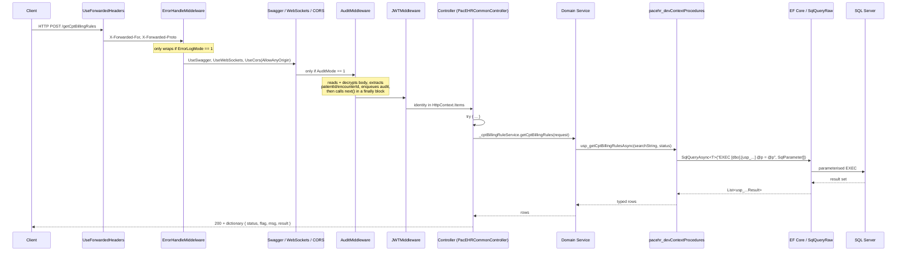
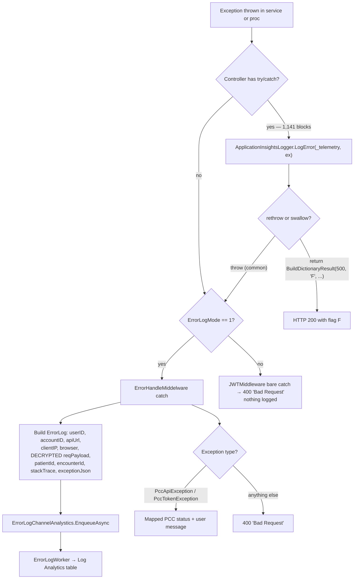
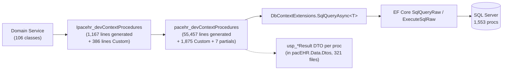

# Deep-Dive - API Request & Data Spine

**Date**: 2026-09-30
**Analyzed By**: ARCHITECT
**Status**: Draft (awaiting user confirmation)
**Scope**: the path every request takes from HTTP to SQL and back — middleware pipeline, controller conventions, domain-service layer, the generated stored-procedure context, response envelopes, error handling, audit/error logging
**Evidence base**: `pacEHR_API` @ `9f2a6ee19`

---

## Module Overview

**Purpose**: the shared machinery all 94 controllers and ~1,012 endpoints ride on. Nothing here is domain-specific; everything here affects every feature.

**Key sizes**:

| Component | Size |
|---|---|
| `PacEHR.API/Program.cs` | 526 lines, one `Main`, ~250 DI registrations |
| `pacehr_devContextProcedures.cs` (generated) | **55,457 lines** |
| `pacehr_devContextProcedures.Custom.cs` (hand-written) | 1,875 lines |
| Other hand-written proc partials | 7 files, ~1,800 lines (Referral, TreatmentPlan, Symptoms, Tasking, CarePath, PccProgressNote, FacilityServiceTags) |
| `Ipacehr_devContextProcedures.cs` (generated interface) | 1,167 lines |
| Domain services | 106 classes / 112 interfaces |
| DTOs | 321 files |
| EF entity models | 928 files |
| Controller `catch` blocks | **1,141** across 89 of 94 controllers |

---

## Component Breakdown

| Layer | Component | File | Responsibility |
|---|---|---|---|
| Host | `Program.cs` | `PacEHR.API/Program.cs` | Config, Key Vault, DbContext, DI, middleware order |
| Middleware | `ForwardedHeaders` | `Program.cs:462` | Real client IP behind the gateway |
| Middleware | `ErrorHandleMiddelware` | `Library/ErrorHandleMiddelware.cs` | Catch-all → error log → response mapping (gated by `ErrorLogMode`) |
| Middleware | `AuditMiddleware` | `Library/AuditMiddleware.cs` | Pre-request audit record (gated by `AuditMode`) |
| Middleware | `JWTMiddleware` | `Library/Authentication/JWTMiddleware.cs` | Body decryption + session auth (see Module 01) |
| Filter | `PccCosmosLoggingFilter` | `Library/PccCosmosLoggingFilter.cs` | PCC request/response capture, attached by convention to `PccController` only |
| Base | `PacEHRCommonController` | `Library/PacEHRCommonController.cs` | `[ApiController]`, header identity, response-envelope builders |
| Service | 106 `*Service`/`*Services` | `pacEHR.DomainServices/` | Orchestration + mapping |
| Data | `pacehr_devContextProcedures` | `pacEHR.DomainServices/` | Typed wrappers over 1,553 stored procedures |
| Data | `DbContextExtensions.SqlQueryAsync<T>` | `PacEHR.Data/Models/DbContextExtensions.cs` | The single call site into `SqlQueryRaw`/`ExecuteSqlRaw` |
| Data | `pacehr_devContext` | `PacEHR.Data/Models/` | EF Core DbContext, 928 entities |
| Workers | `AuditWorker`, `ErrorLogWorker` | `Library/` | Drain channels → Log Analytics |

---

## Key Workflows

### Workflow 1: The canonical request



**Stories**:
1. Two of the three middlewares are **config-gated**. With `ErrorLogMode != 1` there is no global exception handler at all; with `AuditMode != 1` no audit is written. Behaviour differs per environment by configuration, not by code.
2. `AuditMiddleware` calls `await _next(context)` from a `finally` block. This is safe (early `return`s still reach `finally`) but means the audit record is written **before** the action runs — no status code, duration, or outcome is captured.
3. Everything below the controller is synchronous request→proc→rows. There is no caching layer, no unit of work, no repository abstraction.

### Workflow 2: Error path



**Stories**:
1. There are three competing error strategies in one pipeline: per-action `try/catch` (1,141 blocks), the gated `ErrorHandleMiddelware`, and `JWTMiddleware`'s bare catch. Which one handles a given failure depends on config and on whether the controller rethrows.
2. Only PCC exceptions get meaningful status mapping. Everything else becomes `400 Bad Request` regardless of cause — a validation failure, a deadlock and a null-reference are indistinguishable to the client.
3. `app.UseExceptionHandler` is present but commented out (`Program.cs:503`).

### Workflow 3: Audit and error logging to Log Analytics

```mermaid
sequenceDiagram
  participant MW as Audit / Error middleware
  participant CH as *ChannelAnalystics (in-memory Channel)
  participant W as AuditWorker / ErrorLogWorker (IHostedService)
  participant LAW as Azure Log Analytics

  MW->>MW: decrypt body, ExtractIds(patientId, encounterId)
  MW->>CH: EnqueueAsync(JsonConvert.SerializeObject(log))
  Note over CH: unbounded in-process channel;<br/>lost on process recycle
  W->>CH: dequeue
  W->>LAW: POST custom table (LogTableName / ErrorLogTableName)
```

---

## Data Models

### The stored-procedure access layer

There is **no repository pattern and no entity-based querying in the request path**. Every read and write goes through a generated wrapper:



The 928 EF entity classes in `PacEHR.Data/Models` exist and are mapped in `pacehr_devContext`, but the request path does not use `DbSet<T>` LINQ queries — it uses `SqlQueryRaw` against procs. The entities largely serve model generation and the `usp_*Result` shapes.

### `ErrorLog` record (written to Log Analytics)

| Field | Source | PHI risk |
|---|---|---|
| `userID`, `accountID` | decrypted request headers | identifiers |
| `apiUrl`, `clientIP`, `browserBrand`, `browserVersion` | request | — |
| **`reqPayload`** | **full decrypted request body** | 🔴 **high** |
| `patientId`, `encounterId` | extracted from payload | 🔴 identifiers |
| `errorMessage`, `stackTrace`, `exceptionJson` | exception | may embed data |

### `AuditLog` record

Same shape minus the exception fields, also including the full decrypted `reqPayload`, `patientId` and `encounterId`.

---

## Pattern Catalog

### Pattern: stored-procedure wrappers — parameterised and safe

**Where**: `pacEHR.DomainServices/pacehr_devContextProcedures.cs` (generated by EF Core Power Tools, config in `PacEHR.Data/efpt.config.json`)

```csharp
// DO — the house standard, and it is correct
var sqlParameters = new[]
{
    new SqlParameter
    {
        ParameterName = "userEmail",
        Size = 200,
        Value = userEmail ?? Convert.DBNull,
        SqlDbType = System.Data.SqlDbType.NVarChar,
    },
    parameterreturnValue,
};
var _ = await _context.SqlQueryAsync<usp_verifyUserResult>(
    "EXEC @returnValue = [dbo].[usp_verifyUser] @userEmail = @userEmail", sqlParameters, cancellationToken);
```

Every value is bound as a `SqlParameter`. **No SQL injection vector was found in this layer.** The hand-written `*.Custom.cs` partials follow the same convention and add useful ticket-referenced comments (`// PAC-1107 - ...`), which is a genuine strength.

### Pattern: SQL text assembled by string interpolation (proc name + parameter names)

**Where**: `pacehr_devContextProcedures.Referral.cs:34,39`, `.Symptoms.cs:15`, `.TreatmentPlan.cs:29`

```csharp
// ACTUAL
static string RefExec(string proc, SqlParameter[] ps) =>
    $"EXEC [dbo].[{proc}] " + string.Join(", ", ps.Select(p => $"@{p.ParameterName}=@{p.ParameterName}"));
```

```csharp
// DON'T: build the statement text from runtime values
ExecuteSqlRawAsync(RefExec(procNameFromRequest, ps), ps);

// DO: keep the statement a literal, bind only values
ExecuteSqlRawAsync("EXEC [Referral].[usp_saveStagePayerInformationBulk] @myTable = @myTable", ps);
```

**Assessed as not currently exploitable**: every call site passes a hardcoded proc-name literal, and parameter names come from `SqlParameter` objects the code itself constructs. The risk is structural — one future call site that passes a caller-supplied name turns this into injection with no other code change.

### Pattern: response envelope — three near-identical builders with different semantics

**Where**: `PacEHR.API/Library/PacEHRCommonController.cs:96-140`

```csharp
// BuildDictionaryResult — omits "result" when null OR empty
if (!IsNullOrEmpty(result)) { dictionary.Add("result", result); }

// AddToDictionaryResults — bool? flag, omits "result" when null OR empty
if (!IsNullOrEmpty(result)) { dictionary.Add("result", result); }

// AddToDictionaryResult — string flag, omits "result" ONLY when null
if (result != null) { dictionary.Add("result", result); }
```

```csharp
// DON'T: three helpers whose contract differs in whether a key appears at all
return BuildDictionaryResult(200, "F", "No data found", rules);   // empty list → no "result" key
return AddToDictionaryResult(dict, 200, "Y", "ok", rules);        // empty list → "result": []

// DO: one typed envelope with a stable shape
return new ApiResponse<List<Rule>>(status: 200, flag: "Y", msg: "ok", result: rules ?? []);
```

An empty result set produces a response **with** the `result` key from one helper and **without** it from another. Clients must defend against both. `flag` is a `string` in one overload and `bool?` in another.

### Pattern: HTTP 200 for everything

**Where**: every controller signature — `Task<IDictionary<String, Object>>`

```csharp
// ACTUAL — a failure, returned as 200
return BuildDictionaryResult(500, "F", "Invalid account configuration", null);
```

The `500` here is a number inside the JSON body; the HTTP status is 200. Consequences: load balancers, App Insights failure metrics, retry policies and client `catch` blocks all see success. The SPA compensates by branching on `flag === 'F'` (see `auth.interceptor.ts`, which even normalises non-JSON PCC errors into `{flag:'F', ...}`).

### Pattern: the canonical controller action

**Where**: e.g. `PacEHR.API/Controllers/CptBillingRuleController.cs`

```csharp
// ACTUAL — this shape repeats ~1,012 times
[Route("getCptBillingRules")]
[HttpPost]
public async Task<IDictionary<string, object>> getCptBillingRules(getCptBillingRulesRequest request)
{
    try
    {
        ApplicationInsightsLogger.LogInfo(_telemetry, "Start Getting CPT Billing Rules from DB");
        var rules = await _cptBillingRuleService.getCptBillingRules(request);

        if (rules != null && rules.Count > 0)
        {
            ApplicationInsightsLogger.LogInfo(_telemetry, "CPT Billing Rules received successfully");
            return BuildDictionaryResult(200, "Y", "Successfully", rules);
        }
        ApplicationInsightsLogger.LogInfo(_telemetry, "No CPT Billing Rules found");
        return BuildDictionaryResult(200, "F", "No data found", rules);
    }
    catch (Exception ex)
    {
        ApplicationInsightsLogger.LogError(_telemetry, ex);
        throw;
    }
}
```

Observations worth noting as conventions:
- **Route naming**: camelCase verb-noun (`getCptBillingRules`), no resource paths, no HTTP verb semantics — `[HttpPost]` even for reads.
- **Method naming**: C# methods use camelCase, violating .NET convention, presumably to mirror the route.
- **"No data found" is `flag: "F"`** — an empty result set is reported as a failure.
- **Log-around-the-call**: two info logs per action, free-text, unstructured.
- The `catch` logs and rethrows — correct — but only reaches a handler if `ErrorLogMode == 1`.

### Pattern: input validation — largely absent

**Where**: `pacEHR.Data.Dtos/` and all controllers

| Signal | Count |
|---|---|
| DTOs carrying `[Required]`/`[MaxLength]`/`[StringLength]`/`[Range]` | **74 of 321** |
| Explicit `ModelState` checks in controllers | **0** |
| `[ApiController]` on the base class | yes (`PacEHRCommonController.cs:12`) |

```csharp
// ACTUAL — no annotations, no guard clause; the DTO goes straight to the proc
public async Task<IDictionary<string, object>> getCptBillingRules(getCptBillingRulesRequest request)
{
    var rules = await _cptBillingRuleService.getCptBillingRules(request);
```

```csharp
// DO
public sealed class getCptBillingRulesRequest
{
    [StringLength(200)] public string? SearchString { get; init; }
    [RegularExpression("^(Active|Inactive)$")] public string? Status { get; init; }
}
```

`[ApiController]` does give automatic 400 responses on model-binding failure — but only for constraints that exist, and it returns RFC 7807 `ProblemDetails`, a shape that contradicts the dictionary envelope every other response uses. So the 23% of DTOs that *are* annotated produce a different error contract from the rest.

### Pattern: database resilience — one real, one dead

**Where**: `Program.cs:59-99`

```csharp
// ACTIVE — EF Core execution strategy, genuinely in effect
sqlOptions.EnableRetryOnFailure(
    maxRetryCount: 3,
    maxRetryDelay: TimeSpan.FromSeconds(10),
    errorNumbersToAdd: new List<int> { 4060, 1205, -2, -1, 2, 53, 121, 1222 });

// REGISTERED BUT NEVER CONSUMED
var sqlResiliencePipeline = new ResiliencePipelineBuilder()
    .AddRetry(...).AddCircuitBreaker(...).Build();
builder.Services.AddSingleton(sqlResiliencePipeline);
```

`ResiliencePipeline` appears in exactly three places in the whole solution — its construction and registration in `Program.cs`, and nowhere else. **No class injects it.** The comment says it is "for non-EF SQL operations (raw SqlConnection/SqlCommand)", but nothing resolves it. The EF retry policy is real and well-chosen (the error-number list including 1205 deadlock and 1222 lock timeout shows deliberate tuning).

> **Correction to `00-system-overview.md`**: that document states "a Polly retry + circuit-breaker pipeline wraps SQL access". That overstates it — the Polly pipeline is dead code; EF's `EnableRetryOnFailure` is what actually protects SQL calls. The overview's Strengths section should be read with that qualification.

### Pattern: 🔴 PHI written to operational logs

**Where**: `Library/AuditMiddleware.cs:81-95`, `Library/ErrorHandleMiddelware.cs:55-110`

```csharp
// ACTUAL — both middlewares decrypt the body and store it verbatim
bool wasEncrypted = IsBase64String(reqPayload);
string jsonPayload = wasEncrypted ? CryptoHelper.Decrypt(reqPayload, "SecretKey123") : reqPayload;
...
reqPayload = jsonPayload,          // full clinical payload
patientId  = int.TryParse(patientId, out var patId) ? patId : 0,
encounterId = int.TryParse(encounterId, out var encId) ? encId : 0,
```

```csharp
// DON'T: persist the whole request body to an ops log store
reqPayload = jsonPayload;

// DO: log a redacted projection, or a correlation id that points at
// the clinical record without duplicating it
reqPayload = PhiRedactor.Redact(jsonPayload);
```

The resulting record is serialised to JSON and shipped to Azure Log Analytics (`LogTableName`, `ErrorLogTableName`). For an EHR, clinical request bodies in an operations log store is a compliance question, not merely a hygiene one. Note the mitigations already present: `LogAllowedControllers` and `EncryptIgnoredAPI` allowlists can narrow what is captured, and both middlewares are off unless `AuditMode`/`ErrorLogMode` equals 1. **Which environments run with these enabled needs confirmation.**

### Pattern: `ExtractIds` — top-level, three casings, no nesting

**Where**: `AuditMiddleware.cs:162-180`, duplicated in `ErrorHandleMiddelware.cs`

```csharp
// ACTUAL
if (root.TryGetProperty("patientId", out var patientIdProp))  patientId = ...;
if (root.TryGetProperty("patientID", out var patientIDProp))  patientId = ...;
if (root.TryGetProperty("PatientId", out var PatientIdProp))  patientId = ...;
```

Three casing variants are probed because the DTO layer has no naming convention (`options.JsonSerializerOptions.PropertyNamingPolicy = null` in `Program.cs` preserves original casing). Nested payloads — a patient id inside an `encounter` object — yield `0`, so audit rows silently lose their subject. The method is copy-pasted into both middlewares.

### Pattern: logging — free text via a static helper

```csharp
// ACTUAL
ApplicationInsightsLogger.LogInfo(_telemetry, "Start Getting CPT Billing Rules from DB");

// DO
_logger.LogInformation("Fetching CPT billing rules {@Request}", request);
```

Two log lines per action × ~1,012 actions, all unstructured strings with no correlation id, no duration, no outcome. App Insights receives them as trace text that cannot be aggregated without parsing.

### Test patterns (spine)

| Target | Tests |
|---|---|
| Controllers (`PacEHR.Tests.UnitTests/Controllers`) | present for a subset; heavy use of `FakeAntiforgeryValidationFeature` and hand-built `DefaultHttpContext` |
| Domain services (`.../DomainServices`) | present for a subset |
| `AuditMiddleware`, `ErrorHandleMiddelware`, `JWTMiddleware` | **0** |
| `DbContextExtensions.SqlQueryAsync` | **0** |
| `PacEHRCommonController` envelope builders | **0** |
| `PacEHR.Tests.Integration` | **0 tests** — only `GlobalUsings.cs` |

The 3,053 unit tests concentrate on controllers and services with mocked `Ipacehr_devContextProcedures`. That means **the mock defines the contract** — the 1,553 stored procedures those mocks stand in for are never executed by any test, and there are no integration tests to cover the seam.

---

## Entry Points

| Entry | Description |
|---|---|
| `Program.Main` | `PacEHR.API/Program.cs` — the only composition root |
| `app.MapControllers()` | Attribute routing; every route declared per-action with `[Route("verbNoun")]` |
| `app.UseSwagger()` / `UseSwaggerUI()` | Unconditional, all environments |
| `app.UseWebSockets()` | For `AIController` speech streaming |
| `IHostedService` | `AuditWorker`, `ErrorLogWorker`, `PccCosmosWorker` start with the host |

---

## Open Questions for the Team

1. **Which environments run with `AuditMode=1` and `ErrorLogMode=1`?** This determines whether decrypted clinical payloads are currently landing in Log Analytics, and whether a global exception handler exists in production at all.
2. **Was the Polly pipeline meant to be consumed by something?** It is registered and unused; either wire it to the raw-ADO paths it names or delete it.
3. **Is the `result`-key inconsistency between envelope helpers known to the SPA team?** A client relying on `result` always being present will break on empty sets from `BuildDictionaryResult`.
4. **Are the 74 annotated DTOs deliberately different**, or is the `ProblemDetails` 400 they can produce an unnoticed second error contract?
5. **Is `pacehr_devContextProcedures.cs` (55k lines) regenerated, or hand-edited?** `efpt.config.json` implies regeneration; if anyone has hand-edited it, the next regen will silently drop those changes.

---

## Recommendations

| # | Recommendation | Rationale | Effort |
|---|---|---|---|
| 1 | Redact or drop `reqPayload` from audit and error logs | Clinical payloads in an ops log store | Low — two files |
| 2 | Make the global exception handler unconditional | Today there is none when `ErrorLogMode != 1` | Low |
| 3 | Consolidate to one response envelope with a stable `result` key | Three helpers, three contracts | Medium |
| 4 | Return real HTTP status codes | Restores observability, retries and client error handling | High — but can be phased per controller |
| 5 | Delete the unused Polly pipeline, or inject it where raw ADO is used | Dead code that reads as a safety net | Trivial |
| 6 | Add `[Required]`/length/range annotations to the remaining 247 DTOs | Validation currently depends on the proc | High, mechanical |
| 7 | Extract `ExtractIds` into one shared helper and support nested payloads | Duplicated, and silently loses the subject | Low |
| 8 | Replace `ApplicationInsightsLogger` free text with structured `ILogger<T>` | Logs are unqueryable today | Medium |
| 9 | Move `RefExec`-built statements to literal SQL strings | Removes a latent injection shape | Low |
| 10 | Stand up `PacEHR.Tests.Integration` against a real database | 1,553 procs are currently covered only by mocks | High — highest value of the list |
| 11 | Add tests for the three middlewares | Zero coverage on code every request passes through | Medium |

---

**Next**: Module 03 — Data & SQL tier.
