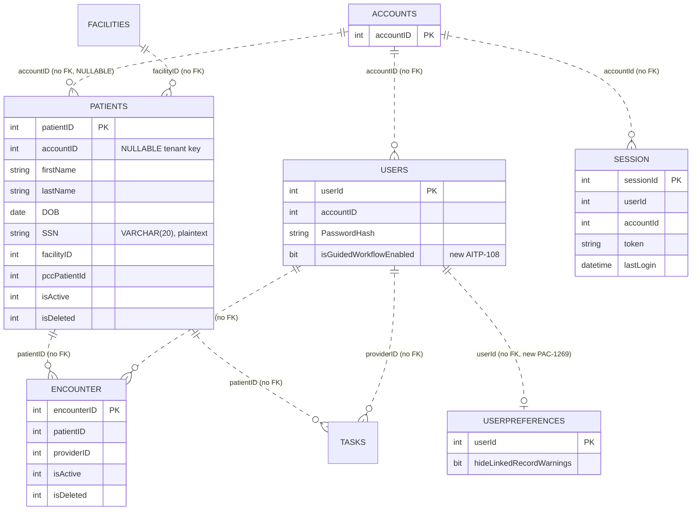
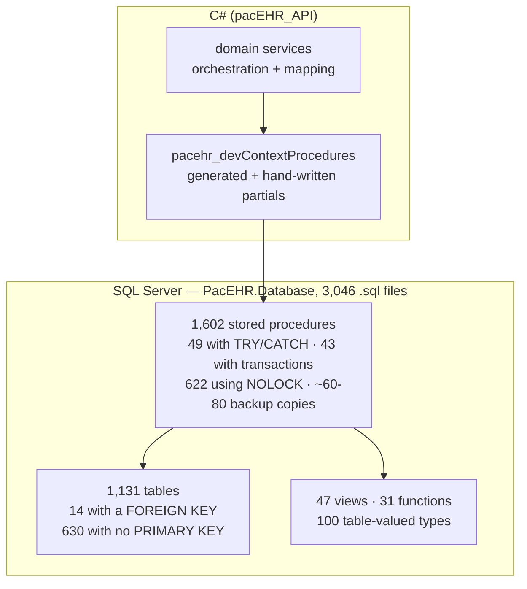
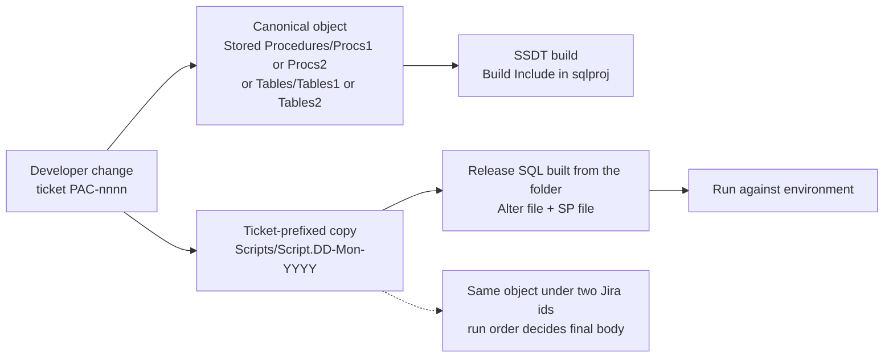
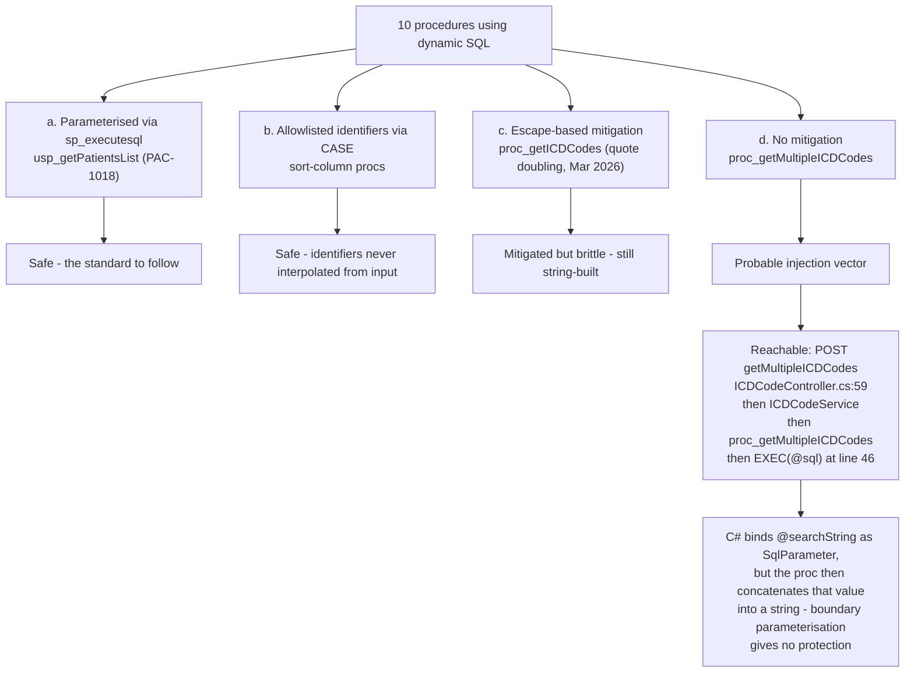

# Deep-Dive - Data & SQL Tier

**Date**: 2026-10-19
**Analyzed By**: ARCHITECT
**Status**: Draft (awaiting user confirmation)
**Scope**: the SSDT database project — schemas, tables, keys, indexes, stored procedures, views, functions, table-valued types, release scripts, and the conventions that govern them
**HEADs analysed**: PacEHR `401caa134`, pacEHR_API `0f611f65c`, pacEHR_AI `ef172ea` (this module's evidence is `pacEHR_API/PacEHR.Database` @ `0f611f65c`; the other two repos hold no SQL tier)
**Supersedes**: deep-dive of 2026-09-30 (`9f2a6ee19`)

> This is where PacEHR's business logic actually lives. 1,602 stored procedures against the C# service layer means the SQL tier is not a persistence layer — it is the application.

---

## Changes since 2026-09-30

Method: `git log --since=2026-09-30 -- PacEHR.Database` plus a fresh recount of every number. 111 commits touched the database project; file-level: 165 added, 195 modified, 13 deleted, 13 renamed.

| Area | Then | Now | Note |
|---|---|---|---|
| `.sql` files | 2,857 | **3,046** | +189 |
| Tables | 1,120 | **1,131** | +11 |
| Stored procedures | 1,553 | **1,602** | +49, split `Procs1` 1,000 / `Procs2` 602 |
| Views / Functions / table types | 47 / 27 / 99 | **47 / 31 / 100** | new `fn_isPatientInWorkflowPopulation`, `fn_isWorkflowReferralActive` |
| Procs with `NOLOCK` | 585 | **622** (38.8%) | still the default read hint |
| Procs with `BEGIN TRY` / `BEGIN TRAN` | 38 / 29 | **49 / 43** | improved, mostly from `usp_mergePatients` and new Referral/Workflow procs; still 3.1% / 2.7% |
| Tables with a `FOREIGN KEY` | 14 | **14** | unchanged |
| Tables with no `PRIMARY KEY` | 630 | **630** | unchanged in count (new tables carry PKs) |
| Plaintext `SSN` columns | 18 tables | **28 table files declare `[SSN]`** | method recount, see Pattern |
| `ENCRYPTED WITH` / `MASKED WITH` | 0 / 0 | **0 / 0** | unchanged |

**Verified still true**: `proc_getMultipleICDCodes` is still unmitigated dynamic SQL (`Stored Procedures/Procs1/proc_getMultipleICDCodes.sql:46`, `EXEC (@sql)` with no escaping, last changed 2026-05-20 in the initial project import commit `3e1de463e`). `proc_getICDCodes` is still quote-doubling only (`Procs1/proc_getICDCodes.sql:25,54`). Backup procedures are still `Build Include`d in the sqlproj (e.g. `usp_getPatientsList_bkpTest.sql`, `usp_getPatientsList_V1.sql` at `PacEHR.Database.sqlproj:2130-2131`).

**Corrected from the old doc**:
- The old claim "`stage` accounts for only 107 of the 630 PK-less tables" was wrong. `stage` has 107 tables in total and only **71** of them lack a PK, so **559** PK-less tables are outside `stage` and need triage.
- The "`PacEHR.Database1/` rename" open question is **dropped**: no tracked path under `PacEHR.Database1/` exists at HEAD.
- Backup-copy count: the old "88" cannot be reproduced. By filename tokens (`bkp`, `backup`, `_old`, `_V<n>`, `_copy`, `_test`) there are **62**; adding procs ending in a date suffix gives **79**. Treat as "60-80, method-dependent" (carried, not exactly re-verified).
- Index definitions: now 417 `CREATE ... INDEX` statements (the old 293 used a different, unrecorded method; not comparable).

**New**:
- Release-script folders `Scripts/Script.16-Oct-2026` and `Scripts/Script.25-Oct-2026` (see Component Breakdown).
- `usp_mergePatients` was hardened (PAC-1317 / commit `e53b7498f`): single `BEGIN TRY` + `BEGIN TRANSACTION` with rollback (`Scripts/Script.25-Oct-2026/PATIENT-MERGE-02-usp_mergePatients.sql:88-89,468-472`). The first real example of the transactional pattern the old doc recommended.
- Schema additions: `Account.userPreferences` (PAC-1269), Automated Workflow tables (PAC-1368), `Hexplora_CCL*` tables (PAC-1322), `MergePatientsDetail`, `ReferralAttachment`, `UserSecondarySpecialityHistory`, `AccountFeatureSetting`; new BIT feature flag `isGuidedWorkflowEnabled` on `Account.accountDetails` and `Account.users` (AITP-108).

---

## Module Overview

**Path**: `pacEHR_API/PacEHR.Database/` (SSDT project, `PacEHR.Database.sqlproj`; 3,031 `Build Include` entries)

| Object type | Count (now) |
|---|---|
| Tables | 1,131 (`Tables/Tables1` 1,008, `Tables/Tables2` 121, remainder elsewhere) |
| Stored procedures | 1,602 (`Procs1` 1,000, `Procs2` 602) |
| Views | 47 |
| Functions | 31 |
| User-defined (table) types | 100 |
| `CREATE ... INDEX` statements | 417 |
| **Total `.sql` files** | **3,046** |

The project is a flat layout: objects are grouped into `Tables1/Tables2`, `Procs1/Procs2` buckets, not by schema. Schema membership is only visible inside each file's `CREATE`.

---

## Component Breakdown

### Schema layout (41 schemas, derived from `CREATE TABLE` statements)

| Schema | Tables | Purpose |
|---|---|---|
| `dbo` | 293 | Catch-all — largest, least cohesive |
| `stage` | 107 | Staging/landing tables for inbound integration data |
| `Log` | 87 | Audit, error and activity logging |
| `Patient` | 85 | Patient demographics and clinical records |
| `Account` | 73 | Tenancy, users, roles, sessions, facilities |
| `Trimmed` | 49 | Purpose unclear from DDL — **needs team input** (carried) |
| `DATA` | 48 | Reference/master data (ICD codes, etc.) |
| `Pcc` / `Referral` / `PQRS` | 35 / 35 / 34 | PointClickCare integration, referral queue, quality reporting |
| `Encounter` / `Template` / `Location` / `TreatmentPlan` | 32 / 28 / 22 / 18 | Clinical and configuration areas |
| remaining ~25 schemas | 1-17 each | Feature-scoped (`ACO`, `ECQM`, `HCC`, `MatrixCare`, `Scheduler`, `Updox`, `HIE`, `AI`, `RabbitMq`, `Qulatitydata` (sic), ...) |

Stored procedures do **not** follow the table schema split: **1,442 of 1,602** live in `dbo` (was 1,359). Schema-aligned procs exist only for the newer areas: `TreatmentPlan` 38, `Referral` 31, `MatrixCare` 24, `Symptoms` 14, `CPTGrouping` 10, `Scheduler` 9, `Account` 9, `Log` 9, `Patient` 7.

`RabbitMq` (1 table) is still present although messaging is Azure Service Bus. Still an open question.

### SSDT release scripts (`PacEHR.Database/Scripts/`)

| Folder | Contents | In sqlproj? |
|---|---|---|
| `Scripts/Script.16-Oct-2026/` | 3 files, all PAC-584 (Dragon Copilot migration: `PAC-584-AlterScripts.sql`, `usp_addEditUser`, `usp_GetDragonSubByUserId`) | **No** — no `16-Oct` reference in the sqlproj |
| `Scripts/Script.25-Oct-2026/` | **131 files / ~14.5k lines**: ~100 stored-procedure scripts plus DDL (`Alter*`, new tables, indexes, a table type). Jira prefixes: PAC (110), PACT2 (9), AITP (7), PATIENT (2), C1 (2) | `Folder Include` at `PacEHR.Database.sqlproj:72`; files are `None Include` (e.g. line 3090), i.e. **not built** |
| `Scripts/Rollback/` | one file (`PACT2-1187-SLUMS-SubQuestions-Rollback.sql`) | — |

How it works: a release folder is the **deployment unit** for a given release date. Each ticket's change is committed twice — once as the canonical object under `Stored Procedures/Procs*/` or `Tables/*` (what SSDT builds) and once as a ticket-prefixed copy under `Scripts/Script.<date>/` (what is run against environments). A stray folder `Scripts/Scripts.25-Oct-2026/` (note the extra "s") was deleted in this period (PACT2-1187 files moved into the correct folder).

Observations (evidence-based):
- The same object is scripted under more than one Jira id within the 25-Oct folder: `usp_UsersList`, `usp_addEditUser`, `usp_getUserandAccountDetailsByToken` (AITP-108 and PAC-1350), `usp_getCareProgramDetails` (PAC-1199 and PAC-1344). `usp_addEditUser` also appears in the 16-Oct folder (PAC-584). Run order therefore decides the final body of the procedure. The repo's `pacehr-release-sql` skill exists for exactly this duplicate check.
- DDL scripts are mostly re-runnable (`IF NOT EXISTS (...)`, e.g. `AITP-108-AlterAccountDetailsAndUsers.sql`, `PAC-1269-userPreferences.sql`) but not all: `PAC-584-AlterScripts.sql` is a bare `BEGIN TRANSACTION;` with `COMMIT`/`ROLLBACK` commented out, an unguarded `ADD nuanceUserId_old`, and a `SELECT` for manual verification. A transaction left open if run unattended.

### Hot spots this period (what the schema work was about)

Referral multi-specialty / care-path redesign (PAC-1388/1392/1393), Care Program report procs (PAC-1199/1344), Automated Workflow appointments (PAC-1367..1372), CCL import via Hexplora (PAC-1322..1326, 1462), patient merge hardening (PAC-1317), per-user preferences (PAC-1269), Dragon Copilot (PAC-584), performance indexes (PAC-1310 `Patient.roundingNotes`, PAC-1313 `getTopEncounterData`), SLUMS assessment sub-questions (PACT2-1187).

---

## Data Models

### Core clinical ER (inferred from columns — **not from declared constraints**)



The dotted relationships are deliberate: **these are conventions, not constraints**. Newer tables follow the same style: `userPreferences` has a PK but no FK to `users` (`Scripts/Script.25-Oct-2026/PAC-1269-userPreferences.sql`).

### Representative table shapes (re-counted)

| Table | PK | Non-clustered index statements |
|---|---|---|
| `Patient.patients` (`Tables/Tables1/patients.sql`) | `PK_patientID` clustered (line 60); `accountID INT NULL` (line 3); `SSN VARCHAR(20) NULL` (line 9) | **15** |
| `Encounter.encounter` (`Tables/Tables1/encounter.sql`) | clustered on `encounterID` | **22** (old doc said 8 — carried figure was wrong or the table grew; recounted with `grep -c 'CREATE NONCLUSTERED INDEX'`) |
| `Account.users`, `Account.accounts`, `Account.session` | clustered PKs | not re-counted (carried) |

---

## Where the Logic Lives



(C# service count and generated line count from the old doc are carried, not re-verified; they belong to Module 02.)

### Release path for a schema/proc change



---

## Pattern Catalog

### Pattern: 🔴 referential integrity by convention, not constraint

**Evidence**: **14 of 1,131 table files contain a `FOREIGN KEY` clause** (unchanged from the old doc's 14 of 1,120).

```sql
-- ACTUAL (Tables/Tables1/patients.sql:3-4) — accountID is the tenant key,
-- both nullable and unconstrained
[accountID]  INT NULL,                      -- no FK, no NOT NULL
[facilityID] INT NULL,                      -- no FK
-- ... line 60
CONSTRAINT [PK_patientID] PRIMARY KEY CLUSTERED ([patientID] ASC)
```

```sql
-- DON'T: rely on application code to keep 1,131 tables consistent
[accountID] INT NOT NULL,   -- (only as a first step; with no FK nothing stops orphans)

-- DO: at minimum, constrain the tenant key
[accountID] INT NOT NULL,
CONSTRAINT [FK_patients_accounts] FOREIGN KEY ([accountID])
    REFERENCES [Account].[accounts] ([accountID]),
```

Consequences: orphaned rows cannot be prevented by the database; cross-tenant corruption is invisible to the engine. Combined with Module 01's finding that `accountID` arrives from a client header (carried, not re-verified here), the tenant boundary has no enforcement at either end.

### Pattern: 🔴 630 of 1,131 tables have no primary key

**Evidence**: 630 table files contain no `PRIMARY KEY` (56%). Of these, **71 are in `stage`** (107 stage tables total), leaving **559 outside `stage`** that need triage. (The old doc understated this as "~520".)

Without a PK a table cannot be reliably updated row-by-row, cannot participate in change tracking, and duplicates cannot be prevented. New tables introduced this period do carry PKs (`PK_userPreferences`), so the trend on new work is better than the legacy base.

### Pattern: 🔴 `WITH (NOLOCK)` as the default read hint

**Evidence**: **622 of 1,602 procedures (38.8%)** use `NOLOCK` (was 585).

```sql
-- DON'T: NOLOCK on clinical reads — it permits dirty reads, missing rows
-- and duplicate rows, not merely "stale" data
FROM [Patient].[patients] p WITH (NOLOCK)

-- DO: use READ COMMITTED SNAPSHOT at the database level and drop the hints
ALTER DATABASE [pacehr] SET READ_COMMITTED_SNAPSHOT ON;
FROM [Patient].[patients] p
```

Example in the code today: `Stored Procedures/Procs2/usp_getTaskBypagination.sql:59-60` (`Account.GroupUser gu WITH(NOLOCK)`). Whether RCSI is already enabled cannot be seen from an SSDT project — **needs confirmation**.

### Pattern: 🟡 dynamic SQL — mostly remediated, one gap still open

Still **10 procedures** build SQL dynamically or call `sp_executesql` (grep for `EXEC (@` / `sp_executesql`). Four qualities:

**(a) Properly parameterised** — `usp_getPatientsList.sql`, PAC-1018 (header at line 21-22: "dynamic SQL parameterised via sp_executesql"):

```sql
-- DO — this is the standard (usp_getPatientsList.sql:344)
EXEC sp_executesql @FinalQuery, @paramDef, @p_accountID = @accountID, @p_name = @name, ...;
```

**(b) Allowlisted identifiers** — `Procs2/usp_getTaskBypagination.sql:41-42` — sort column chosen from a fixed `CASE` (`WHEN @sortBy = 'taskName' AND @sortOrder = 'asc' THEN '[taskName] ASC'`), never interpolated from input.

**(c) Escape-based mitigation** — `proc_getICDCodes.sql`:

```sql
-- Procs1/proc_getICDCodes.sql:25 and :54
SET @safeSearchString = REPLACE(@searchString, '''', '''''');
...
exec (@sql)
```

Quote-doubling blocks the straightforward injection, but the statement is still assembled from a user-controlled string.

**(d) 🔴 Unmitigated — `proc_getMultipleICDCodes.sql`** (unchanged since the 2026-05-20 import):

```sql
-- ACTUAL — Procs1/proc_getMultipleICDCodes.sql:25 and :46
SELECT CAST('<X>'+ REPLACE(@searchString, ',', '</X><X>') +'</X>' AS XML) AS String
...
EXEC (@sql);
```

```sql
-- DON'T: concatenate a split search term into the LIKE predicate and EXEC it
' OR (' + @ColName + ' LIKE ''%' + LTRIM(RTRIM(Split.a.value('.', 'NVARCHAR(MAX)'))) + '%'')'

-- DO: split into a table variable and join, or build with sp_executesql and parameters
```

Reachability re-verified: `POST getMultipleICDCodes` at `PacEHR.API/Controllers/ICDCodeController.cs:59-61` → `IICDCodeService.getMultipleICDCodes(string code)` (`pacEHR.DomainServices.Interfaces/IICDCodeService.cs:9`) → proc. The C# layer binds `@searchString` as a parameter, but the proc concatenates it, so boundary parameterisation gives no protection. Whether the endpoint requires authentication depends on the global filter covered by Module 01; `ICDCodeController` itself has no `[Authorize]`/`[AllowAnonymous]` attribute (carried, not re-verified end to end). **Treat as a probable SQL-injection vulnerability pending confirmation in a test environment**; this remains the highest-priority item in the module and is the same recommendation as 2026-09-30 — no change was made in 19 days. Raise via `aire-raise-defect`.



### Pattern: 🔴 PHI at rest is unprotected

```sql
-- ACTUAL (Tables/Tables1/patients.sql:9)
[SSN] VARCHAR (20) NULL,
```

| Signal | Result |
|---|---|
| Table files declaring a `[SSN]` column | **28** (old doc: 18; different counting, the count of exposed tables is at least as high) |
| `ENCRYPTED WITH` (Always Encrypted) | **0** |
| `MASKED WITH` (Dynamic Data Masking) | **0** |

Names, DOB, addresses, phone numbers and email are plain `VARCHAR`. TDE may be enabled at the Azure SQL level (not visible in SSDT) but does not protect against a compromised application credential and is not column-level. Whether TDE is on, and whether that suffices for the compliance regime, **needs the team's input**.

### Pattern: 🟡 index proliferation on hot tables

`Patient.patients` carries **15** non-clustered indexes with visible overlap (several lead with `accountID`, e.g. lines 96, 113, 124, 130, 142 of `patients.sql`). `Encounter.encounter` has **22** `CREATE NONCLUSTERED INDEX` statements; the old doc's duplicate-looking `IX_`/`NCI_` pairs are carried, not re-listed. Two naming conventions (`IX_`, `NCI_`) coexist. New index work this period was targeted (PAC-1310 `IX_roundingNotes_eventId`, PAC-1313 `IX_getTopEncounterData`, PAC-1325 `AlterHexplora_CCLImportDataIndexes`), but no usage-based cleanup has happened. A `sys.dm_db_index_usage_stats` review would identify unused ones.

### Pattern: 🔴 backup copies of procedures checked into source control

**Roughly 62-79 procedure files** carry backup/version suffixes (method-dependent, see Changes). Examples verified present:

```
usp_getPatientsList.sql
usp_getPatientsList_V1.sql
usp_getPatientsList_bkpTest.sql
usp_getPatientsList_bkp20260112.sql
usp_getPatientsList_20241128.sql
usp_getPatientsListNew_12022024.sql
usp_PatientTagsReportDetails_BKP20262604.sql
usp_getUnsignedNotes_BKP20262604.sql
usp_mergePatients_BKP.sql
```

```
-- DON'T: version procedures by filename in a git repo
usp_getPatientsList_bkp20260112.sql

-- DO: delete it. Git already has every prior version.
git log -p -- "Stored Procedures/Procs1/usp_getPatientsList.sql"
```

These are not inert. They are `Build Include`d in the sqlproj (`PacEHR.Database.sqlproj:2130-2131` for the `usp_getPatientsList` copies), so SSDT deploys them as real procedures. The old copies of `usp_getPatientsList` still contain the unparameterised dynamic SQL that PAC-1018 fixed (carried from old doc; not re-diffed).

### Pattern: 🟡 error handling and transactions are the exception (improving)

| Signal | Count | Share of 1,602 |
|---|---|---|
| Procedures with `BEGIN TRY` | 49 (was 38) | 3.1% |
| Procedures with `BEGIN TRAN` | 43 (was 29) | 2.7% |

DO example, new this period:

```sql
-- Scripts/Script.25-Oct-2026/PATIENT-MERGE-02-usp_mergePatients.sql:88-89, 468-472
BEGIN TRY
    BEGIN TRANSACTION;
    ...
    COMMIT TRANSACTION;
END TRY
BEGIN CATCH
    ... ROLLBACK TRANSACTION;
```

```sql
-- DON'T: multi-statement writes with no transaction (the legacy majority) leave partial
-- writes on failure, and with no FKs the inconsistency is silent
```

### Pattern: ✅ the modification-log header convention (and the release header)

Procedures carry `Author / Created Date / Description / Modification` blocks; this is often the only record of why a change was made. The release scripts add a tighter header:

```sql
--=============================================================================
-- Jira          : AITP-108
-- Release       : 25-Oct-2026
-- Created Date  : 01-October-2026
-- Description   : Guided Workflow feature flag. ... Run BEFORE the AITP-108 procedure scripts in this folder.
```

(`Scripts/Script.25-Oct-2026/AITP-108-AlterAccountDetailsAndUsers.sql:1-9`) — it records the ordering dependency explicitly. Promote it to the standard. The `usp_getPatientsList` "REQUIRES the PAC-1018 version of dbo.view_patientList_20241203 - deploy both together" note is carried from the old doc.

### Pattern: table-valued parameters for bulk writes

100 user-defined table types (one new this period, `typTemplateMappingData`, PAC-1277) back bulk procs, passed from C# as `SqlDbType.Structured`. Right mechanism, used consistently in integration paths.

### Naming conventions (as observed)

| Element | Convention | Consistency |
|---|---|---|
| Procedures | `usp_verbNoun`; `proc_*` in older objects | dominant `usp_` |
| Tables | lowerCamel or lowercase plural | mixed |
| Columns | lowerCamel; `patientID`/`patientId`/`PatientId` all occur | explains the 3-casing probe in Module 02 |
| Primary keys | `PK_<column>` | consistent where present |
| Indexes | `IX_*` and `NCI_*` | two conventions |
| Soft delete | `isDeleted INT` + `isActive INT` | consistent but `INT`; **new flags use `BIT`** (`isGuidedWorkflowEnabled`, `hideLinkedRecordWarnings`) |
| Audit columns | `createdDate/createdBy/lastModifiedDate/lastModifiedBy` | consistent on core tables; `userPreferences` uses `lastModifiedBy/Date` with `DATETIME2` defaults |
| Release scripts | `<JIRA>-<object>.sql` under `Scripts/Script.DD-Mon-YYYY/` | consistent, typo folder `Scripts.25-Oct-2026` was removed |

### API response / logging in this tier

Not applicable inside SQL: response shaping and logging live in C# (Module 02). The `Log` schema (87 tables) holds audit/error tables fed by the application; procs do not log themselves.

---

## Testing Patterns

- No SQL unit-test framework: a case-insensitive search for `tSQLt` across the pacEHR_API repo returns nothing.
- Procedures are exercised indirectly through C# domain-service tests that mock `Ipacehr_devContextProcedures` (`PacEHR.Tests.UnitTests/DomainServices/`), i.e. the SQL itself is **not** under test.
- `PacEHR.Tests.Integration` exists; it contains no connection-string or `PACEHR-DB` reference, so it does not appear to hit a real database (not exhaustively verified).
- Release scripts carry manual verification snippets (e.g. the `SELECT` in `PAC-584-AlterScripts.sql`) rather than automated checks.

---

## Entry Points

The SQL tier has one caller path from the API: `DbContextExtensions.SqlQueryAsync<T>` (Module 02), now also through hand-written partials such as `pacehr_devContextProcedures.AutomatedWorkflow.cs`, `.PatientMerge.cs`, `.UserPreferences.cs`, `.ReferralAttachments.cs` (all added/changed this period). Background jobs (Module 08) reach it through the same generated context.

| Deployment entry | Path |
|---|---|
| SSDT project | `PacEHR.Database/PacEHR.Database.sqlproj` |
| Release scripts | `PacEHR.Database/Scripts/Script.<date>/` (110+ commits touched the project since 2026-09-30) |
| Pipeline | `pacEHR_API/pipelines/deploy-pacehrapis.yml` (deploys the web app; this pass found no dacpac/SQL step in `pipelines/*.yml`, so database deployment appears to be outside these pipelines, carried) |

---

## Open Questions for the Team

1. **Is `READ_COMMITTED_SNAPSHOT` enabled?** Changes how serious 622 `NOLOCK` procs are.
2. **Is TDE enabled, and is column-level protection for SSN out of scope?** 28 table files declare `[SSN]`.
3. **What is the `Trimmed` schema (49 tables)?**
4. **Why does a `RabbitMq` schema exist?**
5. **Can the ~60-80 backup procedures be dropped?** They deploy today. Confirm no report/job references them.
6. **Of the 559 non-`stage` PK-less tables, which are genuinely transient?**
7. **Has `proc_getMultipleICDCodes` been tested for injection?** Still unmitigated, 19 days after the first report.
8. **How are the `Scripts/Script.<date>` folders executed against environments, and who resolves the duplicate-object ordering** (`usp_addEditUser` in three tickets/two folders)?
9. **Why is `Script.16-Oct-2026` not in the sqlproj while `Script.25-Oct-2026` is?**

---

## Recommendations

| # | Recommendation | Rationale | Priority |
|---|---|---|---|
| 1 | Parameterise `proc_getMultipleICDCodes` with `sp_executesql` or table-variable split | Probable injection vector, unchanged | 🔴 Immediate |
| 2 | Apply the same to `proc_getICDCodes` | Escape-based mitigation is brittle | 🔴 High |
| 3 | Delete the backup procedures from the sqlproj and repo | They deploy to production and contain unpatched logic | 🔴 High |
| 4 | `NOT NULL` + FK on `accountID` for the top-20 clinical tables | Tenant boundary has no DB enforcement | 🔴 High |
| 5 | Confirm/enable RCSI, then remove `NOLOCK` from clinical reads | Dirty reads on clinical lists | 🟡 High |
| 6 | Column-level protection/masking for SSN | 28 table files, plaintext | 🟡 High |
| 7 | Triage the 559 non-stage PK-less tables | Not updatable/deduplicable | 🟡 Medium |
| 8 | Add a duplicate-object check to the release process (same object under >1 Jira id) | Already occurring in the 25-Oct folder | 🟡 Medium |
| 9 | Make DDL release scripts uniformly re-runnable; remove open `BEGIN TRANSACTION` patterns | `PAC-584-AlterScripts.sql` leaves a transaction open | 🟡 Medium |
| 10 | Index review via `sys.dm_db_index_usage_stats` (`patients` 15, `encounter` 22) | Overlapping indexes on hot tables | 🟡 Medium |
| 11 | Spread the `usp_mergePatients` TRY/TRANSACTION pattern to other multi-statement writers | Only 43 of 1,602 are transactional | 🟡 Medium |
| 12 | Standardise one index prefix and BIT for flags | Two conventions cause duplicates | 🟢 Low |

---

**Next**: Module 04 — PointClickCare integration.
