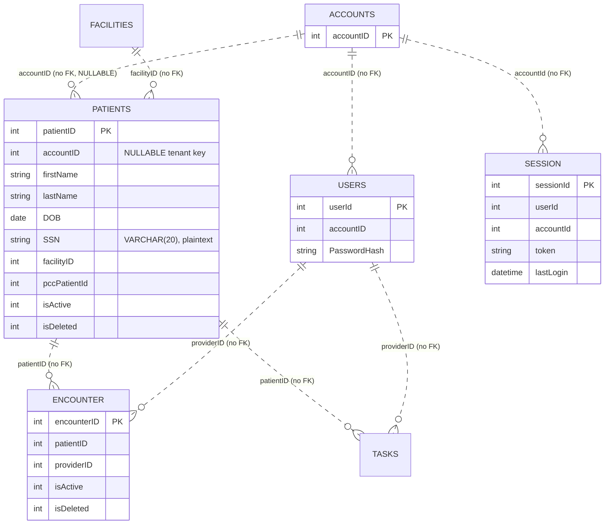
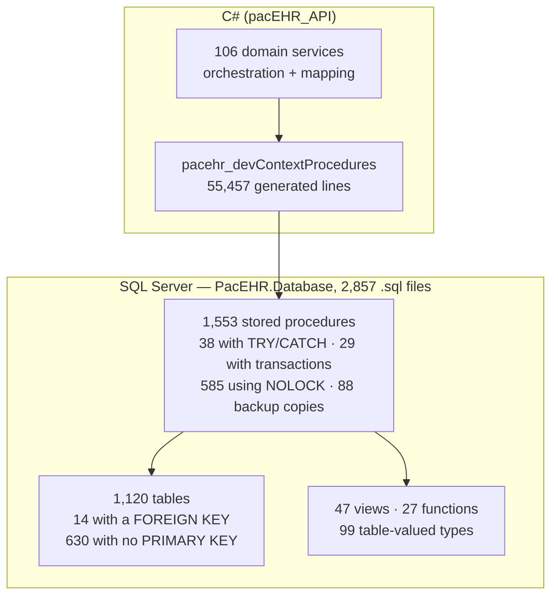
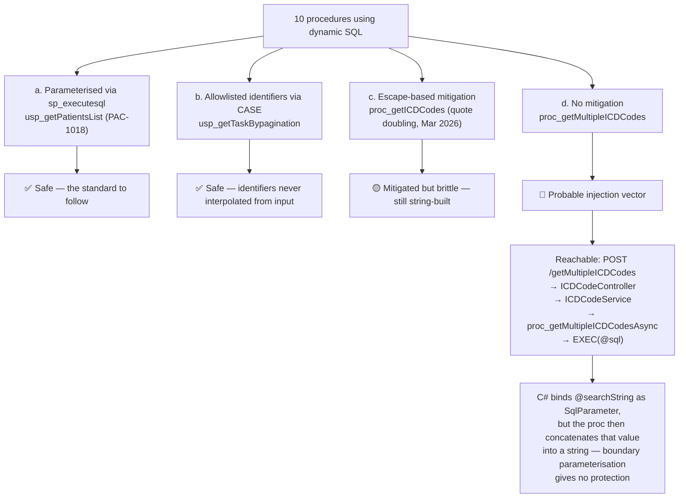

# Deep-Dive - Data & SQL Tier

**Date**: 2026-09-30
**Analyzed By**: ARCHITECT
**Status**: Draft (awaiting user confirmation)
**Scope**: the SSDT database project — schemas, tables, keys, indexes, stored procedures, views, functions, table-valued types, and the conventions that govern them
**Evidence base**: `pacEHR_API/PacEHR.Database` @ `9f2a6ee19`

> This is where PacEHR's business logic actually lives. 1,553 stored procedures against 106 C# service classes means the SQL tier is not a persistence layer — it is the application.

---

## Module Overview

**Path**: `pacEHR_API/PacEHR.Database/` (SSDT project, `PacEHR.Database.sqlproj`)

| Object type | Count |
|---|---|
| Tables | 1,120 |
| Stored procedures | 1,553 |
| Views | 47 |
| Functions | 27 |
| User-defined (table) types | 99 |
| Non-clustered/clustered index definitions | 293 |
| **Total `.sql` files** | **2,857** |

**Churn since 2026-09-08**: this is by far the most active area of the system — roughly 7,200 file touches across `Stored Procedures`, `Tables`, `Views`, `Functions` and `User Defined Types`. A large share appears under a `PacEHR.Database1/` path, indicating a directory rename mid-period.

---

## Component Breakdown

### Schema layout (41 schemas)

| Schema | Tables | Purpose |
|---|---|---|
| `dbo` | 291 | Catch-all — the largest schema, and the least cohesive |
| `stage` | 107 | Staging/landing tables for inbound integration data |
| `Log` | 87 | Audit, error and activity logging |
| `Patient` | 84 | Patient demographics and clinical records |
| `Account` | 70 | Tenancy, users, roles, sessions, facilities |
| `Trimmed` | 49 | Purpose unclear from DDL — **needs team input** |
| `DATA` | 48 | Reference/master data (ICD codes, etc.) |
| `Pcc` | 35 | PointClickCare integration |
| `PQRS` | 34 | Quality reporting |
| `Referral` | 33 | Referral queue and enrollment |
| `Encounter` | 32 | Visits and encounters |
| `Template` | 28 | Note/assessment templates |
| `Location` | 22 | Facilities and geography |
| `TreatmentPlan` | 18 | Care planning |
| `ACO` / `ECQM` / `HCC` / `Qulatitydata` *(sic)* | 17 / 16 / 10 / 2 | Quality and risk adjustment |
| `MatrixCare` | 16 | MatrixCare integration |
| `ccm`, `Assessment`, `communication`, `CPTGrouping`, `Message`, `Wiley`, `Updox`, `Scheduler`, `HIE`, `chartAudit`, `Report`, `Task`, `Symptoms`, `Document`, `ChargeChecker`, `ShareFile`, `Observations`, `CCDAStaging`, `settings`, `RabbitMq`, `Billing`, `AI` | 1–13 each | Feature-scoped |

Stored procedures do **not** follow the table schema split: 1,359 of them live in `dbo` regardless of which schema their tables belong to. Only `TreatmentPlan` (38), `MatrixCare` (24), `Referral` (12), `Symptoms` (12), `CPTGrouping` (10), `Patient` (6), `Log` (6) and `Assessment` (4) have schema-aligned procs — the newer feature areas.

Two schemas are worth flagging by name: `Qulatitydata` (misspelled) and `RabbitMq` (a message broker that appears nowhere in the .NET dependency set — the system uses Azure Service Bus).

---

## Data Models

### Core clinical ER (as inferred from columns — **not from declared constraints**)



The dotted relationships are deliberate: **these are conventions, not constraints**. See below.

### Representative table shapes

| Table | Columns | PK | Indexes |
|---|---|---|---|
| `Patient.patients` | 58 | `PK_patientID` clustered | **15 non-clustered** |
| `Account.users` | 83 | `PK_userId` clustered | — |
| `Encounter.encounter` | 48 | `PK_encounterID` clustered | 8 non-clustered |
| `Account.accounts` | — | `PK_accountID` clustered | — |
| `Account.session` | 7 | clustered on `sessionId` | 1 (`idx_Session_token`) |

---

## Where the Logic Lives



---

## Pattern Catalog

### Pattern: 🔴 referential integrity by convention, not constraint

**Evidence**: **14 of 1,120 table files (1.25%) contain a `FOREIGN KEY` clause.**

```sql
-- ACTUAL (Patient/patients.sql) — accountID is the tenant key, and it is
-- both nullable and unconstrained
CREATE TABLE [Patient].[patients] (
    [patientID]  INT IDENTITY (1, 1) NOT NULL,
    [accountID]  INT NULL,                      -- no FK, no NOT NULL
    [facilityID] INT NULL,                      -- no FK
    ...
    CONSTRAINT [PK_patientID] PRIMARY KEY CLUSTERED ([patientID] ASC)
);
```

```sql
-- DON'T: rely on application code to keep 1,120 tables consistent
[accountID] INT NULL,

-- DO: at minimum, constrain the tenant key
[accountID] INT NOT NULL,
CONSTRAINT [FK_patients_accounts] FOREIGN KEY ([accountID])
    REFERENCES [Account].[accounts] ([accountID]),
```

Consequences: orphaned rows cannot be prevented by the database; a delete in `Account.accounts` leaves patient rows pointing at nothing; cross-tenant data corruption is invisible to the engine. Combined with Module 01's finding that `accountID` arrives from a **client header**, the tenant boundary has no enforcement at either end.

### Pattern: 🔴 630 of 1,120 tables have no primary key

**Evidence**: 630 table files contain no `PRIMARY KEY` clause (56%).

Without a PK a table cannot be reliably updated row-by-row, cannot participate in replication or change tracking, and duplicate rows cannot be prevented. Many of these are likely `stage.*` landing tables where this is a defensible choice — but `stage` accounts for only 107 of the 630. **The remaining ~520 need triage.**

### Pattern: 🔴 `WITH (NOLOCK)` as the default read hint

**Evidence**: **585 of 1,553 procedures (38%) use `NOLOCK`.**

```sql
-- ACTUAL (usp_getTaskBypagination.sql, and 584 others)
FROM [Task].[Tasks] t WITH (NOLOCK)
INNER JOIN [Task].[taskMaster] tm WITH (NOLOCK) ON tm.taskMasterId = t.taskMasterId
LEFT JOIN [Patient].[patients] p WITH (NOLOCK) ON t.[patientID] = p.[patientID]
LEFT JOIN [Account].[users] pr WITH (NOLOCK) ON t.[providerID] = pr.userId
```

```sql
-- DON'T: NOLOCK on clinical reads — it permits dirty reads, missing rows
-- and duplicate rows, not merely "stale" data
FROM [Patient].[patients] p WITH (NOLOCK)

-- DO: use READ COMMITTED SNAPSHOT at the database level and drop the hints
ALTER DATABASE [pacehr] SET READ_COMMITTED_SNAPSHOT ON;
FROM [Patient].[patients] p
```

`NOLOCK` is widely used as a performance reflex, but its actual semantics — reading uncommitted rows, and under page splits **skipping committed rows or returning them twice** — are a poor fit for clinical data. A medication list that intermittently omits a row is a patient-safety concern, not a performance trade-off. Whether RCSI is already enabled on the database would change this assessment and **needs confirmation**.

### Pattern: 🟡 dynamic SQL — mostly remediated, one gap

Only 10 procedures build SQL dynamically. Three distinct qualities are present:

**(a) Properly parameterised** — `usp_getPatientsList.sql`, remediated under PAC-1018:

```sql
-- DO — this is the standard the rest should follow
DECLARE @SQLCriteria NVARCHAR(MAX) = @facilityNew + N' WHERE p.accountID = @p_accountID' + @NameFilter + ...;
EXEC sp_executesql @FinalQuery, @paramDef, @p_accountID = @accountID, @p_name = @name, ...;
```

The header comment records the intent explicitly: *"PAC-1018 performance rework … dynamic SQL parameterised via sp_executesql (closes 9 unescaped inputs and the plan-cache growth)"*. This is exemplary remediation work with a clear audit trail.

**(b) Allowlisted identifiers** — `usp_getTaskBypagination.sql`:

```sql
-- DO — sort column chosen from a fixed CASE, never interpolated from input
SET @orderByClause = CASE
    WHEN @sortBy = 'taskName' AND @sortOrder = 'asc'  THEN '[taskName] ASC'
    WHEN @sortBy = 'taskName' AND @sortOrder = 'desc' THEN '[taskName] DESC'
    ...
```

**(c) Escape-based mitigation** — `proc_getICDCodes.sql`, patched March 2026:

```sql
-- Modification : Added @safeSearchString to handle the special characters by Rohan on 26 Mar 2026.
SET @safeSearchString = REPLACE(@searchString, '''', '''''');
...
SELECT @sql = 'Select TOP (50) ... Where billable=1 And isActive=1 And ' + @wherecondition + ' order by Code'
exec (@sql)
```

Quote-doubling blocks the straightforward injection, but the statement is still assembled from a user-controlled string. Parameterisation, as PAC-1018 did, would be the durable fix.

**(d) 🔴 Unmitigated — `proc_getMultipleICDCodes.sql`**:

```sql
-- ACTUAL — no quote escaping anywhere in this proc
CREATE PROCEDURE [dbo].[proc_getMultipleICDCodes] ( @searchString NVARCHAR(MAX) )
...
SELECT ' OR (' + @ColName + ' LIKE ''%' + LTRIM(RTRIM(Split.a.value('.', 'NVARCHAR(MAX)'))) + '%'')'
...
    AND (' + @WhereCondition + ')
...
EXEC (@sql);
```

The sibling proc got `@safeSearchString` in March 2026; **this one did not**. It is reachable from the outside:

`POST /getMultipleICDCodes` → `ICDCodeController.getMultipleICDCodes(getMultipleICDCode.code)` → `ICDCodeService.getMultipleICDCodes(code)` → `proc_getMultipleICDCodesAsync(searchString)` → the proc above.

The C# layer binds `@searchString` as a `SqlParameter` correctly — but the *proc itself* then concatenates that value into a string and runs `EXEC (@sql)`, so the parameterisation at the boundary provides no protection. **This should be treated as a probable SQL-injection vulnerability pending confirmation in a test environment**, and is the single highest-priority item in this module. Recommended handling: raise via `aire-raise-defect` rather than waiting for the requirements phase.

The four qualities, and how the unmitigated one is reached:



### Pattern: 🔴 PHI at rest is unprotected

```sql
-- ACTUAL (Patient/patients.sql)
[SSN] VARCHAR (20) NULL,
```

| Signal | Result |
|---|---|
| Columns named `SSN` across the schema | **18 tables** |
| `ENCRYPTED WITH` (Always Encrypted) | **0** |
| `MASKED WITH` (Dynamic Data Masking) | **0** |

Social security numbers, names, DOB, addresses, phone numbers and email are stored as plain `VARCHAR`. Transparent Data Encryption may be enabled at the Azure SQL level (not visible in an SSDT project) and would cover data-at-rest on disk — but it does not protect against a compromised application credential, and it is not column-level. **Whether TDE is on, and whether that is considered sufficient for the compliance regime, needs the team's input.**

### Pattern: 🟡 index proliferation on hot tables

`Patient.patients` carries **15 non-clustered indexes**, with visible overlap:

```sql
CREATE NONCLUSTERED INDEX [NCI_Patients_accountid]              -- accountID
CREATE NONCLUSTERED INDEX [IX_patients_account]                 -- accountID again?
CREATE NONCLUSTERED INDEX [IX_patients_acct_active]             -- accountID + isActive
CREATE NONCLUSTERED INDEX [IX_patients_acct_isDeleted_name_perf]
CREATE NONCLUSTERED INDEX [IX_patients_perf]
CREATE NONCLUSTERED INDEX [IX_patients_isActive]
CREATE NONCLUSTERED INDEX [IX_patients_isDeleted]
CREATE NONCLUSTERED INDEX [IX_patients_patientID_isDeleted]
CREATE NONCLUSTERED INDEX [IX_patients_firstName]
CREATE NONCLUSTERED INDEX [IX_patients_lastName]
CREATE NONCLUSTERED INDEX [IX_patients_gender]                  -- very low selectivity
CREATE NONCLUSTERED INDEX [IX_patients_DOB]
...
```

`Encounter.encounter` shows the same pattern with duplicate-looking pairs (`IX_encounter_isActive` / `NCI_encounter_isActive`, `IX_encounter_isDeleted` / `NCI_encounter_isDeleted`). Two naming conventions (`IX_` and `NCI_`) coexist, which is how near-duplicates get created. Every index is a write cost on the busiest tables in the system. A `sys.dm_db_index_usage_stats` review would identify the unused ones.

### Pattern: 🔴 backup copies of procedures checked into source control

**88 procedure files** carry backup/version suffixes:

```
usp_getACOeCQMMeasureScore.sql
usp_getACOeCQMMeasureScore_09112026.sql
usp_getACOeCQMMeasureScore_bkp_09112026.sql
usp_getACOeCQMMeasureScore_bkp_09172026.sql

usp_getPatientsList.sql
usp_getPatientsList_V1.sql
usp_getPatientsList_bkpTest.sql
usp_getPatientsList_bkp20260112.sql
usp_getPatientsList_20241128.sql
usp_getPatientsListNew_12022024.sql

usp_GetPatientsRaffScore_old.sql
usp_GetPatientsRaffScore_bkp_03202026.sql
proc_daySheetReportWithCountsbkp_02052026.sql
usp_DaysheetExtendedReport_BKP20262604.sql
```

```
-- DON'T: version procedures by filename in a git repo
usp_getPatientsList_bkp20260112.sql

-- DO: delete it. Git already has every prior version.
git log -p -- "Stored Procedures/Procs1/usp_getPatientsList.sql"
```

These are not inert. SSDT **deploys every object in the project**, so each backup becomes a real procedure in the production database — 88 extra objects, each a candidate for someone to call by mistake, each holding a snapshot of logic that will never be patched. Note `usp_getPatientsList_bkpTest` and `_V1` both exist alongside the PAC-1018-remediated version; the old copies still contain the **unparameterised** dynamic SQL that PAC-1018 fixed.

### Pattern: 🟡 error handling and transactions are the exception

| Signal | Count | Share of 1,553 |
|---|---|---|
| Procedures with `BEGIN TRY` | 38 | 2.4% |
| Procedures with `BEGIN TRAN` | 29 | 1.9% |

Multi-statement write procedures without a transaction leave partial writes on failure. With no foreign keys to catch the resulting inconsistency, partial writes are silent.

### Pattern: ✅ the modification-log header convention

```sql
-- Author  : Mahesh Kunta
-- Created Date : --
-- Description  : ICD codes search by matching text.
-- Modification : by Mahesh Kunta on 06/25/2021 joined HCC scoring to get the score and category.
-- Modification : Removed Unwanted columns by Bhaurao on 10/26/2021.
-- Modification : added usagecount columns by nnaik on 08/05/2022.
-- Modification : Added @safeSearchString to handle the special characters by Rohan on 26 Mar 2026.
```

This convention is followed consistently and is genuinely valuable — it is often the only documentation of *why* a change was made. The `usp_getPatientsList` header goes further, recording a cross-object deployment dependency and an explicit "do not tidy this" instruction:

```sql
-- REQUIRES the PAC-1018 version of dbo.view_patientList_20241203 - deploy both together,
--                either object alone breaks the patient list.
-- ORDER BY left as p.lastName + ' ' + p.firstName deliberately - the indexed two-column
--                form is deferred pending Product sign-off (68% of rows change position). Do not "tidy" it.
```

That is high-quality engineering communication. It should be promoted to the standard rather than left as one author's habit.

### Pattern: table-valued parameters for bulk writes

99 user-defined table types back the bulk-insert procedures (`usp_saveStageFacilityInfoContactBulk`, `pcc_InsertAdtRecordsData`, etc.), passed from C# as `SqlDbType.Structured`. This is the right mechanism for set-based inserts and is used consistently in the integration paths.

### Naming conventions (as observed)

| Element | Convention | Consistency |
|---|---|---|
| Procedures | `usp_verbNoun` | dominant; `proc_*` in older objects (`proc_getICDCodes`) |
| Tables | lowerCamel or lowercase plural | mixed (`patients`, `taskMaster`, `statusMaster`) |
| Columns | lowerCamel | good, but `patientID` / `patientId` / `PatientId` all occur — the reason `ExtractIds` probes three casings (Module 02) |
| Primary keys | `PK_<column>` | consistent where present |
| Indexes | `IX_*` **and** `NCI_*` | two conventions, causing duplicates |
| Soft delete | `isDeleted INT` + `isActive INT` | consistent, but `INT` rather than `BIT` |
| Audit columns | `createdDate`/`createdBy`/`lastModifiedDate`/`lastModifiedBy` | consistent on core tables |

---

## Entry Points

The SQL tier has exactly one caller path: `DbContextExtensions.SqlQueryAsync<T>` (Module 02). There are no direct `SqlConnection` usages in the domain services, no ad-hoc queries from controllers, and no ORM-generated SQL in the request path.

| Deployment entry | Path |
|---|---|
| SSDT project | `PacEHR.Database/PacEHR.Database.sqlproj` |
| Pre/post-deploy scripts | `PacEHR.Database/Scripts/` (163 touches since 2026-09-08) |
| Pipeline | `pacEHR_API/pipelines/deploy-pacehrapis.yml` |

---

## Open Questions for the Team

1. **Is `READ_COMMITTED_SNAPSHOT` enabled on the database?** This materially changes how serious the 585 `NOLOCK` hints are. One query settles it.
2. **Is TDE enabled, and is column-level protection for SSN considered out of scope?** 18 tables hold plaintext SSN.
3. **What is the `Trimmed` schema (49 tables)?** Nothing in the DDL explains it.
4. **Why does a `RabbitMq` schema exist** when messaging is Azure Service Bus? Dead, or an undocumented integration?
5. **Can the 88 backup procedures be dropped?** They deploy to production today. Confirm none is referenced by a report, job or external consumer before deletion.
6. **Of the 630 tables without a primary key, how many are genuinely staging?** `stage` covers only 107.
7. **Has `proc_getMultipleICDCodes` been penetration-tested?** See the dynamic-SQL finding — this needs a decision this week, not at requirements time.
8. **Was the `PacEHR.Database1/` → `PacEHR.Database/` rename intentional**, and is any deployment tooling still pointing at the old path?

---

## Recommendations

| # | Recommendation | Rationale | Priority |
|---|---|---|---|
| 1 | Parameterise `proc_getMultipleICDCodes` with `sp_executesql` | Probable injection vector reachable from an authenticated endpoint | 🔴 Immediate |
| 2 | Apply the same treatment to `proc_getICDCodes` | Escape-based mitigation is brittle | 🔴 High |
| 3 | Delete the 88 backup procedures | They deploy to production and contain unpatched logic | 🔴 High |
| 4 | Add `NOT NULL` + FK on `accountID` for the top-20 clinical tables | The tenant boundary has no enforcement at either end | 🔴 High |
| 5 | Confirm/enable RCSI, then remove `NOLOCK` from clinical read paths | Dirty reads on medication and problem lists | 🟡 High |
| 6 | Column-level protection or masking for SSN | 18 tables, plaintext | 🟡 High |
| 7 | Triage the 630 PK-less tables; add keys outside `stage` | Unupdatable, undeduplicable rows | 🟡 Medium |
| 8 | Index review via `sys.dm_db_index_usage_stats`, starting with `patients` (15) and `encounter` (8) | Duplicate indexes on the hottest tables | 🟡 Medium |
| 9 | Standardise on one index naming convention (`IX_`) | Two conventions cause the duplicates | 🟢 Low |
| 10 | Wrap multi-statement writes in `BEGIN TRAN` + `TRY/CATCH` | Only 29 of 1,553 procs are transactional | 🟡 Medium |
| 11 | Promote the `usp_getPatientsList` header style (deploy dependencies, "do not tidy" notes) to a documented standard | Already the best documentation in the codebase | 🟢 Low |
| 12 | Settle a single casing convention for id columns | Removes the `ExtractIds` three-casing hack in Module 02 | 🟢 Low |

---

**Next**: Module 04 — PointClickCare integration.
