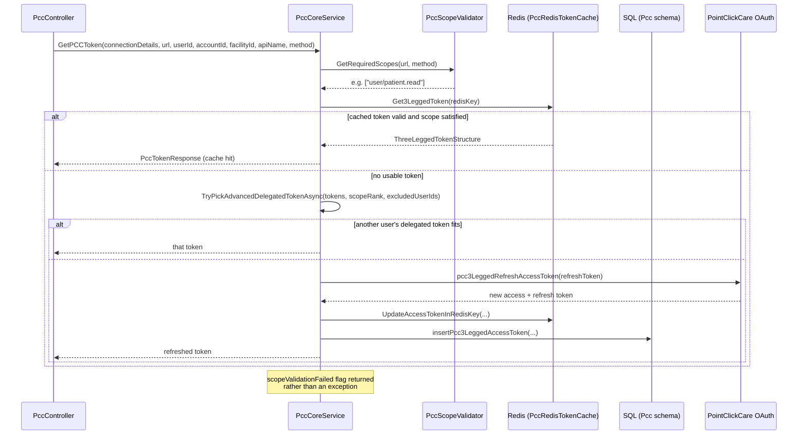
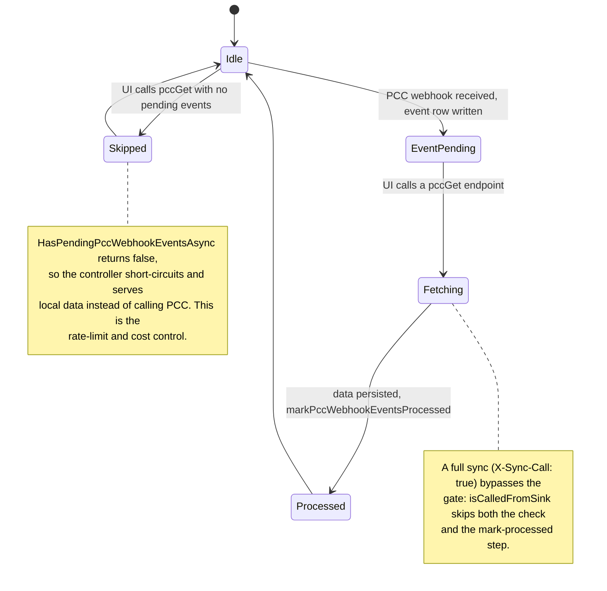
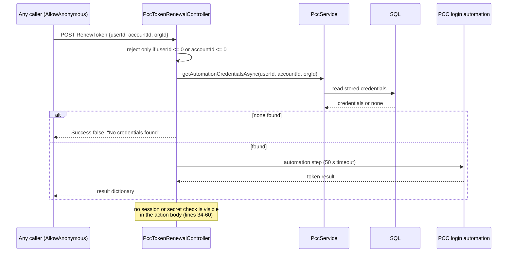
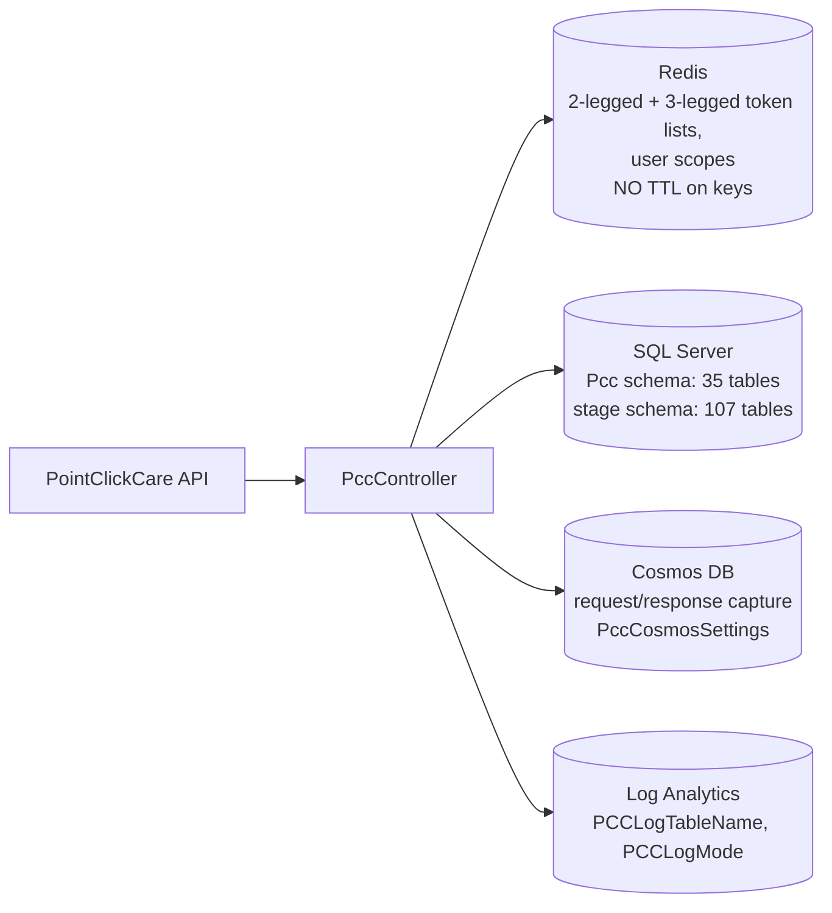

# Deep-Dive - PointClickCare Integration

**Date**: 2026-10-19
**Analyzed By**: ARCHITECT
**Status**: Draft (awaiting user confirmation)
**Method**: AIRE `aire-brownfield-deep-dive` (refresh of the 2026-09-30 deep-dive; every claim re-checked against current code)
**Scope**: the PointClickCare (PCC) integration - OAuth token management, scope validation, request pipeline, Redis caching, Cosmos logging, webhook gating, and the data landing path
**Evidence base**: `pacEHR_API` @ `0f611f65c`; `PacEHR` @ `401caa134` (SPA interceptor only). `pacEHR_AI` @ `ef172ea` has no PCC code and was not analysed for this module.

> PCC is the deepest external integration in the system and the only one with its own .NET project, its own DI module, its own cache, its own log store and its own error-mapping layer. It is also, in places, the best-engineered code in the repository.

---

## Changes since 2026-09-30

`git log --since=2026-09-30` over the PCC paths (`pacEHR.PCC.Services/`, `PccController.cs`, `PccTokenRenewalController.cs`, `PccService.cs`, `PacEHR.API/Library/`) returns **one merge**: `74e9ca119` (PR 12336, PAC-1312, 2026-10-13), which changed only `PccController.cs` and `PccControllerTests.cs`.

| Item | 2026-09-30 | Now | Notes |
|---|---|---|---|
| `PccController.cs` lines | 5,440 | **5,508** | `pccGetPractitioners` reworked (see below) |
| `PccController` HTTP-verb attributes | 66 | 66 (65 explicit `[Route("...")]` attributes) | route count unchanged |
| `PccControllerTests` `[Fact]/[Theory]` | 245 | **252** | +7 tests from PAC-1312 |
| Webhook-gate call sites in `PccController` | "5 (lines 1098, 1324, 1428, 1553, 1681)" | **7 `HasPendingPccWebhookEventsAsync` calls** (1098, 1324, 1428, 1553, 1913, 2508, 2638) and 8 `markPccWebhookEventsProcessed` calls | the old count was an undercount; first four line numbers still match |
| `PccTokenRenewalController` tests | "present (count not isolated)" | **17** (`PccTokenRenewalControllerTests.cs`) | |
| Practitioners endpoint | N+1 lookups | lookups run once per distinct provider type / taxonomy code, then mapped in memory; over-length values trimmed or cleared; bounded rate-slot retry returning 429 (`Pcc:PractitionersRateSlotMaxAttempts`, `PccController.cs:2188`) | per the PR 12336 description and diff stat; behaviour not exercised here |
| `CurrentApiName` | not recorded | `PccController.cs:77` - the webhook-gate key is now the route template, not a hand-typed literal | positive change |

**Unchanged and re-verified**: `pacEHR.PCC.Services` file sizes (`PccCoreService` 1,075; `PccScopeValidator` 146; `PccModels` 156; `PccDbProcedures` 111; `PccDataService` 75; `AddPccCoreServices` extension 46; `PccRedisTokenCache` 34), `PccService` 1,794, `PccTokenRenewalController` 469, Pcc schema 35 tables, stage schema 107 tables, the committed `.pfx`, Redis writes with no TTL, `progress-notes` scope mapping, `[AllowAnonymous]` on token renewal.

**Findings dropped**: none. **Findings corrected**: webhook-gate duplication is 7 sites, not 5; the old "tokens `tokenBlongsTo` ... " field is `int?` (typo name retained). **Findings added**: anonymous token-renewal endpoints validate only `userId > 0 && accountId > 0` (see Pattern Catalog); a `new HttpClient` remains at `PccController.cs:2084`, `PccTokenRenewalController.cs:250` and `PccCoreService.cs:428`.

---

## Module Overview

**Paths**:
- `pacEHR_API/pacEHR.PCC.Services/` - the reusable library (1,736 lines)
- `pacEHR_API/PacEHR.API/Controllers/PccController.cs` - **5,508 lines, 66 HTTP-verb routes**
- `pacEHR_API/PacEHR.API/Controllers/PccTokenRenewalController.cs` - 469 lines
- `pacEHR_API/pacEHR.DomainServices/PccService.cs` - 1,794 lines
- `pacEHR_API/PacEHR.API/Library/` - `PccCosmosLoggingFilter.cs` (237), `PccCosmosLoggingConvention.cs` (38), `PccCosmosWorker.cs` (268), `PccCosmosChannel.cs` (42), `PccErrorMapper.cs` (55)
- `pacEHR_API/PacEHR.Database/Tables/` - `Pcc` schema (35 table scripts), `stage` schema (107 table scripts)

| Component | Lines |
|---|---|
| `PccController` | 5,508 |
| `PccService` (domain) | 1,794 |
| `PccCoreService` (library) | 1,075 |
| `PccTokenRenewalController` | 469 |
| `PccScopeValidator` | 146 |
| `PccModels` | 156 |
| `PccDbProcedures` | 111 |
| `PccDataService` | 75 |
| `PccServicesCollectionExtensions` | 46 |
| `PccRedisTokenCache` | 34 |

---

## Component Breakdown

| Component | File | Responsibility |
|---|---|---|
| `PccCoreService` | `pacEHR.PCC.Services/Services/PccCoreService.cs` | Token acquisition (2-legged and 3-legged), request building, binary/document upload, scope validation entry |
| `PccScopeValidator` | `.../Services/PccScopeValidator.cs` | Maps a PCC URL + HTTP method to the required OAuth scope(s) |
| `PccRedisTokenCache` | `.../Services/PccRedisTokenCache.cs` | Reads/writes 2-legged and 3-legged token lists and user scopes in Redis |
| `PccTokenRepository` / `PccDbProcedures` | `.../Data/` | Token persistence in SQL |
| `PccDataService` | `.../Services/PccDataService.cs` | Connection-details lookup |
| `PccServicesCollectionExtensions` | `.../PccServicesCollectionExtensions.cs` | `AddPccCoreServices()` - one-call registration, host-agnostic (`Program.cs:128`) |
| `PccController` | `PacEHR.API/Controllers/PccController.cs` | 66 endpoints - fetch, link, sync, progress notes, webhooks |
| `PccTokenRenewalController` | `PacEHR.API/Controllers/PccTokenRenewalController.cs` | Two anonymous actions (`RenewToken`, `GetTokenForDelegate`) that obtain PCC credentials via an automation step (50 s timeout constant, line 17) |
| `PccService` | `pacEHR.DomainServices/PccService.cs` | Persistence orchestration, webhook event state |
| `PccCosmosLoggingConvention` + `Filter` + `Channel` + `Worker` | `PacEHR.API/Library/` | Per-action request/response capture into Cosmos DB |
| `PccErrorMapper` | `PacEHR.API/Library/PccErrorMapper.cs` | Config-driven PCC status to user-facing message |

### Authentication modes

`PccAuthType` distinguishes **2-legged** (client-credentials, application-level) from **3-legged** (delegated, per-user with refresh tokens). `ThreeLeggedTokenStructure` carries `isUserTokenDelegateEnabled` and `scopeRank`, and `TryPickAdvancedDelegatedTokenAsync` (`PccCoreService.cs:887`) selects among available user tokens by scope rank with an exclusion set - if one user's delegated token lacks the required scope (`scopeValidationFailed = true`, line 907), the system tries another user's. Call sites at lines 346, 365, 618, 637, 858, 877.

---

## Key Workflows

### Workflow 1: Token acquisition and caching



### Workflow 2: A PCC data fetch, end to end


### Workflow 3: Webhook-gated refresh



### Workflow 4: Anonymous token renewal



**Notes**:
1. Webhook gating was moved from middleware to controller level - `Program.cs:504-506` records that `PccWebhookMiddelware` was removed and the check now runs in the controller.
2. The same gate pattern is repeated inline at **7 call sites** in `PccController` rather than extracted. The gate key is now `CurrentApiName` (`PccController.cs:77`), derived from the route template.
3. PCC's rate limiter returns **403 on duplicate concurrent calls**; the SPA's `AuthInterceptor` silently swallows those for PCC endpoints (`auth.interceptor.ts:159`, `if (error.status === 403) return EMPTY;`) because the first call succeeds.
4. Workflow 4 is drawn from the first lines of each action; the automation internals (lines 60-130) were not traced - **carried, not re-verified**.

---

## Data Models

### Token structures (`Models/PccModels.cs`)

| Type | Fields |
|---|---|
| `TwoLeggedTokenStructure` | `tokenType`, `accessToken`, `accessTokenExpire` |
| `ThreeLeggedTokenStructure` | `type`, `accessToken`, `accessTokenExpire`, `refreshToken`, `refreshTokenExpire`, `orgId`, `userId`, `isUserTokenDelegateEnabled`, `scopeRank` |
| `PccTokenResponse` | `orgId`, `accessToken`, `refreshToken`, `tokenUsedBy`, `tokenBlongsTo` (sic, `int?`), `errorCode`, `errorMessage`, `scopeValidationFailed` |
| `usp_GetPCCConnectionDetailsResult` | `pccConnectionId`, `pccConnectionName`, `pccAPIURL`, `pccAccessTokenAPI`, `pccAuthorizationKey`, `pCCConfiguration` |

### Storage split



Four separate stores participate in one integration. `PCCLogMode`, `PccCosmosMode` (`Program.cs:405`), `IsPccWebhookEnabled` and `PccApiNames` each gate a different part of it. There is no ER diagram for this module: the 35 `Pcc` and 107 `stage` tables were counted by script file, their columns were not re-analysed (**carried, not re-verified** from Module 03).

---

## Pattern Catalog

### Pattern: GOOD - a properly packaged integration library

**Where**: `pacEHR.PCC.Services/PccServicesCollectionExtensions.cs` (registered at `PacEHR.API/Program.cs:128`)

```csharp
// DO - this is the standard the other integrations should follow
public static IServiceCollection AddPccCoreServices(
    this IServiceCollection services,
    IConfiguration configuration = null,
    string sqlConnectionString = null,
    string redisConnectionString = null)
```

Optional parameters let the same library be consumed by the API and by Azure Functions. Every dependency is behind an interface. This is the only part of the solution with a genuine module boundary.

### Pattern: GOOD - explicit, data-driven scope mapping

**Where**: `Services/PccScopeValidator.cs`

```csharp
// DO - a declarative map, not scattered if-statements
{ "patient-progress-notes", ("user/patientProgressNote.read", null) },   // line 10
```

48 map entries (count of `{ "..."` lines in the file), plus `_segmentAliases` and `_orWriteScopes` for the two exceptional cases, each with a comment explaining the reason.

**Anomaly (unchanged, still unconfirmed)**: `PccScopeValidator.cs:34`

```csharp
{ "progress-notes", ("user/progressNote.write", "user/progressNote.write") },
```

`progress-notes` maps its *read* scope to a *write* scope, whereas `patient-progress-notes` (line 10) uses `.read`. Either PCC requires a write scope to read this resource or this is a copy-paste defect that over-requests permission. **Needs confirmation against PCC's API documentation.**

### Pattern: GOOD - startup-time filter attachment by convention

**Where**: `PacEHR.API/Library/PccCosmosLoggingConvention.cs:27-29`, `Program.cs:402-440`

```csharp
// DO - resolve the decision once at startup, not per request
public void Apply(ControllerModel controller)
{
    if (!_enabled || controller.ControllerType != typeof(PccController)) return;
```

`Program.cs:410` computes `cosmosActive = cosmosEnabled && cosmosConfigOk`; the filter and `PccCosmosWorker` hosted service (line 440) are registered only when active.

### Pattern: GOOD - config-driven error messages (error handling)

**Where**: `PacEHR.API/Library/PccErrorMapper.cs`, initialised at `Program.cs:457`; used at `PccController.cs:154`

```csharp
// DO - map PCC status to a configured user message
return BuildDictionaryResult(pccTokenResponse.errorCode, "F", PccErrorMapper.GetUserMessage(pccTokenResponse.errorCode), null);
```

`ErrorHandleMiddelware.cs:117-119` maps both `PccApiException` types (the API-local one and `PacEHR.PCC.Services.PccApiException`) to a meaningful status. A DON'T for contrast: the many `catch (Exception ex)` blocks in `PccController` (e.g. line 164) fold everything else into the same envelope. The PAC-1312 change adds a null-safe catch that cannot mask the original exception for `pccGetPractitioners` only; other endpoints were not re-audited for that defect (**not verified**).

### Pattern: logging, DB access, API response, naming (convention summary)

| Concern | Convention in this module | Evidence |
|---|---|---|
| Logging | Application Insights helper `ApplicationInsightsLogger.LogInfo(_telemetry, "...")` at the start/end of each action; `ILogger` in `PccTokenRenewalController`; per-action Cosmos capture is an extra, optional channel | `PccController.cs:67`, `:99`, `:114`; `PccTokenRenewalController.cs:13-15` |
| DB access | Library path: `IPccDbProcedures` wrapping stored procedures; domain path: EF-generated procedure wrappers plus `DataTable` TVPs for bulk saves (`dtProgressNotes`, `dtNoteCodes`, ...) | `PccService.cs:1482-1561`, `PccService.cs:520` |
| API response | RPC envelope `BuildDictionaryResult(httpCode, "Y"/"F", message, payload)` - business failure is `"F"` inside an HTTP 200 | `PccController.cs:142,147,154` |
| Naming | camelCase RPC routes with mixed prefixes (`pccGet*`, `pccAdd*`, `adtRecords`, `linkExternalPatient`); `PccTokenResponse.tokenBlongsTo` is a typo kept for compatibility | `PccController.cs:2155`; `PccModels.cs:9` |

```csharp
// DO - return the envelope with a mapped message
return BuildDictionaryResult(200, "F", "No data found", null);          // PccController.cs:147
// DON'T - leave a caller to guess the failure shape from a different helper
```

### Pattern: RISK - Redis keys written with no TTL

**Where**: `Services/PccRedisTokenCache.cs:31` (re-verified: still unchanged)

```csharp
// ACTUAL
await _db.StringSetAsync(key, JsonConvert.SerializeObject(value));   // no expiry argument
```

```csharp
// DON'T: cache OAuth material with no expiry
// DO: bound the key's life to the credential's life
await _db.StringSetAsync(key, json, expiry: tokenLifetime + TimeSpan.FromMinutes(5));
```

OAuth access and refresh tokens are serialised to Redis and the key never expires. Expiry is tracked inside the payload (`accessTokenExpire`, `refreshTokenExpire`) and enforced in application code, so behaviour is correct, but stale credentials accumulate and a Redis compromise yields tokens rather than a bounded window of them.

### Pattern: RISK - a client certificate committed to the repository

**Where**: `pacEHR.PCC.Services/Certificates/wcthesnfist_com.pfx` (6,022 bytes, `git ls-files` confirms tracked); loaded at `PacEHR.API/Program.cs:220-228`

```csharp
SslCertificateHelper.Initialize(
    readFromAzure: sslSettings.GetValue<bool>("ReadSslFromAzure"),
    thumbprint:    sslSettings["CertThumbprint"],
    ...
    certPassword:  sslSettings["CertPassword"]);
```

A `.pfx` is a PKCS#12 bundle that normally carries a private key. It is in git history and the password is an `appsettings.json` key. Mitigation: `ReadSslFromAzure=true` loads from the App Service certificate store. The certificate is attached to the **MatrixCare** `HttpClient` (`Program.cs:231-241`), so it is also a misplaced asset in the PCC project. Whether the file contains a private key and whether it has been rotated were **not verified** (the file was not opened). Raise via `aire-raise-defect`.

Also noted: `PccController.cs:63` builds `INFO_LOGS_Directory` pointing at `App_Data\ssl\wcthesnfist_com.pfx`, a second reference to the same certificate name.

### Pattern: RISK - anonymous token-renewal endpoints (new emphasis)

**Where**: `PacEHR.API/Controllers/PccTokenRenewalController.cs:34-47`, `:133-146`

```csharp
// ACTUAL
[AllowAnonymous]
[HttpPost]
public async Task<IDictionary> RenewToken(Data.Dtos.TokenRenewalRequest request)
{
    ...
    if (request == null || request.userId <= 0 || request.accountId <= 0) { ... }
```

Both actions are anonymous and the only guard in the first lines is that `userId` and `accountId` are positive. The caller supplies the identity whose stored credentials are used. Whether the caller is authenticated by a network control, a shared secret in the DTO or something later in the method was **not established** (action bodies were read to line ~60 and ~150 only). Treat as an open question, not a confirmed vulnerability. Module 07 lists it in the anonymous surface.

### Pattern: RISK - `PccController` is a 5,508-line god controller

66 routes in one file, with the webhook-gate block copy-pasted at seven call sites:

```csharp
// ACTUAL - PccController.cs:1098 (also 1324, 1428, 1553, 1913, 2508, 2638)
if (!isCalledFromSink && !await _pccService.HasPendingPccWebhookEventsAsync(CurrentApiName, accountID, 0, webhookPccPatientId))
```

```csharp
// DO: extract the gate once
await using var gate = await _webhookGate.AcquireAsync(CurrentApiName, accountID, pccPatientId, isSyncCall);
if (!gate.ShouldFetch) return LocalData();
await gate.MarkProcessedAsync();
```

Note that at lines 1553 and 2638 the check lacks the `!isCalledFromSink &&` guard in the same expression; whether a sync-bypass is applied by an outer condition was not traced (**carried, not re-verified**). Splitting by resource would also let the Cosmos convention target controllers individually (`PccCosmosLoggingConvention.cs:29` tests `typeof(PccController)`).

### Pattern: RISK - sync-mode signalled by a client header

**Where**: `PacEHR/src/app/core/ineterceptors/auth.interceptor.ts` and `PacEHR.API/Library/PacEHRCommonController.cs:58-61`

```csharp
// ACTUAL - the server trusts the client header
if (Request.Headers.TryGetValue("X-Sync-Call", out StringValues syncCallSV))
    ret.IsSyncCall = string.Equals(syncCallSV.ToString(), "true", StringComparison.OrdinalIgnoreCase);
```

`IsSyncCall` bypasses the webhook gate (the rate-limit and cost control on outbound PCC calls). The SPA keeps hardcoded lists: **6** sync endpoints (`pccSyncEndpoints`) and **27** PCC endpoints (`pccEndpoints`), re-counted now; the controller has 66 routes, so the lists cover a subset by design but must be edited for each new endpoint.

### Pattern: RISK - scope failure returned as a flag, not an exception

```csharp
public bool scopeValidationFailed { get; set; }   // PccModels.cs, set at PccCoreService.cs:181, :907
```

An authorisation failure is a boolean on a success-shaped object; `PccCoreService.cs:232` checks it. `PccController.cs` contains no reference to the field (0 matches), so callers rely on `errorCode` mapping. A caller that ignores both proceeds with an empty `accessToken`. The library's own `PccApiException`/`PccTokenException` *are* exceptions and *are* mapped by the error middleware.

### Pattern: RISK - `new HttpClient` inside the PCC path

`PccCoreService.cs:426-428`, `PccTokenRenewalController.cs:244-250`, `PccController.cs:2084` construct handlers or clients directly instead of using `IHttpClientFactory` (registered at `Program.cs:211`). Same socket and policy concerns as Module 07.

---

## Testing Patterns

| Target | Tests (`[Fact]`/`[Theory]`, re-counted) |
|---|---|
| `Controllers/PccControllerTests.cs` | **252** (was 245) |
| `Controllers/PccTokenRenewalControllerTests.cs` | **17** |
| `DomainServices/PccServiceTest.cs` | 42 |
| `DomainServices/PccServicePendingProgressNotesTests.cs` | 7 |
| `DomainServices/PccServiceDiagnosticBatchTests.cs` | 5 |
| `DomainServices/PccServiceUnlinkOnDiscontinueTests.cs` | 2 |
| `Pcc/PccMedicationTvpMappingTests.cs` | 2 |
| `PccCoreService` (library, 1,075 lines: token flows, refresh, delegation) | **0** (no test file references the concrete class; two PccService tests mention the name only as a dependency) |
| `PccScopeValidator` | **0** |
| `PccRedisTokenCache` | **0** |

Tests are xUnit with mocked interfaces. The library where token selection, delegation fallback and scope validation live still has no direct tests. `PccScopeValidator` is pure and dependency-free: the easiest high-value test target. PAC-1312 added 7 tests alongside its change, a good sign for new work.

---

## Entry Points

| Entry | Route | Description |
|---|---|---|
| Patient fetch | `POST /pccGetPatients`, `/pccGetPatientById`, `/pccGetPatientsByFacility` | Roster sync |
| Clinical fetch | `/pccGetPatientMedication`, `/pccGetPatientDiagnosis`, `/pccGetPatientallergyIntolerances`, `/pccGetPatientImmunizations`, `/pccGetObservations`, `/pccGetDiagnosticReports`, `/pccGetCarePlans` | The six sync-marked endpoints plus care plans |
| Care team | `/pccGetPractitioners` (`PccController.cs:2155`) | Reworked in PAC-1312 |
| Progress notes | `/pccGetProgressNote(s)`, `/pccGetProgressNoteDetails`, `/pccAddPatientProgressNote`, `/pccAddProgressNote`, `/pccAddAddendum`, `/getPendingProgressNotesDetails` | Bidirectional |
| Linking | `/linkExternalPatient` | PacEHR to PCC patient identity |
| Facility/reference | `/pccGetFacility`, `/pccGetFacilityBeds`, `/pccGetPickLists`, `/pccGetPickListByPickListId`, `/pccGetFacilityCategoryId` | |
| ADT | `/adtRecords` | Admissions/discharges |
| Webhooks | `/pccwebhookSubscriptions` (3187), `/pacEHRWebhook` (3288), `/getpccwebhookSubscriptions` (3330), `/simulatepccwebhookSubscriptions` (3419), `/insertPccWebhookResponse` (3152), `/getPendingWebhookEvents` (5002), `/updatePccWebhookEventMapping` (5028) | Subscription management and event state |
| Tokens | `PccTokenRenewalController` (`[AllowAnonymous]`, 2 actions) | Renewal |
| Session/facility | `/getActiveUserTokensByFacility` | Delegated-token inventory |

---

## Open Questions for the Team

1. **Is `progress-notes -> user/progressNote.write` for reads correct per PCC's API spec**, or a copy-paste defect?
2. **Has `wcthesnfist_com.pfx` been rotated since it entered git history?** Does it carry a private key? Is `ReadSslFromAzure=true` in every deployed environment?
3. **What is the Redis eviction policy and memory ceiling?** With no TTLs, that policy is the only bound on token-cache growth.
4. **What authenticates callers of `RenewToken` / `GetTokenForDelegate`?** Both are `[AllowAnonymous]` and accept caller-supplied `userId`/`accountId`.
5. **Can the delegated-token fallback act under a different user's authority than the caller?** The PCC-side audit trail would attribute access to the other user. Clarify whether intended.
6. **Which environments have `PccCosmosMode=1`?** Cosmos captures full PCC request/response bodies - clinical data in a third log store.
7. **Is the SPA's 27-endpoint PCC list kept in sync with the controller's 66 routes**, and what breaks when it drifts?

---

## Recommendations

| # | Recommendation | Rationale | Priority |
|---|---|---|---|
| 1 | Rotate the committed certificate and purge it from git history (after confirming it holds a private key) | Possible private key in source control | Immediate |
| 2 | Add TTLs to all `PccRedisTokenCache` writes | Unbounded OAuth material in cache | High |
| 3 | Establish and document what protects the anonymous `PccTokenRenewalController` actions; add authentication if none | Anonymous endpoints that act on stored credentials by caller-supplied ids | High |
| 4 | Add unit tests for `PccScopeValidator` | Pure, dependency-free, security-relevant, 48 mappings, zero tests | High - easiest win |
| 5 | Derive `IsSyncCall` server-side rather than from a client header | A client header bypasses the rate-limit gate | High |
| 6 | Verify the `progress-notes` scope mapping | Possible over-permissioning | High |
| 7 | Extract the webhook gate into one reusable helper (7 sites) | Copy-pasted logic, and two sites differ in guard shape | Medium |
| 8 | Split `PccController` by resource | 5,508 lines, 66 routes in one file | Medium |
| 9 | Add tests for `PccCoreService` token and delegation paths | 1,075 lines of security logic, untested | Medium |
| 10 | Turn `scopeValidationFailed` into an exception | A silently ignorable authorisation failure | Medium |
| 11 | Move the MatrixCare certificate out of the PCC project | Misplaced asset confuses ownership | Low |
| 12 | Promote `AddPccCoreServices` as the template for every other integration | The only real module boundary in the solution | Low, high leverage |

---

**Next**: Module 05 - Interoperability (FHIR / CCDA / QRDA).
