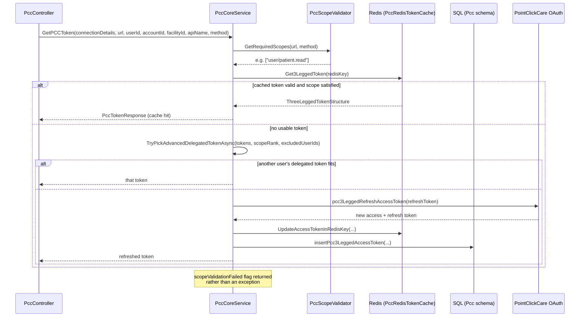
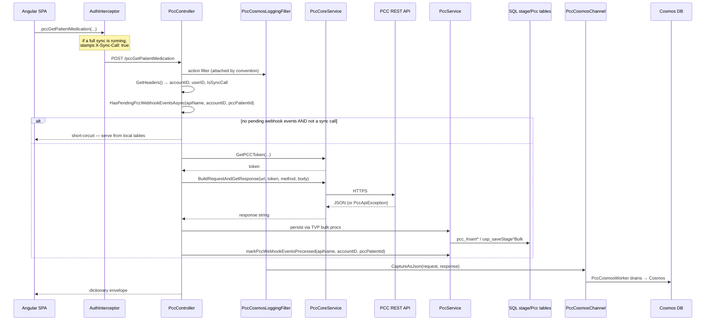
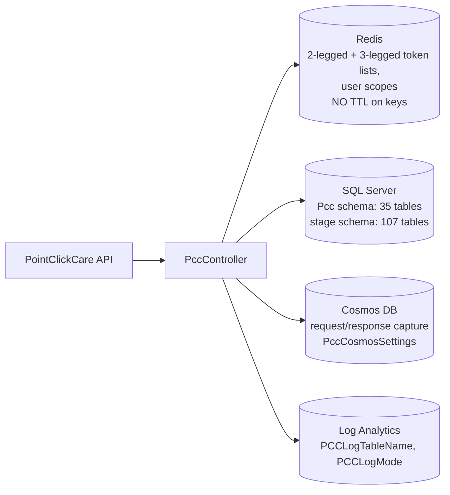

# Deep-Dive - PointClickCare Integration

**Date**: 2026-09-30
**Analyzed By**: ARCHITECT
**Status**: Draft (awaiting user confirmation)
**Scope**: the PointClickCare (PCC) integration — OAuth token management, scope validation, request pipeline, Redis caching, Cosmos logging, webhook gating, and the data landing path
**Evidence base**: `pacEHR_API` @ `9f2a6ee19`

> PCC is the deepest external integration in the system and the only one with its own .NET project, its own DI module, its own cache, its own log store and its own error-mapping layer. It is also, in places, the best-engineered code in the repository.

---

## Module Overview

**Paths**:
- `pacEHR_API/pacEHR.PCC.Services/` — the reusable library (1,736 lines)
- `pacEHR_API/PacEHR.API/Controllers/PccController.cs` — **5,440 lines, 66 routes**
- `pacEHR_API/PacEHR.API/Controllers/PccTokenRenewalController.cs` — 469 lines
- `pacEHR_API/pacEHR.DomainServices/PccService.cs` — 1,794 lines
- `pacEHR_API/PacEHR.API/Library/` — `PccCosmosLoggingFilter.cs`, `PccCosmosLoggingConvention.cs`, `PccCosmosWorker.cs`, `PccCosmosChannel.cs`, `PccErrorMapper.cs`
- `pacEHR_API/PacEHR.Database/` — `Pcc` schema (35 tables), `stage` schema (107 tables)

**Sizes**:

| Component | Lines |
|---|---|
| `PccController` | 5,440 (66 routes) |
| `PccService` (domain) | 1,794 |
| `PccCoreService` (library) | 1,075 |
| `PccTokenRenewalController` | 469 |
| `PccScopeValidator` | 146 |
| `PccModels` | 156 |
| `PccDbProcedures` | 111 |
| `PccDataService` | 75 |
| `PccServicesCollectionExtensions` | 46 |
| `PccRedisTokenCache` | 34 |

---

## Component Breakdown

| Component | File | Responsibility |
|---|---|---|
| `PccCoreService` | `pacEHR.PCC.Services/Services/PccCoreService.cs` | Token acquisition (2-legged and 3-legged), request building, binary/document upload, scope validation entry |
| `PccScopeValidator` | `.../Services/PccScopeValidator.cs` | Maps a PCC URL + HTTP method to the required OAuth scope(s) |
| `PccRedisTokenCache` | `.../Services/PccRedisTokenCache.cs` | Reads/writes 2-legged and 3-legged token lists and user scopes in Redis |
| `PccTokenRepository` / `PccDbProcedures` | `.../Data/` | Token persistence in SQL |
| `PccDataService` | `.../Services/PccDataService.cs` | Connection-details lookup |
| `PccServicesCollectionExtensions` | `.../PccServicesCollectionExtensions.cs` | `AddPccCoreServices()` — one-call registration, host-agnostic |
| `PccController` | `PacEHR.API/Controllers/PccController.cs` | 66 endpoints — fetch, link, sync, progress notes, webhooks |
| `PccService` | `pacEHR.DomainServices/PccService.cs` | Persistence orchestration, webhook event state |
| `PccCosmosLoggingConvention` + `Filter` + `Channel` + `Worker` | `PacEHR.API/Library/` | Per-action request/response capture into Cosmos DB |
| `PccErrorMapper` | `PacEHR.API/Library/PccErrorMapper.cs` | Config-driven PCC status → user-facing message |

### Authentication modes

`PccAuthType` distinguishes **2-legged** (client-credentials, application-level) from **3-legged** (delegated, per-user with refresh tokens) flows. `ThreeLeggedTokenStructure` carries `isUserTokenDelegateEnabled` and `scopeRank`, and `TryPickAdvancedDelegatedTokenAsync` selects among available user tokens by scope rank with an exclusion set — i.e. if one user's delegated token lacks the required scope, the system tries another user's.

---

## Key Workflows

### Workflow 1: Token acquisition and caching



### Workflow 2: A PCC data fetch, end to end



### Workflow 3: Webhook-gated refresh


**Stories**:
1. Webhook gating was moved from middleware to the controller level — `Program.cs:499-502` records that `PccWebhookMiddelware` was removed and the check now runs after `GetPCCToken`.
2. The same gate pattern is repeated inline at **at least 5 call sites** in `PccController` (lines 1098, 1324, 1428, 1553, 1681) rather than extracted.
3. PCC's rate limiter returns **403 on duplicate concurrent calls**; the SPA's `AuthInterceptor` silently swallows those (`if (error.status === 403) return EMPTY;`) because the first call succeeds.

---

## Data Models

### Token structures (`Models/PccModels.cs`)

| Type | Fields |
|---|---|
| `TwoLeggedTokenStructure` | `tokenType`, `accessToken`, `accessTokenExpire` |
| `ThreeLeggedTokenStructure` | `type`, `accessToken`, `accessTokenExpire`, `refreshToken`, `refreshTokenExpire`, `orgId`, `userId`, `isUserTokenDelegateEnabled`, `scopeRank` |
| `PccTokenResponse` | `orgId`, `accessToken`, `refreshToken`, `tokenUsedBy`, `tokenBlongsTo` *(sic)*, `errorCode`, `errorMessage`, `scopeValidationFailed` |
| `usp_GetPCCConnectionDetailsResult` | `pccConnectionId`, `pccConnectionName`, `pccAPIURL`, `pccAccessTokenAPI`, `pccAuthorizationKey`, `pCCConfiguration` |

### Storage split



Four separate stores participate in one integration. `PCCLogMode`, `PccCosmosMode`, `IsPccWebhookEnabled` and `PccApiNames` each gate a different part of it.

---

## Pattern Catalog

### Pattern: ✅ a properly packaged integration library

**Where**: `pacEHR.PCC.Services/PccServicesCollectionExtensions.cs`

```csharp
// DO — this is the standard the other integrations should follow
public static IServiceCollection AddPccCoreServices(
    this IServiceCollection services,
    IConfiguration configuration = null,
    string sqlConnectionString = null,
    string redisConnectionString = null)
{
    if (configuration != null)
        services.Configure<PointClickCareRedisCacheSettings>(opts =>
            configuration.GetSection("PointClickCareRedisCacheSettings").Bind(opts));

    if (sqlConnectionString != null)
        services.AddScoped<IPccDbProcedures>(_ => new PccDbProcedures(sqlConnectionString));
    else
        services.AddScoped<IPccDbProcedures, PccDbProcedures>();
    ...
}
```

Optional parameters let the same library be consumed by the API (which has `IConfiguration` and a registered `IConnectionMultiplexer`) and by Azure Functions (which may not). Every dependency is behind an interface. The XML doc explains *when* to pass each parameter. This is the only part of the solution with a genuine module boundary — `Program.cs` registers it with one call instead of the ~250 hand-written lines everything else needs.

### Pattern: ✅ explicit, data-driven scope mapping

**Where**: `Services/PccScopeValidator.cs`

```csharp
// DO — a declarative map, not scattered if-statements
private static readonly Dictionary<string, (string read, string write)> _map = new()
{
    { "patients",              ("user/patient.read",            "user/patient.write") },
    { "medications",           ("user/medication.read",          null) },
    { "allergyintolerances",   ("user/allergyIntolerance.read",  null) },
    ...   // 48 resources
};

// Sub-resource path segments whose name does not match their scope-map key.
private static readonly Dictionary<string, string> _segmentAliases = new()
{
    { "beds", "beds-availability" },   // /facs/{facId}/beds
};

// Write-only resources satisfied by ANY one of several scopes (OR semantics).
private static readonly Dictionary<string, string[]> _orWriteScopes = new()
{
    { "documents", new[] { "user/adminDocumentCategory.write", "user/clinicalDocumentCategory.write" } },
};
```

48 resources mapped, with aliases and OR-semantics handled as named concepts and each exception commented with its reason. This is exemplary.

**One anomaly worth checking**: `progress-notes` maps its *read* scope to a *write* scope —

```csharp
{ "progress-notes", ("user/progressNote.write", "user/progressNote.write") },
```

Compare `patient-progress-notes`, which correctly uses `user/patientProgressNote.read`. Either PCC genuinely requires a write scope to read this resource, or this is a copy-paste defect that over-requests permission. **Needs confirmation against PCC's API documentation.**

### Pattern: ✅ startup-time filter attachment by convention

**Where**: `PacEHR.API/Library/PccCosmosLoggingConvention.cs`, `Program.cs:400-420`

```csharp
// DO — resolve the decision once at startup, not per request
public void Apply(ControllerModel controller)
{
    if (!_enabled || controller.ControllerType != typeof(PccController)) return;
    foreach (var action in controller.Actions)
    {
        if (_apiNames.Count > 0 && !_apiNames.Contains(action.ActionName)) continue;
        action.Filters.Add(new ServiceFilterAttribute(typeof(PccCosmosLoggingFilter)));
    }
}
```

```csharp
// and the registration is conditional to match
if (cosmosActive) { builder.Services.AddSingleton<PccCosmosLoggingFilter>(); }
```

The comment explains the invariant that makes conditional registration safe: the filter is never attached when the feature is off, so it never needs resolving. That is careful work, and rare in this codebase.

### Pattern: ✅ config-driven error messages

**Where**: `PacEHR.API/Library/PccErrorMapper.cs`, `appsettings.json` `PccErrorMessages` section (`400`, `401`, `403`, `409`, `412`, `413`, `429`, `500`, `503`, `Default`, `DefaultErrorCode`)

Loaded once at startup, falls back to a configured default. PCC failures are the one exception type that `ErrorHandleMiddelware` maps to a meaningful status and message (Module 02) — everything else becomes `400 Bad Request`. The PCC path is the model for how the rest of the API should handle errors.

### Pattern: 🔴 Redis keys written with no TTL

**Where**: `Services/PccRedisTokenCache.cs`

```csharp
// ACTUAL
private async Task SetAsync<T>(string key, T value)
{
    if (value == null) return;
    await _db.StringSetAsync(key, JsonConvert.SerializeObject(value));   // no expiry argument
}
```

```csharp
// DON'T: cache OAuth material with no expiry
await _db.StringSetAsync(key, json);

// DO: bound the key's life to the credential's life
await _db.StringSetAsync(key, json, expiry: tokenLifetime + TimeSpan.FromMinutes(5));
```

OAuth **access and refresh tokens** are serialised to Redis and the key never expires. Expiry is tracked *inside* the payload (`accessTokenExpire`, `refreshTokenExpire`) and enforced in application code, so behaviour is correct — but revoked, superseded and long-dead credentials accumulate in the cache indefinitely, and a Redis compromise yields tokens rather than a bounded window of them. Redis eviction policy is the only thing bounding growth.

### Pattern: 🔴 a client certificate committed to the repository

**Where**: `pacEHR.PCC.Services/Certificates/wcthesnfist_com.pfx` (6,022 bytes, git-tracked)

```csharp
// Program.cs:218-225
var sslSettings = builder.Configuration.GetSection("SslSettings");
SslCertificateHelper.Initialize(
    readFromAzure: sslSettings.GetValue<bool>("ReadSslFromAzure"),
    thumbprint:    sslSettings["CertThumbprint"],
    contentRootPath: builder.Environment.ContentRootPath,
    certRelativePath: sslSettings["CertRelativePath"],
    certPassword:  sslSettings["CertPassword"]);
```

A `.pfx` is a PKCS#12 bundle that normally carries a **private key**. It is committed to git, and `CertPassword` is an `appsettings.json` key. The mitigation in place is real: `ReadSslFromAzure=true` loads the certificate from the Azure App Service certificate store by thumbprint instead, and the file is the local-development fallback. But the file is in the repository's history regardless, and anyone with repo access plus the config value has the key.

Note also that despite living in the PCC project, this certificate is used for the **MatrixCare** SOAP client (`AddHttpClient("MatrixCare")` with `handler.ClientCertificates.Add(cert)`) — a misplaced asset.

**Recommended handling**: treat as a credential-rotation task (revoke, reissue, purge from history), raised via `aire-raise-defect` rather than deferred to requirements.

### Pattern: 🔴 `PccController` is a 5,440-line god controller

66 routes in one file, with the webhook-gate block copy-pasted at five or more locations:

```csharp
// ACTUAL — repeated near-verbatim at lines 1098, 1324, 1428, 1553, 1681
if (!isCalledFromSink && !await _pccService.HasPendingPccWebhookEventsAsync(CurrentApiName, accountID, 0, webhookPccPatientId))
{
    // ... short-circuit and serve local data
}
...
// Webhook events for this patient are now consumed -> mark them processed (skipped for sync calls).
if (!isCalledFromSink)
{
    await _pccService.markPccWebhookEventsProcessed(CurrentApiName, accountID, webhookPccPatientId);
}
```

```csharp
// DO: extract the gate once
await using var gate = await _webhookGate.AcquireAsync(CurrentApiName, accountID, pccPatientId, isSyncCall);
if (!gate.ShouldFetch) return LocalData();
// ... fetch ...
await gate.MarkProcessedAsync();
```

Splitting by resource (`PccPatientController`, `PccProgressNoteController`, `PccDocumentController`, …) would also let the Cosmos-logging convention target them individually rather than testing `controller.ControllerType != typeof(PccController)`.

### Pattern: 🟡 sync-mode signalled by a client header

**Where**: `PacEHR/src/app/core/ineterceptors/auth.interceptor.ts`, `PacEHRCommonController.GetHeaders()`

```typescript
// ACTUAL — the SPA tells the server that a sync is in progress
if (this.pccSyncState.isSyncCall && this.isPccSyncEndpoint(request.url)) {
  request = request.clone({ headers: request.headers.set('X-Sync-Call', 'true') });
}
```

```csharp
// and the server trusts it
if (Request.Headers.TryGetValue("X-Sync-Call", out StringValues syncCallSV))
    ret.IsSyncCall = string.Equals(syncCallSV.ToString(), "true", StringComparison.OrdinalIgnoreCase);
```

`IsSyncCall` bypasses the webhook gate — the rate-limit and cost control on outbound PCC calls. A client that always sets the header defeats the gate on every request. The SPA maintains a hardcoded list of six sync endpoints and twenty-seven PCC endpoints in the interceptor; adding a PCC endpoint requires editing that list, which is easy to miss.

### Pattern: 🟡 scope failure returned as a flag, not an exception

```csharp
public class PccTokenResponse
{
    ...
    public int errorCode { get; set; }
    public string errorMessage { get; set; }
    public bool scopeValidationFailed { get; set; }
}
```

An authorisation failure is a boolean on a success-shaped object. Every caller must remember to check it; a caller that forgets proceeds with an empty `accessToken`. Contrast the library's own `PccApiException`/`PccTokenException`, which *are* exceptions and *are* mapped properly by the error middleware.

### Test patterns (PCC)

| Target | Tests |
|---|---|
| `PccControllerTests` | **245** |
| `Pcc/PccMedicationTvpMappingTests` | 2 |
| `PccCoreService` (1,075 lines: token flows, refresh, delegation) | **0** |
| `PccScopeValidator` (the authorisation decision) | **0** |
| `PccRedisTokenCache` | **0** |
| `PccTokenRenewalController` | present (count not isolated) |

The 245 controller tests are substantial, but the library where the security-relevant logic lives — token selection, delegation fallback, scope validation — has none. `PccScopeValidator` is pure, static, dependency-free and maps 48 resources: it is the single easiest high-value test target in the entire codebase.

---

## Entry Points

| Entry | Route | Description |
|---|---|---|
| Patient fetch | `POST /pccGetPatients`, `/pccGetPatientById`, `/pccGetPatientsByFacility` | Roster sync |
| Clinical fetch | `/pccGetPatientMedication`, `/pccGetPatientDiagnosis`, `/pccGetPatientallergyIntolerances`, `/pccGetPatientImmunizations`, `/pccGetObservations`, `/pccGetDiagnosticReports`, `/pccGetCarePlans` | The six sync-marked endpoints plus care plans |
| Progress notes | `/pccGetProgressNote(s)`, `/pccGetProgressNoteDetails`, `/pccAddPatientProgressNote`, `/pccAddProgressNote`, `/pccAddAddendum`, `/getPendingProgressNotesDetails` | Bidirectional |
| Linking | `/linkExternalPatient` | PacEHR ↔ PCC patient identity |
| Facility/reference | `/pccGetFacility`, `/pccGetFacilityBeds`, `/pccGetPickLists`, `/pccGetPickListByPickListId`, `/pccGetFacilityCategoryId` | |
| ADT | `/adtRecords` | Admissions/discharges |
| Webhooks | `/simulatepccwebhookSubscriptions` | Simulation endpoint |
| Tokens | `PccTokenRenewalController` (`[AllowAnonymous]`) | Renewal |
| Session/facility | `/getActiveUserTokensByFacility` | Delegated-token inventory |

---

## Open Questions for the Team

1. **Is `progress-notes → user/progressNote.write` for reads correct per PCC's API spec**, or a copy-paste defect?
2. **Has `wcthesnfist_com.pfx` been rotated since it entered git history?** And is `ReadSslFromAzure=true` in every deployed environment?
3. **What is the Redis eviction policy and memory ceiling?** With no TTLs, that policy is the only bound on token-cache growth.
4. **Is `PccTokenRenewalController` being `[AllowAnonymous]` deliberate?** It manages OAuth credentials.
5. **Can the delegated-token fallback (`TryPickAdvancedDelegatedTokenAsync`) act under a different user's authority than the caller?** If user A's request is served with user B's delegated token, the PCC-side audit trail attributes the access to B. Clarify whether this is intended and accepted.
6. **Which environments have `PccCosmosMode=1`?** Cosmos captures full PCC request/response bodies — clinical data in a third log store.
7. **Is the SPA's hardcoded 27-endpoint PCC list kept in sync with the controller's 66 routes**, and what breaks when it drifts?

---

## Recommendations

| # | Recommendation | Rationale | Priority |
|---|---|---|---|
| 1 | Rotate the committed certificate and purge it from git history | Private key in source control | 🔴 Immediate |
| 2 | Add TTLs to all `PccRedisTokenCache` writes | Unbounded OAuth material in cache | 🔴 High |
| 3 | Add unit tests for `PccScopeValidator` | Pure, dependency-free, security-relevant, 48 mappings, zero tests | 🔴 High — easiest win available |
| 4 | Derive `IsSyncCall` server-side rather than from a client header | A client header currently bypasses the rate-limit gate | 🟡 High |
| 5 | Verify the `progress-notes` scope mapping | Possible over-permissioning | 🟡 High |
| 6 | Extract the webhook gate into one reusable helper | Copy-pasted at 5+ sites | 🟡 Medium |
| 7 | Split `PccController` by resource | 5,440 lines, 66 routes in one file | 🟡 Medium |
| 8 | Add tests for `PccCoreService` token and delegation paths | 1,075 lines of security logic, untested | 🟡 Medium |
| 9 | Move the MatrixCare certificate out of the PCC project | Misplaced asset confuses ownership | 🟢 Low |
| 10 | Promote `AddPccCoreServices` as the template for every other integration | It is the only real module boundary in the solution | 🟢 Low — but high leverage |
| 11 | Turn `scopeValidationFailed` into an exception | A silently ignorable authorisation failure | 🟡 Medium |

---

**Next**: Module 05 — Interoperability (FHIR / CCDA / QRDA).
