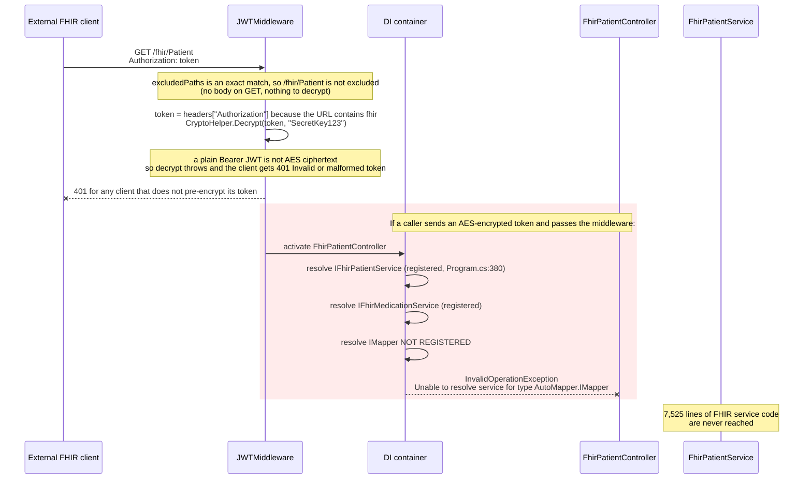
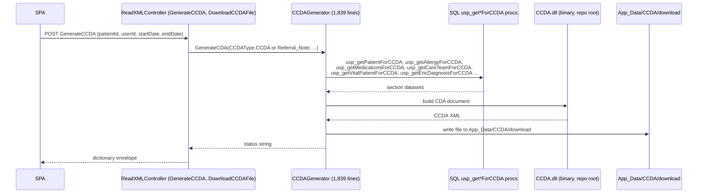
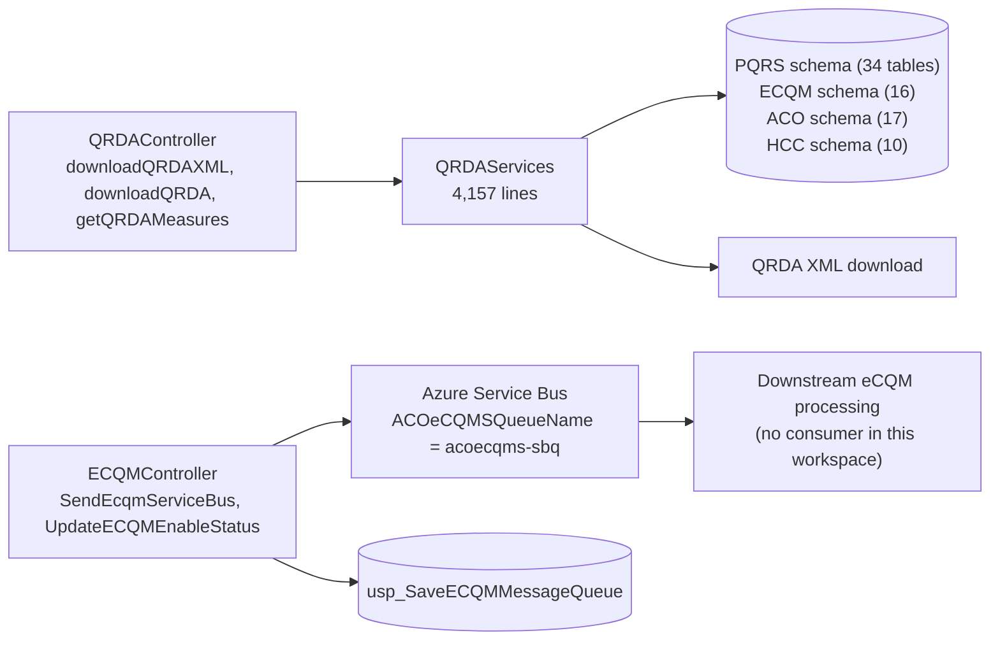
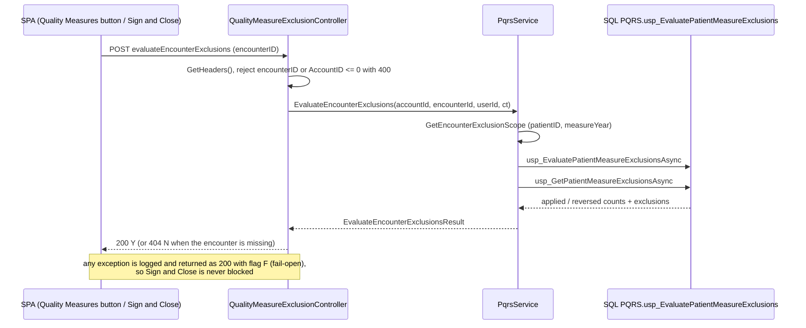
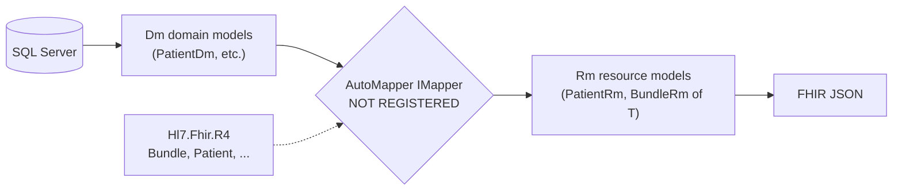

# Deep-Dive - Interoperability (FHIR R4 / CCDA / QRDA / eCQM / HIE)

**Date**: 2026-10-19
**Analyzed By**: ARCHITECT
**Status**: Draft (awaiting user confirmation)
**Scope**: the ONC-style interoperability surface: FHIR R4 resources, CCDA document generation, QRDA quality reporting, eCQM, quality-measure exclusions and HIE exchange
**Evidence base (HEADs analysed)**: `pacEHR_API` @ `0f611f65c`, `PacEHR` @ `401caa134`, `pacEHR_AI` @ `ef172ea` (only `pacEHR_API` is relevant to this module; the SPA and AI service were not re-walked for interop callers: carried, not re-verified)
**Supersedes**: deep-dive of 2026-09-30 (evidence base `pacEHR_API` @ `9f2a6ee19`)

> **Headline finding (still holds)**: the FHIR R4 surface (20 controllers, 77 routes, 7,525 lines of service code, 168 DTO files) still **cannot serve a request in this host**. `IMapper` is injected by all 20 FHIR controllers and is never registered in DI. Nothing in this area changed since 2026-09-30.

---

## Changes since 2026-09-30

`git diff 9f2a6ee19..HEAD` over the interop paths (`Fhir*`, `CCDA*`, `QRDA*`, `ECQM*`, `HIE*`, `JWTMiddleware.cs`) shows **no changes** to any FHIR, CCDA, QRDA, eCQM or HIE file. The only interop-adjacent deltas:

| Change | Evidence |
|---|---|
| NEW: automated quality-measure exclusions (PAC-1479 / AQE-13): `POST /evaluateEncounterExclusions`, fail-open | `PacEHR.API/Controllers/QualityMeasureExclusionController.cs:1-57` (commit `2260d0e9b`, 2026-10-13); `pacEHR.DomainServices/PqrsService.cs:359-395` |
| `PqrsController` now passes `encounterID` into `GetPatientBasicDetails` (3 call sites) | `PqrsController.cs:337`, `:802`, `:2113` (diff vs `9f2a6ee19`) |
| `Program.cs` adds unrelated registrations (Hexplora, AutomatedWorkflow, Paubox); FHIR registrations unchanged, line numbers shifted by +2 (now `Program.cs:377-394`) | `git diff 9f2a6ee19 HEAD -- PacEHR.API/Program.cs` |

**Corrections to the old document (the code was unchanged, the old text was imprecise):**

1. FHIR routes are **77**, not 78 (18 controllers x 4 + `FhirCapabilityStatementController` 3 + `FhirProvenanceController` 2). The old per-controller table already summed to 77.
2. HIE exposes **10 routes**, not 6 (`HIEController.cs:29-353`).
3. The `JWTMiddleware` `excludedPaths` check is an **exact-match** `List.Contains(path)` (`JWTMiddleware.cs:49,52`), so `"/fhir"` only matches the literal path `/fhir`, not `/fhir/Patient`. The body-decrypt skip therefore does not apply to real FHIR URLs (it is harmless in practice: GET has no body and POST bodies contain `{`, `JWTMiddleware.cs:60`).
4. A FHIR caller can pass the middleware if it sends an AES-encrypted token in `Authorization`; the plaintext need not be a JWT. If the decrypted text contains `Bearer` it goes to `CallgetAPIAccessTokenAsync`; otherwise it is treated as an SPA user token (`JWTMiddleware.cs:101-141`). So FHIR is reachable only by clients that know the AES key, not "always 401".
5. CCDA generated files are written to `App_Data/CCDA/download/` (`CCDAGenerator.cs:738-744`); `App_Data/CCDA/upload/` is used for HTML produced from uploaded CCDA files (`ReadXMLController.cs:1463`). The old diagram said `upload`.
6. CCDA generation entry points live in `ReadXMLController` (`GenerateCCDA`, `DownloadCCDAFile`, `DownloadXMLFile` ...), not a generic "Controller".

---

## Module Overview

| Sub-system | Location | Size (verified 2026-10-19) | Status |
|---|---|---|---|
| FHIR R4 | `PacEHR.API/Controllers/Fhir*.cs` (20 files) | 1,889 lines, **77 routes** | Non-functional (see below) |
| FHIR services | `pacEHR.DomainServices/FhirServices/` (22 files) | **7,525 lines** | Unreachable (services are registered, controllers cannot activate) |
| FHIR models | `pacEHR.Data.Dtos/**` Fhir files | 168 files | Unreachable |
| CCDA | `PacEHR.API/Library/CCDA/` (`CCDAGenerator.cs` 1,839 + `CCDAData.cs` 207) + `CCDAServices.cs` (160) + `ReadXMLController.cs` + `CCDA.dll` | 2,206 lines + binary | Active |
| QRDA | `QRDAController.cs` (352) + `QRDAServices.cs` (4,157) | 4,509 lines, 3 routes | Active |
| PQRS / quality measures | `PqrsController.cs` (2,390) + `PqrsService.cs` (408) + new `QualityMeasureExclusionController.cs` (57) | | Active |
| eCQM | `ECQMController.cs` (97) + `ECQMService.cs` (27) | 2 routes | Active (Service Bus dispatch) |
| HIE | `HIEController.cs` (379) + `HIEServices.cs` (365) | **10 routes** | Active |

---

## Component Breakdown

### FHIR R4 (20 controllers, re-verified)

Per-controller line and route counts are unchanged from the previous document (re-counted with `wc -l` and `grep -c "[Route("`): 16 resource controllers x 4 routes (`FhirEncounterController` 119 lines, `FhirPatientController` 115, `FhirPractitionerController` 110, `FhirObservationController` 108, `FhirOrganizationController` 107, `FhirLocationController` 106, `FhirAllergyIntelorenceController` 101 (sic), `FhirCareTeamController` 101, `FhirMedicationRequestController` 101, `FhirImmunizationController` 98, `FhirCarePlanController` 97, `FhirDiagnosticReportController` 97, `FhirDeviceController` 96, `FhirDocumentReferenceController` 96, `FhirGoalController` 93, `FhirMedicationController` 92, `FhirConditionController` 91, `FhirProcedureController` 89), plus `FhirCapabilityStatementController` (41 lines, 3 routes) and `FhirProvenanceController` (31 lines, 2 routes). Of the 4 routes per resource, only 3 carry an `[Http*]` attribute (list GET, `{_search}` POST, `{id}` GET); the fourth route attribute is on the same action set.

All 18 distinct `IFhir*Service` interfaces referenced by the controllers are registered (`Program.cs:377-394`): no unregistered service dependency. `IMapper` is the only unregistered dependency.

Covered resources: Patient, Encounter, Condition, Observation, MedicationRequest, Medication, AllergyIntolerance, Immunization, Procedure, DiagnosticReport, DocumentReference, CarePlan, CareTeam, Goal, Device, Location, Organization, Practitioner, Provenance, plus CapabilityStatement.

### CCDA

| File | Lines | Role |
|---|---|---|
| `PacEHR.API/Library/CCDA/CCDAGenerator.cs` | 1,839 | `GenerateCDA(CCDAType, patientId, userId, startDate, endDate)` (`:519`), wraps `CCDA.dll` |
| `PacEHR.API/Library/CCDA/CCDAData.cs` | 207 | Section data holders |
| `pacEHR.DomainServices/CCDAServices.cs` | 160 | Thin wrappers over `usp_*ForCCDA` procedures |
| `PacEHR.API/Controllers/ReadXMLController.cs` | n/a | 16 routes incl. `GenerateCCDA` (`:983`), `DownloadXMLFile` (`:1050`), `DownloadCCDAFile` (`:1119`), `getCCDAHtml` (`:1345`), `uploadCCDAFile` (`:1281`), `getCCDASectionsbyUser` (`:1519`) |
| `pacEHR.DomainServices/MatrixCareCcdaSyncParser.cs` | n/a | Inbound CCDA parsing for MatrixCare (Module 07) |
| `CCDA.dll` (repo root) | binary | Referenced from `PacEHR.API.csproj:57`, `PacEHR.Data.Dtos.csproj:23`, and the legacy `pacEHR/pacEHR.csproj:70` |

The stored procedures called from C# are `usp_getPatientForCCDA`, `usp_getAllergyForCCDA`, `usp_getMedicationsForCCDA`, `usp_getCareTeamForCCDA`, `usp_getVitalPatientForCCDA`, `usp_getEncDaignosisForCCDA` (sic), `usp_GetPatientDiagnosisForCCDA`, `usp_getEncounterListForCCDA`, `usp_getPatientCPTForCCDA`, `usp_getFacilityForCCDA`, `usp_getProviderAddressForCCDA`, `usp_getPatientAddressForCCDA`, plus `usp_save/verifyPatientForCCDA`, `usp_saveFacilityForCCDA`.

### Quality reporting

`QRDAController` exposes `downloadQRDAXML` (`:42`), `downloadQRDA` (`:124`), `getQRDAMeasures` (`:269`). `ECQMController` (inherits `PacEHRCommonController`) exposes `SendEcqmServiceBus` and `UpdateECQMEnableStatus`. New since the last dive: `QualityMeasureExclusionController.evaluateEncounterExclusions` (see Workflow 4).

---

## Key Workflows

### Workflow 1: A FHIR request: what actually happens



**The evidence chain** (each step re-verified 2026-10-19):

| # | Fact | Evidence |
|---|---|---|
| 1 | All 20 FHIR controllers inject `IMapper` | `grep -l IMapper PacEHR.API/Controllers/*.cs` returns 20 files, all `Fhir*`; e.g. `FhirPatientController.cs:19-27` |
| 2 | They map domain to resource models with it | `FhirPatientController.cs:80` `_mapper.Map<Bundle, BundleRm<PatientRm>>(bundle)`, `:110` |
| 3 | The AutoMapper package is referenced | `PacEHR.API.csproj:16` (`AutoMapper 14.0.0`) |
| 4 | `AddAutoMapper` / `MapperConfiguration` is never called in the active solution | `grep -rn "AddAutoMapper\|MapperConfiguration" --include='*.cs'` returns only `pacEHR/App_Start/UnityConfig.cs:49` (legacy project) |
| 5 | `Program.cs` records the omission | `PacEHR.API/Program.cs:116` `//TODO - AutoMapper Here (if applicable)` |
| 6 | The FHIR services are registered | `Program.cs:377-394` |
| 7 | `FhirAuthenticationAttribute` exists in the new host but is applied to nothing | defined at `PacEHR.API/Library/Authentication/FhirAuthenticationAttribute.cs:23`; the only `[FhirAuthentication(...)]` usages are in legacy `pacEHR/Controllers/` |
| 8 | No authentication scheme is registered | `Program.cs` has `UseAuthentication()` (`:510`) but no `AddAuthentication` |

**Open question carried**: whether `GET /fhir/metadata` has ever been run against a deployed environment is not answerable from code.

### Workflow 2: CCDA document generation (active)



`MatrixCareCcdaSyncParser.cs` handles the inbound direction; `uploadCCDAFile` / `getCCDAHtml` convert uploaded CCDA to HTML under `App_Data/CCDA/upload/`.

### Workflow 3: QRDA / eCQM quality reporting (active)



`SendEcqmServiceBus` sends the queue message **first** (`ECQMController.cs:45`) and writes the DB queue row afterwards (`:49`): the two are not atomic, and `SendACOeCQMSMessageAsync` catches send failures, prints them with `Console.WriteLine` and returns 0 (`ServiceBusQueueHelper.cs:113-127`), a value the controller never checks (Module 06).

### Workflow 4: Automated quality-measure exclusions (NEW, PAC-1479 / AQE-13)



The caller's tenant comes from headers (`GetHeaders()`, `QualityMeasureExclusionController.cs:29`), not the body: the correct house pattern.

---

## Data Models

### FHIR model layering



The `Dm` to `Rm` split is a reasonable design; the break is exactly at the mapper. (`Hl7.Fhir.R4` version `5.11.4` from the old document: carried, not re-verified.)

### Schemas backing quality reporting and exchange (re-counted from `PacEHR.Database` `CREATE TABLE`)

| Schema | Tables | Used by |
|---|---|---|
| `PQRS` | 34 | QRDA measures, measure exclusions |
| `ACO` | 17 | eCQM / ACO reporting |
| `ECQM` | 16 | eCQM |
| `HCC` | 10 | Risk adjustment |
| `Qulatitydata` (misspelled) | 2 | Quality data |
| `HIE` | 7 | Health information exchange |

Counts are unchanged from 2026-09-30.

---

## Pattern Catalog

### Error handling

**DON'T (found): rethrow-only catch blocks, `FhirPatientController.cs:88-95`**

```csharp
catch (AutoMapperMappingException automapEx)
{
    throw automapEx;      // resets the stack trace
}
catch (Exception ex)
{
    throw;                // ex unused, block does nothing
}
```

**DO**: handle or omit.

```csharp
catch (AutoMapperMappingException ex)
{
    _logger.LogError(ex, "FHIR mapping failed for {Resource}", nameof(PatientRm));
    throw;
}
```

**DO (found, new): fail-open with a logged exception, `QualityMeasureExclusionController.cs:51-56`** returns `BuildDictionaryResult(200, "F", ...)` after `ApplicationInsightsLogger.LogError(_telemetry, ex)` and documents why (never block Sign and Close).

### Logging

**DO**: `ApplicationInsightsLogger.LogInfo/LogError(_telemetry, ...)` as in `ECQMController.cs:47,64` and `HIEController.cs:36-52`.
**DON'T**: FHIR controllers have no telemetry at all (`FhirPatientController.cs` has no logger or `TelemetryClient`), so a failed FHIR call leaves no trace.

### DB access

**DO**: controller -> service -> generated stored-procedure interface, e.g. `ECQMService.cs:16-24` (`_proceduresInterface.usp_SaveECQMMessageQueue(...)`).
**DON'T**: the CCDA procedures swallow absent data into empty objects, `CCDAServices.cs:25-26` (`result == null ? new usp_getPatientAddressForCCDAResult() : result.First()`), which hides a missing record as a blank CCDA section (and `result.First()` throws on an empty non-null list).

### API response

**DO (FHIR)**: FHIR controllers correctly opt out of the dictionary envelope: `FhirPatientController.cs:15-17` (`ControllerBase`, `[ApiController]` commented out) and return `BundleRm<PatientRm>` directly (`:63`). FHIR mandates resource-shaped URLs and real status codes.
**DO (rest)**: quality/HIE/eCQM controllers inherit `PacEHRCommonController` and return `BuildDictionaryResult(...)`, `ECQMController.cs:15`.

### Tenant scoping

**DON'T (found): no tenant scoping on FHIR resource reads, `FhirPatientController.cs:105-112`**

```csharp
[HttpGet]
[Route("fhir/Patient/{id}")]
public async Task<PatientRm> GetPatient(int id)
{
    var dm = await _patientservices.GetPatient(id, new Uri(Request.GetDisplayUrl()));
    var rm = _mapper.Map<PatientDm, PatientRm>(dm);
```

**DO**: read the account from `HttpContext.Items["accountId"]` (set at `JWTMiddleware.cs:142`) and pass it to the service, as the non-FHIR controllers do via `GetHeaders()` (`QualityMeasureExclusionController.cs:29`).

If AutoMapper is registered as-is, `GET /fhir/Patient/{id}` becomes a cross-tenant direct object reference. **Fix both in the same change.**

### Dead code

**DON'T (found): claims block that is never used, `FhirPatientController.cs:69-75`**: reads `userName` into a local that is never referenced; `User` is never populated because no auth scheme is registered. It reads as per-user scoping that does not exist.

### Naming and hand-rolled shaping

- `SetToNull(PatientRm)` (`FhirPatientController.cs:29-58`): one class serves both Patient and Provenance via a `ResourceType` discriminator with per-type field blanking. Declarative serialisation attributes would be cleaner.
- Typos baked into names: `FhirAllergyIntelorenceController`, `usp_getEncDaignosisForCCDA`, `Qulatitydata` schema.

### Binary dependency

`CCDA.dll` is committed at the repo root (`PacEHR.API.csproj:57`): no source, version metadata or NuGet package; unauditable for a component that generates clinical documents for external exchange.

### Anonymous HIE endpoints

`HIEController.cs:28-30` `[AllowAnonymous] getHIEPatientData` (POST, takes an `HIE` body, calls `_hieService.getHIEPatientData`) and `HIEController.cs:128-130` `[AllowAnonymous] triggerDocumentQueue` (pushes `SendMessageAsyncForHIE` messages to the Kno2 document queue). The authenticated original of `triggerDocumentQueue` is commented out at `:89-91`. `triggerHIEPatientData` (`:59-60`) is authenticated. The controller comment at `HIEController.cs:55-58` states the queue consumer is `HIEPatientDataFunction` in a separate repo (`PacEHR_AppService/Kno2HIEIntegrationFunction`): **carried, not re-verified** (repo not in the workspace). The anonymous status could be intentional for an Azure Function caller; no shared secret or signature check appears in either action.

---

## Testing Patterns

Unit tests live in `PacEHR.Tests.UnitTests`; `PacEHR.Tests.Integration` contains only `GlobalUsings.cs` and the csproj.

| Target | Tests (attribute count, re-counted) |
|---|---|
| `Controllers/HIEControllerTests.cs` | 43 |
| `DomainServices/CCDAServicesTest.cs` | 28 |
| `Controllers/QRDAControllerTests.cs` | 21 |
| `Controllers/QualityMeasureExclusionControllerTests.cs` (new) | present (128 lines added) |
| `DomainServices/QualityMeasureExclusionServiceTest.cs` (new) | present (123 lines added) |
| **FHIR: 20 controllers, 22 services** | **0** (only `FhirTestPatient.cs` model files match `*fhir*`) |
| `ECQMController` / `ECQMService` | 0 |
| `QRDAServices` (4,157 lines) | no dedicated service test file found |

The new exclusion feature shipped with controller and service tests, which is the pattern to extend. An integration test that builds every controller from the real DI container would have caught the `IMapper` gap.

---

## Entry Points

| Entry | Route(s) | Status |
|---|---|---|
| FHIR resources | `GET /fhir/{Resource}`, `GET /fhir/{Resource}/{id}`, `POST /fhir/{Resource}/{_search}` x 18 resources | Non-functional |
| FHIR metadata / provenance | `/fhir/metadata` (3 routes), `/fhir/Provenance/{id}` (2 routes) | Non-functional |
| QRDA | `POST /downloadQRDAXML`, `/downloadQRDA`, `/getQRDAMeasures` | Active |
| eCQM | `POST /SendEcqmServiceBus`, `/UpdateECQMEnableStatus` | Active |
| Quality exclusions (new) | `POST /evaluateEncounterExclusions` | Active |
| HIE | `/getHIEPatientData` (anon), `/triggerHIEPatientData`, `/triggerDocumentQueue` (anon), `/getHIEPatientDetailsList`, `/addUpdateHIEPatientlinking`, `/addMultiHIEPatientlinking`, `/getHIEModelCount`, `/getHIEDocumentDetails`, `/getRecentActivityNotificationCount`, `/updateRecentActivityLastViewed` | Active |
| CCDA | `ReadXMLController`: `GenerateCCDA`, `DownloadXMLFile`, `DownloadCCDAFile`, `DownloadCCDAFilesByAccount`, `DownloadPatientsCCDAFiles`, `uploadCCDAFile`, `getCCDAHtml`, `GetCCDAHtmlFromFile`, `getCCDASectionsbyUser`, `updateCCDAUserSections`, `ReadCCDADataForGaps` | Active |
| XML download | `/downloadxmlfile`: one of the two paths where `JWTMiddleware` honours a decrypted `Bearer` token (`JWTMiddleware.cs:111`) | Active |

---

## Open Questions for the Team

1. Has the FHIR surface ever served a request from `PacEHR.API` in any environment? Confirm with `GET /fhir/metadata` on dev/QA/prod.
2. Was FHIR served by the legacy `pacEHR/` project? It applies `[FhirAuthentication]` and has its own mapper config (`UnityConfig.cs:49`).
3. Is ONC certification dependent on this surface?
4. Why is `triggerDocumentQueue` `[AllowAnonymous]` when the commented original was not, and is the caller the Kno2 Azure Function?
5. Where does `CCDA.dll` come from (source, licence, patch path)?
6. Is `Qulatitydata` (2 tables) live?

---

## Recommendations

| # | Recommendation | Rationale | Priority |
|---|---|---|---|
| 1 | Decide FHIR's fate explicitly: restore or remove | About 9,400 lines of unreachable code that read as a working certification surface | Immediate |
| 2 | If restoring: register AutoMapper and add tenant scoping in the same change | Registering the mapper alone turns a dead endpoint into a cross-tenant IDOR | Immediate |
| 3 | If restoring: apply `FhirAuthenticationAttribute`, and replace the AES-decrypt-of-Authorization in `JWTMiddleware.cs:101` with real bearer validation | Both gates are absent or non-standard | Immediate |
| 4 | Add one integration test that resolves every controller from the real DI container | Catches this class of defect at build time | High |
| 5 | Review the two `[AllowAnonymous]` HIE actions (add shared secret or signature) | One returns patient data, one enqueues document queries | High |
| 6 | Make `SendEcqmServiceBus` write the DB row before (or transactionally with) the queue send, and surface send failures | Non-atomic, failures swallowed (Module 06) | Medium |
| 7 | Source, version and document `CCDA.dll`, or replace it | Unauditable binary generating clinical documents | Medium |
| 8 | Replace `throw automapEx;` with `throw;`, delete no-op catches and the dead claims blocks | Stack traces discarded; dead code implies auth that does not exist | Low |
| 9 | Split `PatientRm` into `PatientRm` + `ProvenanceRm`; split `QRDAServices.cs` by measure family | Removes discriminator hack; 4,157-line file | Low |
| 10 | Add tests for ECQM and QRDA services | Zero or no dedicated tests | Medium |

---

**Next**: Module 06: HL7 v2 and ADT ingestion.
