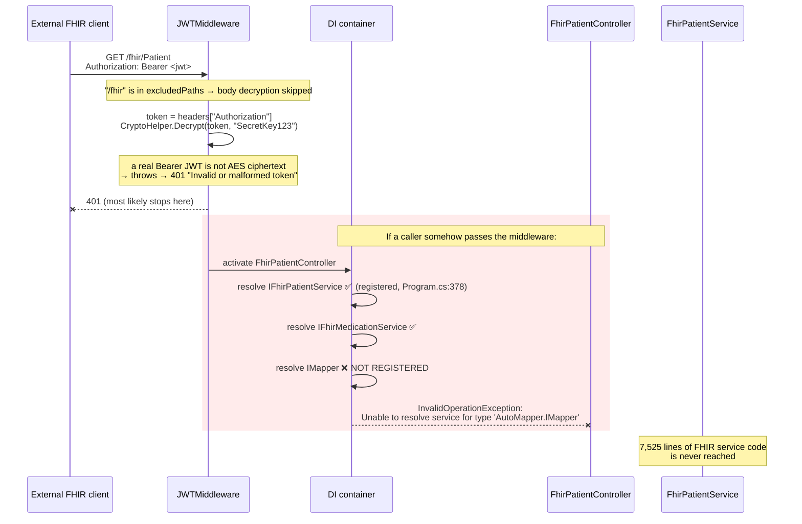
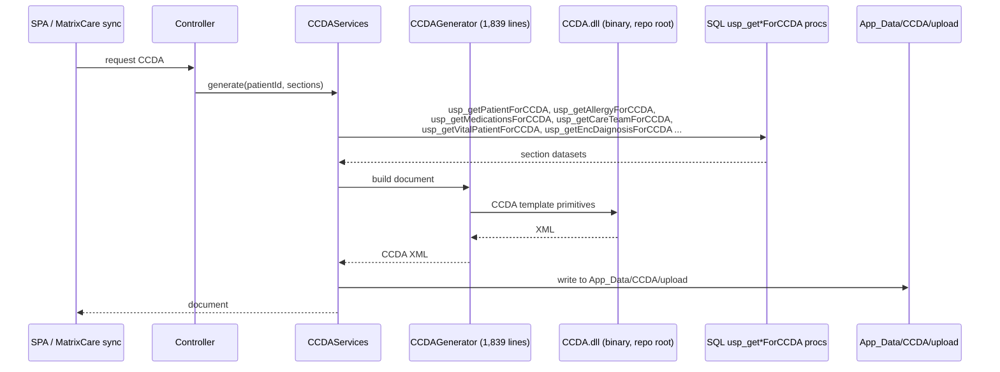
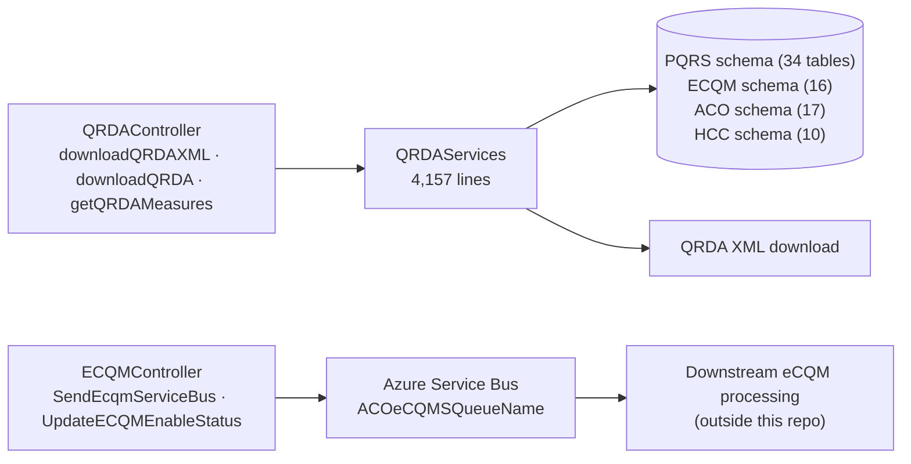
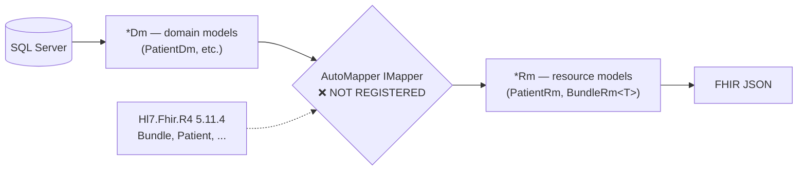

# Deep-Dive - Interoperability (FHIR R4 / CCDA / QRDA / eCQM)

**Date**: 2026-09-30
**Analyzed By**: ARCHITECT
**Status**: Draft (awaiting user confirmation)
**Scope**: the ONC-style interoperability surface — FHIR R4 resources, CCDA document generation, QRDA quality reporting, eCQM, and HIE exchange
**Evidence base**: `pacEHR_API` @ `9f2a6ee19`

> **Headline finding**: the FHIR R4 surface — 20 controllers, 78 routes, 7,525 lines of service code and 168 DTO models — **cannot serve a single request**. `IMapper` is injected by every FHIR controller and is never registered in DI. This is stated below with the full evidence chain, and it resolves the open question raised in Module 01.

---

## Module Overview

| Sub-system | Location | Size | Status |
|---|---|---|---|
| FHIR R4 | `PacEHR.API/Controllers/Fhir*.cs` (20 files) | 1,889 lines, **78 routes** | 🔴 Non-functional (see below) |
| FHIR services | `pacEHR.DomainServices/FhirServices/` (22 files) | **7,525 lines** | Unreachable |
| FHIR models | `pacEHR.Data.Dtos/**/Fhir*` | 168 files | Unreachable |
| CCDA | `PacEHR.API/Library/CCDA/` + `CCDAServices.cs` + `CCDA.dll` | 2,206 lines + binary | Active |
| QRDA | `QRDAController.cs` + `QRDAServices.cs` | 4,509 lines | Active |
| eCQM | `ECQMController.cs` | 97 lines, 2 routes | Active (Service Bus dispatch) |
| HIE | `HIEController.cs` + `HIEServices.cs` | 6 routes | Active |

---

## Component Breakdown

### FHIR R4 (20 controllers)

| Controller | Lines | Routes |
|---|---|---|
| `FhirEncounterController` | 119 | 4 |
| `FhirPatientController` | 115 | 4 |
| `FhirPractitionerController` | 110 | 4 |
| `FhirObservationController` | 108 | 4 |
| `FhirOrganizationController` | 107 | 4 |
| `FhirLocationController` | 106 | 4 |
| `FhirAllergyIntelorenceController` *(sic)* | 101 | 4 |
| `FhirCareTeamController`, `FhirMedicationRequestController` | 101 | 4 each |
| `FhirImmunizationController` | 98 | 4 |
| `FhirCarePlanController`, `FhirDiagnosticReportController` | 97 | 4 each |
| `FhirDeviceController`, `FhirDocumentReferenceController` | 96 | 4 each |
| `FhirGoalController` | 93 | 4 |
| `FhirMedicationController` | 92 | 4 |
| `FhirConditionController` | 91 | 4 |
| `FhirProcedureController` | 89 | 4 |
| `FhirCapabilityStatementController` | 41 | 3 |
| `FhirProvenanceController` | 31 | 2 |

Covered resources map to the USCDI/ONC certification set: Patient, Encounter, Condition, Observation, MedicationRequest, Medication, AllergyIntolerance, Immunization, Procedure, DiagnosticReport, DocumentReference, CarePlan, CareTeam, Goal, Device, Location, Organization, Practitioner, Provenance, plus CapabilityStatement.

---

## Key Workflows

### Workflow 1: 🔴 A FHIR request — what actually happens



**The evidence chain** (each step verified in this working copy):

| # | Fact | Evidence |
|---|---|---|
| 1 | All 20 FHIR controllers inject `IMapper` | `grep -rln "IMapper" PacEHR.API/Controllers` → 20 files, all `Fhir*` |
| 2 | They use it to map domain → resource models | `_mapper.Map<Bundle, BundleRm<PatientRm>>(bundle)` |
| 3 | The AutoMapper package **is** referenced | `PacEHR.API.csproj:15` — `AutoMapper 14.0.0` |
| 4 | `AddAutoMapper` is **never called** | `grep -rn "AddAutoMapper\|MapperConfiguration" PacEHR.API` → **no matches** |
| 5 | `Program.cs` records the omission | line 116: `//TODO - AutoMapper Here (if applicable)` |
| 6 | The only mapping `Profile` is in the orphan project | `pacEHR/App_Start/MappingProfile.cs` — not in `pacEHR.sln`, no `<TargetFramework>` |
| 7 | The services themselves **are** registered | e.g. `Program.cs:378` — `AddScoped<IFhirPatientService, FhirPatientService>()` |

Point 7 is what makes this subtle: the FHIR *services* are wired correctly, so a reader scanning `Program.cs` sees FHIR being registered and assumes it works. Only the mapper is missing — and it is missing for every one of the 20 controllers, including `FhirCapabilityStatementController`, so even `GET /fhir/metadata` fails.

**This supersedes the open question in Module 01.** The recommended test there (`GET /fhir/metadata` against a deployed environment) should now be expected to return 401 from the middleware, or 500 from controller activation if the auth layer is bypassed. Running it remains worthwhile as confirmation.

### Workflow 2: CCDA document generation (active)



CCDA is driven by a family of dedicated stored procedures (`usp_*ForCCDA`), one per document section — consistent with the database-centric architecture. `MatrixCareCcdaSyncParser.cs` handles the inbound direction.

### Workflow 3: QRDA / eCQM quality reporting (active)



`QRDAServices.cs` at 4,157 lines is the second-largest single service file in the solution.

---

## Data Models

### FHIR model layering



The `Dm` → `Rm` split is a reasonable design — domain models stay free of FHIR serialisation concerns, and `Hl7.Fhir.R4` types are used as the intermediate. The break is exactly at the mapper.

### Schemas backing quality reporting

| Schema | Tables | Used by |
|---|---|---|
| `PQRS` | 34 | QRDA measures |
| `ACO` | 17 | eCQM / ACO reporting |
| `ECQM` | 16 | eCQM |
| `HCC` | 10 | Risk adjustment (`vw_hccScoring`) |
| `Qulatitydata` *(misspelled)* | 2 | Quality data |
| `HIE` | 7 | Health information exchange |

---

## Pattern Catalog

### Pattern: ✅ FHIR controllers correctly opt out of the house conventions

```csharp
// DO — FHIR controllers do NOT inherit PacEHRCommonController
//[Route("api/[controller]")]
//[ApiController]
public class FhirPatientController : ControllerBase
{
    [Route("fhir/Patient")]
    [HttpGet]
    public async Task<BundleRm<PatientRm>> Get([FromQuery] PatientBundleRequest request)
```

This is the right call and worth recognising. FHIR mandates resource-shaped URLs, real HTTP verbs and real status codes — all of which the dictionary envelope (Module 02) would destroy. Returning `BundleRm<PatientRm>` directly rather than `IDictionary<string, object>` keeps the contract spec-compliant. It is the only part of the API that is REST.

### Pattern: 🔴 dead claims-reading code

**Where**: `FhirPatientController.cs:69-75`, repeated across the FHIR controllers

```csharp
// ACTUAL — reads a claim into a local that is never used
var identity = User.Identity as ClaimsIdentity;
if (identity != null)
{
    IEnumerable<Claim> claims = identity.Claims;
    var name = claims.Where(p => p.Type == "userName").FirstOrDefault()?.Value;   // never referenced
}
```

Since `FhirAuthenticationAttribute` is not applied (Module 01) and no authentication scheme is registered, `User` is never populated — `identity` is always null. The block is dead twice over: unpopulated input, unused output. It reads as if per-user scoping exists when none does.

### Pattern: 🔴 no tenant scoping on FHIR resource reads

```csharp
// ACTUAL — a bare integer id, no accountId anywhere
[HttpGet]
[Route("fhir/Patient/{id}")]
public async Task<PatientRm> GetPatient(int id)
{
    var dm = await _patientservices.GetPatient(id, new Uri(Request.GetDisplayUrl()));
    var rm = _mapper.Map<PatientDm, PatientRm>(dm);
    return rm;
}
```

```csharp
// DO
[Route("fhir/Patient/{id}")]
public async Task<PatientRm> GetPatient(int id)
{
    var accountId = (int)HttpContext.Items["accountId"]!;
    var dm = await _patientservices.GetPatient(id, accountId, new Uri(Request.GetDisplayUrl()));
```

No tenant identifier is passed into the service. **If** the FHIR surface were activated as written, `GET /fhir/Patient/{id}` would be a direct object reference across every tenant in the database. The mapper defect is currently masking this. Any work to "fix FHIR" by registering AutoMapper would expose it — **this must be addressed in the same change**.

### Pattern: 🔴 rethrow-only catch blocks

```csharp
// ACTUAL — repeated in every FHIR controller
catch (AutoMapperMappingException automapEx)
{
    throw automapEx;      // resets the stack trace
}
catch (Exception ex)
{
    throw;                // ex is unused; the block does nothing
}
```

```csharp
// DON'T
catch (AutoMapperMappingException automapEx) { throw automapEx; }   // loses the original stack

// DO — either handle it or omit the catch entirely
catch (AutoMapperMappingException ex)
{
    _logger.LogError(ex, "FHIR mapping failed for {Resource}", nameof(PatientRm));
    throw;
}
```

`throw automapEx;` rethrows the *variable*, resetting the stack trace to this line and discarding where the mapping actually failed. The generic `catch (Exception ex) { throw; }` is a no-op that only adds noise. Notably, the presence of a dedicated `AutoMapperMappingException` handler suggests mapping failures were once being observed — which is hard to reconcile with the mapper never having been registered. **Worth asking whether this code ran under a different host** (the legacy `pacEHR/` project *does* register AutoMapper 9.0 via `App_Start/MappingProfile.cs`).

### Pattern: 🟡 null-stripping by hand before serialisation

```csharp
// ACTUAL
private static void SetToNull(PatientRm rm)
{
    if (rm.ResourceType == "Patient")
    {
        if (rm.Telecom != null && rm.Telecom.Count == 0) rm.Telecom = null;
        if (rm.Communication != null && rm.Communication.Count == 0) rm.Communication = null;
        rm.Agent = null; rm.Recorded = null; rm.Target = null;
    }
    if (rm.ResourceType == "Provenance")
    {
        rm.Name = null; rm.Meta = null; rm.Id = null; rm.Identifier = null;
        rm.Address = null; rm.Telecom = null; rm.Gender = null; rm.Active = null;
        rm.Communication = null; rm.Extension = null; rm.ManagingOrganization = null;
    }
}
```

FHIR forbids empty arrays, so they must become absent. But `PatientRm` is clearly serving double duty as both Patient and Provenance — a single class with a `ResourceType` discriminator and per-type field blanking. Separate `PatientRm` and `ProvenanceRm` types with serialisation attributes would make the omissions declarative instead of imperative.

### Pattern: 🟡 a binary dependency at the repository root

`CCDA.dll` is referenced by three projects via `<HintPath>..\CCDA.dll</HintPath>` and committed as a binary. There is no NuGet package, no source, no version metadata and no licence information in the repo. It cannot be patched, audited or rebuilt. For a component that generates clinical documents for external exchange, that is a supply-chain and maintenance risk.

### Pattern: 🟡 `[AllowAnonymous]` on HIE endpoints

```csharp
[AllowAnonymous]
[Route("getHIEPatientData")]      // returns patient data
...
[AllowAnonymous]
[Route("triggerDocumentQueue")]   // note: a non-anonymous version is commented out directly above
```

`HIEController.cs:89-90` shows the previous, authenticated declaration of `triggerDocumentQueue` commented out and replaced at line 128 with an `[AllowAnonymous]` version. That is a deliberate change worth a reason. `getHIEPatientData` being anonymous deserves the same scrutiny.

### Test patterns (interop)

| Target | Tests |
|---|---|
| `HIEControllerTests` | 43 |
| `CCDAServicesTest` | 28 |
| `QRDAControllerTests` | 21 |
| **FHIR — all 20 controllers, 22 services, 7,525 lines** | **0** |
| `ECQMController` | 0 |

No test file in the solution matches `*fhir*`. Had even one integration test attempted to construct a FHIR controller, the missing `IMapper` registration would have surfaced immediately — a concrete illustration of what the empty `PacEHR.Tests.Integration` project costs.

---

## Entry Points

| Entry | Route(s) | Status |
|---|---|---|
| FHIR resources | `GET /fhir/{Resource}`, `GET /fhir/{Resource}/{id}`, `POST /fhir/{Resource}/{_search}` × 20 resources | 🔴 Non-functional |
| FHIR metadata | `/fhir/metadata` (CapabilityStatement) | 🔴 Non-functional |
| QRDA | `POST /downloadQRDAXML`, `/downloadQRDA`, `/getQRDAMeasures` | Active |
| eCQM | `POST /SendEcqmServiceBus`, `/UpdateECQMEnableStatus` | Active |
| HIE | `/getHIEPatientData` (anon), `/triggerHIEPatientData`, `/triggerDocumentQueue` (anon), `/getHIEPatientDetailsList`, `/addUpdateHIEPatientlinking`, `/addMultiHIEPatientlinking` | Active |
| CCDA | via MatrixCare sync and document endpoints | Active |
| XML download | `/downloadxmlfile` — one of only two paths where `JWTMiddleware` accepts a Bearer token | Active |

---

## Open Questions for the Team

1. **Has the FHIR surface ever served a request in any environment?** The evidence says no, in this host. Confirm with `GET /fhir/metadata` on dev/QA/prod.
2. **Was FHIR previously served by the legacy `pacEHR/` project?** That project registers AutoMapper 9.0 and applies `FhirAuthenticationAttribute` to its FHIR controllers — i.e. it is a *complete* FHIR host. If FHIR was certified against that deployment, the migration to `PacEHR.API` dropped two required registrations.
3. **Is ONC certification dependent on this surface?** If so, this is a compliance exposure, not just dead code.
4. **Why is `triggerDocumentQueue` now `[AllowAnonymous]`** when the commented-out original was not?
5. **Where does `CCDA.dll` come from?** Source, licence, vendor, patch path.
6. **Is `Qulatitydata` (2 tables) live**, or an abandoned misspelling of a schema that now exists elsewhere?

---

## Recommendations

| # | Recommendation | Rationale | Priority |
|---|---|---|---|
| 1 | Decide FHIR's fate explicitly: **restore or remove** | ~9,600 lines of unreachable code that reads as a working certification surface | 🔴 Immediate |
| 2 | If restoring: register AutoMapper **and** add tenant scoping in the same change | Activating the mapper alone turns a dead endpoint into a cross-tenant IDOR | 🔴 Immediate |
| 3 | If restoring: apply `FhirAuthenticationAttribute` and fix the middleware's `Authorization`-header AES decrypt | Both gates are currently absent (Module 01) | 🔴 Immediate |
| 4 | Add one integration test that constructs every controller from the real DI container | Would have caught this at build time; catches the next one too | 🔴 High |
| 5 | Review the two `[AllowAnonymous]` HIE endpoints | One returns patient data | 🟡 High |
| 6 | Replace `throw automapEx;` with `throw;` and delete the no-op catches | Stack traces are being discarded | 🟢 Low |
| 7 | Split `PatientRm` into `PatientRm` + `ProvenanceRm` | Removes the `SetToNull` discriminator hack | 🟢 Low |
| 8 | Source, version and document `CCDA.dll`, or replace it | Unauditable binary generating clinical documents | 🟡 Medium |
| 9 | Delete the dead claims-reading blocks | They imply authorisation that does not exist | 🟢 Low |
| 10 | Split `QRDAServices.cs` (4,157 lines) by measure family | Second-largest service file in the solution | 🟢 Low |

---

**Next**: Module 06 — HL7 v2 & ADT ingestion.
