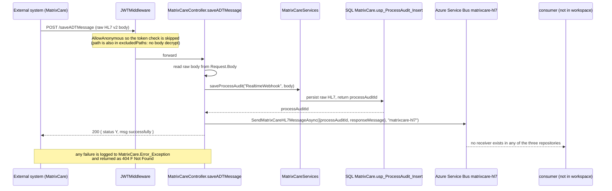
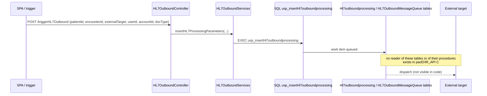
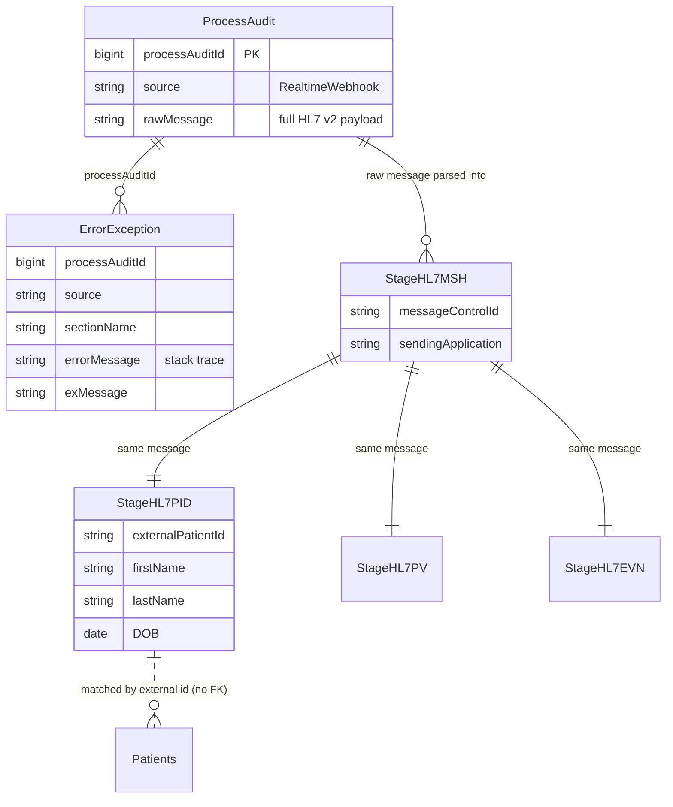

# Deep-Dive - HL7 v2, ADT Ingestion & Messaging Transport

**Date**: 2026-10-19
**Analyzed By**: ARCHITECT
**Status**: Draft (awaiting user confirmation)
**Scope**: inbound HL7 v2 / ADT ingestion, the hand-rolled HL7 parser, outbound HL7 generation, and the Azure Service Bus transport that carries it
**Evidence base (HEADs analysed)**: `pacEHR_API` @ `0f611f65c`, `PacEHR` @ `401caa134`, `pacEHR_AI` @ `ef172ea` (this module is `pacEHR_API` only; `PacEHR` and `pacEHR_AI` were searched for Service Bus receivers and outbound queue use, none found)
**Supersedes**: deep-dive of 2026-09-30 (evidence base `pacEHR_API` @ `9f2a6ee19`)

> **Headline finding (qualified)**: `ServiceBusQueueHelper` has **22 send methods** (the old text said 18; the file is unchanged) and **zero Service Bus consumers in any of the three repositories**. Every asynchronous flow dispatches to a queue that nothing in this workspace reads. One code comment names an out-of-workspace consumer for the Kno2 HIE queues, so "consumers live elsewhere" is now the better-supported reading for at least that flow; it is still unverified for the rest.

---

## Changes since 2026-09-30

`git diff 9f2a6ee19..HEAD` shows **no changes** to `HL7Services/`, `HL7OutboundServices.cs`, `HL7OutboundController.cs`, `ServiceBusQueueHelper.cs`, `MatrixCareController.cs` or `MatrixCare*Services`. Everything below that differs from the old document is a correction of the old text, not a code change.

| # | Correction / new finding | Evidence |
|---|---|---|
| 1 | **Authentication claim narrowed.** Only `saveADTMessage` is `[AllowAnonymous]`. `sigmaCareADTEndPoint` and `sigmaCareCCDEndpoint` carry **no** `[AllowAnonymous]`; being in `JWTMiddleware.excludedPaths` only skips body decryption, so they still require an AES-encrypted `token` header. The old text said all three were unauthenticated. | `MatrixCareController.cs:776,913` (no attribute), `:3255-3258` (anonymous); `JWTMiddleware.cs:49,81,91-107` |
| 2 | NEW anonymous endpoint in the same controller: `MatrixCarePatientSyncLoad` | `MatrixCareController.cs:3178-3180` |
| 3 | Send-method count is **22**, not 18 | `grep -cE "public (async )?Task(<[^>]*>)? Send" ServiceBusQueueHelper.cs` = 22 (also 22 at `9f2a6ee19`) |
| 4 | The old "misspelled `SericeBusConnection` would silently break every queue" finding is **dropped**: the section is bound to `ServiceBusConnString` (`Program.cs:173-174`) but nothing injects that type; every sender reads `IConfiguration["ConnectionStrings:*"]` directly. The real appsettings section is spelled `ServiceBusConnection` (`appsettings.json:123`), so the binding is simply empty and unused | `grep -rn ServiceBusConnString` shows only `ConfigSettings.cs:96` and `Program.cs:173-174` |
| 5 | NEW: **Service Bus shared-access keys are committed** in six appsettings files | see Pattern Catalog, Security |
| 6 | NEW: `Console.WriteLine` error swallowing in 30 places in the transport; many send methods never signal failure to callers | `ServiceBusQueueHelper.cs:54,69,83,...` |
| 7 | `PacEHR.Functions.Process` has **4 active** timer functions plus one commented out (`DailyForTFAFunction.cs:22-23`), not "five" | grep `[Function(` |
| 8 | HL7 parser folder is **16 files** (not 22); 2,350 lines total is confirmed | `ls HL7Services` |
| 9 | `Hl7Helper.GetHL7Format*` has **no live caller** in `pacEHR_API` (only commented references); only `hl7SegmentFormat`'s sibling `new Hl7Helper()` instantiations remain | `MatrixCareController.cs:1098` instantiates it; no `GetHL7Format*` call outside `Hl7Helper.cs` |
| 10 | A consumer outside the workspace is named in code | `HIEController.cs:55-58` (`HIEPatientDataFunction`, `PacEHR_AppService/Kno2HIEIntegrationFunction`, queue `kno2-patient-sbq`) |

---

## Module Overview

| Component | Path | Size (verified) |
|---|---|---|
| HL7 parser library | `pacEHR.DomainServices/HL7Services/` (16 files) | **2,350 lines** |
| `Message.cs` (parser core) | `.../HL7Services/Message.cs` | 964 lines |
| `Hl7Helper` (format builders) | `.../HL7Services/Hl7Helper.cs` | 268 lines |
| Outbound service | `pacEHR.DomainServices/HL7OutboundServices.cs` | 127 lines |
| Outbound controller | `PacEHR.API/Controllers/HL7OutboundController.cs` | 50 lines, 1 route |
| Inbound endpoints | `PacEHR.API/Controllers/MatrixCareController.cs` | 3,329 lines, 17 `[Route]` attributes (3 inbound HL7/CCD feeds + initial load + sync endpoints) |
| Transport | `pacEHR.DomainServices/ServiceBusQueueHelper.cs` | 509 lines, **22 send methods** |
| HL7 schema | `PacEHR.Database/Tables/` | 39 HL7-prefixed table files (of 1,131 table files) |

---

## Component Breakdown

### The HL7 v2 object model (hand-rolled, 2,350 lines)

| File | Lines | Role |
|---|---|---|
| `Message.cs` | 964 | `ParseMessage()` (`:61`), `GetValue("MSH.10")`, segment access |
| `Hl7Helper.cs` | 268 | `hl7SegmentFormat` (`:15`), `GetHL7Format1` (`:52`), `GetHL7Format2` (`:119`), `GetHL7Format` (`:185`) |
| `Encoding.cs` | 181 | Delimiters and escape sequences |
| `Field.cs` | 154 | Field model |
| `Segment.cs` | 126 | Segment model |
| `MessageHelper.cs` | 117 | Split/utility |
| `JsonParserHelper.cs` | 109 | JSON to HL7 bridging |
| `HL7Model.cs` / `DynamicFormData.cs` / `JsonHL7Fields.cs` | 68 / 61 / 45 | Input shapes |
| `Component.cs`, `ComponentCollection.cs`, `FieldCollection.cs`, `SubComponent.cs`, `MessageElement.cs` | 67 / 63 / 59 / 15 / 25 | Composite model |
| `HL7Exception.cs` | 28 | Error type |

A complete Message, Segment, Field, Component, SubComponent object model written in-house.

**Live callers of the parser** (not in the old document):

| Caller | Evidence |
|---|---|
| `sigmaCareADTEndPoint`: splits the body on `MSH`, parses each message, reads `MSH.10` and `PID.2`, calls `saveSigmaMessages` | `MatrixCareController.cs:796-812` |
| `ADTHL7ExportInitialLoad`: parses each message, walks `message.Segments()`, and uses DB-driven field mapping via `getSegmentWiseData` | `MatrixCareController.cs:963`, `:1058`, `:1098-1125`; `MatrixCareServices.cs:107-110` (`usp_getHL7SegmentFieldMapping`) |
| `saveADTMessage` (the real-time webhook) does **not** parse; it stores and queues the raw payload | `MatrixCareController.cs:3256-3300` |

### HL7 schema (DB-driven)

| Table group | Files |
|---|---|
| Segment tables | `HL7_MSH`, `HL7_PID`, `HL7_PV`, `HL7_EVN`, `HL7_DG1`, `HL7_AL1`, `HL7_NK1`, `HL7_OBX`, `HL7_GT1`, `HL7_IN`, `HL7_NTE`, `HL7_SCH`, `HL7_RGS`, `HL7_AIL`, `HL7_AIP`, `HL7_FT` |
| Staging | `Stage_HL7_MSH`, `Stage_HL7_PID`, `Stage_HL7_PV`, `Stage_HL7_EVN` |
| Field mapping | `HL7_HL7SegmentFieldMapping` (`Tables/Tables1/`) |
| Inbound queues | `hl7InboundMessageQueue`, `hl7InboundMessageQueue_reprocess`, `hl7LTC_reprocess`, `hl7Inboundsettings` |
| Outbound queues | `HL7OutboundMessageQueue`, `Hl7outboundprocessing`, `HL7Token` |
| Audit / messages | `HL7_AuditLogs`, `HL7Outbound_AuditLogs`, `HL7_messages`, `HL7_SigmaCareMessages` |
| Backup / dated copies in this prefix | `HL7_AuditLogs_BKP`, `_BKP_09292025`, `_bkp_20251110`, `_bkp_20251222`, `_old`, `HL7Outbound_AuditLogs_2025`, `HL7Outbound_AuditLogs_Backup_20260116` |

Field mapping is data (`HL7_HL7SegmentFieldMapping`), read per segment by `usp_getHL7SegmentFieldMapping`: a new field is mapped by inserting a row.

---

## Key Workflows

### Workflow 1: Inbound ADT, audit-first ingestion



**Stories**:
1. **Audit-first is the right pattern.** The raw message is persisted before the queue send (`MatrixCareController.cs:3280-3294`), and the inline comment states the intent.
2. Failures are recorded to `[MatrixCare].[Error_Exception]` through `logProcessError` with source and section (`:3300-3306`).
3. **The endpoint is unauthenticated** (`[AllowAnonymous]`, `MatrixCareController.cs:3255`). No shared secret, signature or IP allowlist appears in the code path; network-layer restriction is not visible in code (carried: confirm outside the repo).
4. A failure returns `404 "Not Found"` (`:3309`), a misleading status; the outer catch (`:3312-3319`) logs but sets no result, so it returns an empty dictionary.
5. `SendMatrixCareHL7MessageAsync` reads `ConnectionStrings:MatrixCareServiceBusConnectionString` (`ServiceBusQueueHelper.cs:502`). That key is present in `appsettings.Development/QA/Uat/Automation.json` but **not** in `appsettings.json`, `appsettings.Production.json` or `appsettings.Test.json`. If it is not injected by the host for those environments, the send throws after the audit row is written. Not verifiable from code: carried, not re-verified.
6. `GetHl7Sender` caches a static sender on first use and ignores `queueName` on later calls (`ServiceBusQueueHelper.cs:494-509`); harmless today because the only caller passes `"matrixcare-hl7"`, but a latent trap.

### Workflow 2: Outbound HL7



Outbound queueing is table-based (`Hl7outboundprocessing`, `HL7OutboundMessageQueue`), unlike inbound. `triggerHL7Outbound` takes `userId` and `accountId` as **action parameters** (`HL7OutboundController.cs:27`) rather than from the validated token headers (`context.Items`), so a caller can choose the tenant. The only C# reference to these tables is `HL7OutboundServices.cs:75`; procedures `usp_getHl7outboundprocessing_ADT`, `usp_updateHL7OutboundQueueMessage`, `usp_insertHL7OutboundMessageQueue` exist in SQL but no C# caller was found. The three `GetHL7Format*` builders have no live caller in `pacEHR_API`: the old claim that `Hl7Helper` dispatches the message is not supported by code here.

### Workflow 3: The messaging transport, end to end

```mermaid
flowchart TB
  subgraph Producers["Producers: ServiceBusQueueHelper, 22 send methods"]
    P1["SendMatrixCareHL7MessageAsync to matrixcare-hl7 (literal)"]
    P2["SendMatrixCareProgressNoteMessageAsync to matrixcare-progress-note (literal)"]
    P3["SendMessageUpdoxAsync, SendUpdoxFaxAsync"]
    P4["SendCCMEncounterMessageAsync"]
    P5["SendACOeCQMSMessageAsync, SendPQRSEncounterQMMessageAsync"]
    P6["SendPccDocumentMessageAsync, SendLinkExternalPatinetMessage"]
    P7["SendMessageAsyncForPccProgressNote, SendMessageForPccProgressNoteProcess"]
    P8["SendMessageAsyncForFacilityConfiguration"]
    P9["SendDiagnosisMessageAsync (DrFirst)"]
    P10["SendMessageAsyncForHIE, SendMessageAsyncForHIEPatientData (Kno2)"]
    P11["SendAuditLogMessageAsync, SendAuditLogMessagesAsync"]
    P12["SendMessageAsync, SendMessageChartAuditAsync, SendMessageToQuanticianAsync,<br/>SendMessagePatientEventSeriveBus, SendMessageEncounterEventSeriveBus"]
  end

  subgraph Bus["Azure Service Bus"]
    Q["named queues across several namespaces"]
  end

  subgraph Consumers["Receivers in pacEHR_API, PacEHR, pacEHR_AI"]
    C["NONE<br/>0 ServiceBusProcessor, 0 CreateReceiver, 0 ServiceBusTrigger, 0 QueueTrigger"]
  end

  EXT2["Named out-of-workspace consumer:<br/>HIEPatientDataFunction (kno2-patient-sbq), per code comment only"]

  P1 & P2 & P3 & P4 & P5 & P6 & P7 & P8 & P9 & P10 & P11 & P12 --> Q
  Q -.-> C
  Q -.-> EXT2
```



`PacEHR.Functions.Process` references storage-queue extensions but its **four** active functions are `[TimerTrigger]` (`DailyCCMBHFunction.cs:24`, `DailyEmailFunction.cs:20`, `TwiceDailyEmailFunction.cs:21`, `HourlyEmailFunction.cs:19`); `DailyForTFAFunction` is commented out. No `ServiceBusTrigger` exists. Two SDKs are used side by side: `Microsoft.Azure.ServiceBus 5.2.0` (legacy `QueueClient`, most methods) and `Azure.Messaging.ServiceBus 7.19.0` (`ServiceBusClient`, newer methods) (`PacEHR.DomainServices.csproj:10,22`).

---

## Data Models

### Inbound audit chain



(The `ProcessAudit` to Stage relationship is carried, not re-verified; the audit/error writes were re-verified at `MatrixCareController.cs:3280-3306`.)

### Service Bus configuration (from `appsettings.json` and code literals)

| Queue | Producer | Configured as |
|---|---|---|
| `matrixcare-hl7` | `saveADTMessage` | hardcoded literal (`MatrixCareController.cs:3294`) |
| `matrixcare-progress-note` | `MatrixCareProgressNote` | hardcoded literal (`MatrixCareController.cs:2153`) |
| Updox / Updox fax | `UpdoxQueueName`, `UpdoxFaxQueueName` | config (`appsettings.json:35,44`) |
| CCM encounter | `CCMEncounterQueueName` | config + own connection string |
| ACO eCQM | `ACOeCQMSQueueName` | config + own connection string |
| PQRS encounter QM | `PQRSEncounterQMQueueName` | config + own connection string |
| Encounter event / patient event | `EncounterEventQueueName`, `PatientEventQueueName` | config + own connection string |
| Chart audit, Quantician | `QueueNameChartAudit`, Quantician connection | config + own connection string |
| Kno2 HIE | `QueueNameHIEIntegration` (`kno2-document-sbq`), `QueueNameHIEPatientData` (`kno2-patient-sbq`) | config + own connection string |
| PCC documents / facility config / progress note | `pccDocumentsSentQueueName`, `FacilityConfigurationQueueName`, `PccAddProgressNote*QueueName` | config |
| DrFirst diagnosis | `DRFirstDiagnosticQueueName` | config + own connection string |
| Audit log | `AuditLogQueueName` | config + own connection string |

`appsettings.json:29-52` alone holds 12 `SharedAccessKey=` connection strings (11 with non-placeholder keys, 1 `DUMMY_SHARED_ACCESS_KEY_REPLACE_ME` at `:33`), roughly one namespace per feature.

---

## Pattern Catalog

### Error handling

**DO (found): audit-first with failure recorded, `MatrixCareController.cs:3280-3306`**

```csharp
processAuditId = await _matrixCareServices.saveProcessAudit("RealtimeWebhook", body);
...
await _serviceBusQueueHelper.SendMatrixCareHL7MessageAsync(
    JsonConvert.SerializeObject(hl7QueueMessage), "matrixcare-hl7");
```

**DON'T (found): send methods that print and swallow failures, `ServiceBusQueueHelper.cs:43-56`**

```csharp
catch (Exception ex)
{
    // Handle exception
    Console.WriteLine($"Exception occurred: {ex.Message}");
}
```

`Console.WriteLine` appears 30 times in this file; only `:273`, `:357`, `:466` throw. Methods returning `Task<string>` (e.g. `SendMessageAsyncForHIE`, `:72-85`) return `""` on failure, and `HIEController.triggerDocumentQueue` then reports "All documents processed successfully" (`HIEController.cs:148`). A lost message is invisible.
**DO**: log through `ApplicationInsightsLogger`, return or throw a result the caller checks.

**DON'T (found): wrong status for ingestion failure, `MatrixCareController.cs:3309`** `AddToDictionaryResult(dictionary, 404, "F", "Not Found")`. **DO**: 5xx or a specific code.

### Logging

**DO**: `ApplicationInsightsLogger.LogInfo(_telemetry, ...)`, as in `MatrixCareController.cs:787`. **DON'T**: the transport helper has no telemetry; failures go to `Console` (see above).

### DB access

**DO (found): mapping as data, `Hl7Helper.cs:15`**

```csharp
public static Segment hl7SegmentFormat(DynamicFormData hL7Model, string segmentName,
    List<usp_getHL7SegmentFieldMappingResult> segmentMappingData)
```

and `MatrixCareServices.cs:107-110` (`getSegmentWiseData` calls `usp_getHL7SegmentFieldMappingAsync`). **DON'T**: `HL7OutboundServices.cs:75` builds an `EXEC @returnValue = ...` via `ExecuteSqlRawAsync` outside the generated procedures interface used everywhere else.

### API response

**DON'T (found)**: all HL7 endpoints use the dictionary envelope; `sigmaCareADTEndPoint` takes an `HttpRequestMessage` parameter (`MatrixCareController.cs:778`), a legacy Web API type that ASP.NET Core model binding does not populate as in .NET Framework; whether it binds correctly in this host was not verified (carried).
**DO**: read the raw body from `Request.Body`, as `saveADTMessage` does (`:3278`).

### Naming

**DON'T**: `GetHL7Format`, `GetHL7Format1`, `GetHL7Format2` (`Hl7Helper.cs:185,52,119`): numeric suffixes carry no meaning, and none has a live caller in `pacEHR_API`. Also `SendMessagePatientEventSeriveBus`, `SendLinkExternalPatinetMessage` (typos baked into public names). **DO**: name by message type and trading partner, or delete the unused builders.

### Security

**DON'T (found): anonymous clinical ingestion, `MatrixCareController.cs:3255-3258`**

```csharp
[AllowAnonymous]
[Route("saveADTMessage")]
[HttpPost]
public async Task<IDictionary<string, object>> saveADTMessage()
```

plus `MatrixCarePatientSyncLoad` (`:3178-3180`, anonymous, triggers a CCDA Document.Export and staged load for a resident ID taken from the request body). `JWTMiddleware.cs:49` lists `/saveADTMessage`, `/sigmaCareADTEndPoint`, `/sigmaCareCCDEndpoint` in `excludedPaths`, but that only skips body decryption: the two SigmaCare endpoints still need a valid encrypted `token` header (`JWTMiddleware.cs:91-141`).
**DO**: verify a shared secret or HMAC signature before persisting:

```csharp
if (!_webhookVerifier.IsValid(body, Request.Headers["X-Signature"])) return Unauthorized();
```

**DON'T (NEW): committed Service Bus shared-access keys.** `PacEHR.API/appsettings.json:29-52` contains 11 connection strings with `SharedAccessKeyName=RootManageSharedAccessKey` and non-placeholder keys (values not reproduced here); `appsettings.Development.json` (16), `.QA.json` (13), `.Uat.json` (14), `.Test.json` (12) and `.Automation.json` (1; the other 12 are placeholders) carry more (counts of `SharedAccessKey=` lines, minus placeholders). `appsettings.Production.json` has none. All seven files are tracked in git (`git ls-files`). `RootManageSharedAccessKey` grants Manage/Send/Listen on the namespace. Whether these keys are live was not tested. **DO**: move to Key Vault / app settings, rotate, and use per-queue send-only policies or managed identity.

### Backup tables (carried, partly re-verified)

The files named in the old document still exist under `PacEHR.Database/Tables/` (e.g. `PatientDiagnosis_MismatchBackup_MatrixCare_HL7_20260407*.sql`, `PatientDeaseasedbackup_07102026.sql`, `EncounterData_Backup_31225.sql`, `CCD_Medication_bkp05072026.sql`, `PacEHRPatientInsurabce_BKP.sql`, `HL7_AuditLogs_*`). Counts: **1,131** table files now (old: 1,120); **122** have `bkp`, `backup`, `_bak` or `_old` in the name and **173** end in a 6-8 digit date suffix (the two sets overlap). The old "190" figure could not be reproduced with a stated method: carried, not re-verified. They hold PHI copies outside the governed tables, which SSDT will create in production.

---

## Testing Patterns

| Target | Tests |
|---|---|
| `Controllers/MatrixCareControllerTests.cs`: `saveADTMessage` (success asserts audit + queue `"matrixcare-hl7"` `Times.Once`; queue-throws returns 404 and logs), `sigmaCareADTEndPoint`, `sigmaCareCCDEndpoint` | 40 tests total in the file; `#region` blocks, flow documented in comments |
| `DomainServices/MatrixCareServicesTest.cs` | 45 tests |
| **`HL7Services` parser (2,350 lines)** | **0** (`grep ParseMessage\|new Message(` in `PacEHR.Tests.UnitTests` and `.Integration` finds nothing) |
| `Hl7Helper` format builders | 0 |
| `HL7OutboundServices` / `HL7OutboundController` | 0 |
| `ServiceBusQueueHelper` | mocked via `IServiceBusQueueHelper` in controller tests; no tests of its own |

A 964-line parser fed by external systems and used by two live endpoints (`sigmaCareADTEndPoint`, `ADTHL7ExportInitialLoad`) has no tests. The controller tests only assert the queue name and audit call; they do not exercise the swallow-on-failure behaviour in the helper.

---

## Entry Points

| Entry | Route | Auth | Description |
|---|---|---|---|
| ADT ingest | `POST /saveADTMessage` | none (`[AllowAnonymous]`) | Raw HL7 v2 to audit to `matrixcare-hl7` queue |
| MatrixCare sync | `POST /MatrixCarePatientSyncLoad` | none (`[AllowAnonymous]`) | On-demand CCDA-direct load for one resident |
| SigmaCare ADT | `POST /sigmaCareADTEndPoint` | encrypted `token` header | Parses HL7, stores via `saveSigmaMessages` |
| SigmaCare CCD | `POST /sigmaCareCCDEndpoint` | encrypted `token` header | CCD file upload to `App_Data/SigmaCare/CCD` |
| ADT initial load | `POST /ADTHL7ExportInitialLoad` | encrypted `token` header | Parses HL7, DB-mapped segments, triggers CCDA read |
| Outbound trigger | `POST /triggerHL7Outbound` | encrypted `token` header (tenant ids supplied as parameters) | Queue an outbound message row |
| PCC ADT records | `POST /adtRecords` | encrypted `token` header | Pull ADT from PCC (`PccController.cs:2588`, Module 04) |

---

## Open Questions for the Team

1. Who consumes each Service Bus queue? `HIEPatientDataFunction` is named in a comment; name the component and repo for the other queues (`matrixcare-hl7`, Updox, CCM, eCQM, PCC, DrFirst, audit log, ...). Check active and dead-letter depths.
2. Is `/saveADTMessage` network-restricted (IP allowlist, private endpoint, App Gateway), and is `/MatrixCarePatientSyncLoad` meant to be anonymous?
3. Are the Service Bus keys in the tracked `appsettings*.json` files live, and have they been rotated?
4. Is `MatrixCareServiceBusConnectionString` supplied by the host in Production and Test (absent from their appsettings files)?
5. What reads `Hl7outboundprocessing` / `HL7OutboundMessageQueue` and dispatches outbound messages? Are `GetHL7Format*` still used by it?
6. Can the backup tables be dropped under a retention decision?
7. Is the in-house parser preferred over NHapi deliberately?

---

## Recommendations

| # | Recommendation | Rationale | Priority |
|---|---|---|---|
| 1 | Remove Service Bus connection strings from tracked appsettings, rotate the keys, move to Key Vault or managed identity | Namespace-level manage keys committed to git | Immediate |
| 2 | Add signature or shared-secret verification to `saveADTMessage` and decide on `MatrixCarePatientSyncLoad` | Anonymous clinical data injection | Immediate |
| 3 | Confirm queue consumers exist and check active + dead-letter depths | 22 producers, 0 receivers in the workspace | Immediate |
| 4 | Make `ServiceBusQueueHelper` throw or return a checked result instead of `Console.WriteLine` | Messages can be lost while the API reports success | High |
| 5 | Add unit tests for the HL7 parser using real ADT fixtures | 964-line parser on untrusted input, two live callers, zero tests | High |
| 6 | Take `userId` / `accountId` for `triggerHL7Outbound` from the validated token context, not parameters | Caller chooses the tenant | High |
| 7 | Plan removal of backup tables under a retention decision | PHI copies outside governed storage | High |
| 8 | Move `matrixcare-hl7` and `matrixcare-progress-note` to configuration; stop caching the sender by first queue name | Hardcoded infra names, latent trap | Medium |
| 9 | Return a correct status code from `saveADTMessage` failures | Currently 404 for ingestion errors | Low |
| 10 | Delete or rename unused `GetHL7Format*` builders; document inbound/outbound flows; evaluate NHapi | No live caller, undocumented, 2,350 untested lines | Low |

---

**Next**: Module 07: Other external integrations.
