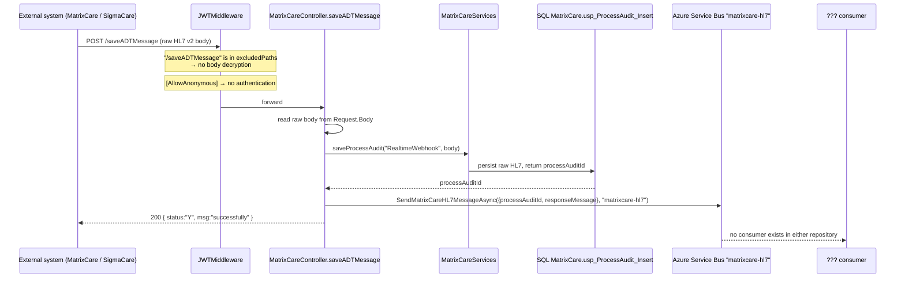
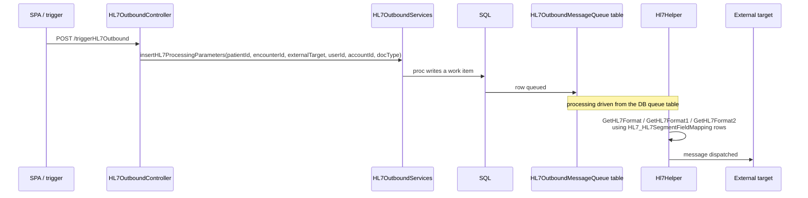
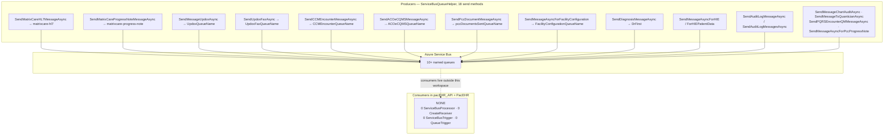
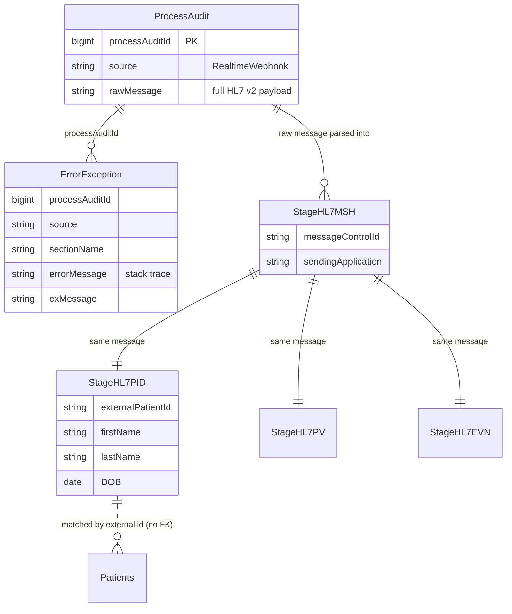

# Deep-Dive - HL7 v2, ADT Ingestion & Messaging Transport

**Date**: 2026-09-30
**Analyzed By**: ARCHITECT
**Status**: Draft (awaiting user confirmation)
**Scope**: inbound HL7 v2 / ADT ingestion, the hand-rolled HL7 parser, outbound HL7 generation, and the Azure Service Bus transport that carries it
**Evidence base**: `pacEHR_API` @ `9f2a6ee19`

> **Headline finding**: the solution contains **18 Service Bus send methods and zero Service Bus consumers**. Every asynchronous flow in PacEHR — HL7 ingestion, Updox, CCM encounters, eCQM, PCC documents, facility config, DrFirst diagnosis — dispatches to a queue that nothing in either repository reads.

---

## Module Overview

| Component | Path | Size |
|---|---|---|
| HL7 parser library | `pacEHR.DomainServices/HL7Services/` (22 files) | **2,350 lines** |
| `Message.cs` (parser core) | `.../HL7Services/Message.cs` | 964 lines |
| `Hl7Helper` (format builders) | `.../HL7Services/Hl7Helper.cs` | 268 lines |
| Outbound service | `pacEHR.DomainServices/HL7OutboundServices.cs` | 127 lines |
| Outbound controller | `PacEHR.API/Controllers/HL7OutboundController.cs` | 50 lines, 1 route |
| Inbound endpoints | `PacEHR.API/Controllers/MatrixCareController.cs` | 3 routes |
| Transport | `pacEHR.DomainServices/ServiceBusQueueHelper.cs` | 18 send methods |
| HL7 schema | `PacEHR.Database/Tables/` | ~35 HL7-prefixed tables |

---

## Component Breakdown

### The HL7 v2 object model (hand-rolled, 2,350 lines)

| File | Lines | Role |
|---|---|---|
| `Message.cs` | 964 | Parse/serialise a full HL7 message |
| `Hl7Helper.cs` | 268 | `GetHL7Format`, `GetHL7Format1`, `GetHL7Format2`, `hl7SegmentFormat` |
| `Encoding.cs` | 181 | Delimiters and escape sequences |
| `Field.cs` / `FieldCollection.cs` | 154 / — | Field model |
| `Segment.cs` | 126 | Segment model |
| `MessageHelper.cs` | 117 | Utilities |
| `JsonParserHelper.cs` / `JsonHL7Fields.cs` | 109 / — | JSON ↔ HL7 bridging |
| `Component.cs`, `SubComponent.cs`, `ComponentCollection.cs`, `MessageElement.cs` | — | Composite model |
| `HL7Model.cs`, `DynamicFormData.cs` | — | Input shapes |
| `HL7Exception.cs` | — | Error type |

This is a complete, well-decomposed HL7 v2 object model (Message → Segment → Field → Component → SubComponent), written in-house rather than taken from a library such as NHapi.

### HL7 schema (DB-driven)

| Table group | Examples |
|---|---|
| Segment tables | `HL7_MSH`, `HL7_PID`, `HL7_PV`, `HL7_EVN`, `HL7_DG1`, `HL7_AL1`, `HL7_NK1`, `HL7_OBX`, `HL7_GT1`, `HL7_IN`, `HL7_NTE`, `HL7_SCH`, `HL7_RGS`, `HL7_AIL`, `HL7_AIP`, `HL7_FT` |
| Staging | `Stage_HL7_MSH`, `Stage_HL7_PID`, `Stage_HL7_PV`, `Stage_HL7_EVN` (+ matching TVP types `typStage_HL7_*`) |
| Field mapping | **`HL7_HL7SegmentFieldMapping`** — segment/field mapping held as data |
| Inbound queues | `hl7InboundMessageQueue`, `hl7InboundMessageQueue_reprocess`, `hl7LTC_reprocess`, `hl7Inboundsettings` |
| Outbound queues | `HL7OutboundMessageQueue`, `Hl7outboundprocessing`, `HL7Token` |
| Audit | `HL7_AuditLogs`, `HL7Outbound_AuditLogs`, `HL7_messages`, `HL7_SigmaCareMessages` |

Field mapping lives in `HL7_HL7SegmentFieldMapping` and is passed into the parser (`hl7SegmentFormat(..., List<usp_getHL7SegmentFieldMappingResult> segmentMappingData)`) — so a new HL7 field can be mapped by inserting a row rather than shipping code. That is a genuinely good design choice for an interface engine.

---

## Key Workflows

### Workflow 1: Inbound ADT — audit-first ingestion



**Stories**:
1. **Audit-first is the right pattern.** The raw message is persisted *before* anything else, so a parse failure downstream never loses the source. The inline comment states the intent clearly: *"1) persist the raw inbound HL7 … 2) attach the processAuditId … 3) push to the new 'matrixcare-hl7' queue."*
2. Failures are recorded to `[MatrixCare].[Error_Exception]` with source/section context — better error handling than the API average.
3. **The endpoint is unauthenticated.** `[AllowAnonymous]`, and `/saveADTMessage` is also in `JWTMiddleware`'s `excludedPaths`, so it is exempt twice. No shared secret, signature, mTLS or IP allowlist appears in the code path. Anyone who can reach the URL can inject an ADT message into the clinical pipeline.
4. `catch (Exception ex)` returns `404 "Not Found"` for an ingestion failure — a misleading status even within the dictionary-envelope convention.

### Workflow 2: Outbound HL7



Outbound queueing is **table-based** (`HL7OutboundMessageQueue`, `Hl7outboundprocessing`) rather than Service Bus — a different asynchronous mechanism from the inbound path. Three format builders (`GetHL7Format`, `GetHL7Format1`, `GetHL7Format2`) exist with no naming to distinguish their purpose.

### Workflow 3: 🔴 the messaging transport, end to end



`PacEHR.Functions.Process` references `Microsoft.Azure.Functions.Worker.Extensions.Storage.Queues 5.5.1`, but all five of its functions are `[TimerTrigger]`. There is no `ServiceBusTrigger` anywhere.

---

## Data Models

### Inbound audit chain



### Service Bus queues (from `appsettings.json` + code literals)

| Queue | Producer | Configured as |
|---|---|---|
| `matrixcare-hl7` | `saveADTMessage` | **hardcoded string literal** |
| `matrixcare-progress-note` | progress-note sync | **hardcoded string literal** |
| Updox | `UpdoxQueueName` | config |
| Updox fax | `UpdoxFaxQueueName` | config |
| CCM encounter | `CCMEncounterQueueName` | config (+ own connection string) |
| ACO eCQM | `ACOeCQMSQueueName` | config (+ own connection string) |
| Encounter event | `EncounterEventQueueName` | config (+ own connection string) |
| Facility configuration | `FacilityConfigurationQueueName` | config |
| PCC documents sent | `pccDocumentsSentQueueName` | config (+ own connection string) |

---

## Pattern Catalog

### Pattern: ✅ audit-first ingestion

```csharp
// DO — persist the raw message before doing anything that can fail
processAuditId = await _matrixCareServices.saveProcessAudit("RealtimeWebhook", body);

var hl7QueueMessage = new MatrixCareHL7AuditMessage
{
    processAuditId = processAuditId,
    responseMessage = body
};
await _serviceBusQueueHelper.SendMatrixCareHL7MessageAsync(
    JsonConvert.SerializeObject(hl7QueueMessage), "matrixcare-hl7");
```

The raw payload is durable before the queue send, and the `processAuditId` correlates the audit row, the queue message and any downstream error. This is the best-designed ingestion path in the codebase.

### Pattern: ✅ DB-driven segment/field mapping

```csharp
// DO — mapping is data, not code
public static Segment hl7SegmentFormat(
    DynamicFormData hL7Model,
    string segmentName,
    List<usp_getHL7SegmentFieldMappingResult> segmentMappingData)
```

Adding or changing an HL7 field mapping is an insert into `HL7_HL7SegmentFieldMapping`, not a release. Appropriate for an interface engine, where trading-partner variation is the norm.

### Pattern: 🔴 unauthenticated clinical ingestion endpoints

```csharp
// ACTUAL
[AllowAnonymous]
[Route("saveADTMessage")]
[HttpPost]
public async Task<IDictionary<string, object>> saveADTMessage()
```

And in `JWTMiddleware.cs:49`:

```csharp
var excludedPaths = new List<string> { "/saveADTMessage", "/sigmaCareADTEndPoint", "/sigmaCareCCDEndpoint", "/fhir", ... };
```

```csharp
// DO — at minimum verify a shared secret or signature before persisting
[AllowAnonymous]
[Route("saveADTMessage")]
public async Task<IActionResult> saveADTMessage([FromHeader(Name = "X-Signature")] string signature)
{
    var body = await ReadBodyAsync();
    if (!_webhookVerifier.IsValid(body, signature)) return Unauthorized();
    ...
}
```

Three endpoints accept clinical data with no authentication: `/saveADTMessage`, `/sigmaCareADTEndPoint`, `/sigmaCareCCDEndpoint`. Mitigations may exist at the network layer (App Gateway IP restriction, private endpoint) — **that is the key thing to confirm**. If they are publicly reachable, an unauthenticated party can inject ADT messages and CCD documents into the clinical record pipeline.

### Pattern: 🔴 fire-and-forget into queues nothing reads

Eighteen send methods, zero receivers. Two readings are possible and the difference matters:

1. **Consumers exist outside this workspace** (a separate repo, Logic App, or worker). Then the architecture is fine but **undocumented** — as with the SignalR services noted in the system overview.
2. **Consumers do not exist.** Then every message sent to those queues accumulates until TTL or dead-lettering, and the features depending on them silently do nothing.

The safest way to distinguish: check active and dead-letter message counts on each queue in the Azure portal. A queue with a large active backlog and no receivers is case 2.

This was raised as verification item #3 in the 2026-09-08 status (`Does the Service Bus queue "matrixcare" exist and is it drained?`) and is still open. It has grown from one queue to at least ten.

### Pattern: 🟡 queue names split between config and literals

```csharp
// ACTUAL — some queues configured...
builder.Services.Configure<ServiceBusConnString>(options =>
    builder.Configuration.GetSection("SericeBusConnection").Bind(options));   // note the typo

// ...others hardcoded at the call site
await _serviceBusQueueHelper.SendMatrixCareHL7MessageAsync(json, "matrixcare-hl7");
```

Seven queue names come from `appsettings.json`; `matrixcare-hl7` and `matrixcare-progress-note` are string literals in controller code, duplicated into the test assertions. Renaming a queue then requires a code change in two repos. Note also the config section is misspelled `SericeBusConnection` and is bound under that misspelling — correcting the spelling without updating `Program.cs` would silently break every queue.

### Pattern: 🟡 four connection strings for one bus

`CCMEncounterServiceBusConnectionString`, `ACOeCQMSServiceBusConnectionString`, `EncounterEventServiceBus`, `pccDocumentsSentServiceBusConnectionString`, `updoxServiceBusConnectionString` plus the general `SericeBusConnection`. Six connection-string settings for what is likely one namespace — six secrets to rotate, six ways to misconfigure an environment.

### Pattern: 🟡 three undifferentiated format builders

```csharp
public static string GetHL7Format(JsonHL7Fields inpModel)
public static string GetHL7Format1(HL7Model hL7Model)
public static string GetHL7Format2(HL7Model hL7Model)
```

Numeric suffixes carry no information about message type, trading partner or version. A caller cannot tell which to use without reading all three.

### Pattern: 🔴 backup **tables** — patient data duplicated in the schema

**190 of 1,120 table files** carry backup/date suffixes. Unlike the 88 backup *procedures* (Module 03), these hold **data**:

```
PatientDiagnosis_MismatchBackup_MatrixCare_HL7_20260407.sql
PatientDiagnosis_MismatchBackup_MatrixCare_HL7_20260407_01.sql
PatientDiagnosis_MismatchBackup_MatrixCare_HL7_20260407_02.sql
PatientDiagnosis_matchBackup_MatrixCare_HL7_20260407.sql
PatientDiagnosis_matchBackup_MatrixCare_HL7_20260407_01.sql
PatientDeaseasedbackup_07102026.sql          (sic)
EncounterData_Backup_31225.sql
ENCOUNTERDATA_BKP_082620260708.sql
CCD_Medication_bkp05072026.sql
HL7_AuditLogs_BKP.sql / _BKP_09292025 / _bkp_20251110 / _bkp_20251222 / _old / _2025
PacEHRPatientInsurabce_BKP.sql               (sic)
```

These are diagnosis, encounter, medication, deceased-status and insurance snapshots — **PHI copies created during past migrations and left in the schema**, outside whatever retention, access-control and audit rules apply to the live tables. Each is a table SSDT will create and maintain in production.

### Test patterns (HL7)

| Target | Tests |
|---|---|
| `MatrixCareControllerTests` — `saveADTMessage`, `sigmaCareADTEndPoint`, `sigmaCareCCDEndpoint` | present, well-organised in `#region` blocks with the flow documented in comments |
| **`HL7Services` parser — 2,350 lines** | **0** |
| `Hl7Helper` format builders | **0** |
| `HL7OutboundServices` | **0** |
| `ServiceBusQueueHelper` | mocked in controller tests; no tests of its own |

The controller tests are good — they assert the queue name and that the audit call happens (`Times.Once`). But a 964-line hand-rolled HL7 v2 parser with zero tests is the largest untested risk surface in the solution: malformed segments, escape sequences, repeating fields and encoding characters are exactly what a parser gets wrong, and the input comes from external systems.

---

## Entry Points

| Entry | Route | Auth | Description |
|---|---|---|---|
| ADT ingest | `POST /saveADTMessage` | 🔴 none | Raw HL7 v2 → audit → queue |
| SigmaCare ADT | `POST /sigmaCareADTEndPoint` | 🔴 none | ADT from SigmaCare |
| SigmaCare CCD | `POST /sigmaCareCCDEndpoint` | 🔴 none | CCD document upload |
| Outbound trigger | `POST /triggerHL7Outbound` | authenticated | Queue an outbound message |
| PCC ADT records | `POST /adtRecords` | authenticated | Pull ADT from PCC (Module 04) |

---

## Open Questions for the Team

1. **Who consumes the Service Bus queues?** Name the component and repo for each of the ten. If none exists, which features are silently dead?
2. **Are the three anonymous ingestion endpoints network-restricted?** IP allowlist, private endpoint or App Gateway rule — and is that documented anywhere?
3. **Can the 190 backup tables be dropped?** They hold PHI outside the governed tables. This likely needs a data-retention decision, not just an engineering one.
4. **Is the hand-rolled HL7 parser preferred over NHapi deliberately?** 2,350 untested lines versus a maintained library.
5. **Why does outbound use DB queue tables while inbound uses Service Bus?** Two asynchronous mechanisms, one system.
6. **Is `SericeBusConnection` (misspelled) safe to correct**, or is the key baked into deployment templates and Key Vault?
7. **What distinguishes `GetHL7Format`, `GetHL7Format1` and `GetHL7Format2`?**

---

## Recommendations

| # | Recommendation | Rationale | Priority |
|---|---|---|---|
| 1 | Confirm queue consumers exist; check active + dead-letter depths | 18 producers, 0 consumers in-repo | 🔴 Immediate |
| 2 | Add signature or shared-secret verification to the three anonymous ingestion endpoints | Unauthenticated clinical data injection | 🔴 Immediate |
| 3 | Add unit tests for the HL7 parser using real ADT fixtures | 964 lines parsing untrusted external input, zero tests | 🔴 High |
| 4 | Plan removal of the 190 backup tables under a retention decision | PHI copies outside governed storage | 🔴 High |
| 5 | Move `matrixcare-hl7` and `matrixcare-progress-note` into configuration | Hardcoded infrastructure names | 🟡 Medium |
| 6 | Consolidate the six Service Bus connection strings | Six secrets, one namespace | 🟡 Medium |
| 7 | Return a correct status code from `saveADTMessage` failures | Currently `404 "Not Found"` for an ingestion error | 🟢 Low |
| 8 | Rename the three `GetHL7Format*` builders by message type | Numeric suffixes carry no meaning | 🟢 Low |
| 9 | Document the inbound and outbound HL7 flows for operations | The most externally-facing part of the system, undocumented | 🟡 Medium |
| 10 | Evaluate NHapi against the in-house parser | Reduces 2,350 lines of untested surface | 🟢 Low |

---

**Next**: Module 07 — Other external integrations.
