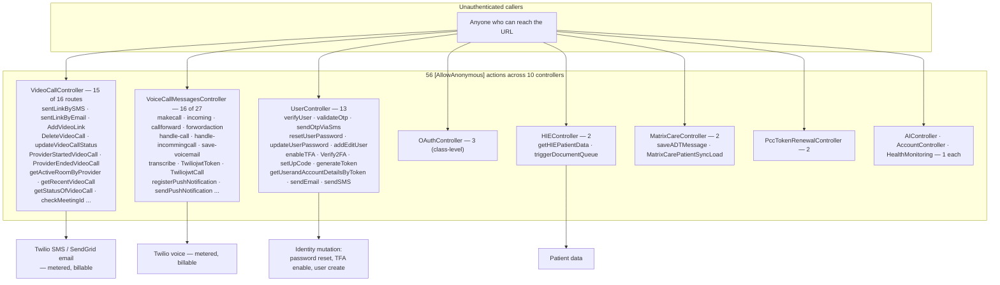
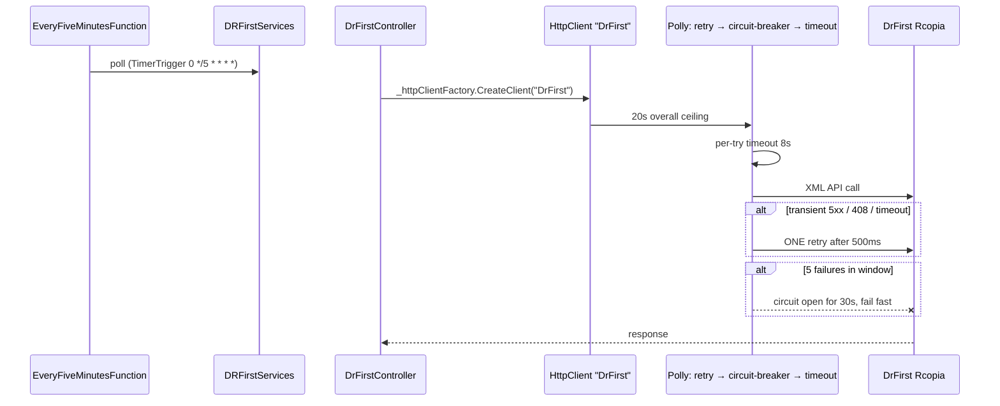

# Deep-Dive - Other External Integrations

**Date**: 2026-09-30
**Analyzed By**: ARCHITECT
**Status**: Draft (awaiting user confirmation)
**Scope**: every external integration except PointClickCare (Module 04) and HL7/ADT (Module 06) — Updox, DrFirst, MatrixCare, IMO, Twilio (voice/video/SMS/push), SendGrid/SMTP, Power BI, Azure Blob, ShareFile, Log Analytics
**Evidence base**: `pacEHR_API` @ `9f2a6ee19`

> **Headline finding**: 56 endpoints are `[AllowAnonymous]`, and 31 of them are in the two Twilio-adjacent controllers. `VideoCallController` has **15 of its 16 routes anonymous**, including endpoints that send SMS and email, create video links and delete calls. No Twilio request-signature validation exists anywhere in the solution.

---

## Module Overview

| Integration | Service | Controller | Lines (svc / ctrl) | Routes | Anonymous |
|---|---|---|---|---|---|
| Updox (fax, secure messaging) | `UpdoxService.cs` | `UpdoxController.cs` | 1,214 / 1,807 | 3 | 0 |
| DrFirst (eRx) | `DRFirstServices.cs` | `DrFirstController.cs` | 185 / 2,075 | 20 | 0 |
| MatrixCare | `MatrixCareServices.cs` | `MatrixCareController.cs` | 458 / 3,329 | 17 | 2 |
| IMO (terminology) | `ImoService.cs` | `ImoController.cs` | 893 / 292 | 4 | 0 |
| Labs | `LabServices.cs` | `LabController.cs` | 145 / 261 | 9 | 0 |
| Twilio video | — | `VideoCallController.cs` | — / 576 | 16 | **15** |
| Twilio voice/SMS/push | — | `VoiceCallMessagesController.cs` | — / 1,678 | 27 | **16** |
| Messaging | — | `MessageController.cs` | — / 405 | 11 | 0 |
| Files / Blob | `AzureStorageService.cs` | `FileUploadController.cs` | 278 / 1,669 | 21 | 0 |
| Email | `EmailService.cs` | — | 136 | — | — |
| Log Analytics | `LogAnalyticsClient.cs` | — | — | — | — |

---

## Component Breakdown

### Outbound HTTP clients

Four **named** `HttpClient` registrations exist in `Program.cs`, three with real resilience policies:

| Name | Timeout | Policies | Consumers |
|---|---|---|---|
| `DrFirst` | 20s overall | retry(1, 500ms) → circuit-breaker(5 failures / 30s) → per-try timeout(8s) | `DrFirstController` (3 sites) |
| `Updox` | 30s | none | `UpdoxController` (2 sites) |
| `MatrixCare` | 60s | client certificate attached | `MatrixCareController` (1 site) |
| `OpenAI` | long (streaming) | none | `AIPromptServices` (4 sites) |

Against that: **40 call sites construct `new HttpClient()` directly**, in `PatientController`, `DiagnosisController`, `VoiceCallMessagesController`, `PccTokenRenewalController`, `LogAnalyticsClient`, `PccCoreService` and others.

---

## Key Workflows

### Workflow 1: 🔴 the anonymous-endpoint surface



### Workflow 2: Twilio voice — webhook callbacks


Webhook endpoints **must** be anonymous — Twilio cannot present a session token. That part is correct and expected. The gap is that Twilio's signature scheme (`X-Twilio-Signature`, validated with `Twilio.Security.RequestValidator`) is the mechanism that makes anonymous webhooks safe, and **no `RequestValidator`, `ValidateRequest` or `X-Twilio-Signature` reference exists in the solution**. Anyone can post forged call logs, voicemails and transcripts.

`/TwiliojwtToken` and `/getVideocallToken` are a different matter: they **mint Twilio credentials** and are anonymous, which is not a webhook requirement.

### Workflow 3: DrFirst — the one well-protected outbound path



The comment in `Program.cs` records the reasoning: *"Fail-fast + resilience against a hung/slow Rcopia endpoint (was: 20s p95 -> thread starvation)"*, with policy ordering spelled out and a `// TUNE to DrFirst SLA` marker. This is the standard the other integrations should meet.

---

## Data Models

### Where integration data lands

| Integration | Schema / store |
|---|---|
| Updox | `Updox` schema (7 tables) + Service Bus queues |
| MatrixCare | `MatrixCare` schema (16 tables), `MatrixCareAudit`, `Log_ProcessAudit`, `BulkMatrixCareProgressNoteAudit` |
| IMO | in-process `IMemoryCache` + reference tables |
| Twilio | call-log and voicemail tables, Blob for recordings |
| Files | Azure Blob (`pacehrdev` container per environment) |
| ShareFile | `ShareFile` schema (3 tables) |
| Power BI | `PowerBISettings` only — embedded reports, no local storage |
| Log Analytics | custom tables via `LogTableName`, `ErrorLogTableName`, `PCCLogTableName` |

---

## Pattern Catalog

### Pattern: ✅ named `HttpClient` with layered Polly policies (DrFirst)

```csharp
// DO — the best outbound-HTTP configuration in the solution
builder.Services.AddHttpClient("DrFirst", client =>
{
    client.Timeout = TimeSpan.FromSeconds(20); // hard overall ceiling across all retries
})
.AddPolicyHandler(HttpPolicyExtensions.HandleTransientHttpError()   // 5xx / 408
    .Or<TimeoutRejectedException>()
    .WaitAndRetryAsync(1, _ => TimeSpan.FromMilliseconds(500)))     // ONE short retry only
.AddPolicyHandler(HttpPolicyExtensions.HandleTransientHttpError()
    .Or<TimeoutRejectedException>()
    .CircuitBreakerAsync(5, TimeSpan.FromSeconds(30)))
.AddPolicyHandler(Policy.TimeoutAsync<HttpResponseMessage>(TimeSpan.FromSeconds(8)));
```

Correct policy ordering (outer retry wraps circuit-breaker wraps per-try timeout), a documented cause, and a tuning marker. Apply this to Updox, OpenAI and MatrixCare.

### Pattern: 🔴 40 sites bypass the factory entirely

```csharp
// ACTUAL — in PatientController, DiagnosisController, VoiceCallMessagesController,
// PccTokenRenewalController, LogAnalyticsClient, PccCoreService, and 34 more
using (var client = new HttpClient())
{
    ...
}
```

```csharp
// DO
private readonly IHttpClientFactory _factory;
using var client = _factory.CreateClient("Imo");
```

Each `new HttpClient()` opens its own connection pool. Disposing it leaves the socket in `TIME_WAIT`, so a high-frequency path can exhaust ephemeral ports; a long-lived one never picks up DNS changes. These 40 sites also bypass every Polly policy, every configured timeout and every telemetry handler. `IHttpClientFactory` **is** registered (`Program.cs:210`), so the fix is mechanical.

### Pattern: 🔴 anonymous endpoints that spend money and mutate identity

```csharp
// ACTUAL — VideoCallController, 15 of 16 routes
[AllowAnonymous]
[Route("sentLinkBySMS")]          // sends a Twilio SMS
[AllowAnonymous]
[Route("sentOngoingCallLinkByEmail")]  // sends an email
[AllowAnonymous]
[Route("AddVideoLink")]           // creates a video room
[AllowAnonymous]
[Route("DeleteVideoCall")]        // deletes a call
[AllowAnonymous]
[Route("getActiveRoomByProvider")] // discloses provider activity
```

```csharp
// ACTUAL — UserController
[AllowAnonymous] [Route("resetUserPassword")]
[AllowAnonymous] [Route("updateUserPassword")]
[AllowAnonymous] [Route("addEditUser")]
[AllowAnonymous] [Route("enableTFA")]
[AllowAnonymous] [Route("generateToken")]
[AllowAnonymous] [Route("getUserandAccountDetailsByToken")]
[AllowAnonymous] [Route("sendEmail")]
[AllowAnonymous] [Route("sendSMS")]
```

Some of these are legitimately pre-authentication: `verifyUser`, `validateOtp`, `sendOtpViaSms`, `setUpCode`, `Verify2FA` are all steps in a login or enrolment flow that by definition cannot require a session. `resetUserPassword` likewise — provided it validates a reset token internally.

The ones that warrant explanation are `addEditUser` (user creation), `enableTFA` (security-setting change), `generateToken`, and the bare `sendEmail`/`sendSMS` endpoints. **Each needs a per-endpoint decision**, and the internal token checks each performs should be recorded. The VideoCall set is harder to justify: those are in-application operations for a logged-in provider, not pre-auth steps.

Three distinct risks: **cost** (unauthenticated SMS/email/voice is a billable abuse vector), **integrity** (call state and user records mutable without a session), and **disclosure** (`getActiveRoomByProvider`, `getRecentVideoCall`, `getHIEPatientData`).

### Pattern: 🔴 no Twilio webhook signature validation

```csharp
// DO — Twilio's SDK is already a dependency (Twilio 5.49.0)
var validator = new Twilio.Security.RequestValidator(_twilioSettings.AuthToken);
if (!validator.Validate(requestUrl, formParams, Request.Headers["X-Twilio-Signature"]))
    return Unauthorized();
```

Searched: no `RequestValidator`, no `ValidateRequest`, no `X-Twilio-Signature` anywhere in `pacEHR_API`. Sixteen anonymous webhook endpoints accept and persist call logs, voicemails and transcripts with no proof they came from Twilio.

### Pattern: 🟡 `IMemoryCache` on a scaled-out service

```csharp
// ACTUAL — ImoService
private readonly IMemoryCache _cache;
public ImoService(Ipacehr_devContextProcedures proceduresInterface, IAppSettingService appSettingService, IMemoryCache cache)
```

`Program.cs` registers `AddMemoryCache()` with the comment *"PERF-001: In-memory cache for IMO tokens, app settings, and search results"*. On multi-instance App Service this gives each instance its own cache: N× the token fetches, inconsistent app-settings reads across instances, and no invalidation path. Redis is already in the stack and already used for PCC tokens.

### Pattern: 🟡 a client certificate in the wrong project

`pacEHR.PCC.Services/Certificates/wcthesnfist_com.pfx` is loaded by `SslCertificateHelper` and attached to the **MatrixCare** `HttpClient`. It lives in the PCC project, is git-tracked, and its password is an `appsettings.json` key. (Full treatment in Module 04.) `ReadSslFromAzure=true` loads it from the App Service certificate store instead — the file is the local-dev fallback, but it is in git history regardless.

### Pattern: 🟡 god controllers on the integration boundary

| Controller | Lines | Routes |
|---|---|---|
| `MatrixCareController` | 3,329 | 17 |
| `DrFirstController` | 2,075 | 20 |
| `UpdoxController` | 1,807 | 3 |
| `VoiceCallMessagesController` | 1,678 | 27 |
| `FileUploadController` | 1,669 | 21 |

`UpdoxController` is notable: 1,807 lines for **3 routes** — roughly 600 lines per action. `UpdoxService` adds another 1,214. Business logic that should sit in the service layer is in the controller.

### Pattern: 🟡 inconsistent layering across integrations

| Integration | Where the HTTP call is made |
|---|---|
| PCC | dedicated project, behind `IPccCoreService` ✅ |
| DrFirst | **controller** (`DrFirstController:202, 464, 814`) |
| Updox | **controller** (`UpdoxController:1372, 1506`) |
| MatrixCare | **controller** (`MatrixCareController:45`) |
| OpenAI | service (`AIPromptServices`) ✅ |
| IMO | service ✅ |

Three integrations call external APIs directly from controllers, so their outbound logic cannot be unit-tested without spinning up MVC, and cannot be reused by the Functions worker.

### Pattern: ✅ audit-first for MatrixCare (see Module 06)

`saveProcessAudit` → `Log_ProcessAudit` → queue, with failures to `[MatrixCare].[Error_Exception]` carrying `source` and `sectionName`. The best error handling in the integration layer.

### Test patterns (integrations)

| Target | Tests |
|---|---|
| `MatrixCareControllerTests` | present, well-structured with `#region` per endpoint |
| `UpdoxServiceTest` | present |
| `DrFirstController` / `DRFirstServices` | — |
| `VideoCallController` (15 anonymous routes) | — |
| `VoiceCallMessagesController` (16 anonymous routes) | — |
| `AzureStorageService` | — |
| `ImoService` (893 lines) | — |

The controllers with the largest anonymous attack surface have the least coverage.

---

## Entry Points

### Anonymous (56 actions, 10 controllers)

| Controller | Count | Notable |
|---|---|---|
| `VoiceCallMessagesController` | 16 | `makecall`, `incoming`, `handle-call`, `save-voicemail`, `transcribe`, `TwiliojwtToken`, `sendPushNotification` |
| `VideoCallController` | 15 | `sentLinkBySMS`, `AddVideoLink`, `DeleteVideoCall`, `getActiveRoomByProvider` |
| `UserController` | 13 | `verifyUser`, `resetUserPassword`, `addEditUser`, `enableTFA`, `generateToken` |
| `OAuthController` | 3 | class-level (Module 01) |
| `HIEController` | 2 | `getHIEPatientData`, `triggerDocumentQueue` |
| `MatrixCareController` | 2 | `saveADTMessage`, `MatrixCarePatientSyncLoad` |
| `PccTokenRenewalController` | 2 | token renewal |
| `AIController` | 1 | ambient details |
| `AccountController` | 1 | `checkAppVersion` — reasonable |
| `PacEHRHealthMonitoringController` | 1 | health probe — reasonable |

### Authenticated integration endpoints

`DrFirstController` (20), `MatrixCareController` (15 of 17), `FileUploadController` (21), `MessageController` (11), `LabController` (9), `ImoController` (4), `UpdoxController` (3).

---

## Open Questions for the Team

1. **Is there a network-layer control in front of the anonymous endpoints?** App Gateway rules, WAF, IP allowlists. This determines whether the 56 are internet-reachable.
2. **What internal checks do the anonymous `UserController` endpoints perform?** `resetUserPassword` presumably validates a reset token; `addEditUser` and `enableTFA` need an explanation.
3. **Why is `VideoCallController` almost entirely anonymous?** Is there a token in the request body doing the work?
4. **Has Twilio signature validation ever been implemented, or is there an equivalent control?**
5. **Are Twilio spend alerts configured?** Unauthenticated SMS/voice endpoints without a spend cap are a direct financial exposure.
6. **Is the IMO `IMemoryCache` acceptable at current instance counts?**
7. **Should the DrFirst Polly policies be extended to Updox, OpenAI and MatrixCare**, or do their SLAs differ?

---

## Recommendations

| # | Recommendation | Rationale | Priority |
|---|---|---|---|
| 1 | Add Twilio `RequestValidator` to all 16 webhook endpoints | The control that makes anonymous webhooks safe is absent; the SDK is already referenced | 🔴 Immediate |
| 2 | Audit the 56 anonymous endpoints; justify or remove each | Especially `VideoCallController` (15) and the identity-mutating `UserController` set | 🔴 Immediate |
| 3 | Authenticate `TwiliojwtToken` / `getVideocallToken` | They mint credentials and are not webhooks | 🔴 High |
| 4 | Confirm Twilio spend alerts and rate limits | Unauthenticated billable endpoints | 🔴 High |
| 5 | Replace the 40 `new HttpClient()` sites with `IHttpClientFactory` | Socket exhaustion, stale DNS, bypassed policies | 🟡 High |
| 6 | Extend the DrFirst policy pattern to Updox, OpenAI, MatrixCare | Only one of four named clients has resilience | 🟡 Medium |
| 7 | Move DrFirst/Updox/MatrixCare HTTP calls out of controllers into services | Untestable and unreusable where they are | 🟡 Medium |
| 8 | Replace `IMemoryCache` with Redis for IMO tokens and app settings | Per-instance cache on a scaled-out service | 🟡 Medium |
| 9 | Add tests for `VideoCallController` and `VoiceCallMessagesController` | Largest anonymous surface, least coverage | 🟡 Medium |
| 10 | Split `UpdoxController` (1,807 lines / 3 routes) and `MatrixCareController` (3,329) | ~600 lines per action | 🟢 Low |
| 11 | Relocate the MatrixCare certificate out of the PCC project | Misplaced asset | 🟢 Low |

---

**Next**: Module 08 — Background processing.
