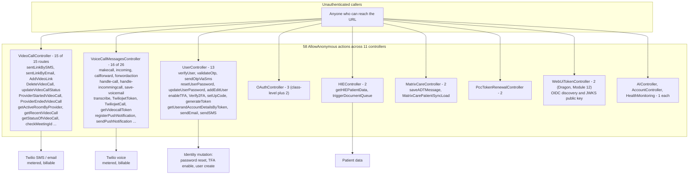
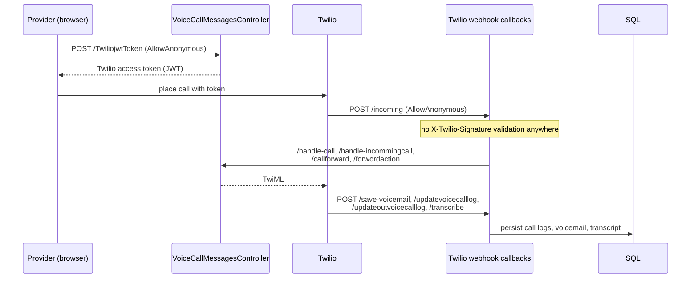
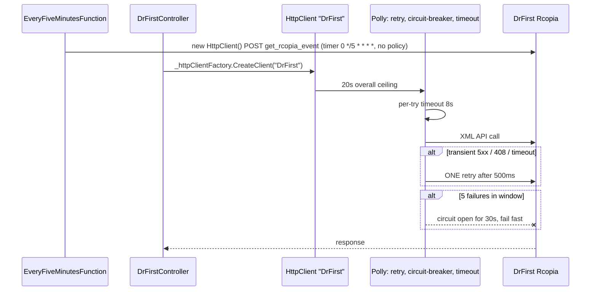
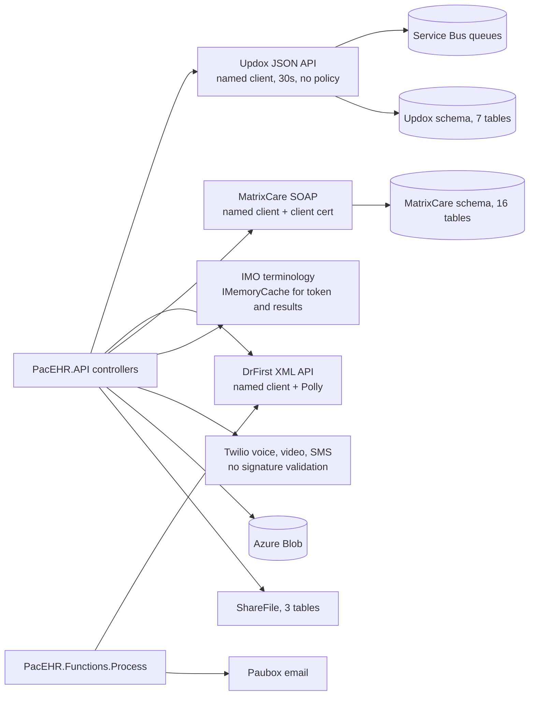

# Deep-Dive - Other External Integrations

**Date**: 2026-10-19
**Analyzed By**: ARCHITECT
**Status**: Draft (awaiting user confirmation)
**Method**: AIRE `aire-brownfield-deep-dive` (refresh of the 2026-09-30 deep-dive; every claim re-checked against current code)
**Scope**: every external integration except PointClickCare (Module 04), HL7/ADT (Module 06) and AI/dictation (Module 12) - Updox, DrFirst, MatrixCare, IMO, Twilio (voice/video/SMS/push), SendGrid/SMTP/Paubox, Power BI, Azure Blob, ShareFile, Log Analytics. The OpenAI named client and the Dragon `WebUiTokenController` belong to Module 12 and are cross-referenced only.
**Evidence base**: `pacEHR_API` @ `0f611f65c`. `PacEHR` @ `401caa134` and `pacEHR_AI` @ `ef172ea` were not needed for this module.

> **Headline finding (unchanged)**: 56 pre-existing `[AllowAnonymous]` endpoints remain, 31 of them in the two Twilio-adjacent controllers (`VideoCallController` 15 of 15 routes, `VoiceCallMessagesController` 16 of 26). No Twilio request-signature validation exists anywhere in the solution (re-searched).

---

## Changes since 2026-09-30

| Item | 2026-09-30 | Now | Notes |
|---|---|---|---|
| Live `[AllowAnonymous]` attributes | 56 | **58** | +2 are `WebUiTokenController` `.well-known/openid-configuration` and `.well-known/jwks.json` (Dragon, Module 12; public-key discovery documents, anonymous by design per the code comment at lines 160-166). The other 56 are unchanged |
| `VideoCallController` anonymous routes | "15 of 16" | **15 of 15** | re-counted: 15 `[Route]` attributes, all anonymous |
| `VoiceCallMessagesController` routes | 27 | **26** | re-counted by `[Route("...")]`; 16 anonymous unchanged |
| `LabController` routes | 9 | **8** | re-counted |
| `new HttpClient` call sites | "40" | **20 live sites in the built solution** (plus 19 in a legacy `pacEHR/` folder that is git-tracked but not in `pacEHR.sln`) | old figure not reproducible; commented-out sites excluded. See Component Breakdown |
| `ImoService` | 893 lines | **1,013** | IMO DSM-5 and sex-omission changes (PAC-1320, PACT2-1462, 2026-10-07/15) |
| `ImoController` `getICDSearch` | listed as authenticated | still authenticated; `//[AllowAnonymous]` is commented out at `ImoController.cs:204` | confirms no anonymous IMO route |
| Paubox email | not covered | **new `PauboxEmailService`** (2026-10-08, "paubox for adhoc job"), DI-registered in API and Functions, used by `EmailEncounterJob` | typed-client-capable, no hardcoded key |
| `FileUploadController` | 1,669 lines | **1,678** | |
| Test gaps | "no tests" for `DrFirstController`/`DRFirstServices`, `AzureStorageService`, `ImoService` | tests exist for all three (added 2025-05 and 2026-02, i.e. **before** the old doc) | **old claim was wrong; dropped** |
| DrFirst workflow | poll uses the resilient `DrFirst` client | the Azure Function poll builds its own `new HttpClient()` (`EveryFiveMinutesFunction.cs:55`) with no Polly policy | **old diagram corrected** |

**Findings dropped**: "DrFirst/IMO/AzureStorage untested"; "40 sites" (replaced by a re-measured count). **Added**: Paubox service; DrFirst poll bypasses the named client; Functions and Paubox raw-client usage; WebUiToken anonymous discovery endpoints (cross-ref). **Unchanged and re-verified**: the anonymous surface, no Twilio validator, `IMemoryCache` in `ImoService`, controller-level HTTP calls in DrFirst/Updox/MatrixCare, schema table counts (Updox 7, MatrixCare 16, ShareFile 3).

---

## Module Overview

| Integration | Service | Controller | Lines (svc / ctrl) | Routes | Anonymous |
|---|---|---|---|---|---|
| Updox (fax, secure messaging) | `UpdoxService.cs` | `UpdoxController.cs` | 1,214 / 1,807 | 3 | 0 |
| DrFirst (eRx) | `DRFirstServices.cs` | `DrFirstController.cs` | 185 / 2,075 | 20 | 0 |
| MatrixCare | `MatrixCareServices.cs` | `MatrixCareController.cs` | 458 / 3,329 | 15 | 2 |
| IMO (terminology) | `ImoService.cs` | `ImoController.cs` | 1,013 / 292 | 4 | 0 |
| Labs | `LabServices.cs` | `LabController.cs` | 145 / 261 | 8 | 0 |
| Twilio video | - | `VideoCallController.cs` | - / 576 | 15 | **15** |
| Twilio voice/SMS/push | - | `VoiceCallMessagesController.cs` | - / 1,678 | 26 | **16** |
| Messaging | - | `MessageController.cs` | - / 405 | 11 | 0 |
| Files / Blob | `AzureStorageService.cs` | `FileUploadController.cs` | 278 / 1,678 | 21 | 0 |
| Email (SMTP) | `EmailService.cs` | - | 136 | - | - |
| Email (Paubox) | `PauboxEmailService.cs` | - | (new) | - | - |
| Log Analytics | `LogAnalyticsClient.cs` (in `PacEHR.API/Library`) | - | 99 | - | - |

Routes are counted as `[Route("...")]` attributes. Paths: services in `pacEHR_API/pacEHR.DomainServices/`, controllers in `pacEHR_API/PacEHR.API/Controllers/`. Packages (csproj): Twilio 5.49.0, SendGrid 9.21.1, ShareFile.Api.Client 4.0.200, Azure.Storage.Blobs 12.14.1, Polly 8.6.6, Microsoft.Extensions.Http.Polly 10.0.5. HIE/Kno2 (`HIEServices.cs`, `HIEController`) is touched only for its anonymous routes; its detail belongs to Module 05/06.

---

## Component Breakdown

### Outbound HTTP clients

Named `HttpClient` registrations in `PacEHR.API/Program.cs` (`AddHttpClient()` default factory at line 211):

| Name | Line | Timeout | Policies | Consumers |
|---|---|---|---|---|
| `MatrixCare` | 231 | 60 s | client certificate attached via primary handler | `MatrixCareController` (`:45`) |
| `DrFirst` | 246 | 20 s overall | retry(1, 500 ms), circuit-breaker(5 failures / 30 s), per-try timeout(8 s) | `DrFirstController` (`:202`, `:464`, `:814`) |
| `Updox` | 259 | 30 s | none | `UpdoxController` (`:1372`, `:1506`) |
| `OpenAI` | 265 | 5 min | none | Module 12 (not analysed here) |

`DrFirstController` also calls `_httpClientFactory.CreateClient()` with no name (`:960`, `:1189`), which carries none of the DrFirst policies, and builds `new HttpClient()` at `:797`, `:1656`, `:1973`.

Live `new HttpClient` sites in the built solution (commented-out code excluded), by file: `LogAnalyticsClient.cs` 2, `DrFirstController.cs` 3, `PatientController.cs` 2, `DaySheetReportServices.cs` 2, and one each in `DiagnosisController`, `VoiceCallMessagesController`, `PccController`, `PccTokenRenewalController`, `PccCoreService`, `EveryFiveMinutesFunction`, `EmailLibrary`, `APIHelper`, plus field-initialised shared clients in `HIEServices.cs:27` and `PauboxEmailService.cs:17` (`static readonly`, which is the acceptable long-lived pattern) = 20 lines. The legacy `pacEHR/` folder (951 tracked files, not referenced by `pacEHR.sln`) holds 19 more raw sites that do not ship.

---

## Key Workflows

### Workflow 1: the anonymous-endpoint surface



### Workflow 2: Twilio voice - webhook callbacks



Webhook endpoints **must** be anonymous - Twilio cannot present a session token. The gap is that Twilio's signature scheme (`X-Twilio-Signature`, validated with `Twilio.Security.RequestValidator`) is what makes anonymous webhooks safe, and a case-insensitive search of `pacEHR_API` for `RequestValidator`, `ValidateRequest` and `X-Twilio-Signature` finds only unrelated hits (a DB procedure named `usp_getDirectAddressValidateRequest` and Updox DTOs). `/TwiliojwtToken` and `/getVideocallToken` (`VoiceCallMessagesController.cs:73`, `:1071`) **mint Twilio credentials** and are anonymous, which is not a webhook requirement. Whether the request body of the token endpoints carries a proof of identity was not traced.

### Workflow 3: DrFirst - resilient controller path versus unprotected poll



The comment above the `DrFirst` registration in `Program.cs` records the reasoning for the policies and carries a `TUNE to DrFirst SLA` marker. That protection applies to the three named-client sites in `DrFirstController`; the timer function in `PacEHR.Functions.Process` creates its own client (`EveryFiveMinutesFunction.cs:55`) and so has neither the 8 s per-try timeout nor the circuit breaker (default `HttpClient` timeout applies). The function also posts a hard-coded `LastUpdateDate` of `03/29/2022 08:21:11` in the XML body (line ~65); its effect was not analysed.

---

## Data Models

### Where integration data lands

| Integration | Schema / store |
|---|---|
| Updox | `Updox` schema (7 table scripts) + Service Bus queues (`UpdoxFaxQueueName`, `UpdoxQueueName` in `appsettings.json:35,44`) |
| MatrixCare | `MatrixCare` schema (16 table scripts), `MatrixCareAudit`, `Log_ProcessAudit`, `BulkMatrixCareProgressNoteAudit` (carried from Module 06, table names not re-listed) |
| IMO | in-process `IMemoryCache` + reference tables |
| Twilio | call-log and voicemail tables, Blob for recordings (carried, not re-verified) |
| Files | Azure Blob via `AzureStorageService` |
| ShareFile | `ShareFile` schema (3 table scripts) |
| Paubox | delivery status via `usp_updatePauboxStatus` (`EmailJobService.cs:59`) |
| Power BI | `PowerBISettings` only (`appsettings.json:72`) - embedded reports, no local storage |
| Log Analytics | custom tables via `LogTableName`, `ErrorLogTableName`, `PCCLogTableName` (carried) |



The ER detail for these schemas is not drawn: table counts were re-verified by script file, but columns and relations are owned by Module 03 / 06 (**carried**).

---

## Pattern Catalog

### Pattern: GOOD - named `HttpClient` with layered Polly policies (DrFirst)

**Where**: `PacEHR.API/Program.cs:246-256`

```csharp
// DO - the best outbound-HTTP configuration in the solution
builder.Services.AddHttpClient("DrFirst", client =>
{
    client.Timeout = TimeSpan.FromSeconds(20); // hard overall ceiling across all retries
})
.AddPolicyHandler(HttpPolicyExtensions.HandleTransientHttpError()
    .Or<TimeoutRejectedException>()
    .WaitAndRetryAsync(1, _ => TimeSpan.FromMilliseconds(500)))
.AddPolicyHandler(HttpPolicyExtensions.HandleTransientHttpError()
    .Or<TimeoutRejectedException>()
    .CircuitBreakerAsync(5, TimeSpan.FromSeconds(30)))
.AddPolicyHandler(Policy.TimeoutAsync<HttpResponseMessage>(TimeSpan.FromSeconds(8)));
```

Apply to Updox and MatrixCare (OpenAI is Module 12).

### Pattern: RISK - raw `new HttpClient()` sites bypass the factory

```csharp
// ACTUAL - PacEHR.API/Controllers/DrFirstController.cs:797 (also 1656, 1973)
using (var client = new HttpClient())
```

```csharp
// DO - PacEHR.API/Controllers/DrFirstController.cs:202
var drFirstClient = _httpClientFactory.CreateClient("DrFirst");
```

DON'T construct clients per call: each opens its own connection pool, can leave sockets in `TIME_WAIT`, never picks up DNS changes and bypasses every named policy and timeout. `IHttpClientFactory` is registered (`Program.cs:211`), so the fix is mechanical. The same controller shows both styles side by side.

### Pattern: RISK - anonymous endpoints that spend money and mutate identity

```csharp
// ACTUAL - PacEHR.API/Controllers/VideoCallController.cs, all 15 routes are [AllowAnonymous]
[AllowAnonymous] [Route("sentLinkBySMS")]       // sends a Twilio SMS
[AllowAnonymous] [Route("sentOngoingCallLinkByEmail")]
[AllowAnonymous] [Route("AddVideoLink")]
[AllowAnonymous] [Route("DeleteVideoCall")]
[AllowAnonymous] [Route("getActiveRoomByProvider")]
```

```csharp
// ACTUAL - PacEHR.API/Controllers/UserController.cs, 13 anonymous routes including
[AllowAnonymous] [Route("addEditUser")] [Route("enableTFA")] [Route("generateToken")]
[AllowAnonymous] [Route("sendEmail")]   [Route("sendSMS")]  [Route("resetUserPassword")]
```

Some are legitimately pre-authentication (`verifyUser`, `validateOtp`, `sendOtpViaSms`, `setUpCode`, `Verify2FA`; `resetUserPassword` provided it validates a reset token internally). Each of `addEditUser`, `enableTFA`, `generateToken` and the bare `sendEmail`/`sendSMS` needs a per-endpoint decision, and the internal token checks should be recorded; that internal logic was **not re-traced** here (carried). The VideoCall set is harder to justify: in-application operations for a logged-in provider. Risks: cost (billable SMS/email/voice), integrity (call state, user records), disclosure (`getActiveRoomByProvider`, `getRecentVideoCall`, `getHIEPatientData`). Recently added anonymous routes are limited to the two Dragon discovery documents, which are public by design.

### Pattern: RISK - no Twilio webhook signature validation

```csharp
// DO - the Twilio SDK is already a dependency (Twilio 5.49.0)
var validator = new Twilio.Security.RequestValidator(_twilioAccountSettings.AuthToken);
if (!validator.Validate(requestUrl, formParams, Request.Headers["X-Twilio-Signature"]))
    return Unauthorized();
```

`VoiceCallMessagesController` already injects `TwilioAccountSettings` (`:45`). Sixteen anonymous actions accept and persist call logs, voicemails and transcripts with no proof of origin. (The `AuthToken` property name in the sketch is illustrative; the settings class was not inspected.)

### Pattern: RISK - `IMemoryCache` on a scaled-out service

```csharp
// ACTUAL - pacEHR.DomainServices/ImoService.cs:19-21, 139-177
private readonly IMemoryCache _cache;
...
_cache.Set(TokenCacheKey, accessToken, TimeSpan.FromSeconds(expiresIn - 300));
```

`Program.cs:213-214` registers `AddMemoryCache()` ("PERF-001"). On multi-instance App Service each instance has its own cache; instance count was not verified. Redis is already in the stack.

### Pattern: RISK - client certificate in the wrong project

`pacEHR.PCC.Services/Certificates/wcthesnfist_com.pfx` is attached to the MatrixCare client (`Program.cs:231-241`) and is git-tracked. Full treatment in Module 04.

### Pattern: RISK - god controllers on the integration boundary

| Controller | Lines | Routes |
|---|---|---|
| `MatrixCareController` | 3,329 | 15 |
| `DrFirstController` | 2,075 | 20 |
| `UpdoxController` | 1,807 | 3 |
| `VoiceCallMessagesController` | 1,678 | 26 |
| `FileUploadController` | 1,678 | 21 |

`UpdoxController` has roughly 600 lines per route; `UpdoxService` adds 1,214.

### Pattern: RISK - inconsistent layering across integrations

| Integration | Where the HTTP call is made |
|---|---|
| PCC | dedicated project behind `IPccCoreService` (best) |
| DrFirst | controller (`DrFirstController.cs:202, 464, 814`) and the Functions timer |
| Updox | controller (`UpdoxController.cs:1372, 1506`) |
| MatrixCare | controller (`MatrixCareController.cs:45`) |
| IMO | service (`ImoService`) |
| Paubox | service (`PauboxEmailService`, accepts an injected `HttpClient`, `:23-24`) |

### Pattern: GOOD - Paubox service is injectable and does not fall back to a hardcoded key

`PauboxEmailService.cs:11-25` documents that, unlike the static `EmailLibrary` (which holds `private static string APIKey = ""` at `:19`, sets up its own `new HttpClient()` at `:100`), it reads `APIkeySettings` from configuration and can be mocked. Its fallback shared client is `static readonly`. The `HttpClient? httpClient = null` default means the DI container supplies none unless a typed client is registered; `Program.cs:397` registers it as a plain scoped service, so the shared static client is what runs (inference from the constructor and registration).

### Cross-cutting conventions

| Concern | Convention | Evidence |
|---|---|---|
| Error handling | per-action `try/catch` returning `BuildDictionaryResult(200, "F", message, ...)`; failures are HTTP 200 with a flag | `ImoController.cs:195-199` |
| Logging | `ApplicationInsightsLogger.LogInfo(_telemetry, ...)` | `VoiceCallMessagesController.cs:80` |
| DB access | EF-generated procedure wrappers (`Ipacehr_devContextProcedures`) | `UpdoxService.cs:34`, `ImoService.cs:21` |
| API response | RPC dictionary envelope; Twilio callbacks return TwiML | `VoiceCallMessagesController.cs:322` |
| Naming | mixed casing and typos in public routes (`forwordaction`, `handle-incommingcall`, `sentLinkBySMS`) | `VoiceCallMessagesController`, `VideoCallController` |

```csharp
// DO - explicit failure envelope (ImoController.cs:197)
return BuildDictionaryResult(200, "F", "no data found", " ");
// DON'T - swallow the exception detail: the catch above discards `ex` entirely
```

---

## Testing Patterns

| Target | Tests (`[Fact]`/`[Theory]`, re-counted) |
|---|---|
| `MatrixCareControllerTests` | 40 |
| `MatrixCareServicesTest` | 45 |
| `UpdoxServiceTest` | 34 |
| `UpdoxControllerTests` | present (count not isolated) |
| `DrFirstControllerTests` | 46 |
| `DRFirstServicesTest` | 15 (+2 in `DRFirstServicesUnlinkOnDiscontinueTests`) |
| `ImoControllerTests` | 19 |
| `ImoServiceTest` | 15 |
| `LabServicesTest` | 8 |
| `AzureStorageServiceTest` | 7 |
| `FileUploadServiceTest` | 13 (+ `FileUploadControllerTests`, `MessageControllerTests` present) |
| `EmailServiceTest` | 1 |
| `VideoCallController` (15 anonymous routes) | none found (no matching test file) |
| `VoiceCallMessagesController` (16 anonymous routes) | none found |
| `PauboxEmailService` | none found |

xUnit with mocked interfaces under `pacEHR_API/PacEHR.Tests.UnitTests/`. The controllers with the largest anonymous attack surface still have no tests. Test counts only count attributes; they say nothing about what is asserted.

---

## Entry Points

### Anonymous (58 actions, 11 controllers)

| Controller | Count | Notable |
|---|---|---|
| `VoiceCallMessagesController` | 16 | `makecall`, `incoming`, `handle-call`, `save-voicemail`, `transcribe`, `TwiliojwtToken`, `getVideocallToken`, `sendPushNotification` |
| `VideoCallController` | 15 | `sentLinkBySMS`, `AddVideoLink`, `DeleteVideoCall`, `getActiveRoomByProvider` |
| `UserController` | 13 | `verifyUser`, `resetUserPassword`, `addEditUser`, `enableTFA`, `generateToken` |
| `OAuthController` | 3 | class-level plus two actions (Module 01) |
| `HIEController` | 2 | `getHIEPatientData`, `triggerDocumentQueue` |
| `MatrixCareController` | 2 | `saveADTMessage`, `MatrixCarePatientSyncLoad` (an earlier `saveADTMessage` copy is commented out at `:724`) |
| `PccTokenRenewalController` | 2 | token renewal (Module 04) |
| `WebUiTokenController` | 2 | Dragon OIDC discovery and JWKS (Module 12, new) |
| `AIController` | 1 | ambient details (Module 12) |
| `AccountController` | 1 | `checkAppVersion` - reasonable |
| `PacEHRHealthMonitoringController` | 1 | health probe - reasonable |

Total matches `grep -hE '^\s*\[AllowAnonymous' Controllers/*.cs` = 58 (commented-out attributes excluded).

### Authenticated integration endpoints

`DrFirstController` (20), `MatrixCareController` (13 of 15), `FileUploadController` (21), `MessageController` (11), `LabController` (8), `ImoController` (4), `UpdoxController` (3). Whether a global authorisation policy applies to non-anonymous actions was not re-checked here (**carried** from Module 01).

---

## Open Questions for the Team

1. **Is there a network-layer control in front of the anonymous endpoints?** App Gateway rules, WAF, IP allowlists. This determines whether the 58 are internet-reachable.
2. **What internal checks do the anonymous `UserController` endpoints perform?** `addEditUser` and `enableTFA` in particular.
3. **Why is `VideoCallController` entirely anonymous?** Is there a token in the request body doing the work?
4. **Has Twilio signature validation ever been implemented, or is there an equivalent control?**
5. **Are Twilio spend alerts configured?**
6. **Is the IMO `IMemoryCache` acceptable at current instance counts?**
7. **Should the DrFirst policies extend to Updox and MatrixCare, and should the DrFirst Functions poll use the named client?** What is the intended `LastUpdateDate` in that poll?
8. **Is the legacy `pacEHR/` folder (951 tracked files, not in the solution) still needed?** It carries 19 raw `HttpClient` sites and duplicates controller names.

---

## Recommendations

| # | Recommendation | Rationale | Priority |
|---|---|---|---|
| 1 | Add Twilio `RequestValidator` to the 16 webhook endpoints | The control that makes anonymous webhooks safe is absent; the SDK is referenced | Immediate |
| 2 | Audit the 56 non-Dragon anonymous endpoints; justify or remove each | Especially `VideoCallController` (15) and the identity-mutating `UserController` set | Immediate |
| 3 | Authenticate `TwiliojwtToken` / `getVideocallToken` | They mint credentials and are not webhooks | High |
| 4 | Confirm Twilio spend alerts and rate limits | Unauthenticated billable endpoints | High |
| 5 | Replace live `new HttpClient()` sites (20) with `IHttpClientFactory`, starting with the DrFirst Functions poll and `DrFirstController` | Socket exhaustion, stale DNS, bypassed policies | High |
| 6 | Extend the DrFirst policy pattern to Updox and MatrixCare | Only one of three integration clients has resilience | Medium |
| 7 | Move DrFirst/Updox/MatrixCare HTTP calls out of controllers into services | Untestable and unreusable where they are | Medium |
| 8 | Replace `IMemoryCache` with Redis for IMO tokens and app settings | Per-instance cache on a scaled-out service | Medium |
| 9 | Add tests for `VideoCallController`, `VoiceCallMessagesController`, `PauboxEmailService` | Largest anonymous surface, no tests found | Medium |
| 10 | Split `UpdoxController` and `MatrixCareController` | ~600 lines per Updox action; 3,329-line MatrixCare controller | Low |
| 11 | Relocate the MatrixCare certificate out of the PCC project | Misplaced asset | Low |
| 12 | Decide the fate of the untracked-by-build `pacEHR/` legacy folder | Dead code carrying duplicated risk patterns | Low |

---

**Next**: Module 08 - Background processing.
