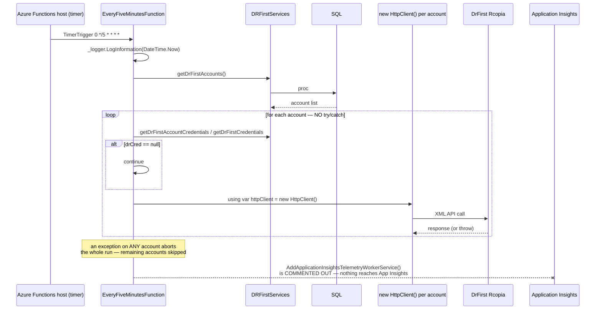
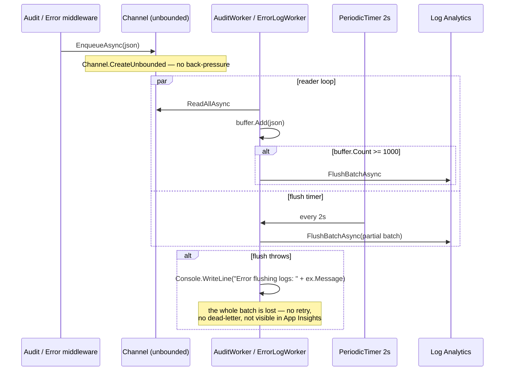
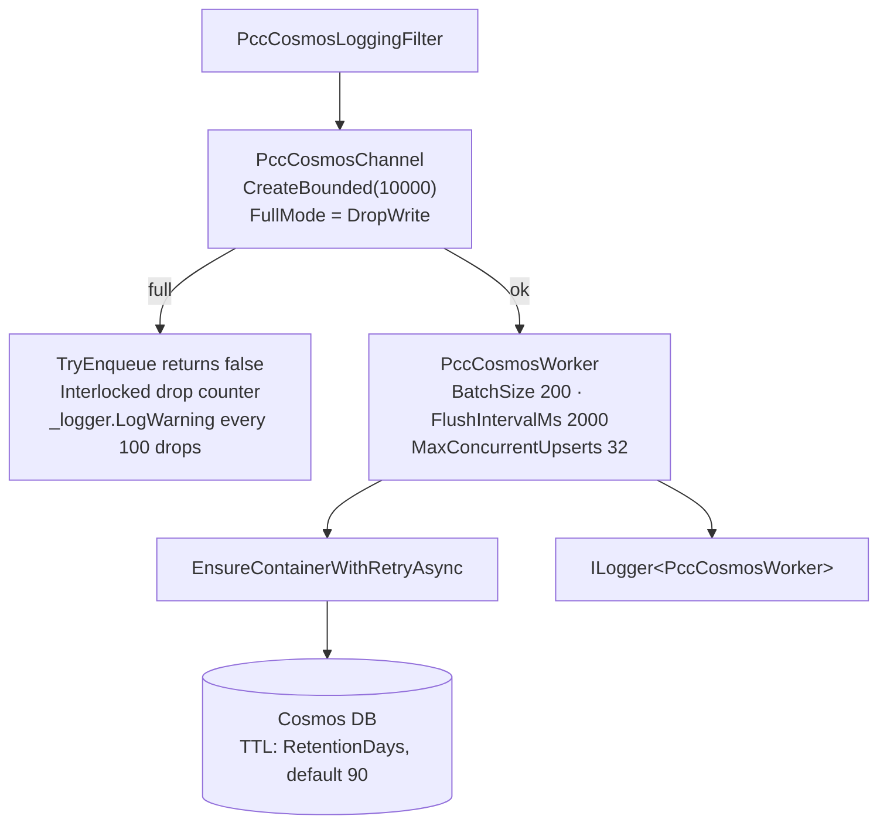

# Deep-Dive - Background Processing (Functions Worker & Hosted Services)

**Date**: 2026-09-30
**Analyzed By**: ARCHITECT
**Status**: Draft (awaiting user confirmation)
**Scope**: everything that runs outside a request — the Azure Functions timer worker, the three in-process `BackgroundService` workers, their channels, and the DB-table job queues
**Evidence base**: `pacEHR_API` @ `9f2a6ee19`

> **Headline finding**: Application Insights is **commented out** in the Functions worker (`PacEHR.Functions.Process/Program.cs:29-31`). The DrFirst prescription poller, the CCM/BHI auto-billing job and the three email jobs run with no telemetry — a failure is invisible outside the Functions host's own logs. This is the root cause of the still-open 2026-09-08 question *"How long has the DrFirst prescription sync been failing?"*

---

## Module Overview

Background work runs in **four** different mechanisms:

| Mechanism | Where | Count | Observability |
|---|---|---|---|
| Azure Functions timer triggers | `PacEHR.Functions.Process` | 5 active, 1 dead | 🔴 App Insights commented out |
| In-process `BackgroundService` | `PacEHR.API/Library` | 3 (`AuditWorker`, `ErrorLogWorker`, `PccCosmosWorker`) | mixed — see below |
| DB queue tables | `PacEHR.Database` | `HL7OutboundMessageQueue`, `Hl7outboundprocessing`, `hl7InboundMessageQueue` | none in code |
| Azure Service Bus | 10+ queues | 18 producers | 🔴 **no consumers in either repo** (Module 06) |

---

## Component Breakdown

### Azure Functions worker (`PacEHR.Functions.Process`)

| Function | CRON (UTC) | Injects | Purpose |
|---|---|---|---|
| `EveryFiveMinutesFunction` | `0 */5 * * * *` | `IDRFirstServices` | Poll DrFirst prescription events, all accounts |
| `HourlyEmailFunction` | `0 0 */1 * * *` | `IEmailEncounterJob` | Hourly encounter email |
| `DailyEmailFunction` | `0 0 13 * * *` | `IEmailEncounterJob` | Daily encounter email |
| `TwiceDailyEmailFunction` | `0 0 */12 * * *` | `IEmailEncounterJob` | Twice-daily encounter email |
| `DailyCCMBHFunction` | `0 0 14 * * *` | `ICCMBHIAutoBillingService` | CCM/BHI auto-billing |
| `DailyForTFAFunction` | — | — | 🔴 **entirely commented out** |

Host registrations (`Program.cs`): `pacehr_devContext`, `Ipacehr_devContextProcedures`, `IEmailEncounterJob`, `IScheduleTFAJob` *(marked `//Maybe obsolete`)*, `ICCMBHIAutoBillingService`, `IDRFirstServices`, `IEmailJobService`, `IEncounterService`, `ICPTCodeService`. Also present: `//TODO - Config Params`.

### In-process workers (`PacEHR.API`)

| Worker | Channel | Bounded? | Batch | Error handling | Retention |
|---|---|---|---|---|---|
| `AuditWorker` | `AuditLogChannelAnalystics` | 🔴 **unbounded** | 1000 / 2s | `Console.WriteLine` | none |
| `ErrorLogWorker` | `ErrorLogChannelAnalystics` | 🔴 **unbounded** | 1000 / 2s | `Console.WriteLine` | none |
| `PccCosmosWorker` | `PccCosmosChannel` | ✅ bounded 10,000, `DropWrite` | 200 / 2s, 32 concurrent | `ILogger` + drop counter | ✅ TTL, 90-day default |

All three are registered unconditionally except `PccCosmosWorker`, which is conditional on `cosmosActive`.

---

## Key Workflows

### Workflow 1: The Functions timer worker



**Stories**:
1. **No `try/catch` in any of the five functions.** One bad account credential, one DrFirst timeout, and every remaining account in that run is skipped. The next run starts over from the top of the list, so an account early in the list that always fails can starve every account after it indefinitely.
2. `new HttpClient()` is constructed **inside the per-account loop**, so the worker also bypasses the carefully-tuned `"DrFirst"` named client and its Polly policies (Module 07). The API has resilience for DrFirst; the worker that actually polls DrFirst every five minutes does not.
3. Logging uses `DateTime.Now` (host local time) while CRON expressions are UTC.
4. Failures are recorded only in the Functions host's own log stream. With App Insights disabled there is no alerting, no failure metric and no dependency tracking.

### Workflow 2: In-process log workers



### Workflow 3: `PccCosmosWorker` — the same pattern done right



---

## Data Models

### Job state lives in the database, not the runtime

| Table | Role |
|---|---|
| `HL7OutboundMessageQueue` | Outbound HL7 work items |
| `Hl7outboundprocessing` | Outbound processing state |
| `hl7InboundMessageQueue` / `_reprocess` | Inbound HL7 work + reprocess |
| `hl7LTC_reprocess` | LTC-specific reprocess |
| `hl7Inboundsettings` | Per-partner ingestion configuration |
| `Log_ProcessAudit` | Raw inbound message audit (Module 06) |

There is a `_reprocess` table for HL7 but **no visible retry mechanism in code** for the email, billing or DrFirst jobs.

---

## Pattern Catalog

### Pattern: ✅ bounded channel with explicit overload policy (`PccCosmosChannel`)

```csharp
// DO — and note the comment explains the trade-off rather than just the mechanics
// Burst buffer only — durability across app restarts isn't required, so this stays
// in-memory. Capacity is sized to absorb bursts while Cosmos autoscale ramps up or a
// batch is draining, not to guarantee zero loss under sustained overload; DropWrite
// remains the last-resort safety valve so a pathological spike can never block a
// request thread.
private readonly Channel<PccCosmosDocument> _channel =
    Channel.CreateBounded<PccCosmosDocument>(
        new BoundedChannelOptions(10000)
        {
            SingleReader = true,
            SingleWriter = false,
            FullMode = BoundedChannelFullMode.DropWrite
        });

public bool TryEnqueue(PccCosmosDocument document)
{
    if (_channel.Writer.TryWrite(document)) return true;
    var dropped = Interlocked.Increment(ref _droppedCount);
    if (dropped == 1 || dropped % 100 == 0)
        _logger.LogWarning("PccCosmos channel full — dropped {Count} docs total", dropped);
    return false;
}
```

Bounded capacity, a named overload policy, a drop counter, rate-limited structured warnings, and a comment stating what guarantee is *not* being offered. This is the reference implementation.

### Pattern: 🔴 the same component, unbounded and unobservable

```csharp
// ACTUAL — AuditLogChannelAnalystics and ErrorLogChannelAnalystics
private readonly Channel<string> _channel = Channel.CreateUnbounded<string>(
    new UnboundedChannelOptions { SingleReader = true, SingleWriter = false });

public ValueTask EnqueueAsync(string auditLogJson) => _channel.Writer.WriteAsync(auditLogJson);
```

```csharp
// DO — mirror PccCosmosChannel
Channel.CreateBounded<string>(new BoundedChannelOptions(10000)
{
    SingleReader = true, SingleWriter = false,
    FullMode = BoundedChannelFullMode.DropWrite
});
```

If Log Analytics is slow or unreachable, the channel grows without limit and the process climbs toward OOM. Each entry carries the **full decrypted request body** (Module 02), so entries are large. There is no drop counter and no warning — the first symptom is a restart.

Two generations of the same pattern coexist: the newer `PccCosmosChannel` gets it right, the two older ones do not.

### Pattern: 🔴 swallowed flush failures

```csharp
// ACTUAL — AuditWorker.FlushBatchAsync and ErrorLogWorker
catch (Exception ex)
{
    Console.WriteLine($"Error flushing logs: {ex.Message}");
}
```

```csharp
// DO
catch (Exception ex)
{
    _logger.LogError(ex, "Failed to flush {Count} audit logs to Log Analytics", buffer.Count);
    // then: retry with backoff, or persist locally, before dropping
}
```

A failed flush silently discards up to 1,000 audit records. `Console.WriteLine` on Azure App Service goes to the console log stream, not App Insights — so audit-trail loss produces no alert. For an EHR, a silently lossy audit trail is a compliance concern as much as an engineering one.

Both workers also carry a fully commented-out alternative `FlushBatchAsync` that wrote to Service Bus instead — a previous design left in place.

### Pattern: 🔴 telemetry disabled in the Functions worker

```csharp
// ACTUAL — PacEHR.Functions.Process/Program.cs
// Application Insights isn't enabled by default. See https://aka.ms/AAt8mw4.
// builder.Services
//     .AddApplicationInsightsTelemetryWorkerService()
//     .ConfigureFunctionsApplicationInsights();
```

The package **is** referenced (`Microsoft.Azure.Functions.Worker.ApplicationInsights 2.0.0`) and `Microsoft.ApplicationInsights.WorkerService 2.22.0` is in the project file. Someone intended to enable it. Uncommenting three lines would give the billing and prescription jobs the same observability the API already has.

### Pattern: 🔴 no error handling in scheduled jobs

```csharp
// ACTUAL — every one of the five functions follows this shape, with no try/catch
[Function("DailyCCMBHFunction")]
public async Task Run([TimerTrigger("0 0 14 * * *")] TimerInfo myTimer)
{
    _logger.LogInformation($"DailyCCMBHFunction Timer trigger function executed at: {DateTime.Now}");
    await _billingService.createCCMBHIEncounter();
    if (myTimer.ScheduleStatus is not null) { ... }
}
```

```csharp
// DO — isolate per-unit failures so one bad record does not abort the run
foreach (var account in accounts)
{
    try { await ProcessAsync(account); }
    catch (Exception ex)
    {
        _logger.LogError(ex, "CCM/BHI billing failed for {AccountId}", account.accountID);
        // continue with the next account
    }
}
```

`createCCMBHIEncounter()` is an **auto-billing** job. A mid-run exception leaves an unknown subset of accounts billed and the rest not, with no record of where it stopped and no retry. That is a financial-correctness risk, not just an availability one.

### Pattern: 🟡 four scheduling mechanisms, one system

1. Azure Functions `[TimerTrigger]` — the current approach
2. In-process `BackgroundService` + `PeriodicTimer` — the log workers
3. DB queue tables polled by external processes — HL7
4. FluentScheduler — package referenced (`FluentScheduler 5.5.1`), used **only** in the orphan `pacEHR/Global.asax.cs`; the `EmailJob.cs` in `PacEHR.API/Library/Jobs` has all its `JobManager.AddJob` calls commented out

`PacEHR.API/Library/Jobs/EmailJob.cs` is **1,233 lines** and is not registered (`//builder.Services.AddScoped<EmailJob>();` at `Program.cs:365`, `//...<ShareFileJob>();` at 369). It is dead code duplicating what `PacEHR.Functions.Process/lib/EmailEncounterJob.cs` now does.

### Pattern: 🟡 timer functions assume a single instance

The five timer functions have no distributed lock or idempotency guard. Azure Functions' timer trigger uses a storage lease to ensure single execution across instances on Consumption/Premium plans — **if** the storage account is correctly configured. On an App Service plan with `WEBSITE_RUN_FROM_PACKAGE` and multiple always-on instances the guarantee depends on that configuration. For an auto-billing job, double execution means double billing. **Worth confirming the hosting plan and storage configuration.**

### Pattern: 🟡 no retention on audit/error logs

`PccCosmosWorker` sets a Cosmos TTL with a 90-day default. The Log Analytics audit and error tables have no retention configuration in code — it is presumably set on the workspace. Given those tables hold decrypted clinical payloads, retention is a compliance parameter that should be explicit and documented.

### Test patterns (background)

| Target | Tests |
|---|---|
| All five Functions | **0** |
| `AuditWorker`, `ErrorLogWorker`, `PccCosmosWorker` | **0** |
| `AuditLogChannelAnalystics`, `ErrorLogChannelAnalystics`, `PccCosmosChannel` | **0** |
| `CCMBHIAutoBillingService` | present under `DomainServices` tests |
| `EmailEncounterJob` | — |

No background component has a test. The auto-billing service has service-level tests, but the function that invokes it — including its lack of error isolation — does not.

---

## Entry Points

| Entry | Trigger |
|---|---|
| `PacEHR.Functions.Process/Program.cs` | Functions host startup |
| 5 `[TimerTrigger]` functions | CRON (UTC) |
| `AuditWorker` / `ErrorLogWorker` | `AddHostedService`, API startup |
| `PccCosmosWorker` | `AddHostedService`, conditional on `PccCosmosMode=1` + Cosmos config |
| `POST /triggerHL7Outbound` | Manual/API-driven queue insert |
| `POST /triggerDocumentQueue` | `[AllowAnonymous]` (Module 05) |
| `POST /triggerHIEPatientData` | Authenticated |

---

## Open Questions for the Team

1. **Why is App Insights commented out in the Functions worker?** Cost, a startup failure, or an oversight? This is the single change that would make the background tier observable.
2. **Is the DrFirst poller currently succeeding?** With no telemetry, nobody can answer this from data. Check the `hl7`/DrFirst event tables for recent rows.
3. **What hosting plan runs the Functions app, and is the timer lease storage configured?** Determines whether `DailyCCMBHFunction` can double-bill.
4. **Has CCM/BHI auto-billing ever aborted mid-run?** The absence of try/catch means partial runs are possible and unrecorded.
5. **Can `PacEHR.API/Library/Jobs/EmailJob.cs` (1,233 lines) be deleted?** It is unregistered and duplicated by the Functions job.
6. **What is the Log Analytics retention on the audit and error tables?**
7. **Is `IScheduleTFAJob` obsolete?** It is registered with `//Maybe obsolete` and its function is fully commented out.

---

## Recommendations

| # | Recommendation | Rationale | Priority |
|---|---|---|---|
| 1 | Uncomment App Insights in the Functions worker | Three lines; makes the whole background tier observable | 🔴 Immediate |
| 2 | Add per-item try/catch to all five timer functions | One failure currently aborts an entire billing or sync run | 🔴 Immediate |
| 3 | Bound `AuditLogChannelAnalystics` and `ErrorLogChannelAnalystics`, copying `PccCosmosChannel` | Unbounded growth of large PHI-bearing entries | 🔴 High |
| 4 | Replace `Console.WriteLine` in the flush paths with `ILogger` + retry | Audit records are being dropped silently | 🔴 High |
| 5 | Confirm the timer singleton guarantee for `DailyCCMBHFunction` | Double execution means double billing | 🔴 High |
| 6 | Use the named `"DrFirst"` HttpClient in `EveryFiveMinutesFunction` | The worker bypasses the resilience built for exactly this dependency | 🟡 Medium |
| 7 | Add idempotency keys to the billing job | Makes reruns safe regardless of the lease question | 🟡 Medium |
| 8 | Delete `EmailJob.cs` (1,233 lines), `ShareFileJob` in the API, and `DailyForTFAFunction` | Dead code with a live-looking shape | 🟡 Medium |
| 9 | Standardise on `DateTime.UtcNow` in job logging | CRON is UTC; logs are host-local | 🟢 Low |
| 10 | Document Log Analytics retention for the audit/error tables | Compliance parameter, currently implicit | 🟡 Medium |
| 11 | Add tests for the workers and channels | Zero coverage on the components that carry the audit trail | 🟡 Medium |

---

**Next**: Module 09 — SPA shell & navigation.
