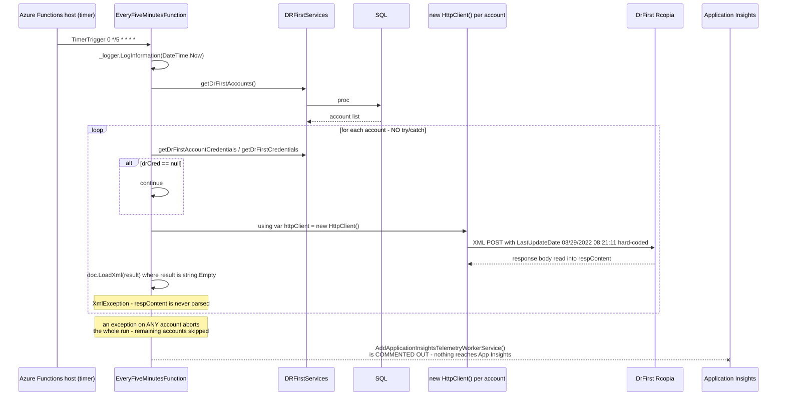
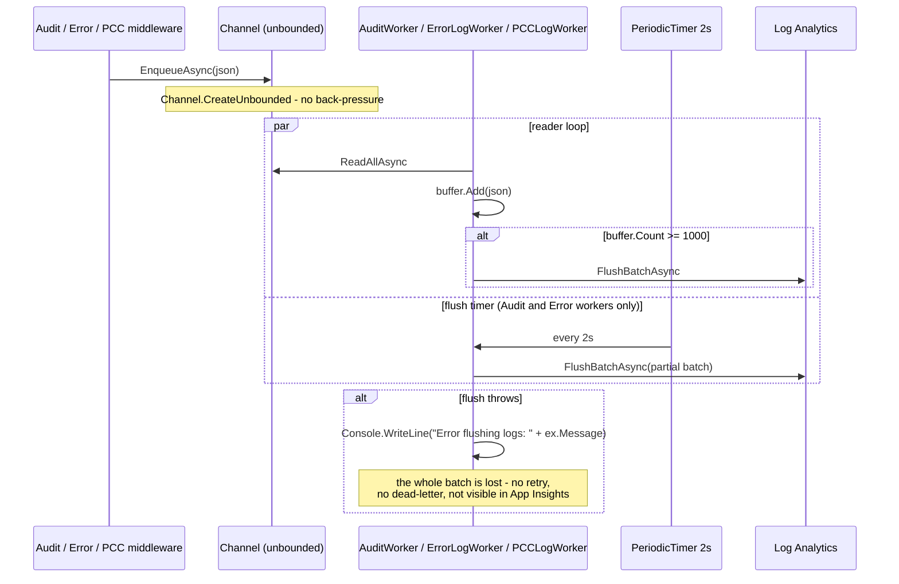
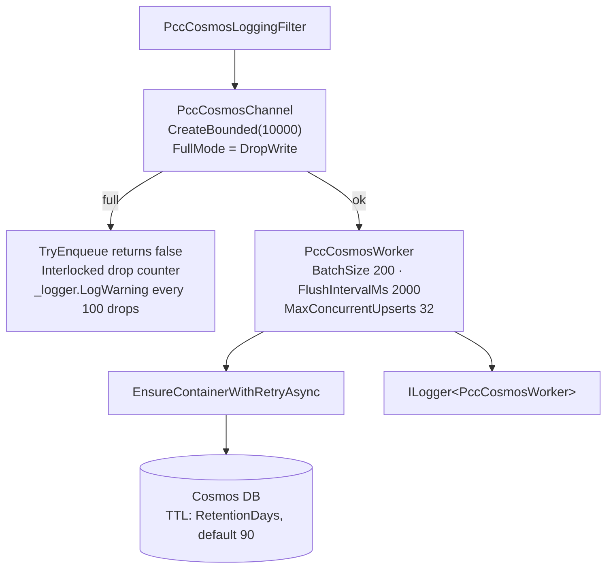
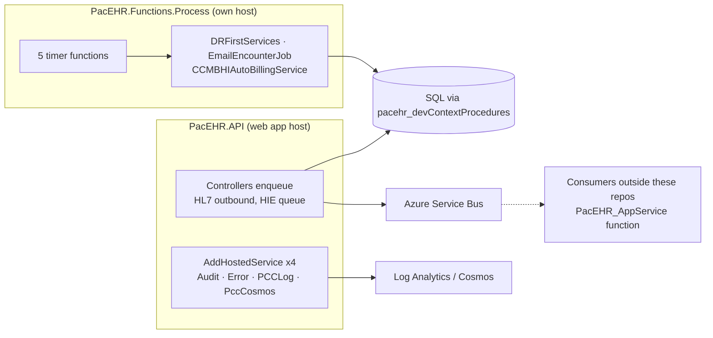
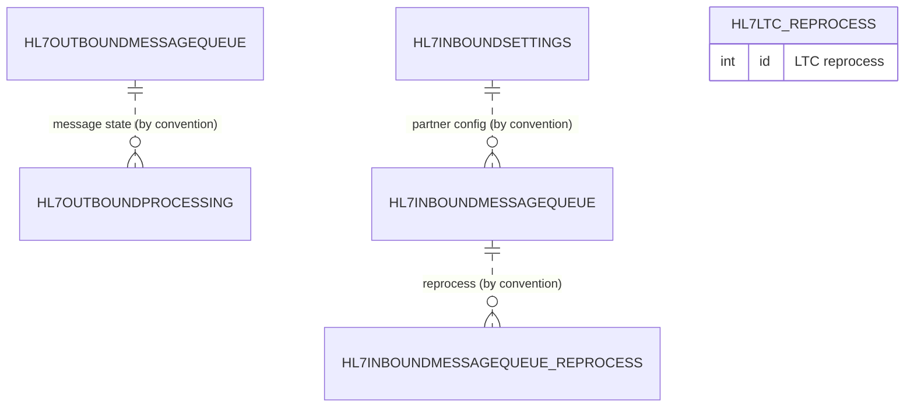

# Deep-Dive - Background Processing (Functions Worker & Hosted Services)

**Date**: 2026-10-19
**Analyzed By**: ARCHITECT
**Status**: Draft (awaiting user confirmation)
**Scope**: everything that runs outside a request — the Azure Functions timer worker, the in-process `BackgroundService` workers, their channels, and the DB-table job queues
**HEADs analysed**: PacEHR `401caa134`, pacEHR_API `0f611f65c`, pacEHR_AI `ef172ea` (all evidence below is in `pacEHR_API`; `PacEHR` is the SPA and `pacEHR_AI` is a separate Node service, neither was re-examined for background work in this pass — carried, not re-verified)
**Supersedes**: deep-dive of 2026-09-30 (`9f2a6ee19`)

> **Headline finding (re-verified)**: Application Insights is still **commented out** in the Functions worker (`PacEHR.Functions.Process/Program.cs:30-33`), and — correcting the old doc — the two App Insights **package references are also commented out** in the project file (`PacEHR.Functions.Process.csproj:14-15`). Enabling telemetry is therefore a code change plus two package restores, not "uncomment three lines". The DrFirst prescription poller, the CCM/BHI auto-billing job and the email jobs run with no telemetry. New this pass: the DrFirst poller appears to throw on every run for the first account that has a configured URL (see Workflow 1).

---

## Changes since 2026-09-30

Method: `git log --since=2026-09-30` on `PacEHR.Functions.Process`, `PacEHR.API/Library`, `PacEHR.API/Program.cs`, `pacEHR.DomainServices`.

**Functions project** — only two files changed: `lib/EmailEncounterJob.cs` and `Program.cs`.
- `Program.cs:12`: `IPauboxEmailService` is now registered in the Functions host.
- `lib/EmailEncounterJob.cs` (455 lines; was a long method with bare `catch`): now takes `ILogger<EmailEncounterJob>` and `IPauboxEmailService`; adds a Paubox delivery branch (`EmailType == "paubox"`, line 213), per-facility status constants (`Completed`, `Partially Completed`, `Failed`, `Failed - No Recipients`, `Failed - No Attachments`), and `try/catch` with structured `LogWarning/LogError` at facility, encounter and job level (lines 185-187, 242-244, 290-301, 343-346, 380-383). **The old claim "no error handling in the email jobs" no longer holds for the job body**; the five timer *functions* themselves still contain no `try/catch`.

**Findings dropped or corrected**
- Re-verified (still true): `POST triggerDocumentQueue` is `[AllowAnonymous]` (`PacEHR.API/Controllers/HIEController.cs:128-130`) and enqueues caller-supplied `documentQueryJson` items to Service Bus (`SendMessageAsyncForHIE`, line 141). An older commented-out copy of the same action sits at lines 89-92; the live one is the second. Last changed 2026-08-03, so unchanged since the old doc.
- Corrected: "`EmailJob.cs` 1,233 lines of dead code" — the file is still 1,233 lines (`PacEHR.API/Library/Jobs/EmailJob.cs`), but **1,064 of them are comment lines**; it is a commented-out class, not live dead code. Registrations remain commented (`PacEHR.API/Program.cs:367,371`).
- Corrected: App Insights packages are commented out, not merely unused (see headline).
- Corrected: "three in-process workers" — there are **four** hosted workers. Missed in the first pass: `PCCLogWorker` (see Component Breakdown).
- Carried and re-verified: five active timer functions + one fully commented-out (`DailyForTFAFunction`), unbounded audit/error channels, `Console.WriteLine` flush failures, no retention config in code, bounded `PccCosmosChannel`.

**Added**
- 🔴 `EveryFiveMinutesFunction` parses an always-empty string and uses a hard-coded 2022 `LastUpdateDate` (Workflow 1).
- 🔴 `PCCLogWorker` + `PCCLogChannelAnalystics`: a **third unbounded channel**, `Console.WriteLine` on every log item, silent flush failures.
- 🟡 `HIEController.triggerHIEPatientData` comment now names an external consumer (`HIEPatientDataFunction` in `PacEHR_AppService/Kno2HIEIntegrationFunction`), which is outside the three analysed repos. This partly answers the Module 06 "no consumers" finding: consumers exist, but not in these repos.
- No change to `CCMBHIAutoBillingService` itself; no change to `PccCosmosWorker/Channel`, `AuditWorker`, `ErrorLogWorker`.

---

## Module Overview

Background work runs in **four** mechanisms:

| Mechanism | Where | Count | Observability |
|---|---|---|---|
| Azure Functions timer triggers | `PacEHR.Functions.Process` | 5 active, 1 dead | 🔴 App Insights commented out (code and packages) |
| In-process `BackgroundService` | `PacEHR.API/Library`, `pacEHR.DomainServices/PCCServices` | **4** (`AuditWorker`, `ErrorLogWorker`, `PccCosmosWorker` (conditional), `PCCLogWorker`) | mixed — see below |
| DB queue tables | `PacEHR.Database` | `HL7OutboundMessageQueue`, `Hl7outboundprocessing`, `hl7InboundMessageQueue`, `_reprocess` tables | none in code |
| Azure Service Bus | queues produced by the API | producers in API (Module 06) | consumers are outside these repos (comment at `HIEController.cs:55-58`); producer/queue counts carried, not re-verified |

Functions `host.json` does configure App Insights sampling (`applicationInsights.samplingSettings`), but with no SDK registered it has no effect.

---

## Component Breakdown

### Azure Functions worker (`PacEHR.Functions.Process`)

| Function | CRON (UTC) | Injects | Purpose |
|---|---|---|---|
| `EveryFiveMinutesFunction` (`:23`) | `0 */5 * * * *` | `IDRFirstServices` | Poll DrFirst prescription events, all accounts |
| `HourlyEmailFunction` (`:19`) | `0 0 */1 * * *` | `IEmailEncounterJob` | Hourly encounter email |
| `DailyEmailFunction` (`:20`) | `0 0 13 * * *` | `IEmailEncounterJob` | Daily encounter email |
| `TwiceDailyEmailFunction` (`:21`) | `0 0 */12 * * *` | `IEmailEncounterJob` | Twice-daily encounter email |
| `DailyCCMBHFunction` (`:24`) | `0 0 14 * * *` | `ICCMBHIAutoBillingService` | CCM/BHI auto-billing |
| `DailyForTFAFunction` | — | — | 🔴 entirely commented out (`//NOTE - ... I do not believe this job is still in service`) |

Host registrations (`Program.cs:13-23`): `pacehr_devContext`, `Ipacehr_devContextProcedures`, `IEmailEncounterJob`, **`IPauboxEmailService` (new)**, `IScheduleTFAJob` (`//Maybe obsolete`), `ICCMBHIAutoBillingService`, `IDRFirstServices`, `IEmailJobService`, `IEncounterService`, `ICPTCodeService`. `//TODO - Config Params` at line 25. `lib/` also holds `ShareFileJob.cs` (462 lines).

### In-process workers

| Worker | Channel | Bounded? | Batch | Error handling | Retention |
|---|---|---|---|---|---|
| `AuditWorker` | `AuditLogChannelAnalystics` | 🔴 unbounded (`AuditLogChannelAnalystics.cs:7`) | 1000 / 2s | `Console.WriteLine` (`AuditWorker.cs:90`) | none in code |
| `ErrorLogWorker` | `ErrorLogChannelAnalystics` | 🔴 unbounded (`:7`) | 1000 / 2s | `Console.WriteLine` (`ErrorLogWorker.cs:89`) | none in code |
| `PCCLogWorker` (`pacEHR.DomainServices/PCCServices/PCCLogWorker.cs`) | `PCCLogChannelAnalystics` | 🔴 unbounded (`PCCLogChannelAnalystics.cs:7`) | 1000, time check only when an item arrives | `Console.WriteLine` (`:64`), plus `Console.WriteLine` per item (`:22,33`) | none in code |
| `PccCosmosWorker` | `PccCosmosChannel` | ✅ bounded 10,000, `DropWrite` (`PccCosmosChannel.cs:17-22`) | 200 / 2s, 32 concurrent (`PccCosmosWorker.cs:10-12`) | `ILogger` + drop counter | ✅ Cosmos TTL, 90-day default (`:15`) |

Registration: `AuditWorker` and `ErrorLogWorker` unconditionally (`PacEHR.API/Program.cs:444-445`); `PccCosmosWorker` only when `cosmosActive` (`:440`); `PCCLogWorker` via `AddPccCoreServices` (`Program.cs:128` → `PCCServiceCollectionExtensions.cs:25`). Note `PCCLogChannelAnalystics` is registered as a singleton **twice** (`Program.cs:401` and `PCCServiceCollectionExtensions.cs:23`); harmless for singleton resolution but evidence of unreviewed duplication.

---

## Key Workflows

### Workflow 1: The Functions timer worker (DrFirst poll)



**Stories** (all re-verified in `PacEHR.Functions.Process/EveryFiveMinutesFunction.cs`):
1. **No `try/catch` in the five timer functions.** One bad account, one DrFirst timeout, and every remaining account in that run is skipped; the next run restarts at the top of the list.
2. 🔴 **New finding — parse of an empty string.** `string result = string.Empty;` (line 42) is never assigned. The HTTP response is read into `respContent` (line 82) but `doc.LoadXml(result)` (line 89) loads the empty `result`. `XmlDocument.LoadXml("")` throws `XmlException`, so for the first account with a non-empty `drFirstPatientURL` the run should abort every five minutes, which would explain *"how long has the DrFirst prescription sync been failing"*: since the code was ported (`git log` shows the file last changed 2025-04-16). This is a code-reading conclusion; **confirm by checking the Functions host log for `XmlException` and the DrFirst event tables for recent rows.**
3. The request hard-codes `<LastUpdateDate>03/29/2022 08:21:11</LastUpdateDate>` (line 66) instead of a stored watermark.
4. `new HttpClient()` is created inside the per-account loop (line 55), bypassing the named `"DrFirst"` client that the API registers with resilience policies (`PacEHR.API/Program.cs:246`).
5. Logging uses `DateTime.Now` while CRON is UTC. Failures reach only the Functions host's own log stream.
6. The error log call `_logger.LogError("Error on Dr First Post", [respContent])` (line 85) has no message placeholder, so the body is not rendered.

### Workflow 2: In-process log workers



`PCCLogWorker` has no `PeriodicTimer`: it checks `DateTime.UtcNow >= nextFlush` only after an item arrives (`PCCLogWorker.cs:30-44`), so a partial batch sits in memory until the next log item. It also writes `Console.WriteLine("LOG RECEIVED")` for every item (line 33).

### Workflow 3: `PccCosmosWorker` — the same pattern done right



### Workflow 4: Where background work is started



---

## Data Models

### Job state lives in the database, not the runtime

| Table | Role |
|---|---|
| `HL7OutboundMessageQueue` | Outbound HL7 work items |
| `Hl7outboundprocessing` | Outbound processing state |
| `hl7InboundMessageQueue` / `_reprocess` | Inbound HL7 work + reprocess |
| `hl7LTC_reprocess` | LTC-specific reprocess |
| `hl7Inboundsettings`, `Log_ProcessAudit` | Per-partner ingestion config; raw inbound audit (Module 06, carried) |

All verified to exist as files under `PacEHR.Database/Tables/Tables1/`. There is a `_reprocess` table for HL7 but **no visible retry mechanism in code** for the email, billing or DrFirst jobs. The email job does now record per-facility status strings (`Completed`, `Partially Completed`, `Failed - ...`), which is the closest thing to job state outside HL7.



(The ER is relationship-by-naming only: these tables declare no foreign keys, consistent with Module 03.)

---

## Pattern Catalog

### Error handling

```csharp
// DON'T — ACTUAL, PacEHR.Functions.Process/DailyCCMBHFunction.cs:24-34, no try/catch
[Function("DailyCCMBHFunction")]
public async Task Run([TimerTrigger("0 0 14 * * *")] TimerInfo myTimer)
{
    _logger.LogInformation($"DailyCCMBHFunction Timer trigger function executed at: {DateTime.Now}");
    await _billingService.createCCMBHIEncounter();
    ...
}
```

```csharp
// DO — isolate per-unit failures so one bad record does not abort the run
foreach (var account in accounts)
{
    try { await ProcessAsync(account); }
    catch (Exception ex)
    {
        _logger.LogError(ex, "CCM/BHI billing failed for {AccountId}", account.accountID);
    }
}
```

`createCCMBHIEncounter()` (`CCMBHIAutoBillingService.cs:24`) loops accounts then records with no `try/catch` anywhere in the file (grep finds none). A mid-run exception leaves an unknown subset billed. A financial-correctness risk, not just availability.

```csharp
// DO — and it exists now, ACTUAL PacEHR.Functions.Process/lib/EmailEncounterJob.cs:242-244
catch (Exception ex)
{
    _logger.LogError(ex, "Facility {FacilityName} failed.", facilityName);
```

The email job is the in-repo example of per-facility isolation with structured logging. Follow this shape in the billing and DrFirst jobs.

### Logging

```csharp
// DON'T — ACTUAL AuditWorker.cs:88-91, ErrorLogWorker.cs:87-90, PCCLogWorker.cs:62-65
catch (Exception ex)
{
    Console.WriteLine($"Error flushing logs: {ex.Message}");
}
```

```csharp
// DO
catch (Exception ex)
{
    _logger.LogError(ex, "Failed to flush {Count} audit logs to Log Analytics", buffer.Count);
    // then: retry with backoff, or persist locally, before dropping
}
```

A failed flush silently discards up to 1,000 records. `Console.WriteLine` on App Service goes to the console stream, not App Insights. For an EHR a silently lossy audit trail is a compliance concern. `AuditWorker` and `ErrorLogWorker` also keep a commented-out Service Bus `FlushBatchAsync` alternative (`AuditWorker.cs:99-108`).

### Pattern: ✅ bounded channel with explicit overload policy (reference implementation)

```csharp
// DO — PacEHR.API/Library/PccCosmosChannel.cs:17-22 (with the trade-off explained in the comment above)
private readonly Channel<PccCosmosDocument> _channel =
    Channel.CreateBounded<PccCosmosDocument>(
        new BoundedChannelOptions(10000)
        {
            SingleReader = true,
            SingleWriter = false,
            FullMode = BoundedChannelFullMode.DropWrite
        });
// TryEnqueue: Interlocked drop counter, LogWarning at dropped == 1 or every 100 (line 34-36)
```

### Pattern: 🔴 three unbounded channels carrying large entries

```csharp
// DON'T — ACTUAL AuditLogChannelAnalystics.cs:7, ErrorLogChannelAnalystics.cs:7, PCCLogChannelAnalystics.cs:7
private readonly Channel<string> _channel = Channel.CreateUnbounded<string>(
    new UnboundedChannelOptions { SingleReader = true, SingleWriter = false });
```

```csharp
// DO — mirror PccCosmosChannel
Channel.CreateBounded<string>(new BoundedChannelOptions(10000)
{ SingleReader = true, SingleWriter = false, FullMode = BoundedChannelFullMode.DropWrite });
```

If Log Analytics is slow or unreachable the channel grows without limit. Audit entries carry the decrypted request body (Module 02, carried). No drop counter, so the first symptom is a restart. Two generations of the same pattern coexist; the older three lack the protections the newest one has.

### Pattern: 🔴 telemetry disabled in the Functions worker

```csharp
// ACTUAL — PacEHR.Functions.Process/Program.cs:30-33
// Application Insights isn't enabled by default. See https://aka.ms/AAt8mw4.
// builder.Services
//     .AddApplicationInsightsTelemetryWorkerService()
//     .ConfigureFunctionsApplicationInsights();
```

```xml
<!-- ACTUAL — PacEHR.Functions.Process.csproj:14-15 -->
<!-- <PackageReference Include="Microsoft.ApplicationInsights.WorkerService" Version="2.22.0" /> -->
<!-- <PackageReference Include="Microsoft.Azure.Functions.Worker.ApplicationInsights" Version="2.0.0" /> -->
```

The old doc said the packages were referenced; at this HEAD they are not (the csproj was last touched 2025-08-05, so this was also true on 2026-09-30 — the old statement was wrong). Fix: restore both packages, uncomment the registration.

### Pattern: DB access in jobs

```csharp
// ACTUAL — jobs call generated procedure wrappers via Ipacehr_devContextProcedures (Program.cs:13-14)
builder.Services.AddScoped<Ipacehr_devContextProcedures, pacehr_devContextProcedures>();
```

All job data access goes through stored procedures (Module 03). DO: keep it; DON'T add direct ADO.NET in jobs. `EmailEncounterJob` also uses SMTP and ShareFile clients directly (carried, outside this pass).

### Pattern: API response / naming

Timer functions return `Task` and have no response shape. HTTP-triggered queue inserts (`triggerHL7Outbound`, `triggerHIEPatientData`) return the common `IDictionary<string, object>` envelope via `BuildDictionaryResult` (`HL7OutboundController.cs:23-25`, `HIEController.cs:59-61`). Naming: functions are `<Cadence>Function`; jobs are `<Name>Job` in `lib/`; channels are misspelled `...Analystics` consistently — rename in one pass if touched.

### Pattern: 🟡 four scheduling mechanisms, one system

1. Azure Functions `[TimerTrigger]` — the current approach.
2. In-process `BackgroundService` — log shippers (4).
3. DB queue tables polled by external processes — HL7.
4. FluentScheduler — referenced only by the orphan `pacEHR` project (`Global.asax.cs`) per the old doc (carried, not re-verified); `PacEHR.API/Library/Jobs/EmailJob.cs` is a 1,233-line file that is ~86% commented-out code (1,064 comment lines) with registrations commented at `Program.cs:367,371`.

### Pattern: 🟡 timer functions assume a single instance

No distributed lock or idempotency guard in any function (re-verified by reading all six function files). The Functions timer trigger uses a storage lease to ensure single execution **if** the storage account is configured correctly; the hosting plan is not visible in code. For auto-billing, a double run means double billing. **Confirm plan and lease storage.**

### Pattern: 🟡 no retention on audit/error logs in code

`PccCosmosWorker` sets a Cosmos TTL, default 90 days (`PccCosmosWorker.cs:15,175-182`). Log Analytics retention for audit/error/PCC tables is not configured in code (presumably on the workspace). Those tables hold decrypted clinical payloads; retention should be explicit.

---

## Testing Patterns

| Target | Tests (re-verified by file search under `PacEHR.Tests.UnitTests`, `PacEHR.API.Tests`, `PacEHR.Tests.Integration`) |
|---|---|
| Five Functions | **0** |
| `AuditWorker`, `ErrorLogWorker`, `PccCosmosWorker`, `PCCLogWorker` | **0** (`PacEHR.Tests.UnitTests/Library` holds only `IpAddressHelperTests.cs`) |
| Channels (4) | **0** |
| `CCMBHIAutoBillingService` | present: `PacEHR.Tests.UnitTests/DomainServices/CCMBHIAutoBillingServiceTest.cs` (service-level, mocks `Ipacehr_devContextProcedures`) |
| `DRFirstServices` | present: `DRFirstServicesTest.cs`, `DRFirstServicesUnlinkOnDiscontinueTests.cs` — but the poll loop that lives in the Function is not covered |
| `EmailEncounterJob` | **0** (no test file; this job changed substantially this period with Paubox) |

DO: follow the unit-test shape used for `CCMBHIAutoBillingService` (mock the procedures interface). DON'T leave logic inside a Function method (`EveryFiveMinutesFunction.updatePrescriptionEvents` holds HTTP, XML and loop logic) where it cannot be unit-tested — move it into `DRFirstServices`.

---

## Entry Points

| Entry | Trigger |
|---|---|
| `PacEHR.Functions.Process/Program.cs` | Functions host startup |
| 5 `[TimerTrigger]` functions | CRON (UTC) |
| `AuditWorker` / `ErrorLogWorker` | `AddHostedService`, API startup (`PacEHR.API/Program.cs:444-445`) |
| `PCCLogWorker` | `AddHostedService` via `AddPccCoreServices` |
| `PccCosmosWorker` | `AddHostedService`, conditional on `cosmosActive` (`Program.cs:440`) |
| `POST triggerHL7Outbound` | API-driven queue insert (`HL7OutboundController.cs:23`; no `[AllowAnonymous]` on the controller) |
| `POST triggerHIEPatientData` | Queues to `kno2-patient-sbq` for an external function (`HIEController.cs:59`) |
| `POST triggerDocumentQueue` | `[AllowAnonymous]` (`HIEController.cs:128`) — queues arbitrary caller-supplied items to Service Bus (Module 05) |

`getHIEPatientData` (line 28) is also `[AllowAnonymous]`; not examined here (Module 05).

---

## Open Questions for the Team

1. **Why is App Insights commented out in the Functions worker, packages included?** Cost, a startup failure, or an oversight?
2. **Is the DrFirst poller currently succeeding?** Code reading says `LoadXml(string.Empty)` throws. Check the Functions log for `XmlException` and the DrFirst event tables for recent rows. Is `03/29/2022` intentional?
3. **What hosting plan runs the Functions app, and is the timer lease storage configured?** Determines whether `DailyCCMBHFunction` can double-bill.
4. **Has CCM/BHI auto-billing ever aborted mid-run?** No `try/catch`, so partial runs are possible and unrecorded.
5. **Can `PacEHR.API/Library/Jobs/EmailJob.cs` (86% commented) be deleted?** Same for `lib/ShareFileJob.cs` use, and `IScheduleTFAJob`.
6. **What is the Log Analytics retention on the audit, error and PCC tables?**
7. **Where does the `HIEPatientDataFunction` consumer live and who owns it?** It is referenced in a code comment but is not in the three analysed repos.
8. **Is the Paubox path in `EmailEncounterJob` in production use?** It is new and untested.

---

## Recommendations

| # | Recommendation | Rationale | Priority |
|---|---|---|---|
| 1 | Fix `EveryFiveMinutesFunction`: parse `respContent`, store a real `LastUpdateDate` watermark, add per-account try/catch | Likely failing on every run; hard-coded 2022 watermark | 🔴 Immediate |
| 2 | Restore the two App Insights packages and uncomment registration in the Functions worker | Makes the background tier observable | 🔴 Immediate |
| 3 | Per-item try/catch in `DailyCCMBHFunction`/`createCCMBHIEncounter` | One failure aborts an entire billing run | 🔴 Immediate |
| 4 | Bound all three unbounded channels (Audit, Error, PCC) copying `PccCosmosChannel` | Unbounded growth of large entries | 🔴 High |
| 5 | Replace `Console.WriteLine` in the three flush paths (and `PCCLogWorker` per-item prints) with `ILogger` + retry | Audit records dropped silently | 🔴 High |
| 6 | Confirm the timer singleton guarantee for `DailyCCMBHFunction` | Double execution means double billing | 🔴 High |
| 7 | Use the named `"DrFirst"` HttpClient (via `IHttpClientFactory`) in the poller | Worker bypasses the resilience built for this dependency | 🟡 Medium |
| 8 | Add idempotency keys to the billing job | Safe reruns | 🟡 Medium |
| 9 | Delete `EmailJob.cs`, the unregistered `ShareFileJob` registration, and `DailyForTFAFunction`/`IScheduleTFAJob` once confirmed unused | Dead code with a live-looking shape | 🟡 Medium |
| 10 | Tests for the workers, channels, `EmailEncounterJob` and the DrFirst poll logic | Zero coverage on the audit trail and on a job changed this period | 🟡 Medium |
| 11 | Document Log Analytics retention for audit/error/PCC tables | Compliance parameter | 🟡 Medium |
| 12 | `DateTime.UtcNow` in job logging; fix `LogError` placeholder at `EveryFiveMinutesFunction.cs:85` | CRON is UTC; body currently not logged | 🟢 Low |

---

**Next**: Module 09 — SPA shell & navigation.
